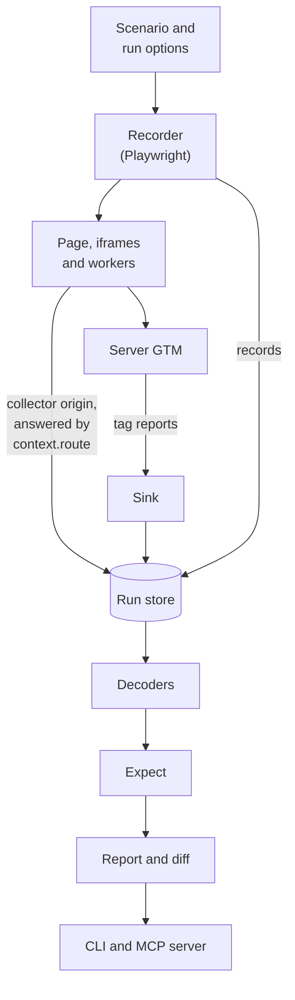

# Pingwright design

Status: revision 8, for release 0.3.0-rc.2. Milestones 0.1, 0.2 and 0.3 are built (§15); the rest is design. Claims marked **(verify)** are believed true but not tested in code, and each one says so. Revision 2 took in an adversarial design review and the CodeRabbit review on PR #1. Revision 3 records verification results. Revision 4 adds the recorder results. Revision 5 resolves the 0.1 claims and adds §15.1, the differences in 0.1. Revision 6 takes in the field-test fixes released in 0.1.0. Revision 7 adds §15.2, the differences in 0.2. Revision 8 adds §15.3, the differences in 0.3, and rewrites the roadmap in §15.

## 1. Problem

A modern tracking setup has four or more layers: the site or theme, a consent banner, a tag manager in the browser, and often a server-side tag manager. Each layer can change on its own, and a change in one layer can make another layer send data it should not, or stop sending data it should.

Today the ways to check this are:

- **GTM Preview and Tag Assistant.** They show which tags fired, but only to a signed-in person in a browser UI.
- **Network inspection by hand.** DevTools or an extension shows the raw requests. It does not scale, and nothing can call it.
- **Commercial auditing services.** They run scheduled crawls in their own cloud. They cannot test an unpublished change, and they are not built for agents.

Pingwright makes this checkable by a program: a coding agent, a CI job, or a person running one command.

## 2. Goals and non-goals

**Goals**

1. Record what a site sends to each tracking vendor, for a scripted visitor, at each consent state.
2. Report which tag manager tags fired or failed, per event, without a signed-in person. Report which expected tags did not fire, when the caller supplies the container's tag list.
3. Test an unpublished GTM workspace before publishing it, in the test browser only.
4. Express expected behaviour as data, and report pass or fail with evidence.
5. Compare two runs per vendor and per event.
6. Expose all of this to agents through MCP, with stable, structured results.
7. Be safe by default: fake identities, no payments except the opt-in test payment (§5.4), no hosted service, and known collection endpoints stubbed. Unknown destinations still receive test hits, and every one is flagged (§5.3).

**Non-goals**

- Production monitoring of real visitor traffic. Tools such as Trackingplan do this.
- A schema registry for product events. Tools such as Avo do this.
- Explaining why a tag did not fire. GTM exposes no trigger evaluation data outside its own debugger.
- Changing GTM containers. Agents use a GTM API client for that (§8.2). Pingwright only takes the values it needs as input.
- Legal advice on consent. Pingwright shows what is sent. Whether that is allowed is for the site owner to decide.
- A hosted service. Every part runs on infrastructure the user controls.

## 3. Architecture



The recorder plays the scenario in a browser and writes everything it sees to the run store. Reports from the page reach the store through the collector origin, which `context.route` answers. Reports from server GTM reach it through the sink. The decoders, expectations, report and diff read the store, and the CLI and MCP server expose them.

## 4. Data model

All output is JSON. A run is one scenario played once.

Every record has a stable `id` with a type prefix and a sortable unique suffix (ULID), for example `req_01J…`, `hit_01J…`. All references between records use these IDs, never list positions. Evidence and links resolve the same way regardless of ordering or filtering.

| Entity | Fields (main) |
| --- | --- |
| `Run` | `id` (`run_…`), `recordSchemaVersion`, `scenario`, `site`, `startedAt`, `graceWindowMs` (the consent grace window used), `variant` (set by `suite`), `pingwrightVersion`, `browser` (name and version), `networkMode`, `gtmOverride` (`container`, `gtmPreview`, `gtmAuth` always `[redacted]`, `expectedTags`, and `applied`: `{way, url, status}` for each match, plus `loses` for the `loader` and `replace` ways, and `loader` (the loader kind) for the `loader` way), `testGtmOrigin` (set only when the test-only GTM origin was used), `containerVersions` (read from `google_tag_manager[id]` where exposed), `identity` (the fake identity used, §13) |
| `Step` | `id` (`stp_…`), `runId`, `index`, `label`, `startedAt`, `endedAt`, `locator` (optional: the position of the selector that an `any` locator used) |
| `Request` | `id` (`req_…`), `runId`, `stepId`, `t`, `method`, `url`, `resourceType`, `frameUrl`, `initiator`, `headers` (secrets redacted), `postData` (size-capped), `outcome` (`passed`, `stubbed`, `failed`), `failure` (Playwright's error text for a failed request), `redacted` (`handoff` when a handoff step replaced the body and query values) |
| `Response` | `id` (`res_…`), `requestId`, `status`, `setCookieNames[]` |
| `Hit` | `id` (`hit_…`), `runId`, `stepId`, `requestId`, `t`, `vendor`, `event`, `consent`, `ids`, `page`, `transport`, `params`, `fields`, `fieldsComplete`, `idFields` |
| `DataLayerEvent` | `id` (`dle_…`), `runId`, `stepId`, `t`, `event`, `gtmUniqueEventId`, `args` (the pushed arguments, JSON-safe), `isConsentCommand` |
| `TagReport` | `id` (`tag_…`), `runId`, `stepId`, `container`, `side` (`web` or `server`), `event`, `gtmUniqueEventId`, `tags[]` (`id`, `name` or `null`, `status`, `executionTime`) |
| `ConsentEpoch` | `id` (`cep_…`), `runId`, `startT`, `endT`, `source`, `state` (§7.3), `label` (`undecided`, `granted`, `denied`, `mixed` or `withdrawn`), `outcome` (optional: `granted`, `denied` or `mixed`; on a withdrawn epoch, the label it had before) |
| `Checkpoint` | `id` (`ckp_…`), `runId`, `stepId`, `label`, `t`, `consentState` (per probe), `cookies[]` (`name`, `domain`, `expires`, `firstParty`) |
| `Result` | `id` (`rsl_…`), `runId`, `expectation`, `pass`, `severity` (optional: `fail` or `warn`; absent means `fail`), `evidence[]` (record IDs), `note` (optional: `stubNoCookies`, `cannotEvaluateBody`, `fieldsNotRecorded`, `cookieNotStored` or `nestedNameOnly`) |

`recordSchemaVersion` on a `Run` is an integer. Version 1 is the 0.2.0 record shape, including fields added before 0.2.0 ships. Do not bump it within 0.2. A reader treats a record with no version as version 0, and warns when the version is newer than it knows.

Version 2 adds `Hit.fields`, `Hit.fieldsComplete` and `Hit.idFields`. A version 1 hit has none of them, so a reader can tell "no extra fields" from "field names were not recorded". `fields` is the sorted, unique list of non-empty field names in the hit's decoded payload (query, JSON or form body, `dtdc`). Nested names use dots and array items collapse to `[]`. A name segment that looks like a value (over 64 characters, hex of 32 or more, a digest-shaped token, six or more digits, or an `@`) is stored as `(other)`. `idFields` is the subset taken to be identifiers. Both hold names only, never values. `fieldsComplete` is `false` when the decoder could not see the whole payload: the body was cut at the 64 KiB cap, a JSON body did not parse, or a net-log request that can carry a body has none.

`t` is milliseconds on one shared clock (§7.3).

`consent` on a `Hit` is normalised to `{analytics, ads, adUserData, adPersonalization}`, each `granted`, `denied` or `unknown`, plus the raw vendor value. Only Google hits carry consent in the hit itself. For other vendors, every value is `unknown`, and expectations fall back to the consent epoch the hit falls in.

`ids` records whether an identifier was present (`user_id`, `client_id`, hashed email, click IDs), and for hashed identity fields, whether it matches the run's fake identity (§13). `HitIds` has an optional `hashes[name]: { present, matchesIdentity }` shape for hashed identity fields. The 0.1 decoders still report hashed fields as presence booleans.

A `Hit` links to a `TagReport` only as a **probable** link: same `gtmUniqueEventId` where available, otherwise the same event within a short time window. Links carry `confidence: probable`.

## 5. Recorder

### 5.1 Browser profiles

| Profile | Use |
| --- | --- |
| `chromium` (default) | Playwright's Chromium. |
| `firefox` | Optional. |
| `webkit` | Later, for Safari tracking-prevention behaviour. |

Every profile:

- Uses a fresh context per run.
- Sends a normal browser user agent. Some consent banners treat headless user agents as bots and grant consent automatically, which silently invalidates a run. This is not an attempt to hide automation, and it does not hide `navigator.webdriver` or other signals. The real guard is the "banner shown" check (§7.1).
- Needs no certificate trust and no browser flags in the default design, because reports go to a collector origin that Playwright answers itself (§9). A real local HTTPS collector is not available yet (§9). If one is added, it must use a trusted local CA: `ignoreHTTPSErrors` applies to the whole browser context, not one origin, so it must not be used for this.
- Must run outside restrictive process sandboxes. Browsers fail to launch inside some agent command sandboxes.

### 5.2 Capture

- All hooks are on the browser context: `context.on('request')`, `context.on('response')` and `context.route`. Page-level hooks miss service-worker traffic.
- Covered: the page and all frames, including sandboxed iframes, except requests a sandboxed `srcdoc` iframe sends while it is loading, and under machine load for at least 1.5 s after (no safe delay was found), which are neither routed nor reported (§9) unless `--net-log` records them in live mode (`captured: "netlog"`, §5.3), and sends from `pagehide` or `visibilitychange`, which the page answers itself in stub mode (§5.3). A sandboxed iframe's unload sends are only recorded with `--net-log`, which needs `--network live` (§5.3).
- Service workers: Playwright reports and routes their requests on the context, in Chromium only. Requests to update a service worker's own script cannot be routed. Option: `serviceWorkers: 'block'`.
- Dedicated workers: **verified** on Chromium 156.0.8078.4 with Playwright 1.64.1. Requests to the collector origin are routed and seen from a worker on the page and from a worker inside a sandboxed iframe (`collector-origin.e2e.test.ts`). Requests from a dedicated worker to an ordinary host are recorded (`network-modes.e2e.test.ts`, the dedicated worker test), and the startup self-test reports `dedicatedWorker` coverage (`recorder.e2e.test.ts`). A collection request from a dedicated worker is stubbed in `stub` mode and never reaches the server (`network-modes.e2e.test.ts`).
- A startup self-test loads a routed page at `https://selftest.pingwright.invalid/`. The page, a sandboxed iframe and a dedicated worker each send a report to the collector origin. The run states its capture coverage: `{page, iframe, dedicatedWorker, serviceWorker: 'chromium-only'}`. Self-test reports are not stored, also when one arrives after the self-test page is closed. The self-test does not probe early iframe requests: a probe cannot tell a request that bypassed capture from one that was never sent (§5.3).
- An init script hooks `dataLayer.push` and records each push with a timestamp on the shared clock (§7.3). A push over 10000 characters when serialised is recorded with its top levels, deeper values replaced by `"[truncated]"`, so the event name, ids and consent command survive. Consent epochs use only pushes from the main frame; a `gtag('consent', ...)` call in an embedded frame is recorded but does not change the page's consent state.
- Checkpoints run at the end of each step and after each consent action.

### 5.3 Network modes

| Mode | Behaviour |
| --- | --- |
| `stub` (default) | Scripts, libraries and pages load normally. Known **collection endpoints** (decoder-listed paths such as GA4 `/g/collect` and Meta `/tr`) are recorded, then answered locally. Requests to known vendor hosts (Meta, Google ad hosts and `googletagmanager.com`) are also stubbed by host: collection paths for every resource type, and any other request that is not a script, stylesheet, font or document load. Library loads such as `gtag/js` and `fbevents.js` continue. Site functions on those hosts (`/recaptcha`, `/maps`, `/plugins`, `/dialog`, `/login`) continue too. Tracker-list entries (§6) are stubbed too: an entry with paths on those paths for every resource type, an entry without paths for every non-load request on its host. Unknown third-party destinations pass through and are flagged in the report as `unknownDestination`. |
| `server` | As `stub`, but collection requests to the hosts in `options.serverHosts` (hosts or `*.domain`) pass through. Every other collection request is still stubbed. Needed to see server-set cookies. Sends from `pagehide` or `visibilitychange` are still answered in the page, also to `serverHosts`, so cookies set by an unload-time send are not seen and a passing cookie rule carries that gap. A host that is not loopback prints a warning on stderr. `serverHosts` rejects a wildcard on a public suffix (such as `*.com`, `*.co.uk` or `*.myshopify.com`), and vendor or tracker-list hosts. The check uses the Public Suffix List from `tldts`, private suffixes included, plus a short local list for shared hosting the list lacks (`wordpress.com`). The list ships in the package and is never fetched at run time. The mode needs `serverHosts`, and `--net-log` still needs `live`. 0.3 has no server tag reporter and no preview header. |
| `live` | Everything goes through. Test hits reach real vendor accounts. |

Why unknown destinations pass rather than being blocked: blocking by host stops vendor libraries from loading, which hides the very hits a test is looking for, and makes a broken setup look compliant. Flagging them makes them visible without changing the site's behaviour. Requests that `stub` mode stubs by vendor host or path (Meta `/tr`, Ads `rmkt`, `ccm` and `viewthroughconversion`) are known destinations, not unknown ones.

Stub answers: 204 for `fetch`, `xhr` and beacon requests, a 1x1 GIF for images, an empty 200 JavaScript response for scripts (gtag.js sends some Ads hits as script requests), and an empty 200 HTML response for documents (such as `td.doubleclick.net` iframes). The CORS headers echo the request `Origin` and allow credentials. Reports mark stubbed requests with `outcome: stubbed`. In `live` mode every request continues and has `outcome: passed`.

**Unknown destination rule.** A request is flagged `unknownDestination` when its host is not first party, no decoder matches it, and it can carry data: a `fetch`, `xhr` or beacon request, or an `image` or `other` request with a query string or a body. Scripts, stylesheets, fonts and documents are never flagged.

**First party.** The registrable domain of the `--site` host, found with the Public Suffix List (`tldts`, private suffixes included), is first party: `--site https://www.shop.co.uk` makes `shop.co.uk` and every `*.shop.co.uk` host first party. A host with no registrable domain (an IP address, `localhost`) is first party only as the exact `--site` host. `options.firstPartyHosts` adds hosts or `*.domain` wildcards. A wildcard matches subdomains at any depth, not the bare domain.

**`firstPartySubdomain` flag.** A request that would be flagged `unknownDestination` except that its host is first party, and that is not to the exact `--site` host, gets the informational flag `firstPartySubdomain` instead. This keeps server-side GTM on a custom subdomain (for example `sgtm.shop.com/collect`) visible. It never fails a run. The terminal summary groups it, and `unknownDestination`, by host with a count and a few example paths.

**Stubbing side effects (verified).** On Chromium 156.0.8078.4 with Playwright 1.64.1 and the real gtag.js on the fixture site with consent denied (`packages/recorder/test/e2e/stubbing-side-effects.e2e.test.ts`), the same results held for a 204, a 1x1 GIF and a 204 delayed by 2 seconds. An aborted request is described below.

- GA4 sent each event once (`page_view`, `view_item`), as a `POST` through `fetch` to `/g/collect`. It did not retry on another transport, such as an image or a beacon.
- A gtag `event_callback` fired within 1.5 s of the GA4 hit being sent, without waiting for any response; with the delayed stub it fired before the stub answered. A stub therefore does not change callback timing. A site that waits on a tag callback does not wait for the vendor, with or without stubbing.
- GA4 can batch several events in one POST body, one event per line, so a check must read every line of the body. The stubbing test does not assert this; the GA4 decoder test covers a batched body.
- When the request is aborted, GA4 still sent each event once as `POST` through `fetch`, but the Google Ads hits (`/ccm/collect`) were retried as `GET` image requests.

Other vendors were not tested in 0.1.

**Unload-time sends.** The findings in this paragraph come from one-off probes on Chromium 156.0.8078.4 with Playwright 1.64.1. Only the workaround is covered by a test. Chromium neither routes nor reports requests a page sends from `pagehide` or `visibilitychange` (`sendBeacon` and `fetch` with `keepalive` to a local server and to the collector origin; the server received them and `context.on('request')` saw none). Binding calls from those handlers are lost too. In a probe, real gtag.js sent a GA4 `fetch` with `keepalive` at that moment on every same-tab navigation, so without a fix stub mode would leak it. In `stub` mode the init script therefore answers `sendBeacon` and `fetch` with `keepalive` locally while the page is hidden or unloading. It queues each one in `sessionStorage` until the binding call is acknowledged, and the next same-origin document in the tab, or `close()`, replays the queue. These requests are recorded with `initiator: unload` and `outcome: stubbed`. Limits: every unload-time beacon is swallowed, not only collection endpoints. A send is unrecorded, though still not sent, if the tab navigates to another origin, or comes from a sandboxed iframe without `allow-same-origin`. Other transports used during unload (image, XHR) are not covered. Test of the workaround: `network-modes.e2e.test.ts`.

**Limit: unload sends from a sandboxed frame (field case, issue #233).** A frame without `allow-same-origin` has no `sessionStorage` to queue in, and its binding call from `pagehide` is lost, so the workaround above swallows the send and records nothing. GA4 does this with a held hit (about 5 s for a visitor who has not consented): it flushes it as a `keepalive` POST or a beacon when the page unloads. A rule on that hit then fails although the hit was sent. Probe on Chromium 156.0.8078.4 with Playwright 1.64.1: a top page on `localhost`, a sandboxed cross-site iframe (out of process) or `srcdoc` iframe that sends `navigator.sendBeacon` and `fetch(..., {keepalive: true})` from `pagehide`, then a navigation of the top page. 20 runs each, 2 sends per run, so 40 expected:

| Capture method | Cross-site iframe, no routes | Cross-site iframe, `context.route` fulfilling | `srcdoc` iframe, no routes | `srcdoc` iframe, `context.route` fulfilling |
| --- | --- | --- | --- | --- |
| Local server received the request | 40 | 40 | 40 | 40 |
| `context.on('request')` | 0 | 0 | 0 | 0 |
| `context.route` handler | not applicable | 0 | not applicable | 0 |
| `Network.enable` CDP session on the page and on each frame, created before the navigation | 0 | 0 | 0 | 0 |
| Chromium net log (`--log-net-log`), `URL_REQUEST_START_JOB` | 40 | 40 | 40 | 40 |

A separate probe attached to every target with `Target.setAutoAttach` (`flatten`, `waitForDebuggerOnStart`, nested), with `Network.enable` and with `Fetch.enable` answering the request, over a raw DevTools connection (which needs `--remote-debugging-port`, so it is not a design option), for the cross-site iframe only: 0 of 40 unload sends seen or paused in 20 runs each, while the same sessions saw 5 of 5 ordinary `fetch` requests sent from the frame 300 ms after load. So CDP auto-attach does not close the gap; the request is sent by the browser process after the frame's target is gone. Stub mode did not answer these requests either: with a routed destination, the server still received all 40 (`context.route` never ran). Only the net log shows them.

What Pingwright does:

- `--net-log` (`RecorderOptions.netLog`, off by default; the only browser flag, opt-in) launches Chromium with `--log-net-log=<file>`, reads the file when the browser closes and deletes it. The file can hold every URL of the run and some sensitive headers, so it is written to a private directory made with `mkdtemp` under the OS temp directory, never to the output directory. The directory is removed when the run closes, when the process exits, and on SIGINT or SIGTERM. SIGKILL or a crash can still leave it. Each `URL_REQUEST_START_JOB` entry that is a collection request and that no recorded request accounts for (one entry per recorded request with the same method and URL) is added as a request with `captured: 'netlog'`, the response status when the log has one, and the step it started in. The initiator is `unload` when the request started after a top-level navigation request (not the first of the run, which loads the first page, nor any redirect hop of it) and up to 1.5 s after that navigation's response, however late it came (5 s after the request when no response came), and `netlog` otherwise. The label is a guess from timing only: unload sends were measured about 0.5 s after the response, when a sandboxed `srcdoc` iframe of the new page also sends while it loads, so that second kind is also labelled `unload` on a later page. A CORS preflight (`OPTIONS`) is skipped, since Playwright never reports it and the real request is recorded on its own. The log has no request body at its default capture mode, so `postData` is null and only what is in the URL is decoded. A batched GA4 body sent this way is not read.
- `--net-log` is allowed only with `--network live`. In stub mode the CLI refuses it with exit code 2 and the library throws, because a sandboxed frame's unload sends would no longer be swallowed and could leave the machine. The in-page workaround and the `unloadGap` warning stay for stub mode.
- Without `--net-log` (always, in stub mode) the run flags `unloadGap` when an embedded frame pushed a named dataLayer event (not a consent command, not `gtm.*`) up to 10 s before the main frame started a navigation, and no GA4 hit for it was recorded after the push. Only events that look like tracking events are checked: some vendor sent a hit with that name in the run, or the name is a GA4 recommended event (`add_to_cart`, `purchase` and so on). A custom event that no vendor ever answered, such as `consent_update`, is skipped. GA4 is expected when the run has any GA4 hit or the name is a GA4 event. A hit from another vendor, such as an sgtm hit with the same name, does not cover it, unless the run has no GA4 hit at all: then a hit of any vendor with the same name, recorded after the push, covers it. Names are compared literally, except for a small table of Shopify standard names (`product_added_to_cart` for `add_to_cart`, `checkout_completed` for `purchase` and so on, see `GA4_ALIASES` in `flags.ts`). The table is used only to match a covering GA4 hit. A Shopify name that no vendor answered is skipped like any other custom name, because the checks above use the literal name. Other custom names are not mapped. Closing the browser is not an unload point; only navigations are. For a name that is not a GA4 event, a GA4 hit with a GA4 recommended name covers it, because the mapping is unknown. A covering hit must be recorded before the navigation (plus 1 s of slack), so a hit from a later page never covers the event. Only GA4 is checked, because only GA4 holds hits. `options.unloadGapIgnore` lists names or `*` globs to skip. 10 s is the 5 s GA4 hold plus margin. The flag appears in the summary and names the option. In stub mode its text says the hit cannot be captured, and points to `unloadGapIgnore` or to a live run with `--network live --net-log`; in live mode without `--net-log` it points to `--net-log`. It is a warning and never fails a run.
- Test: `e2e/unload-beacons.e2e.test.ts` on the fixture page `/unload-beacons` checks the stub-mode refusal and the `unloadGap` flag end to end. `packages/recorder/test/e2e/net-log.e2e.test.ts` runs Chromium with `--log-net-log` in live mode on `/unload-beacons-bare`, the same page without `site.js` and its third-party tags (the hit goes to a `.invalid` host, so nothing leaves the machine) and checks the `netlog` request, the `add_to_cart` hit and that no net log file stays on disk. The merge rules are unit tests in `packages/recorder/src/netlog.test.ts`.

**Limit: early iframe requests.** A request sent while a sandboxed `srcdoc` iframe is loading, or under machine load for at least 1.5 s after it (no safe delay was found), is usually not routed, so it is not stubbed and reaches the network. It is then usually also not reported by `context.on('request')`. Locally on Chromium 156.0.8078.4 with Playwright 1.64.1 this happened in 5 of 5 runs of `network-modes.e2e.test.ts` (the srcdoc test). On CI the same request was once routed and stubbed, so the outcome depends on timing. The test accepts three outcomes and logs which one it saw: routed and `stubbed`; reported but not routed, which ends `failed` and is flagged `stubBypass`; or neither routed nor reported. The one `failed` request seen (CI, Chromium 156.0.8078.4, Playwright 1.64.1) had reached the local server before Chromium reported the failure. So a `failed` request was not stubbed and left the machine, in `stub` mode too. The error text of that failure is not known; the test logs it. When a request is neither routed nor reported, the recorder cannot record or flag it, so a collection hit sent this way can leave the machine unrecorded in `stub` mode. With `--net-log` in `live` mode the net log shows such a request, and it is recorded with `captured: 'netlog'`. The recorder still flags any collection request it sees but did not route as `stubBypass`, in every mode except `live`.

**Stub mode and the site's own requests.** Most requests go to Chromium untouched. Only a same-origin subresource of the top-level frame (request and page share scheme, host and port; not a navigation, not from a child frame) is fetched through Playwright's request client with redirects off, so the recorder can see each redirect hop. Navigations are not fetched: a fulfilled document loses its loopback address space, and Playwright's cookie jar does not follow Chromium's SameSite rules for cross-site requests, and a sandboxed iframe without allow-same-origin has an opaque origin, so its requests count as cross-site for cookies. For that reason every child frame is left to Chromium. Side effects for the fetched requests: they come from Node's network stack, not Chromium's, the body is buffered (streaming responses arrive only when they end), and `response.redirected` and the final URL seen by the page are those of the first request, since the recorder follows same-origin hops itself. Playwright's request client applies the cookie jar and Set-Cookie without Chromium's fetch rules, so cross-origin requests, including same-site ones on another host or port, are left to Chromium. Limit: a `fetch` or XHR with `credentials: 'omit'` cannot be told apart from Playwright, so when it is same-origin the fetched request carries the jar cookies and its Set-Cookie is stored. Limit: a same-origin `fetch` with `redirect: 'manual'` or `redirect: 'error'` cannot be told apart either, so the page gets the final response of the followed chain instead of an opaque redirect or a network error. Test: `network-modes.e2e.test.ts` compares the cookies a server receives and the jar between live and stub.

**Limit: redirects.** Playwright calls a route handler only for the first URL of a redirect chain. In `stub` mode, for a same-origin subresource of the top-level frame, the recorder follows the chain hop by hop while the hops stay on the origin, records each hop and its response, and answers the first hop that is a collection endpoint or a known vendor collection path with the stub. Five paths can still reach the network, because Chromium follows the later hops without routing them: a chain that starts from a navigation (a frame or top-level document), a chain that starts from any child frame (iframe), a chain that starts from a cross-origin request, a same-origin chain that passes through a cross-origin hop before the collection hop (Chromium follows that hop, so cookies and Authorization follow the fetch rules), and a same-origin chain longer than 10 hops whose collection hop comes after the 11th. The recorder sees such a hop and flags it `stubBypass`. Two exceptions. First, under the recorder, Playwright sometimes reports neither a redirect response nor the cross-origin hop after it (about 4 runs in 30 in a probe, never in a bare context), so such a hop can then go unflagged (#180). Second, and for every request, not only redirects: a request Chromium sends in the last moments before the run closes can reach the network before Playwright reports it, and then it has no record and no flag. A scenario should end with a `wait` step after its last action. Hops the recorder follows keep Chromium's behaviour: cookies stay with the browser context, and a redirect that turns a POST into a GET drops the body, its headers and `Origin`, also when a later hop is handed back to Chromium.

### 5.4 Steps

`visit`, `click`, `fill` (from the fake identity, §13), `select` (an option by value, then label), `consent` (`accept`, `reject`, `none`, or a named choice), `wait`, `addToCart` (through the platform adapter or a selector), `evaluate`, `checkpoint`, and `handoff`.

The scenario's `start` is played first, as step 0 labelled `start`. A step may carry `label: <name>`; the default is the kind and the step's index (`click-3`), and a checkpoint is named by its value. Labels are unique, and `after:` must name one. Each Request, Hit and DataLayerEvent carries the id of the step that was running when it was recorded, and a step that ends records a checkpoint of the cookies. A `fill` or `select` on a card or password field (autocomplete `cc-*`, `type=password`, or a name or id matching card, cvc, cvv, iban or password) fails unless the page host is loopback. An `evaluate` step is no way around this: while it runs, such fields in non-loopback frames refuse plain writes through the value setters, setAttribute, setAttributeNS and Attr.value, and the step fails; a field left changed is cleared. This is a guard, not a sandbox. A script that works around it (HTML parsing such as innerHTML, a setter taken from another frame, frames created during the script, writes after the step returns, redefining the setters, execCommand, setRangeText) can still send a value. Do not rely on it to keep card data off a site. `addToCart` clicks the selector and then fails with "click did not add to cart" unless the step recorded a cart request (a Shopify POST to `/cart/add`, `/cart/change` or `/cart/update`, a GET of `/cart/add`, a POST to `/cart`, Magento `/checkout/cart/add`, WooCommerce `wc-ajax=add_to_cart`, a Storefront `cartCreate` or `cartLinesAdd` mutation, or a URL that `options.cartRequest` matches) or an `add_to_cart` dataLayer event within 5 s. A cart request counts only when its response has a 2xx or 3xx status.

`handoff` opens a visible window, prints what the person must do and a reminder to use test accounts and test cards, and keeps recording until the person signals done, with the Done button in the page or Enter in the terminal (§15.3). Pingwright never automates a log-in on a hosted site, and it automates a payment there only in one case. An opt-in `payment` step may type a payment provider's documented test card on a hosted store, when all of these hold before anything is typed: the CLI flag `--allow-test-payment <host>` names the exact `--site` host; that host is in the user-level allowlist file; and the provider's test-mode marker is on the page. The `payment` step has its own code path. The `fill`, `select` and `evaluate` guards above do not change. Only values from the provider table are typed, and a typed value never reaches a record. The three gates stop mistakes. They do not stop a person who sets all three on purpose. A loopback host (`localhost`, `127.0.0.1`, `::1`), such as Pingwright's own fixture shop, keeps its exemption: no real payment can happen there, so a scenario may fill a fake payment form so the test suite can cover a whole checkout.

While a handoff waits, a person types real-looking values into the page. Requests sent in that time that do not decode as tracking hits are stored without their body and with every query value replaced by `[redacted]`, and carry `redacted: handoff`. Tracking hits keep theirs, so a purchase made during a handoff is still checked. Later requests that are not redacted keep the page URL as it is.

## 6. Decoders

A decoder is a plugin: `match(request) → boolean`, `decode(request) → Hit[]`, and `isCollectionEndpoint(request) → boolean` for `stub` mode. The check takes the request, not a fixed list, because some endpoints are only known after decoding (for example Stape's disguised paths). One request can hold several hits (GA4 batches events in the POST body, one per line).

| Decoder | Notes |
| --- | --- |
| `ga4` | Event name (`en`), parameters (`ep.*`, `epn.*`), `uid` presence, `cid`, measurement ID (`tid`), batched bodies. Matches `/g/collect` under a path prefix too. Consent from `gcs` and `gcd`. |
| `google-ads` | Conversion and remarketing pings, including `/ccm/collect` on google.com, doubleclick and googlesyndication hosts, and the `googletagmanager.com/td` collection endpoint, which is stubbed and flagged on bypass but decoded into no hit. Records that a user id (`userId` or `uid`) is present, not its value; `oid` as `transaction_id`, and `ep.`/`epn.` params. Multi-hop chains are recorded as linked requests. |
| `meta` | `facebook.com/tr`: `ev`, `id`, `eid`, every `ud[*]` field, and multipart beacon bodies. |
| `pinterest` | `ct.pinterest.com/v3/` and `/user/`: `event` (a `/user/` request without one, the user-match call that carries `pd.em`, is named `user`), `tid`, `ed` (event data, `event_id` as `eventId`), `pd.em` (hashed email) and `ad.loc` (page). In `stub` mode every path on `ct.pinterest.com` is stubbed. |
| `microsoft-uet` | `bat.bing.com`: `evt`, `ti`. A missing `ti` is reported as a defect. |
| `tracker` | The curated tracker list (LinkedIn, Microsoft UET, Reddit) plus entries from `--tracker-list`. A listed request becomes a minimal hit with the entry's vendor, the event and page when the URL has a common parameter for them, unknown consent and transport `tracker-list`. A request that another decoder matches stays with that decoder. |
| `tiktok`, `criteo`, `snapchat` | Later. |
| `sgtm-data-client` | A server container's data client path (`/data`). Any `/data` reached through the Stape loader matches. Otherwise it needs a non-empty JSON `dtdc` object, `v` with `event` or `en`, or a POST whose JSON body has `event_name` and `page_location`. Reports the event name, page location and page hostname, read from `dtdc` or the JSON body. A POST whose body is cut at the recorder's 64 KiB cap also matches when the kept prefix holds the keys `event_name` and `page_location`. Its hit has `fieldsComplete: false` and no fields. |
| `stape-custom-loader` | Stape's custom loader disguises paths as `/<id>?<key>=<base64>`. This decoder base64-decodes the real path and query, then passes the request to the other decoders. |

**`gcs` meaning.** The value has the form `G1xy`: `x` is `ad_storage`, `y` is `analytics_storage`, `1` is granted and `0` is denied. So `G100` is both denied and `G111` is both granted. `gcd` carries more detail, including `ad_user_data` and `ad_personalization`, and whether each value was a default or an update. The decoder keeps the raw values beside the normalised ones.

**Page URL check.** Decoders report the page URL the vendor received. A built-in expectation flags page URLs that point at a sandbox frame (for example Shopify's `/web-pixels@…/sandbox/` path) instead of the real page.

Every decoder ships with fixture requests and expected hits as tests. Fixtures use fake identities only.

## 7. Consent

### 7.1 Answering the banner

Pingwright uses DuckDuckGo's open-source [autoconsent](https://github.com/duckduckgo/autoconsent) (MPL-2.0) for `accept` and `reject`. It covers a large number of consent banners, and its rules mostly click the real buttons. Clicking matters: site code often listens to the banner's click events, and calling a banner's JavaScript API directly would skip that code.

autoconsent is used as an unmodified dependency. Changes to its files would have to stay under MPL-2.0, so fixes go upstream.

For `consent: none`, Pingwright asserts that a banner was detected and shown, then answers nothing. If no banner is shown, the run fails with "banner not shown", rather than recording a visitor who was silently consented.

### 7.2 Consent-state probes

| Probe | Reads |
| --- | --- |
| Google Consent Mode | `consent` commands in the dataLayer, in order, from the `dataLayer.push` hook |
| IAB TCF | `__tcfapi('addEventListener')` (TCF v2.2; `getTCData` is deprecated) |
| IAB GPP | `__gpp('ping')` |
| Shopify | `Shopify.customerPrivacy.currentVisitorConsent()`, after `Shopify.loadFeatures([{ name: 'consent-tracking-api' }])`. Not available on checkout pages. |

### 7.3 Consent epochs and timing

"Before consent" needs a precise meaning.

- **One clock.** The init script records dataLayer pushes and banner events with `performance.timeOrigin + performance.now()`. Request times are converted to the same clock.
- **Epochs.** Each banner action defines a window from a short lead before it starts to a pair window (default 2 s) after it ends. Consent Mode updates inside the window belong to that decision. The epoch starts at the earliest of the action end and those updates, is labelled by the action, and takes the last Consent Mode state in the window (the action's own state if no update came). An update outside every window that changes state starts its own epoch with source `consentMode`, except that while undecided an update that grants nothing only updates the undecided state. Defaults before the first decision set the undecided state. The first decision is the first banner action or the first Consent Mode update, whichever comes first, even an update that grants nothing. A default after the first decision is ignored, because within one document an update takes precedence over a later default and the recording cannot tell a new page's default from a pixel iframe's. A default with a `region` list is ignored, because the test machine's region does not say which visitors it covers. A run can have several epochs, for example accept and then withdraw. An epoch after the undecided one gets the label `withdrawn` when it denies a signal that any earlier decided epoch granted. `withdrawn` is a label, not a consent state: the epoch keeps its state (`denied` or `mixed`).
- **Google hits** are judged by the consent value inside the hit (`gcs`, `gcd`), not by timing. This handles hits that were queued before an update and sent after it.
- **Other vendors** are judged by the epoch their request falls in. A configurable grace window (default 50 ms) covers tags that legitimately fire on the consent-update event itself. A withdrawn epoch, and any epoch that denies a signal the previous epoch granted (such as a first reject after a granted default), gets no grace window, because a hit just before it was sent while consent was still granted.

`state` is the Consent Mode state at the end of the window and may be `mixed`. `label` is what `before: consent`, `epoch(label=<label>)` and `epoch(undecided)` (for every vendor) and, on non-Google hits, `epoch(granted)` and `epoch(denied)` read. A withdrawn epoch also records the label it had before (`outcome`), and `epoch(granted)` and `epoch(denied)` read that on non-Google hits.

Rules: `before: consent` means "in the first epoch, while the state is undecided". `in: epoch(<state>)` matches hits in any epoch with that state, so `epoch(denied)` matches a first reject and a withdrawal. `in: epoch(label=<label>)` matches by label; `epoch(label=withdrawn)` matches only a withdrawal.

## 8. GTM

### 8.1 Web tag-firing reporter

A custom tag template, published to the Community Template Gallery.

- **Trigger and consent.** Fires on every event when a debug signal is present (a cookie set by the recorder). Its consent setting must be "no additional consent required", or reports go missing exactly in the before-consent window.
- **Data.** Calls `addEventCallback`. The callback runs once the tags for the event have run, and receives the container ID and event data. The event data includes `tags[]` with `id`, `status` and `executionTime`, plus each tag's monitoring metadata.
- **Only fired tags appear.** Tags blocked by triggers or consent do not appear. "Did not fire" is computed by comparing against an expected tag list the caller supplies (§8.2).
- **Tag names.** Names are present only when tags have monitoring metadata with a tag-name key. A missing name is reported as `null` (unknown). Name-based rules (`tags.mustFire`, `tags.mustNotFire`) treat an unknown name as "cannot evaluate" and report that, instead of passing or failing. Rules can also match by tag ID.
- **Permissions.** The template needs `read_event_metadata` for `addEventCallback`, and a sending permission (for example `send_pixel`) limited to the collector origin field. Which web template API can send the report body is still open **(verify)**. Not tested in 0.1. Template tests check the permissions and the URL limit.
- **What it sends.** `{runId, event, gtmUniqueEventId, tags[]}` to the collector origin. Never event data.
- **Exposure.** A published template ships to all visitors. Any visitor could set the debug cookie and make their own browser post to the collector origin, which resolves nowhere for them. Keep the reporter in workspace or environment versions where possible.

### 8.2 Testing an unpublished workspace

Pingwright does not call the GTM API. The caller supplies the preview values, so Pingwright needs no Google sign-in. Ways to get them:

- **An agent with a GTM MCP server,** for example Stape's GTM MCP server, which can edit a workspace and run a quick preview.
- **A CI script** using the GTM API with a Google service account added as a container user.
- **By hand,** from the GTM UI.

The values are a GTM override, passed with the run:

```json
{"container": "GTM-XXXXXXX", "gtmAuth": "…", "gtmPreview": "env-12", "expectedTags": [{"id": "45", "name": "GA4 - Purchase"}]}
```

The recorder intercepts the request for the container script with `context.route` and either calls `route.continue({ url })` with the preview build URL (`https://www.googletagmanager.com/gtm.js?id=<container>&gtm_auth=…&gtm_preview=env-N&gtm_cookies_win=x`), or fetches that URL with `route.fetch({ url })` and fulfils with the response. The override belongs to that run only. It is never stored as a shared setting.

In 0.2 the recorder fetches the preview build with `route.fetch({ url })` and fulfils the original request with the response, so the page's request URL is unchanged. It matches `https://www.googletagmanager.com/gtm.js` with `id=<container>` (other parameters are ignored; `gtag/js` and `ns.html` do not match). It also matches a Stape-style custom loader request that unwraps to that container (`way: "loader"`, the loader script runs unchanged). It also sniffs a real Stape loader script, whose URL names no container: a script request with a `.js` path and a query to the site's registrable domain, a `firstPartyHosts` host or (on a loopback site) a loopback host is fetched, and if its body holds the container ID it is answered with the preview build (`way: "loader"`, with a `loses` note). The sniff checks cross-origin scripts only. It does not run when the override file has a `loader` key. On a loopback site it checks loopback hosts only. The recorder also matches the exact URL in the override file's `loader.replace`, and any script request that `loader.match` (a regular expression) matches (`way: "replace"`, with a `loses` note). The run records each match in `gtmOverride.applied` as `{way, url, status}`, with `loses` for the other two ways, and `loader` (the loader kind) for the `loader` way. The preview fetch URL is `gtm.js?id=<container>&gtm_auth=…&gtm_preview=…&gtm_cookies_win=x`, plus `l` and `gtm_debug` when the matched request carries them. The run fails with exit 2, and the JSONL is still written, if nothing matched, if a preview fetch was not 200, or if `loader.replace` is set and the page never requested that URL.

For tests, `PINGWRIGHT_TEST_GTM_ORIGIN` replaces `https://www.googletagmanager.com` in every `gtm.js` fetch, with or without an override, but not in matching. It must parse with `new URL` to `http:` and a hostname of exactly `localhost`, `127.0.0.1` or `[::1]`, with no userinfo, path, query or fragment; anything else is a hard error. It is read only from the environment, never from scenario YAML or the override file, and the run records it as `testGtmOrigin`.

Limits:

- Sites that load the container through a custom loader (for example Stape's) are handled in three ways. All are recorded in `gtmOverride.applied`.
  - **Loader (default).** A request that decodes (`unwrapStapeLoader`) to `/gtm.js?id=<container>` is answered with the preview build, fetched as above. The loader script stays in place, and the request URL the page made is unchanged. The record is `{way: "loader", loader: "stape", url, status, loses: "nothing known; the loader script runs unchanged"}`.
  - **Loader sniff.** A real loader script has no container in its URL. The recorder fetches a candidate script (see above for the host limits; the sniff is off when the override file has a `loader` key) and, if the body holds the container ID, swaps the script for the preview build. The record is `way: "loader"` with a `loses` note of everything the loader does beyond fetching the container.
  - **Replace (fallback).** `"loader": {"replace": "<script URL>"}` in the override JSON answers the request for exactly that URL with the preview build, and `"loader": {"match": "<regex>"}` does the same for any script request whose URL matches. It copies `l` and `gtm_debug` only if the replaced URL carries them. The record is `{way: "replace", url, status, loses: "everything the loader does beyond fetching the container"}`.
  - Passing the preview values through the loader is not built. Whether Stape loaders forward `gtm_auth` and `gtm_preview` is a field question.
- **Sandboxed iframes (resolved).** The proposal's claim that a request from inside a sandboxed iframe can be answered with a preview build fetched by `route.fetch` holds. On Chromium 156 with Playwright 1.64.1, an e2e run of the fixture's `/container/sandbox` page (a sandboxed iframe with a Stape-style loader) gets the workspace build through `context.route`, and its hits show the workspace build's events. The page is on localhost; sandboxed iframes on public pages were probed in P02 only for the collector origin.
- An environment with no version assigned returns 404.
- Only the test browser is affected.

**Server workspaces.** For an unpublished server container workspace, the caller supplies the server preview header value (`X-Gtm-Server-Preview`). In `server` mode the recorder adds it to requests for the server-container hosts.

### 8.3 Server tag-firing reporter

A server-side tag template with the same job. The server-side `addEventCallback` exists: it runs once all tags for the event have run, and its `tags[]` has `id`, `status` and `executionTime` plus metadata ([server-side API reference](https://developers.google.com/tag-platform/tag-manager/server-side/api)).

- **Gating.** The server container is public, so a header alone is not enough: anyone could send it. The recorder sends a run token: run ID, timestamp, and a signature of both under a secret held in a template field. The template recomputes the signature and drops requests that do not match or are older than a few minutes. Signature method: HMAC-SHA256 if the server template APIs offer it **(verify)**, otherwise SHA-256 over secret, run ID and timestamp. Not tested in 0.1.
- **Target.** It posts only to the sink address in its template field. It never takes an address from the incoming request. Its `send_http` permission is limited to that address.
- **What it sends.** Run ID, event name, client name, tag statuses and the consent state the server saw. Never the event payload.
- **Not visible.** The server container's own outgoing requests, for example to Meta's Conversions API, are not recorded. The reporter shows only whether those tags succeeded.
- **The sink** authenticates the template (for example with a Cloudflare Access service token), accepts only run IDs Pingwright issued, and rate-limits writes.

### 8.4 The sink

The server container runs on a remote host and cannot reach the user's machine. The user runs the sink. Pingwright runs no service. Any HTTPS endpoint that accepts an authenticated POST works.

| Option | When |
| --- | --- |
| Named Cloudflare Tunnel on the user's own domain, protected by Cloudflare Access | Local development |
| A small Worker in the user's own Cloudflare account, storing reports in D1 or KV | CI and unattended runs |
| Any other endpoint the user controls | Anything else |

Setup commands for the tunnel and the Worker are deferred until after the first releases.

## 9. Collector and run store

- **Collector origin.** The platform bridge and the web reporter post to a reserved origin, `https://collector.pingwright.invalid/`. The recorder answers these requests itself through `context.route`. No DNS lookup, private address, certificate or browser flag is involved, so Chrome's local-network checks do not apply.
  - **Verified** on Chromium 156.0.8078.4 with Playwright 1.64.1, no browser flags (`packages/recorder/test/e2e/collector-origin.e2e.test.ts`). `context.route` answers the collector origin, and `context.on('request')` sees it, from: page `fetch`, `navigator.sendBeacon`, a dedicated worker, a sandboxed `srcdoc` iframe (`sandbox="allow-scripts"`), a sandboxed cross-site iframe (top page on `localhost`, iframe on `127.0.0.1`, so out of process), and a worker inside a sandboxed iframe. It also works from a sandboxed iframe on a page served as `https://shop.pingwright.test/` through `context.route`. Firefox and WebKit were not tested.
  - **Direct fetch.** From that same public-looking page, a sandboxed iframe's `fetch` to `http://localhost:<port>` fails and the server is never reached. This was the same in every run. A local listener would not work there. The cause is Chromium's Local Network Access check, which blocks a request from a public page to a loopback address: Chromium logs a loopback permission denial for it, and the test asserts that message. As a control, the same fetch from a sandboxed iframe on a `localhost` top page succeeds and reaches the server, since LNA only blocks public to local.
  - **Early requests.** A request sent while a sandboxed `srcdoc` iframe is still loading is usually neither routed nor reported by `context.on('request')`; on CI it was once routed (§5.3). This holds for every destination, not only the collector. In probes the collector request failed with `ERR_NAME_NOT_RESOLVED` (5 of 5 runs). A request to a local server (`/g/collect?early`) with a stubbing route in place was not routed and reached the server (3 of 3 runs). Sends after the load event are captured when the machine is idle, but not reliably under load: with 12 browser contexts running in parallel, a single send 100 ms after load bypassed `context.route` in 34 of 40 runs, 500 ms after load in 4 of 40, and 1.5 s after load in 2 of 40. The failed `fetch` was neither routed nor reported (`ERR_NAME_NOT_RESOLVED`, no `requestfailed` event). `context.on('request')` also does not see such a request (§5.3). The recorder must not rely on reports sent during iframe load, and in stub mode such a request can leave the machine unrecorded.
- **Authorisation.** Because the requests never leave the browser context, nothing outside the test browser can write to the run store. The run ID is a label, not a credential.
- **Validation.** Every incoming report is checked against a schema. Invalid reports are kept as `invalidReport` records, not dropped silently. A request that is not a POST, such as an image or a GET beacon, is kept as an invalid report with its URL. CORS preflights are answered but not recorded.
- **Sink reader.** Server reports are read from the configured sink with the sink's credentials.
- **Correlation.** The run ID travels in a cookie and, for server-container hosts, in the signed run token header. It does not travel in URL parameters, which redirects and checkouts drop.
- **Storage.** Each run is written to `runs/<id>.jsonl`. There is no fixed in-memory cap.
- **No fallback yet.** A local HTTPS listener could replace the reserved origin where interception does not work, but it is not available until its write authorization is defined. Browser-context isolation (above) does not protect a real listener, and a trusted local CA only authenticates the listener to the browser. It does not decide who may write. If the reserved origin cannot be intercepted on a platform, that platform is unsupported until then.

## 10. Platforms

### 10.1 Shopify

- **Custom pixel bridge.** A small snippet for a custom pixel that copies pushes to the collector origin when the debug cookie is set. It is inert otherwise.
- **Sandbox handling.** Custom pixels run in a sandboxed iframe whose URL contains `/web-pixels@…/sandbox/`. Decoders report that path as a defect when it reaches vendors as the page URL.
- **Checkout.** Checkout pages run no theme code. Add to cart goes through the cart API. Checkout payment is a handoff step. The one exception is the opt-in test payment (§5.4).
- **Theme preview.** `preview_theme_id` is a scenario variable, so an unpublished theme can be tested.

Other platforms come later and only if someone needs them.

## 11. Expectations

Scenario files are YAML. An expectation is a filter over records, plus a rule.

| Rule | Meaning |
| --- | --- |
| `must` | At least one match (or `count`) |
| `mustNot` | No match |
| `before: consent` | Only in the first epoch, while undecided (§7.3) |
| `in: epoch(<state>)` | Only in epochs with that consent state, withdrawn epochs included |
| `in: epoch(label=<label>)` | Only in epochs with that label: `undecided`, `granted`, `denied`, `mixed` or `withdrawn` |
| `after: <step>` | Only after a named step |
| `tags.mustFire`, `tags.mustNotFire` | Over tag reports, by tag ID or name pattern. An unknown name is "cannot evaluate", not a pass or fail. |
| `identity.hashesMatch` | Hashed identity fields sent to a vendor match the run's fake identity (§13) |

Every run also gets built-in checks. `unknownDestination` fails the run when a request goes to a host that is not first party and that no decoder or tracker-list entry matches (§5.3). `options.firstPartyHosts` lists more first-party hosts or `*.domain` wildcards. `options.allowUnknownDestination` is `true` for all, or a host list for only those hosts (§15.1). `options.builtins` sets the severity of each built-in check (`unknownDestination`, `sandboxPageUrl`, `possibleRealData`, and from 0.3 `deniedIdentifiers`, see §15.3) to `fail` (the default) or `warn`. A warned check still runs and is recorded as a `result` with its evidence and `severity: warn`. It shows as `WARN` and does not change the exit code. There is no `off`: a check that is hidden cannot be audited, and `warn` keeps the evidence.

Filters support `vendor`, `event`, `consent.*`, `ids.*`, `page` (with `matches`), `transport`, `host`, `outcome` and `params.*`. `host` is a `host:port` or a bare hostname, matched exactly and with case. `ids.hashes` is true when any hashed ID is present; `ids.hashes.<param>` and `ids.hashes.<param>.matchesIdentity` test one parameter.

`pingwright diff a b` groups hits by vendor and event and reports added, removed and changed hits, including consent and ID changes.

## 12. Interfaces

**CLI:** `pingwright run`, `pingwright diff`, `pingwright suite` and `pingwright report` (an HTML file for one run or a suite). Terminal, JSON and JUnit output of `report` is not built (§15.3).

**MCP tools:**

| Tool | Returns |
| --- | --- |
| `run_scenario(file, options)` | Run ID and summary. `options` can hold a GTM override (§8.2), a server preview header, and an expected tag list. Overrides apply to this run only. |
| `list_runs(filter)` | Runs with scenario, site, time, result |
| `get_records(runId, type, filter)` | Hits, requests, responses, tag reports, dataLayer events, epochs or checkpoints |
| `get_record(id)` | One record by ID, from any run |
| `diff_runs(a, b)` | Per-vendor, per-event differences |
| `handoff_status(runId)` | Whether a run waits for a person |

Every result includes record IDs, the run ID and the step label. Errors say what was expected and what was found. The MCP output schema is frozen before 0.2.

## 13. Test identities, privacy and security

**Fake identities.** Each run gets a seeded identity generated with Faker: name, email, phone, address. `fill` steps type it into forms. The seed is stored with the run, so a run can be repeated exactly. A scenario can set identity fields itself with a top-level `identity` mapping, which replaces the generated value. A literal `fill` value (not an identity field name, and not typed into a card or password field) is stored as `identity.extra`. The scanner treats extra values as the run's own, and `identity.hashesMatch` accepts them for name and address fields, never for email or phone. Values a person types during a `handoff` step are unknown to Pingwright unless the scenario declares them under `identity`.

**Hash checks.** Because the run knows its identity, it can check that vendors received the right hashes. For example, the hashed email in GA4 `user_data` or in Meta's `em` should equal the SHA-256 of the normalised fake email. The same check runs on `sgtm` hits, where the decoder reads `user_data` from the data client payload (`email_address`, `phone_number`, `first_name`, `last_name`, `street`, `city`, `postal_code`, `country`) into `user_data.<field>` params. The Stape Data Tag sends the same names as top-level body fields; the decoder reads those when there is no `user_data` object. An `address` list or an email or phone list contributes its first entry. A mismatch points at broken hashing or normalisation.

**Leak detection instead of masking.** Pingwright does not try to mask personal data. It flags it. Any email, phone number or hashed identifier in a recording that does not come from the run's identity is reported as `possibleRealData`, with the request and step. Detection runs after decoding (base64, URL encoding), so encoded values are found too. The recorder runs it on the raw records, before the `gtmAuth` scrub, and stores the findings as `possibleRealData` flags that hold no values. A value that the scrub redacts whole is therefore still scanned. `evaluate` scans the stored records again and adds only requests that have no such flag. One gap: in image, script, stylesheet, font and media requests, a path segment of the form `/<64 hex>.<ext>` is not checked, because content-addressed assets use that name. A hashed identifier sent as a pixel file name in that form is therefore not flagged. Two more shapes are the same for every visitor and are skipped: the top-level `id` and `sha256Hash` fields, and `extensions.persistedQuery.sha256Hash`, of a GraphQL persisted-query request (the path contains `/graphql` and either `persisted` or the request carries a `persistedQuery` extension), in the query, a JSON body (an object or an array of objects) or a form body; and a 64-hex digest that follows a name and a `-`, `_` or `.` in a path segment with a file extension (`app-<hex>.js`, `countryschemas.en-<hex>.json`), on script, stylesheet, font, media, fetch and xhr requests and on image requests that are not `.gif`, and never on a request that decoded into a vendor hit. `variables`, nested `id` fields, repeated keys and every other key of a persisted-query request are still scanned, and so are a segment that is only a digest and `key=<hex>.ext`. One gap: a hashed identifier sent as `name-<hex>.<ext>` to a fetch, xhr, script, stylesheet, font or media request, or to a non-`.gif` image request, that is not a decoded vendor hit is not flagged. Hashes under a short list of ID keys are skipped as non-personal; the exact rule is in the next paragraph.

The scanner never flags the run identity's own values; that rule wins over catching more encoded leaks. A base64 value glued to unseparated text (for example `abc<base64>xyz`) may not be detected. Values separated by `/`, `_`, `-` or `+` are. A base64 or base64url SHA-256 digest is flagged only as the value of a known identity-hash key (`em`, `ph`, `fn`, `ln`, `ud[*]`, `sha256_email_address`, `sha256_phone_number`, `sha256_first_name`, `sha256_last_name`, GA4 `user_data.*`, and the `em.`, `ph.`, `fn.` and `ln.` fields in a Google Ads `tv.1~` value). A base64 digest under any other key or with no key is not flagged, because a digest and a 43-character readable value cannot be told apart by shape; 64-hex digests are flagged under any key except two groups of ID keys. Always-exempt keys: `hmac`, `client_id`, `client_id_hash`, `cid`, `controllerId`, `controller_id`, `visitor_id`, `device_id`, `session_id`, `anonymous_id`, `state`, `nonce`, `csrf` and `csrf_token`. Repeat-only keys: `uid`, `user_id`, `userid`, `external_id`, `externalid`, `id`, `uuid` and `guid`. A hash under a repeat-only key is skipped only when it is a stable ID: the same digest appears under repeat-only keys in two or more requests, or under two or more different repeat-only keys (`external_id` and `externalId` count once, and an always-exempt key counts toward neither the keys nor the requests), and every occurrence is under a repeat-only or always-exempt key. Keys match in snake_case or camelCase. The key may carry an `ep.`, `epn.`, `up.`, `upn.`, `cd.` or `ud.` prefix, or sit inside a `cd[...]` or `ud[...]` wrapper, so `ud[external_id]` is a repeat-only key. `ud[em]`, `ud[ph]` and the other identity keys, and a hash with no key, are always reported. This leaves a known gap: a hashed email sent only under repeat-only keys, in two or more requests or under two of those keys in one request, is not flagged. A single send, or any occurrence under an identity key, is still caught.

Real data can still appear through:

- Handoff steps, if a person uses a real account or card, or autofill inserts saved details.
- Staging stores that hold copies of real customer data.

The docs and the handoff prompt tell people to use test accounts and test cards.

**Secrets are always redacted:** the run token, sink credentials and any `Authorization` or cookie header values Pingwright adds.

**The `gtmAuth` value is redacted in any form.** In `Recorder.close()`, as its last step, the recorder scrubs the value from every string in the records. Decoding and flags run on the raw records first, so a redacted value still has its hit. The built-in checks run in `evaluate`, on the scrubbed records. They read the flags made from the raw records. The scrub decodes before it searches: it URL-decodes and base64-decodes each string recursively, and reads the query strings found inside decoded text. For a query value of `Request.url` or a form body, the whole value becomes `[redacted]`. The URL at the end of a flag's `detail` is scrubbed like `Request.url`. If it is redacted whole, it keeps its origin (`https://host/[redacted]`), unless the origin holds the value. Any other string, including `Hit.params`, `Hit.page`, headers and object fields such as `DataLayerEvent.args`, becomes `[redacted]` whole. CLI output and error messages get the same treatment. Limit: a base64 value glued to unseparated text may not be decoded.

**Other rules**

- Playwright traces, HAR files and screenshots are off by default. When turned on, the report states that they are unfiltered.
- MCP results go to the agent's model provider. With fake identities this is acceptable. Flagged `possibleRealData` values are replaced with a placeholder in MCP output.
- Pingwright never enters a password on a hosted site. Log-ins are handoff steps. Payments are handoff steps too, except the opt-in test payment, which types only a provider's documented test card after the three gates in §5.4 hold. Loopback hosts are exempt as before (§5.4).
- Pingwright never takes a target address from incoming traffic.

## 14. Risks and open questions

1. **Collector origin interception.** Verified in Chromium 156.0.8078.4 with Playwright 1.64.1 for the sources listed in §9 (`collector-origin.e2e.test.ts`), once the sandboxed iframe has loaded. Open: requests sent during sandboxed `srcdoc` iframe load are usually not routed or seen, and reach the network; Firefox and WebKit are untested. There is no fallback yet: a local listener needs write authorization first (§9).
2. **Early iframe requests can escape stub mode and capture.** A tracking hit fired while a sandboxed `srcdoc` iframe loads is usually not recorded and not stubbed (§9). P09 confirmed that `context.on('request')` does not see these requests either (§5.3), so the recorder cannot detect them from the network. With `--net-log` in live mode they are recorded from the net log with `captured: "netlog"`. Open in stub mode: block or rewrite `srcdoc` iframes, or detect them in the page.
   Unload-time sends are handled in the page in stub mode, with the limits in §5.3. A sandboxed frame's unload sends are captured only with `--net-log` in live mode; otherwise the run flags `unloadGap`.
3. **Dedicated worker capture.** Verified in Chromium 156.0.8078.4 with Playwright 1.64.1 (§5.2). The startup self-test still reports coverage per run.
4. **Stubbing side effects.** Verified for GA4 in Chromium 156.0.8078.4 with Playwright 1.64.1 (§5.3). Other vendors are untested in 0.1.
5. **Server template signature APIs (verify).** Not tested in 0.1.
6. **Web template sending permission (verify).** Not tested in 0.1.
7. **Custom loaders.** Swapping the container script loses loader-specific behaviour (§8.2).
8. **Banner bot detection** changes over time. Guard: the "banner shown" check.
9. **Scope.** Many vendors and banners exist. Decoders are plugins, and banner handling is delegated to autoconsent.

## 15. Milestones

1. **0.1:** recorder with `stub` and `live` modes, consent epochs, fake identities, `ga4`, `meta`, `google-ads` and `stape-custom-loader` decoders, autoconsent, YAML expectations, CLI, JSONL output. 0.1.0 adds the field-test fixes and withdrawal epochs.
2. **0.2 (built, `0.2.0`):** GTM override per run (web, including custom loaders), `diff`, `pinterest` decoder, stubbing of known tracker hosts from a curated list, Shopify checkout pattern. See docs/proposal-0.2.md and docs/plan-0.2.md.
3. **0.3 (built, `0.3.0-rc.2`):** rules on payload fields (`body.has`, `body.only`) and cookies, the `deniedIdentifiers` check, `suite`, an HTML `report` for one run and for a suite, the Done control for handoff steps, role and `any` locators, a `select` step, a minimal `server` network mode (`serverHosts`), record schema version 2. See docs/plan-0.3.md.
4. **0.4 (planned):** MCP server (schema frozen first), web tag-firing reporter template and expected tag lists, full `microsoft-uet` decoder, server-container visibility (#358), baselines (#359), multi-store runs (#360), a WebKit probe (#361), Shopify custom pixel bridge, collector origin bridge.
5. **0.5 (planned):** server tag reporter, sink reader, server workspace preview header. The `server` network mode itself is built in 0.3 in its minimal form.

Deferred: terminal, JSON and JUnit output for `report`, sink setup commands, a replay page.

### 15.1 Differences in 0.1

Where the code in 0.1 differs from the design above:

- **`sgtm-data-client` is minimal.** It decodes `/data` requests that came through the Stape loader, or that carry a non-empty `dtdc` object, `v` with `event` or `en`, or a JSON POST body with `event_name` and `page_location`, and reports vendor `sgtm` with the event name, `page_location` as `page`, `tid` and `page_hostname` in `params`, presence of `cid` and `uid` as `ids.client_id` and `ids.user_id` (not their values), and consent. It does not know other data client paths.
- **Only Meta and Google hosts are stubbed by host in 0.1.** In 0.2, Pinterest (every path on ct.pinterest.com) and the tracker list (§15.2) are stubbed too. The tracker list adds LinkedIn, Microsoft UET and Reddit (§15.2). Hits to other vendors, such as TikTok, pass through in `stub` mode and can only appear as `unknownDestination` flags.
- **`unknownDestination` is a built-in check.** A flagged request fails the run unless the scenario sets `options.allowUnknownDestination: true`, or a list of hosts or `*.domain` wildcards. With a list, only requests to those hosts pass and every other unknown destination still fails. `options.firstPartyHosts` marks more hosts as first party. The rule for what is flagged, and what first party means, is in §5.3.
- **Fake Meta pixel ID is `100000000000001`.** fbevents.js rejects IDs that start with 0 and sends no `/tr`.
- **Loopback payment exception.** Card and password fields can be filled on `localhost`, `127.0.0.1` and `::1` only (§5.4). On any other host the run fails and the step must be a `handoff`.
- **Install from git needs `--install-links`.** With npm 10, a global git install without it links to a temporary clone that npm deletes. Only release tags carry a built `dist/`, so install from a tag, not a branch (`docs/release.md`). A tarball from `pnpm install && pnpm build && pnpm pack` also works (`docs/cli.md`).
- **Consent answers are `accept`, `reject`, `none` and `withdraw`.** Named choices are not supported. Only the Google Consent Mode probe exists; TCF, GPP and Shopify probes are not built.
- **Network modes are `stub` and `live`.** `server` mode is not built.
- **Commands are `run`, `install-browser` and `--version`.** `diff`, `report` and the MCP server are not built.
- **Rules are `must`, `mustNot`, `count`, `before`, `in`, `after` and `identity.hashesMatch`.** `tags.mustFire` and `tags.mustNotFire` need the GTM reporters, which are not built. The `TagReport` record type exists and no 0.1 code writes it.
- **Chromium only.** There is no Firefox or WebKit profile. Playwright's Firefox does not start on the macOS used for development.
- **Decoders are `ga4`, `google-ads`, `meta`, `sgtm-data-client` and `stape-custom-loader`.** `pinterest` comes in 0.2 (§15.2). `microsoft-uet` is not built.
- **`Run.containerVersions` is always `{}`.** No GTM reporter fills it.
- **`Checkpoint.consentState` is always `null`.** Checkpoints record cookies only.
- **`addToCart` is a selector click followed by a cart check (§5).** There is no platform adapter.
- **Hits are not linked to `TagReport`s.** No `TagReport` is written (see the rules item above).
- **There is no run ID cookie and no run token.** Server-side correlation by run ID does not exist.
- **Verification used Chromium 156.0.8078.4 and Playwright 1.64.1.** Other versions are untested.

### 15.2 Differences in 0.2

Where the code in 0.2 differs from the design above. Section 15.1 still applies, except where noted.

- **`Run.recordSchemaVersion` is 1.** A record with no version reads as version 0. A newer version reads with a warning.
- **GTM override is for web containers, loaded by `gtm.js?id=<container>`.** It is a JSON file passed with `--gtm-override`. The recorder fetches the preview build with `route.fetch` and fulfils the original request. Custom loaders are handled by the `loader` way (a Stape-style URL, or a sniffed loader script) or the `replace` fallback (`loader.replace` or `loader.match`, §8.2). A sniffed loader script is replaced, so it loses what the loader does beyond fetching the container. Passing the preview values through the loader is not built. Server workspaces, the server preview header and the web tag-firing reporter are not built.
- **`expectedTags` is stored and not evaluated.** `Run.containerVersions` is still `{}`.
- **`gtmAuth` never appears in a record or in output.** It is replaced with `[redacted]` in any form.
- **`pingwright diff <a.jsonl> <b.jsonl>` exists,** with `--by-page`, `--all-flags` and `--json`. It reads two records and opens no browser. It reports added, removed and changed hits per epoch, vendor and event, and changed flag counts per host. With `--by-page` the match key adds the page path, with the Shopify `/web-pixels@…/sandbox/` prefix stripped; a hit with no page uses the URL of its frame. The step label is not part of the key. The text summary hides flag-count changes for hosts allowed by `allowUnknownDestination` and says how many it hid. `--all-flags` shows them, and the JSON result always has them with `allowed: true`. It exits 0 whether or not the runs differ. Rules on a diff are not built: run the scenario against each build and let its own rules fail.
- **Commands are `run`, `diff`, `install-browser` and `--version`.** `report` and the MCP server are not built.
- **`--net-log`** is new in 0.2: opt-in capture, from the Chromium net log, of collection requests no browser hook reports: unload sends and early sandboxed `srcdoc` sends (§5.3). The request record has an optional `captured` field.
- **A curated tracker list is stubbed and decoded.** It holds LinkedIn, Microsoft UET and Reddit hosts, each with a link to the vendor's docs. A listed request becomes a minimal hit with the vendor name, unknown consent and transport `tracker-list`. `--tracker-list <file>` adds entries. A listed path is stubbed for every resource type. There is still no full `microsoft-uet` decoder: its hits carry no parameters.
- **A `pinterest` decoder exists.** In `stub` mode every path on `ct.pinterest.com` is stubbed (§6).
- **Vendor keys in scenarios** are the built-in decoders plus every vendor in the tracker list and in a `--tracker-list` file.
- **The Shopify checkout pattern is a doc and fixture pages,** not an adapter (`docs/shopify-checkout.md`). Payment is a `handoff`. `addToCart` is still a selector click with a cart check.

### 15.3 Differences in 0.3

Where the code in 0.3 differs from the design above. Sections 15.1 and 15.2 still apply, except where noted.

- **`Run.recordSchemaVersion` is 2.** Version 2 adds `Hit.fields`, `Hit.fieldsComplete`, `Hit.idFields`, `Checkpoint.t`, `Run.graceWindowMs`, `Run.variant`, `Result.note` and `Step.locator`. A version 1 record reads with those fields undefined. Rules never pass on a record that cannot answer them (`cannot evaluate`).
- **`body.has` and `body.only` read the whole decoded payload,** not only the body: the query string, a JSON or form body and the `dtdc` object. They read names only. A body cut at 64 KiB or a JSON body that does not parse gives `cannot evaluate`, unless a visible field already decides the rule.
- **`cookie` rules read names only.** A `Set-Cookie` header on any response is placed at its request's time. A script cookie is seen only at a checkpoint, so the rule says "present then", not "set then". In `stub` mode a stubbed endpoint sets no cookies, and a pass carries `note: stubNoCookies`.
- **`deniedIdentifiers` is a built-in check with severity `fail` by default.** Google hits are judged by their own `gcs` and `gcd`, every other hit by its consent epoch. `cid`, `client_id`, `fbp` and click IDs are not flagged.
- **`server` network mode is minimal.** It is `stub` plus pass-through for `options.serverHosts`. Sends from `pagehide` and `visibilitychange` are still answered in the page, also to those hosts (§5.3). There is no server tag reporter and no preview header.
- **Commands are `run`, `diff`, `suite`, `report`, `install-browser` and `--version`.** `suite` runs scenarios one after another, once per variant, with one seed per scenario. A diff between variants never changes the exit code. `suite.json` holds names, statuses, exit codes, record file names and counts, and no path or value. Its `labels` are empty, as the store axis (#360) is not built.
- **`report` writes HTML only,** from one record or a suite directory. It shows names and counts, never values or result messages, and has no script and no network request. A `leak` mark comes from `deniedIdentifiers` and from the evidence of a failed `mustNot` with a consent scope. An `unchecked` mark is a denied hit that cannot be called clean. A hit with some signals granted and some denied is `mixed`, never plain `full`. A hit with unknown consent in the undecided epoch is `early`, ranked above `full`: it fired before the person answered and no Consent Mode default was set. A result shows its severity (`on failure: fail` or `warn`) only when it failed or warned. The report does not claim legal compliance.
- **The Done control is a pill in the page,** not a window of its own. It is installed by a context init script, sits in a closed shadow root and is not drawn in sandboxed iframes. Drawing outside the page needs CDP or a browser flag, which the rules forbid. A page can still hide it, and a capture-phase listener on `window` or `document` sees its click. Enter in the terminal is the fallback when the pill is hidden.
- **`click` and `wait` take `{ role, name }` and `{ any: [selectors] }`.** `fill` and `addToCart` keep selector strings. `select` chooses by value, then by label, and reads the value back.
- **Older fields still hold values.** `Request.url`, `Request.postData`, `Hit.params` and `DataLayerEvent.args` are unchanged. The names-and-counts rule covers only what 0.3 adds: fields, messages, `suite.json` and the report.
- **Still not built:** the MCP server, the GTM tag-firing reporters, evaluation of `expectedTags`, a full `microsoft-uet` decoder, Firefox and WebKit. `Run.containerVersions` is still `{}`.

## 16. Related tools

| Tool | Overlap |
| --- | --- |
| [EDPS website-evidence-collector](https://github.com/EU-EDPS/website-evidence-collector) | Open source. Records cookies and beacons, including before consent. Pingwright adds vendor decoding, expectations, diffs and tag reports. |
| [DuckDuckGo autoconsent](https://github.com/duckduckgo/autoconsent) | Used by Pingwright for banners. |
| [DuckDuckGo Tracker Radar](https://github.com/duckduckgo/tracker-radar) | A source for classifying unknown destinations. Its data is CC BY-NC-SA 4.0 (non-commercial), so Pingwright neither ships it nor derives entries from it. |
| Playwright MCP | Gives agents raw browser and network access. Pingwright adds decoding and assertions on top. |
| Snowplow Micro | The same idea for Snowplow trackers only. |
| ObservePoint, DataTrue, Trackingplan | Commercial auditing and monitoring. |
