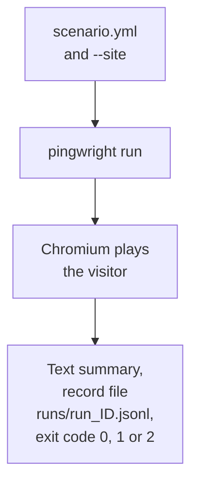

# Your first run

This guide installs Pingwright and runs one scenario. You need Node 22.18 or newer and a site with a cookie banner.

## Install

```bash
npm i -g pingwright@next
pingwright install-browser
```

The first command installs the `pingwright` command. The second installs Chromium, the browser that Pingwright drives. Both steps are needed once per machine. The [CLI page](../cli.md) lists other ways to install.

## Write a scenario

A scenario is a YAML file. Save this as `scenario.yml`:

```yaml
start: /
steps:
  - consent: none
  - wait: 4s
expect:
  mustNot:
    - { vendor: [meta, google-ads], before: consent }
```

This is what each part does:

- `start: /` opens the home page of the site.
- `consent: none` checks that a cookie banner is on the page. It does not answer the banner.
- `wait: 4s` waits 4 seconds so that late requests can arrive.
- `mustNot` is an expectation: a rule about which requests the site may send. It says that Meta and Google Ads must send nothing before the visitor answers the banner.

If the page shows no banner, the run stops with "banner not shown" and exit code 2.

## Run it

```bash
pingwright run scenario.yml --site https://staging.example.com
```

Replace the address with your own site. Use a test or staging site when you can.



`pingwright run` plays the scenario in Chromium, then prints a summary, writes a record file and sets the exit code.

The summary lists the hits, the consent epochs and each check with PASS or FAIL. [Reading a run's results](./reading-results.md) explains it line by line.

## The exit code

| Code | Meaning |
| --- | --- |
| 0 | Every expectation and built-in check passed. |
| 1 | At least one expectation or built-in check failed. |
| 2 | The run could not finish. For example, the scenario is not valid, or no banner was shown. |

A script can read this code. So can a job that runs your tests on every change. Code 1 means the site broke an expectation. Code 2 means the run itself needs a fix.

## Safe by default

- The run is in stub mode. Pingwright records known tracking requests and answers them itself. It does not send them on. See [What Pingwright checks](./what-it-checks.md).
- Pingwright types fake data only.
- A request to a site it does not know is flagged as an unknown destination, and the run fails. Allow a host in the scenario with `options: { allowUnknownDestination: ['tracker.example.net'] }`.

## Next

- [Reading a run's results](./reading-results.md)
- [CLI reference](../cli.md) for every option and command
- [Design](../design.md) for scenario steps and expectations
