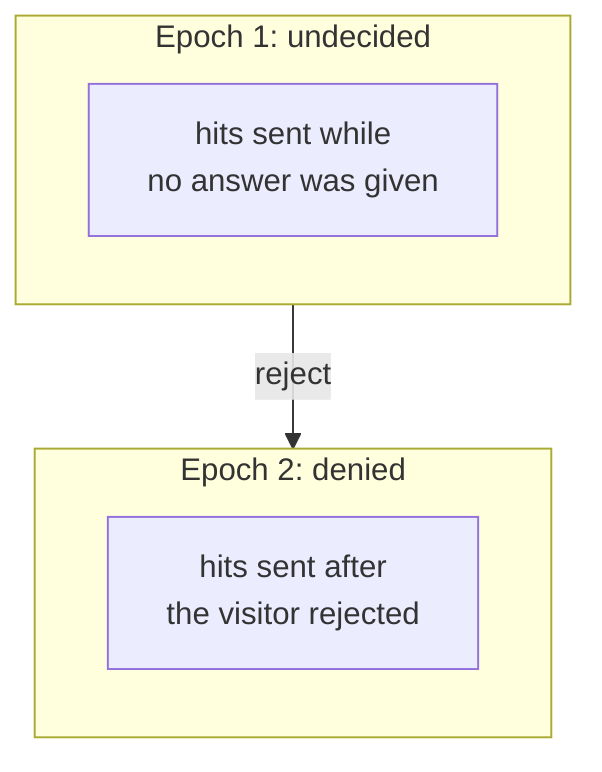
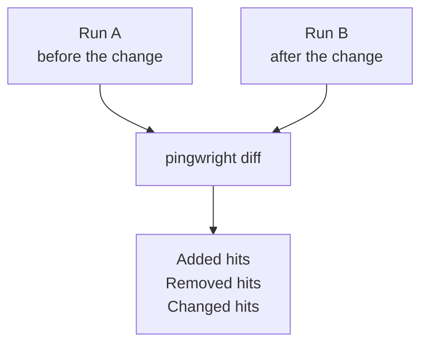

# Reading a run's results

A run gives you two things: a text summary on screen and a record file. This guide uses a real run against Pingwright's own test shop. The shop has deliberate faults, so the run fails. All values are fake.

## The text summary

```text
Hits
  ga4: page_view x3
  sgtm: (no event) x1
  meta: PageView x1
  google-ads: page_view x1
Consent epochs
  undecided (to end)
Flags
  unknownDestination: 127.0.0.1:57305 x1 (/unknown-pixel)
  sandboxPageUrl: ga4 x1 (/web-pixels@0.0.0-fixture/sandbox/modern/)
Expectations
  FAIL mustNot: {"vendor":["meta","google-ads"],"before":"consent"}
       Expected no matching hits before consent, found 2 matching hits (2 before narrowing).
       evidence: hit_01M66F9D0HD6QK42KFX8VH3CMT, hit_01M66F9D0J8K09EP6VRBY9AYEF
  PASS builtin: unknownDestination
  FAIL builtin: sandboxPageUrl
       Expected no hit to carry a sandbox URL as its page, found 1: http://localhost:57308/web-pixels@0.0.0-fixture/sandbox/modern/.
  PASS builtin: possibleRealData
Result: fail (2 of 4)
Record: runs/run_01M66F96D46CDXKXRNKJVPASAT.jsonl
```

The summary has five parts:

| Part | What it shows |
| --- | --- |
| Hits | Each vendor and event, and how many times it was sent. |
| Consent epochs | The periods of consent in the run. |
| Flags | Things worth a look. A flag does not fail the run by itself. |
| Expectations | Your rules and the built-in checks, each with PASS or FAIL. |
| Record | The path of the record file. |

This output is shortened. A real run also lists evidence for passing checks.

## Consent epochs

An epoch is a period with one consent state. The run above ends in one epoch, `undecided`, because the scenario never answered the banner. A scenario that rejects the banner has two epochs.



A reject ends the undecided epoch and starts a denied epoch, and Pingwright puts each hit in the epoch where it was sent.

Rules use epochs. `before: consent` means "in the first epoch, while the visitor is undecided". `in: epoch(denied)` means "in any epoch where consent is denied". The [design](../design.md#_7-3-consent-epochs-and-timing) has the exact timing rules.

## Expectations and built-in checks

An expectation is a rule from your scenario. `must` needs at least one matching hit. `mustNot` needs none. The failing line above shows which rule failed, why, and the IDs of the hits that broke it.

Built-in checks run on every run, without a rule from you:

- `unknownDestination` fails if a request went to a host that is not your site and that Pingwright does not know.
- `sandboxPageUrl` fails if a vendor received the address of a sandboxed iframe as the page address. The vendor then reports the wrong page.
- `possibleRealData` fails if the record holds an email address, a phone number or a hash that does not belong to the fake identity.

The [CLI page](../cli.md) lists the options that change these checks.

## The record file

The record is a JSONL file. Each line is one JSON object, and its `type` says what it is: `run`, `step`, `request`, `response`, `hit`, `dataLayerEvent`, `consentEpoch`, `flag`, `checkpoint` and `result`. Every record has an `id` that starts with a short prefix, such as `hit_`. The summary prints these IDs as evidence. Search the file for an ID to see the full record.

```bash
grep hit_01M66F9D0HD6QK42KFX8VH3CMT runs/run_01M66F96D46CDXKXRNKJVPASAT.jsonl
```

Programs can read the file, or the output of `pingwright run --json`. The [design](../design.md#_4-data-model) lists every field.

## Compare two runs

`pingwright diff` compares two record files of the same scenario. It does not open a browser. Use it to see what a change did, for example a new version of your tag manager.



`pingwright diff` pairs the hits of run A and run B, and lists hits that were added, removed or changed.

```bash
pingwright diff runs/a/run_A.jsonl runs/b/run_B.jsonl
```

This part of a diff comes from two different scenarios: run A rejected the banner and run B gave no answer. (Normally both runs use the same scenario.)

```text
Epoch undecided
  ga4
    page_view
      added (step "wait-2"): hit_01M66F9D0J8K09EP6VRBY9AYEE
      count 2 -> 3 (pairing by order)
```

The diff groups hits by epoch, vendor and event. A changed hit is one with the same key whose consent values or ID presence differ. The command exits 0 even when the runs differ. The exit code of each `run` tells you whether its rules passed. Options like `--by-page` are in the [CLI page](../cli.md).
