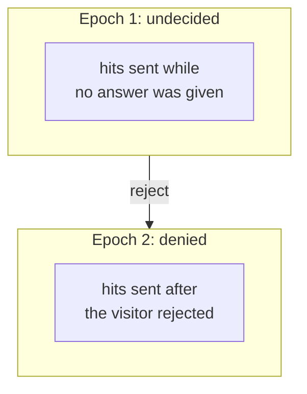
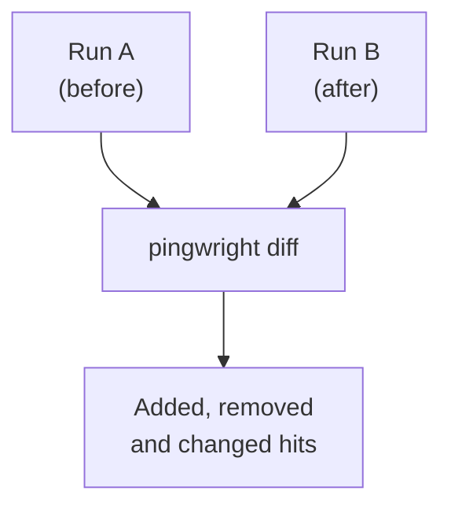

# Reading a run's results

A run gives you two things: a text summary on screen and a record file. The record file holds everything Pingwright saw during the run. This guide uses the scenario from [Your first run](./first-run.md), played against Pingwright's own test shop. The shop has deliberate faults, so the run fails. All values are fake.

## The text summary

```text
Hits
  ga4: page_view x3
  sgtm: (no event) x1
  meta: PageView x1
  google-ads: page_view x1
Consent epochs
  undecided (to end)
Flags
  unknownDestination: 127.0.0.1:57305 x1 (/unknown-pixel)
  sandboxPageUrl: ga4 x1 (/web-pixels@0.0.0-fixture/sandbox/modern/)
Expectations
  FAIL mustNot: {"vendor":["meta","google-ads"],"before":"consent"}
       Expected no matching hits before consent, found 2 matching hits (2 before narrowing).
       evidence: hit_01M66G9M2S992B5DF1MZ15ZQ08, hit_01M66G9M2T97WBWV5AA85VFM3W
  FAIL builtin: unknownDestination
       Expected no requests to unknown destinations, found 1: 127.0.0.1 x1.
       evidence: flg_01M66G9M2VCB4KHQ2ZD3ZQ9J4R, req_01M66G9DWR5CH6SQB4MF2XJWHX
  FAIL builtin: sandboxPageUrl
       Expected no hit to carry a sandbox URL as its page, found 1: http://localhost:57308/web-pixels@0.0.0-fixture/sandbox/modern/.
       evidence: hit_01M66G9M2S992B5DF1MZ15ZQ07
  PASS builtin: possibleRealData
Result: fail (3 of 4)
Record: runs/run_01M66G9DA0714WFS5QHQM5A0NX.jsonl
```

The summary has five parts:

| Part | What it shows |
| --- | --- |
| Hits | Each vendor and event, and how many times it was sent. |
| Consent epochs | The periods of consent in the run. |
| Flags | Things worth a look. Some flags have a built-in check that fails the run, such as `unknownDestination`. Other flags only inform. |
| Expectations | Your expectations and the built-in checks, each with PASS or FAIL. |
| Record | The path of the record file. |


This is the full output. It is not shortened. Here is how to read the less obvious lines:

- `sgtm` is a server-side Google Tag Manager container. It is a server that receives hits from the site and passes them on. `(no event)` means the hit has no event name.
- `127.0.0.1:57305` is a host the site called that Pingwright does not know. The test shop sends one request to it on purpose.
- `sandboxPageUrl` is a flag for a hit that gives a sandboxed iframe's address as the page. A sandboxed iframe is a small page inside your page with limited rights. Shopify uses one for its custom pixels.
- `(2 before narrowing)` is the number of hits that matched `vendor` in the whole run. Pingwright then kept only the hits that `before: consent` selects. Here both hits stayed.
- `evidence` lists the IDs of the records behind the failure.

## Consent epochs

An epoch is a period with one consent state. The run above ends in one epoch, `undecided`, because the scenario never answered the banner. A scenario that rejects the banner has two epochs.



A reject ends the undecided epoch and starts a denied epoch, and Pingwright puts each hit in the epoch where it was sent.

Expectations use epochs. `before: consent` means "in the first epoch, while the visitor is undecided". `in: epoch(denied)` means "in an epoch where consent is denied". A Google hit is the exception: Pingwright reads the consent values the hit carries, not the epoch. So a GA4 hit sent with denied values matches `in: epoch(denied)`, even while the visitor is undecided. See [Consent states](what-it-checks.md#consent-states). The [design](../design.md#_7-3-consent-epochs-and-timing) has the exact timing rules.

## Expectations and built-in checks

An expectation is a rule from your scenario. `must` needs at least one matching hit. `mustNot` needs none. The failing line above shows which expectation failed, why, and the IDs of the hits that broke it.

Built-in checks run on every run. You do not write them:

- `unknownDestination` fails if a request went to a host that is not your site and that Pingwright does not know. The scenario can allow a host with `options.allowUnknownDestination`.
- `sandboxPageUrl` fails if a vendor received the address of a sandboxed iframe as the page address. The vendor then reports the wrong page. Shopify custom pixels run in such an iframe.
- `possibleRealData` fails if the record holds an email address, a phone number or a hash that does not belong to the fake identity. A hash is a fixed code made from a value, such as an email address.

The [CLI page](../cli.md) lists the options that change these checks. One of them, `options.builtins`, sets a check to `warn`. The summary then shows `WARN` for it and the exit code stays 0.

## The record file

The record file is a JSONL file. Each line is one JSON object, and its `type` says what it is: `run`, `step`, `request`, `response`, `hit`, `dataLayerEvent`, `consentEpoch`, `flag`, `checkpoint` and `result`. Every record has an `id` that starts with a short prefix, such as `hit_`. The summary prints these IDs as evidence. Search the record file for an ID to see the whole line. This finds the first evidence hit from the summary above:

```bash
grep hit_01M66G9M2S992B5DF1MZ15ZQ08 runs/run_01M66G9DA0714WFS5QHQM5A0NX.jsonl
```

Programs can read the file, or the output of `pingwright run --json`. The [design](../design.md#_4-data-model) lists every field.

## Compare two runs

`pingwright diff` compares two record files of the same scenario. It does not open a browser. Use it to see what a change did, for example a new version of your Google Tag Manager container.



`pingwright diff` pairs the hits of run A with the hits of run B, and lists hits that were added, removed or changed.

```bash
pingwright diff runs/a/run_A.jsonl runs/b/run_B.jsonl
```

This part of a diff comes from two different scenarios: run A rejected the banner and run B gave no answer. Normally both runs use the same scenario.

```text
Epoch undecided
  ga4
    page_view
      added (step "wait-2"): hit_01M66F9D0J8K09EP6VRBY9AYEE
      count 2 -> 3 (pairing by order)
```

Here is what the lines mean:

- `Epoch undecided`, `ga4` and `page_view` are the group: an epoch, a vendor and an event.
- `step "wait-2"` is the step that was running when the hit arrived. Pingwright names a step by its kind and its position, so `wait-2` is the `wait` step at position 2 in the scenario.
- `count 2 -> 3` means run A had two hits in this group and run B had three. Pingwright pairs the hits in time order, so with different counts it may pair the wrong hits. Check such a group by hand.

The diff groups hits by epoch, vendor and event. A changed hit is a paired hit whose consent values differ, or where an ID is present in one run and missing in the other. The command exits 0 even when the runs differ. The exit code of each `run` tells you whether its expectations passed. Options like `--by-page` are in the [CLI page](../cli.md).
