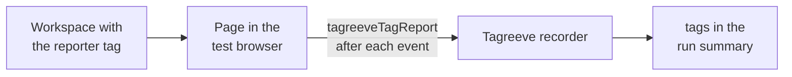

# Report which tags fired

Tagreeve can tell you which Google Tag Manager tags fired or failed for each event, and which tags you expected did not fire. It needs no Google sign-in during the run. You add one small reporter tag to your web container workspace, and Tagreeve reads what it reports.

This guide installs the reporter, runs a scenario against your unpublished workspace and reads the result. You need a working [first run](./first-run.md) and a web container that you can edit. All IDs below are fake. `GTM-PWTEST1` stands for your container.

Tagreeve never calls the GTM API. The reporter reaches Tagreeve through a function that only the Tagreeve test browser has, so on a real visitor's page it does nothing.



The reporter tag runs after each event in the page, hands its list of tags to the recorder, and the run summary shows them under `tags`.

## Install the reporter with an agent

These steps are for a coding agent that has its own access to your GTM account, for example a GTM API client that the person has signed in. Tagreeve gives the agent the template and the setup. The agent does the GTM work.

1. Run `tagreeve template web --json` and read the object it prints. It has `template` (the `.tpl` text), `fileName`, `setup` and `steps`. It needs no network.

   ```bash
   tagreeve template web --json
   ```

2. In a GTM workspace of your web container, import `template` as a custom tag template. Save the text to a file named `fileName` if the import needs one. Use a workspace, not a published version.
3. Add one tag of the new type. Give it the trigger from `setup.trigger`: a Custom Event trigger whose event name is `.*`, with "Use regex matching" on. Set consent to "No additional consent required" (`setup.consent`). With any other consent setting, the reports for the time before consent go missing.
4. In each tag's Additional Tag Metadata, turn on "Include tag name" with the key `name` (`setup.tagMetadata`). Without it, a report has tag IDs and no names. You can also list names in `expectedTags`, see below.
5. Do not publish the workspace version, and do not create a published version for this. `setup.publish` is always `false`. The reporter belongs in a workspace or an environment.
6. Get the workspace's preview values: the preview environment ID and its auth token. Write them to a file outside the repository, with the container ID, in the format of [`--gtm-override`](../cli.md#gtm-override). Do not print the auth value, and do not commit the file.

   ```json
   {"container": "GTM-PWTEST1", "gtmAuth": "<auth>", "gtmPreview": "<env id>"}
   ```

7. Run your scenario against the workspace, with `--json`:

   ```bash
   tagreeve run tagreeve/scenarios/checkout.yml --site https://test.example.com --gtm-override ~/.config/tagreeve/override.json --json
   ```

8. Check the install. Read `tags["GTM-PWTEST1"].reports` in the output. It must be greater than 0. The install failed when the entry is `{ "reports": 0, "hint": "tagreeve template web --json" }`, or when the text summary has a `Tags: no reports from GTM-PWTEST1` line. An entry with `reports: 0` is still an entry, so a check that only asks whether `tags` has content passes a failed install.

If the check fails, look at the tag's trigger, its consent setting and whether the run used the workspace's preview values. The [`--gtm-override`](../cli.md#gtm-override) section lists what makes a run exit 2.

## Install the reporter by hand

The same steps work in the GTM web interface.

1. Run `tagreeve template web > tagreeve-tag-reporter.tpl`. This prints the template text byte for byte.
2. In your web container, open Templates, then Tag Templates, then New, open the menu, choose Import and pick the file. Save it.
3. Open Tags and add a tag of the new type. For the trigger, make a Custom Event trigger with the event name `.*` and tick "Use regex matching". Under Advanced Settings, Consent Settings, choose "No additional consent required".
4. In each tag you want to see by name, open Advanced Settings, Additional Tag Metadata, tick "Include tag name" and keep the key `name`.
5. Do not publish. Keep the change in the workspace, or put it in a GTM environment that only you test with.
6. Open Preview or the environment's "Get the link" dialog to find the environment ID and the auth value. Put them in an override file as in the agent steps.
7. Run with `--gtm-override` and read the `Tags` line of the summary.

## Read the result

The text summary has one `Tags` line for each container. For example:

```text
Tags GTM-PWTEST1: 6 fired, 1 failed (13 Meta - PageView: failure), 1 expected did not fire (45 GA4 - Purchase)
```

`fired` counts every tag that appeared in a report, failed ones included. `--json` has the detail:

```json
{
  "tags": {
    "GTM-PWTEST1": {
      "reports": 9,
      "fired": [{ "id": "13", "name": "Meta - PageView", "nameFrom": "report", "count": 3, "statuses": { "failure": 3 } }],
      "notFired": [{ "id": "45", "name": "GA4 - Purchase" }]
    }
  }
}
```

`count` is the number of report entries for the tag, and `statuses` counts them by status. `nameFrom` says where the name came from: `report`, `expectedTags` or `null` when no name is known. A name that holds an email address or a phone number reads `(other)`. The full field list is in the [CLI reference](../cli.md#tagreeve-run-scenarioyml---site-url).

### Expected tags

GTM only reports tags that fired. To find tags that did not, list the tags you expect in the override file:

```json
{
  "container": "GTM-PWTEST1",
  "gtmAuth": "<auth>",
  "gtmPreview": "<env id>",
  "expectedTags": [{ "id": "45", "name": "GA4 - Purchase" }]
}
```

`notFired` lists the expected tags that appeared in no web report. It is set only for a container that sent at least one report, and it never fails a run. A name in `expectedTags` also fills a tag name that the report left out. Only the summary shows it; the record keeps what GTM sent.

### Fail a run on one tag

A `tag` rule in a scenario turns a tag report into a pass or a fail:

```yaml
expect:
  must:
    - { tag: { id: "45" } }
  mustNot:
    - { tag: { name: "Meta *", status: [failure, exception, timeout] } }
```

A rule with no report for its container cannot be evaluated. It fails with `noTagReports` and never passes. A name pattern on a tag with no name fails with `tagNameUnknown`. See [Rules on tags](../cli.md#rules-on-tags) for the keys.

## What the reports cannot tell you

- A report can be lost at a navigation. The page may unload before the reporter hands over the list for the last event. A tag that is missing from the reports and a report that was lost look the same, so a full `expectedTags` list can hold tags that a scenario never triggers or whose report was lost.
- The reporter is a tag too. Its own entry can appear in the list for an event. Field checks have not confirmed this yet.
- A report is whatever the page function receives. Any script on the page can call `tagreeveTagReport` in the test browser, so a hostile page could forge a report. Use reports to check your own container, not to audit a site you do not control.
- Only tags that fired appear. A tag that GTM blocked by trigger or consent leaves no entry.
- Reports from the server container are not built. A preview-environment config for the server container is covered in [Run your server container locally](./server-container.md).
- Real GTM has not run the reporter in the Tagreeve tests. Tests use a stand-in. Check the first run against your container with the `reports` count above.
