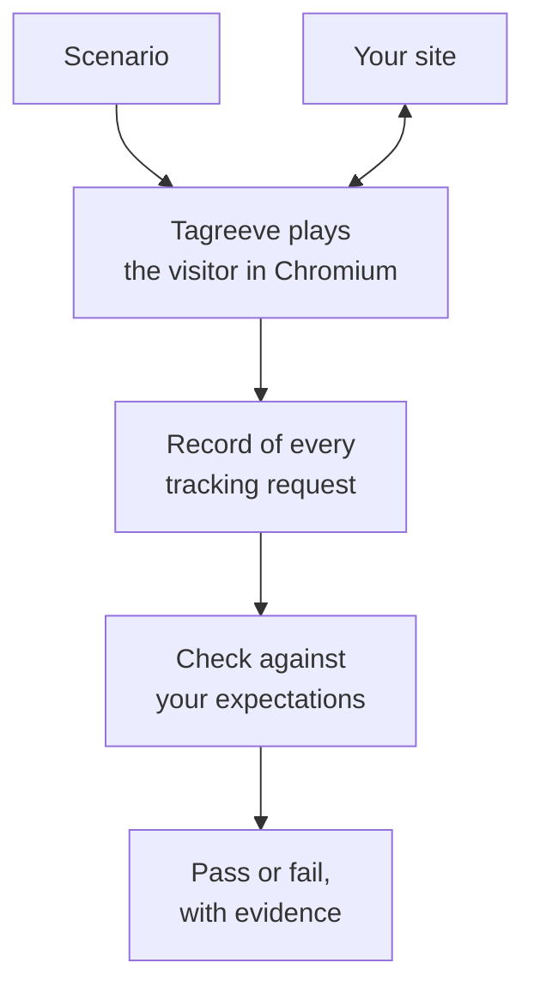
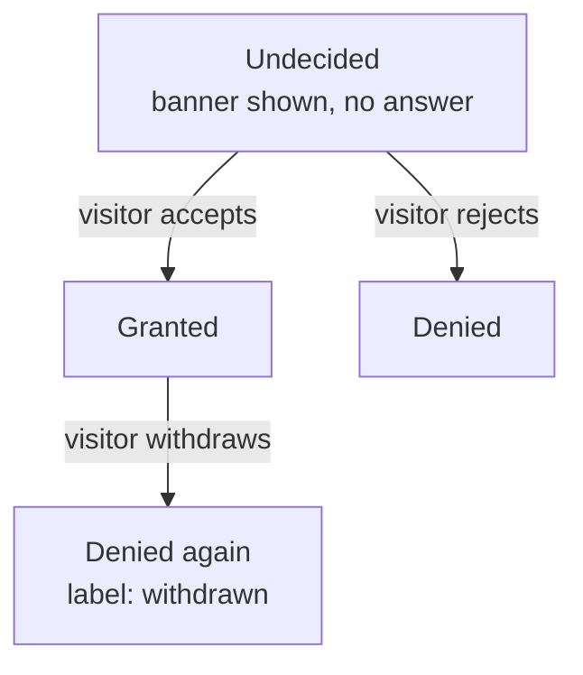
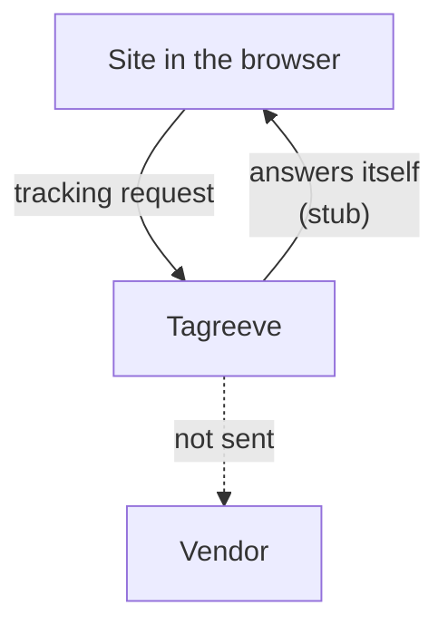

# What Tagreeve checks

A website often sends data to other companies. For example, it tells Google Analytics that a visitor opened a page. These messages are tracking requests. Each tracking request goes to a vendor, such as Google or Meta.

Visitors can say no to some tracking. A cookie banner asks them. The answer is the visitor's consent. A site must not send some requests until the visitor says yes.

A tracking setup can break and show no error. A small change can make a vendor receive data it should not get. Tagreeve plays a visitor in a real browser, records every tracking request, and checks them against your expectations. An expectation is a rule about which requests the site may send, and when.

## The idea

Tagreeve plays a scenario in a browser, records the tracking requests, checks them against your expectations and reports pass or fail.

A scenario is a short YAML file. It lists what the visitor does and what you expect. [Your first run](./first-run.md) shows one.

## Tracking requests

Tagreeve reads each tracking request and turns it into a hit. A hit has the vendor, the event and the consent values the request carries. An event is the action the site reports, such as `page_view`. Consent values are the consent signals that a Google hit carries in its own parameters. Tagreeve decodes hits for GA4 (Google Analytics 4), Google Ads, Meta, Pinterest and `sgtm`. An `sgtm` hit goes to a server-side Google Tag Manager container, for example one hosted by Stape. It also recognises a short list of other trackers.

## Consent states

The visitor's consent changes over time. Tagreeve calls each period an epoch. A period starts when the consent state changes.

Every visitor starts undecided, then accepts or rejects. An accepting visitor can withdraw later.

You write expectations per state. For example: "Meta must send nothing while the visitor is undecided." Tagreeve checks each hit against the epoch it falls in. For `in: epoch(granted)` and `in: epoch(denied)`, Tagreeve reads the consent values a Google hit carries instead of the epoch. `before: consent` uses the time of the hit for every vendor.

[Reading a run's results](./reading-results.md) shows how epochs appear in the output.

Google tags also send the Consent Mode signals they were set up with. Tagreeve warns when a Google hit shows a signal that was never set, for example a setup that misses `ad_user_data` and `ad_personalization`.

## Stub mode

By default, a run is in stub mode. In stub mode, Tagreeve records each known tracking request and then answers it itself. Your test visits do not add fake traffic to real reports.

In stub mode, Tagreeve records a known tracking request and answers it itself, so the vendor does not get it.

Scripts and pages still load. For example, the Google tag script and the Meta pixel script (the code that sends Meta hits) come from the vendor as usual. Only the tracking requests are answered locally.

A few rare requests can still get through. One example is a request that a sandboxed iframe (a small page inside your page with limited rights) sends while it is still loading. The [design](../design.md#53-network-modes) lists these cases.

Tagreeve sends a request it does not know on to its host. It flags that request as an unknown destination, and the run fails unless you allow it. Live mode (`--network live`) sends every request on. Use live mode only when you want test hits to reach a real vendor account.

## Fake identity

A scenario can fill forms, for example at checkout. Tagreeve never uses a real person's data. It makes a fake identity for each run: a name, an email address and a phone number that belong to no one.

Because Tagreeve knows what it typed, it can check what the site sends. Many sites turn an email address into a hash before they send it. A hash is a fixed code made from the address. The same address always gives the same hash. Tagreeve can compute the hash of the fake email address, so it can tell if the site sent another value. If the record file holds an email address or phone number that is not the fake one, Tagreeve reports it as possible real data.

Tagreeve never automates a log-in on a site on the internet. A payment there is a handoff step too: a person does it in a visible window while Tagreeve keeps recording. The one exception is an opt-in `payment` step that types a payment provider's documented test card. It runs only when you name the host on the command line, list the host in a file in your own config folder, and the provider is in test mode. You declare that for the host in the same file, or the page shows the provider's test mode inside the card form. See the Test payments paragraph in the [CLI reference](../cli.md).

## Go deeper

- [Your first run](./first-run.md) installs Tagreeve and runs a scenario.
- [Reading a run's results](./reading-results.md) explains the output.
- [The design](../design.md) has every detail, including how Tagreeve captures requests from sandboxed iframes.
