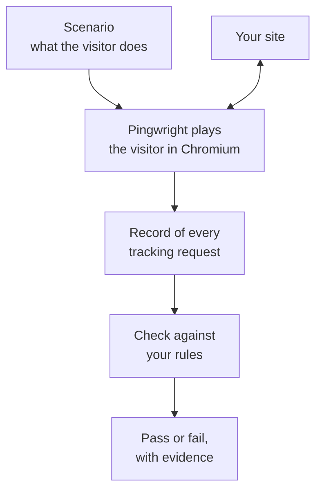
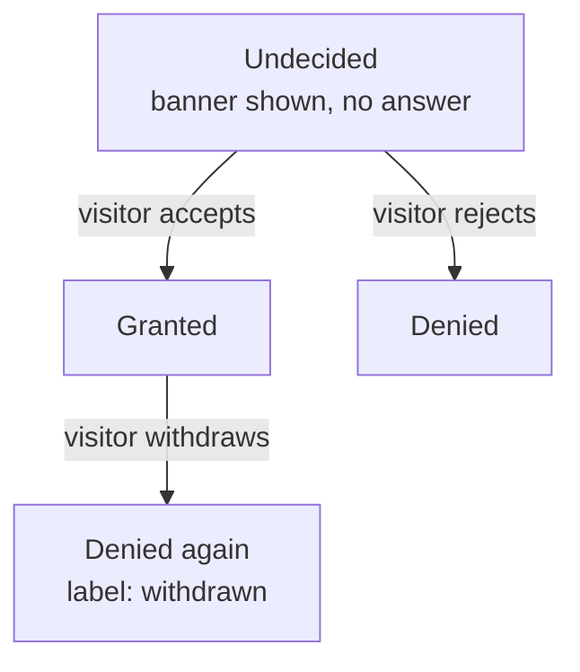
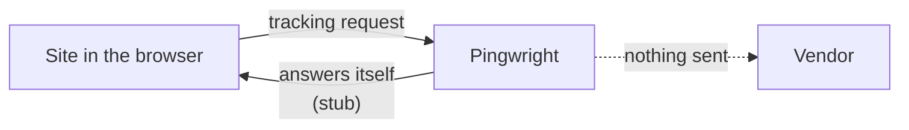

# What Pingwright checks

A website often sends data to other companies. For example, it tells Google Analytics that a visitor opened a page. These messages are tracking requests. Each tracking request goes to a vendor, such as Google or Meta.

Visitors can say no to some tracking. A cookie banner asks them. The answer is the visitor's consent. A site must not send some requests until the visitor says yes.

Tracking setups break without a sound. A small change can make a vendor receive data it should not get. Pingwright plays a visitor in a real browser, records every tracking request, and checks them against your rules.

## The idea

Pingwright plays a scenario in a browser, records the tracking requests, checks them against your rules and reports pass or fail.

A scenario is a short YAML file. It lists what the visitor does and what you expect. [Your first run](./first-run.md) shows one.

## Tracking requests

Pingwright reads each tracking request and turns it into a hit. A hit has the vendor, the event and the consent values the request carries. An event is the action the site reports, such as `page_view`. Pingwright decodes hits for GA4, Google Ads, Meta, Pinterest and Stape. It also recognises a short list of other trackers.

## Consent states

The visitor's consent changes over time. Pingwright calls each period an epoch. A period starts when the consent state changes.

Every visitor starts undecided, then accepts or rejects. An accepting visitor can withdraw later.

You write rules per state. For example: "Meta must send nothing while the visitor is undecided." Pingwright checks each hit against the epoch it falls in. Google hits carry their own consent values, so Pingwright reads those values instead.

[Reading a run's results](./reading-results.md) shows how epochs appear in the output.

## Stub mode

By default, a run is in stub mode. In stub mode, Pingwright records each known tracking request and then answers it itself. The request never reaches the vendor. Your test visits do not add fake traffic to real reports.

In stub mode, Pingwright records a tracking request and answers it itself, so the vendor sees nothing.

Pingwright sends a request on to the vendor only if it does not know the request. It flags that request as an unknown destination, and the run fails unless you allow it. Live mode (`--network live`) sends everything on. Use live mode only when you want test hits to reach a real vendor account.

## Fake identity

A scenario can fill forms, for example at checkout. Pingwright never uses a real person's data. It makes a fake identity for each run: a name, an email address and a phone number that belong to no one.

Because Pingwright knows what it typed, it can check what the site sends. A site that hashes the email address must hash the fake email address and not another value. If a recording holds an email address or phone number that is not the fake one, Pingwright reports it as possible real data.

Pingwright never automates a payment or a log-in on a site on the internet. Those are handoff steps. A person does them in a visible window while Pingwright keeps recording.

## Go deeper

- [Your first run](./first-run.md) installs Pingwright and runs a scenario.
- [Reading a run's results](./reading-results.md) explains the output.
- [The design](../design.md) has every detail, including how Pingwright captures requests from sandboxed iframes.
