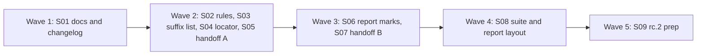

# Plan for 0.3.0-rc.2

This is the checklist for `0.3.0-rc.2`. The scope comes from the field test of `0.3.0-rc.1` on a real Shopify store, plus the open review issues for 0.3 and 0.2. Each item is one small PR. A PR is done when its acceptance test passes in CI, an adversarial review reports no blockers or majors, and it is squash-merged to main. The target is `0.3.0-rc.2`, published on `next` by the maintainer. The maintainer then runs the field test again on the same store.

## What the field test found

| Finding | Issue | What was wrong |
| --- | --- | --- |
| A suite cell said `FAIL` and nothing else. | #457 | A reader cannot tell a leak from a known, accepted failure. |
| A passing result read `PASS ... severity: fail`. | #458 | Severity is a setting. It reads as a verdict. |
| The diff tables came before the timelines. | #459 | People who do not write scenarios see the hardest part first. |
| A role locator timeout listed the first ten controls of the page. | #460 | None of them were of the requested role. |
| A cookie rule said `found _dcid from Set-Cookie`. | #461 | It reads as if the browser kept the cookie. It did not. |
| `body.has: [email]` passed on `customerHashed.email`. | #462 | A plain name matches only a top-level field, and the result does not say so. |
| The Done pill ran off the left edge at 390 px. | #464 | It covered card fields and "Pay now". |

## Scope

In `0.3.0-rc.2`:

| Group | Issues | Decision |
| --- | --- | --- |
| Report and suite | #457, #458, #459, #378, #448 | In. |
| Locator timeout | #460 | In. |
| Cookie rule evidence | #461 | In. |
| `body.has` | #462 | In. |
| Done pill width | #464 | In. |
| Handoff robustness | #398, #443, #444, #445, #446 | In. Before any payment work. |
| From 0.2 | #348, #349 | In. |
| Docs | #449, #450, #451, #452, #453, #454, #455 | In. |
| Public suffix list | #427 | In. |

Not in `0.3.0-rc.2`:

| Issue | Why it waits |
| --- | --- |
| #463 test payment step | Planned for 0.4. The handoff PRs (S05, S06) come first because a payment step needs a handoff that a page script cannot end. |
| #358 to #362, #256, #323, #180, #32, #144, #404, #441, #261 | Enhancements. Out of scope for a fix release. They stay open. |

## Order and waves

The waves run left to right. PRs in one wave touch different files, so they can be built in parallel. One-line summary: docs first, then four independent fixes, then two that build on wave 2, then the suite report, then the version.

Why this order:

- **S01 first, alone.** It creates the `0.3.0-rc.2` heading in CHANGELOG and fixes the existing docs. Every later PR adds lines under that heading, so it must exist first. It is docs only, so it is fast.
- **S05 and S07 are two PRs on one file.** `packages/recorder/src/handoff-overlay.ts` holds all six handoff issues. They cannot be in one wave. S05 changes how the overlay is built (prototype capture, width). S07 changes its polling and wake logic.
- **S06 before S08.** S08 puts the verdict and the timelines in the suite report. It reads the marks and the severity rule from S06, and it reuses the timeline renderer in `render.ts`.
- **S06 after S02.** S02 adds two note codes, and S06 owns `packages/cli/src/report/model.ts`, where their text goes. So S06 adds the text for the S02 codes, and S02 does not touch the report.
- **S02 shares `evaluate.ts` for two issues.** #461 and #462 both change it, so they are one PR.
- **S09 last.** It sets the version and writes the "Known in rc.2" list from what is still open.

## Which issues share code

| Shared code | Issues | PR |
| --- | --- | --- |
| `packages/expect/src/evaluate.ts` (cookie and `body.has` rules) | #461, #462 | S02 |
| `packages/cli/src/report/model.ts` and `render.ts` (marks, severity text) | #378, #448, #458 | S06 |
| The notion of an effective severity for `expect` results | #349, #458 | S06 |
| `packages/cli/src/suite.ts`, `report/suite.ts`, `diff.ts` (cell text, flag label, page order) | #348, #457, #459 | S08 |
| `packages/recorder/src/handoff-overlay.ts`, build and styles | #398, #446, #464 | S05 |
| `packages/recorder/src/handoff-overlay.ts`, polling and wake | #443, #444, #445 | S07 |
| `README.md`, `CHANGELOG.md`, `docs/cli.md`, `docs/design.md`, `docs/shopify-checkout.md`, `docs/plan-0.3.md` | #449 to #455 | S01 |

## Dependency decision for #427

No new dependency. `tldts` 7.4.18 is already in `dependencies` of the root package and of `packages/recorder`. It is MIT licensed. It ships the Public Suffix List inside the package, both the ICANN and the private sections (`myshopify.com`, `github.io`), and it needs no network call. `packages/recorder` already uses it for first-party hosts (design §3, `getDomain`), so the two checks will agree.

- **Version.** Stay on 7.4.18, published 2026-10-07. 7.4.19 (2026-10-20) is less than two weeks old on 2026-10-29, so it does not qualify. The version is pinned exactly.
- **What changes.** `packages/expect/package.json` lists `tldts` 7.4.18. `isPublicSuffix` in `packages/expect/src/hosts.ts` calls `getPublicSuffix(domain, { allowPrivateDomains: true })` and treats the wildcard as a public suffix when the result equals the domain. The `SHARED_SUFFIXES` set and the two-letter rule are deleted.
- **Bundling.** `scripts/build.ts` marks every `dependencies` entry as external, so `tldts` is installed with the package and is not inlined into `dist`. This matches the rule that the list is never fetched at run time. The plan does not change this. The root package already works this way for `playwright` and `yaml`.
- **Staying current.** The list is updated by `tldts` releases. A Dependabot or manual bump, done at the same two-week age rule, refreshes it. The new list is only a bundled file, so a bump needs no code change. S03 adds a line to `docs/release.md`: bump `tldts` before each release if a version at least two weeks old exists.

## Package layout

No new packages and no new dependency:

- **Report and suite:** `packages/cli`.
- **Rules and `serverHosts` check:** `packages/expect`.
- **Locator timeout and handoff overlay:** `packages/recorder`.
- **Result note codes:** `packages/core` (S02 adds two codes to `ResultNote`).

## Rules for every PR

The 0.1, 0.2 and 0.3 rules still hold (AGENTS.md, docs/plan-0.3.md):

- fake IDs only: GA4 `G-PWTEST0001`, Google Ads `AW-000000001`, Meta `100000000000001`, GTM `GTM-PWTEST1` and `GTM-PWNOVER`, hosts under `.invalid` or `example.com`;
- names and counts only in records, messages, the report and `suite.json`: no cookie value, no identity value and no `gtmAuth`. Each PR's leak test feeds a fake email (`pw-fixture@example.com`), its SHA-256 and a fake cookie value through the feature and asserts none of them appears in what the PR adds;
- the report loads nothing from the network and runs no script;
- payments and log-ins on a hosted site stay `handoff` steps. Only loopback hosts may be automated through payment;
- e2e tests run only against `fixtures/site` in `stub` mode, plus the one loopback `server` mode test that already exists;
- context-level hooks only, no CDP, no new browser flags, a normal Chrome user agent;
- Pingwright never calls the GTM API and runs no service.

More for rc.2:

- **Each PR adds a regression test with fake-value fixtures.** The test fails when the fix is removed. The PR description says how it checked.
- **Existing e2e tests do not change.** Each PR adds a new `e2e/<name>.e2e.test.ts` and new scenarios under `e2e/scenarios/`. New fixture pages only. One named exception is in S04.
- **CHANGELOG and docs.** See the next section.
- **No record schema bump.** `recordSchemaVersion` stays 2. S02 adds two codes to the optional `Result.note`. An older reader that meets an unknown note code ignores it (it prints no note text).

## CHANGELOG and docs without collisions

Choice: each PR adds its own lines under `## 0.3.0-rc.2`, in a fixed set of sections. S01 creates the heading and the sections, empty, so no two PRs create the same lines.

| Section (in this order) | Written by |
| --- | --- |
| `### Exit codes can change` | none expected. Add only if a PR changes an exit code. |
| `### Report and suite` | S06, S08 |
| `### Rules` | S02, S03 |
| `### Steps and handoff` | S04, S05, S07 |
| `### Docs` | S01 |
| `### Known in 0.3.0-rc.2` | S09 only |

Two PRs in one wave can write the same section. Each appends at the end of the section, and the PR that merges second rebases. The conflict is adjacent lines only.

Why not one consolidating PR: the maintainer asked for CHANGELOG and docs in the same PR as the change, and a consolidating PR would be written from PR descriptions instead of from the diff, so it drifts. Why this is safe: PRs in one wave write different sections, so their hunks do not touch. An empty section is deleted by S09.

Docs: each PR edits only the `docs/cli.md` section for its feature, named in its Touches line. Two PRs in one wave never name the same section. `docs/design.md` is touched only by S01 (#455) and by S02 if the cookie evidence note needs a line in §15.3.

The "Known in 0.3.0-rc.2" list is written by S09 from the issues still open at that point. It will at least name: #463 (not in rc.2), and any `review-minor` issue the rc.2 reviews filed. It is also where the rc.1 list from #451 gets its final form: a "Known in 0.3.0-rc.1" note under the rc.1 heading, which says #348, #349 and #445 were open in rc.1 and are fixed in rc.2.

## PRs

### Wave 1

**S01 Docs and changelog fixes (#449, #450, #451, #452, #453, #454, #455).** Touches: `README.md`, `CHANGELOG.md`, `docs/cli.md`, `docs/design.md`, `docs/shopify-checkout.md`, `docs/plan-0.3.md`, `.vitepress/` docs test files.
- Adds the `## 0.3.0-rc.2` heading and the empty sections above.
- #449: the handoff ends when the person clicks Done or presses Enter (`docs/shopify-checkout.md`, line 13).
- #450: README says the 0.3 sections need `npm i -g pingwright@next`. The plain `npm i -g pingwright` line stays, with a note that it installs 0.2.0 until 0.3.0 is released.
- #451: a "Known in 0.3.0-rc.1" list under the rc.1 heading (#348, #349, #445). `docs/cli.md` and design §15.3 drop "always" from "Enter always works".
- #452: one sentence in the CHANGELOG exit-code note and in the `deniedIdentifiers` section of `docs/cli.md`: the check also fails when a denied hit has a body that was not fully recorded (cut at 64 KiB, unparsable JSON, or a `--net-log` hit with no body).
- #453: the CHANGELOG sentence on a cut body gets "unless the recorded fields already decide the rule".
- #454: the handoff docs say the host is a child of `<html>`, a sibling of `<body>`, with inline `!important` styles, so `body { display: none }` does not hide it. Use `html { display: none }` or a script that removes the host. Changes `docs/cli.md` and `docs/plan-0.3.md`.
- #455: design §11 lists `deniedIdentifiers` as the fourth built-in check and points to §15.3.
- Wrong or stale in the issues: none. #454 says the plan file holds the claim, and it does, so the fix there is a doc edit and not a history rewrite.

Regression test: the docs project already builds the site and checks links. S01 adds a docs test (`pnpm docs:test`) that fails if README mentions the 0.3 sections without `pingwright@next`, and if `docs/cli.md` or design §15.3 says Enter "always" works. Fixture: none. A docs test needs no fake values.
Acceptance: `pnpm lint`, `pnpm docs:build` and `pnpm docs:test` pass, and the new docs test fails on a copy of the old README line.

### Wave 2

**S02 Cookie evidence and `body.has` leaf names (#461, #462).** Touches: `packages/expect/src/evaluate.ts`, `packages/expect/src/scenario.ts`, `packages/core/src/records.ts` (two note codes), `docs/cli.md` (cookie rule and `body.has` sections), `CHANGELOG.md` (Rules), `e2e/stored-cookie-evidence.e2e.test.ts`, `e2e/leaf-names.e2e.test.ts`, `e2e/scenarios/`.
- **#461.** A `cookie` result that found a name from `Set-Cookie` also checks the checkpoints. If any checkpoint holds that name, the message says `stored by the browser`. If none does, it says `found _dcid from Set-Cookie (7 requests); not stored by the browser (no checkpoint has it)` and sets `Result.note` to `cookieNotStored`. The rule keeps failing on the attempt. Counts are requests, as the issue asks. The old `(N before narrowing)` text stays for the other sources.
- **#462.** Two changes. (a) A leaf-name form: a pattern that starts with `**.` matches the name at any depth, so `**.email` matches `email`, `customerHashed.email` and `a.b.email`. It matches on a dot boundary, so it does not match `useremail`. (b) When a plain name (no `*`) matches nothing at the top level but matches the last segment of nested fields, the result gets `Result.note` `nestedNameOnly` and the message `no top-level match; nested fields with this name: customerHashed.email`. The rule outcome does not change: a plain name still means a top-level field.
- Why both: the issue asks for one or the other. The note fixes the silent pass for people who do not know the new form, and the form fixes the rule itself. They share the same lookup, so the cost is small. The maintainer can drop either.
- Flagged: in a glob, `*` already matches dots, so `*.email` matches `customerHashed.email` today but not a top-level `email`. `**.` is a different meaning from `*`, and the docs must say so in one table row.
- Flagged: the issue asks for `stored: true|false` in the result evidence. Evidence is a list of IDs. A new note code carries the same fact and needs no new record field, so the plan uses the note.
- Field names in the nested note go through `guardFieldName`, so a value used as a JSON key prints as `(other)`.

Regression test: unit tests on the evaluator for both cases and for the old behaviour. Fixture: a new page `/set-cookie-unstored` served with a `Set-Cookie: _pwtest=pw-fixture-cookie-value` from the loopback server host that the browser rejects in a cross-site frame, and the existing `/sgtm-data-tag` page for nested `customerHashed.email`. Fake email `pw-fixture@example.com`. The leak test asserts neither the cookie value nor the email nor its hash appears in the message, the note or the report.
Acceptance: the e2e test runs the scenarios with `--network server` and `stub`, checks the two messages and notes, and the exit codes (1, because the rules still fail). It fails when `cookieNotStored` is not set, and when `**.email` is treated as a plain name.

**S03 Public suffix list (#427).** Touches: `packages/expect/src/hosts.ts`, `packages/expect/src/hosts.test.ts`, `packages/expect/package.json`, `pnpm-lock.yaml`, `docs/release.md`, `CHANGELOG.md` (Rules).
Replaces `SHARED_SUFFIXES` and the two-letter rule with `tldts` (see "Dependency decision for #427"). The `isSpecificServerHost` function keeps its other checks (vendor domains, the tracker list, loopback hosts).
Regression test: unit tests for `*.myshopify.com`, `*.github.io`, `*.co.kr`, `*.com.au`, `*.co.uk` (rejected), `*.shop.example.com`, `*.sgtm.example.com` and `sgtm.example.com` (accepted), a single label such as `*.com` (rejected), and loopback hosts (accepted). Fixture: none beyond these strings. All hosts are reserved names or public suffixes, with no real store data.
Acceptance: the new unit tests. An e2e is not needed: no browser behaviour changes. A scenario with `serverHosts: ["*.myshopify.com"]` exits 2 with the scenario error, checked in a CLI test in `e2e/server-hosts-suffix.e2e.test.ts` (it exits before it launches a browser). It fails with the old hard-coded list for `*.co.kr`.

**S04 Locator timeout (#460).** Touches: `packages/recorder/src/locators.ts`, `packages/recorder/src/locators.test.ts`, `packages/recorder/src/steps.ts` (pass the requested role and name to `timeoutMessage`), `docs/cli.md` (locator section), `CHANGELOG.md` (Steps and handoff), `fixtures/site/public/swatches.html`, `e2e/locator-timeout.e2e.test.ts`, `e2e/scenarios/`.
- For a `{ role, name }` locator, `timeoutMessage` lists up to ten controls of that role, ranked by name similarity to the requested name, in the form `Closest radio controls: "White (01)", "Natural (02)".` Similarity is a plain, deterministic score (shared words first, then shared prefix length, then edit distance), with ties kept in page order.
- If the page has no control of that role, the message says `No radio controls on the page.` and then lists the page's first controls as today, so nothing is lost.
- A selector or `any` locator keeps `Controls on the page:`.
- Names pass through `visibleName`, so an email, a phone or a digest in a name prints as `(hidden)`. The requested name is the scenario's own text and is printed as written.
- Named exception to "existing e2e tests do not change": `e2e/locators-select.e2e.test.ts` line 16 asserts `Controls on the page:` for a role locator. If it fails after this change, S04 updates that one assertion and says so in the PR. The unit test in `steps.test.ts` line 320 changes for the same reason.

Regression test: unit tests for the ranking (`White (99)` against `White (01)`, `Natural (02)`, `Black (03)`), the empty-role fallback, and the hiding of an email-like name. Fixture: a new page `/swatches` with colour radios named `White (01)`, `Natural (02)`, `Black (03)`, and a link and a button, so the page's first controls are not radios.
Acceptance: the e2e scenario clicks `{ role: radio, name: "White (99)" }` with a short timeout, exits 2, and its stderr contains `Closest radio controls: "White (01)"` and no `link`. It fails when the message goes back to the first ten controls.

**S05 Handoff overlay, build and width (#398, #446, #464).** Touches: `packages/recorder/src/handoff-overlay.ts`, `packages/recorder/src/handoff-overlay.test.ts`, `docs/cli.md` (handoff section), `CHANGELOG.md` (Steps and handoff), `fixtures/site/public/handoff-patched.html`, `e2e/handoff-hardening.e2e.test.ts`, `e2e/scenarios/`.
- **#398 and #446.** At the top of the init script, before any page script runs, capture the prototype methods the overlay uses (`createElement`, `attachShadow`, `addEventListener`, `append`, `remove`, `setProperty`, the `textContent` and `title` setters, and the `isTrusted` getter from `Event.prototype`) and call them with `.call`. The Done click handler accepts only an event whose `isTrusted` read through the captured getter is true. The comment above the script is reworded to say what the code now guarantees and what it does not: a page can still move the host or cover it, and the person's real click is what ends the wait.
- **#464.** The host gets `max-width: calc(100vw - 32px)` as an inline `!important` style, and the label shrinks first (`min-width: 0`, ellipsis) so the Done button stays whole. At 390 px the pill is at most 358 px wide and sits inside the viewport. The optional "move to the top when a focused control is under it" is not built: it adds a focus listener on every page and moves the pill under a person's hand. The pill can be dragged already.
- Flagged: #398 suggests building the host eagerly at document start as a second option. This plan captures prototypes instead, because an eager host appears on pages where no handoff will happen and changes the page's DOM for every scenario.

Regression test: a unit test on the generated script (it contains no direct `EventTarget.prototype.addEventListener` call after the capture) and two e2e cases. (1) A fixture page whose inline script patches `EventTarget.prototype.addEventListener`, `Node.prototype.textContent` and `Element.prototype.attachShadow`, then calls the Done handler with a fake `{ isTrusted: true }`. The handoff must still be waiting. A real click ends it. (2) A viewport of 390 by 844 on `/handoff`: the pill's box is inside `[0, 390]`, and its Done button is visible and whole. Fixture: `/handoff-patched` and the existing `/handoff`, fake identity only.
Acceptance: `e2e/handoff-hardening.e2e.test.ts`. It fails when the captures are removed (the patched listener ends the wait) and when `max-width` is removed (the pill's left edge is below 0).

### Wave 3

**S06 Report marks and severity (#378, #448, #458, #349).** Starts after S02 merges. Touches: `packages/cli/src/report/model.ts`, `packages/cli/src/report/render.ts`, `packages/cli/src/report/model.test.ts`, `packages/cli/src/report/render.test.ts`, `packages/cli/src/summary.ts`, `packages/cli/src/summary.test.ts`, `docs/cli.md` (report marks table and the `--json` section), `CHANGELOG.md` (Report and suite), `e2e/report-marks.e2e.test.ts`, `e2e/scenarios/`.
- **#458.** `ExpectationView.severity` becomes optional and is set only on a result that failed or warned. In `render.ts` a failed result reads `on failure: fail` or `on failure: warn`, and a passing result shows no severity. This means a reader sees a setting only where it decided the outcome.
- **#349.** In `--json` output (`summary.ts`), every result has `severity`. An `expect` rule with no recorded severity gets `fail`, which is what the exit code already uses (`passesGate`). The record is not changed. Only the summary adds the field.
- **#378.** Part of it is in the code already, so the PR checks and adds tests, and builds only what is missing:
  - Evidence from a `cannot evaluate` result gives `unchecked`, not `leak` (`namedLeaks` skips those notes today). Add a model test.
  - A hit flagged only through `options.identifierFields` takes `leak` from the `deniedIdentifiers` evidence (`namedLeaks` does this today). Add a model test.
  - New: a hit with unknown consent in an undecided epoch gets its own mark, `early`, ranked above `full` in `WORST_FIRST`. Today it is `full` with the label `before an answer`. The glyph and text label are `early` and `before an answer`. The vendor timeline then shows a Meta pixel that fires before the person answers.
  - Mixed signals: the code returns `mixed` for a hit with both a granted and a denied signal. #378 asks for "denied for ping and unchecked when any signal is denied". #448 asks the docs to say `mixed`. These two issues disagree. The plan keeps `mixed` (it is the more honest mark, and a hit with a denied signal is never shown as plain `full`) and treats #448 as the correct description. #378 is closed with that note.
- **#448.** The marks table says `unchecked` covers identifier names whose consent signal is unknown, and that a hit with both a granted and a denied signal shows `mixed`. The table also gets the `early` row.

Regression test: model tests for each mark, including the four #378 cases, and a render test that a passing result has no severity text and a failed one has `on failure:`. A summary test for `severity` on every `--json` result. Fixture: the existing `/identifiers`, `/sgtm-data-tag` and `/meta-purchase-no-hash` pages, and a new scenario for a pre-answer Meta hit. Fake pixel `100000000000001`. The leak test checks the HTML has no email, hash or cookie value.
Acceptance: `e2e/report-marks.e2e.test.ts` runs a scenario and reports it. The HTML has an `early` mark for the pre-answer hit, no `severity: fail` on a passing result, and `on failure: fail` on a failed one. The `--json` check reads `severity` on every result. It fails when `ExpectationView.severity` is set on passing results again.

**S07 Handoff overlay, polling and wake (#443, #444, #445).** Touches: `packages/recorder/src/handoff-overlay.ts`, `packages/recorder/src/handoff-overlay.test.ts`, `docs/cli.md` (handoff section, if the wait text changes), `CHANGELOG.md` (Steps and handoff), `e2e/handoff-polling.e2e.test.ts`, `e2e/scenarios/`. It starts after S05 merges, because both edit the same file.
- **#444.** A generation counter that `start()` increments. A tick stops polling on a `not waiting` answer only if no `start()` happened since the tick began.
- **#445.** `waitForHandoff` does not await the wake. It starts it with `void`, and each `page.evaluate` is raced against a short timer (2 s) and its error is ignored. Enter and Done both end the wait even if one page cannot evaluate.
- **#443.** An e2e test that counts calls of the state binding.

Regression test: a unit test for the generation counter (a stale answer does not clear a newer timer) and one for `waitForHandoff` with a `wake` that never settles (the wait still ends on a Done signal). Fixture: the existing `/handoff` and `/handoff-second` pages. The e2e counts state calls: the count grows while a handoff waits, stops growing after it ends, and grows again on the second handoff.
Acceptance: `e2e/handoff-polling.e2e.test.ts`. It fails when `stopPolling()` is removed (the count keeps growing), when the generation counter is removed (the pill stays after the second handoff), and when the wake is awaited again.

### Wave 4

**S08 Suite table and report layout (#457, #459, #348).** Touches: `packages/cli/src/suite.ts`, `packages/cli/src/report/suite.ts`, `packages/cli/src/report/index.ts`, `packages/cli/src/diff.ts`, `packages/cli/src/diff.test.ts`, `packages/cli/src/suite.test.ts`, `packages/cli/src/report/suite.test.ts`, `docs/cli.md` (suite and report sections), `CHANGELOG.md` (Report and suite), `e2e/suite-cells.e2e.test.ts`, `e2e/suites/`. It starts after S06 merges.
- **#457.** A suite cell says what failed. Format: `FAIL: 5 rules, deniedIdentifiers` and `WARN: 1 rule`. It counts failed rules and names failed built-in checks. A failed rule is counted, not printed, because a rule's text can be long. Names come from `Result.expectation`, which already holds names only. A passing cell stays `PASS`. A cell of a run that did not finish keeps `ERROR (exit 2)`. The same text is used in the terminal table and in the report.
- **#459.** The suite report order is: (1) a plain-language verdict, (2) the results table, (3) the per-run vendor timelines, (4) the diff tables. The verdict is built from marks and counts, per variant: `published: Meta and Pinterest send hits after a reject; identifiers go out after a withdrawal. workspace: no leaks, 1 accepted warning.` It uses vendor names, epoch labels and counts. It uses no value. A variant with no leak and no failure reads `no leaks`. The single-run report gets the same verdict line at the top.
- **#348.** `diff` and the suite diff tables print `unloadGap: 0 -> 1` for a flag with no host, and `unloadGap api.example.com: 0 -> 1` with one. "(no host)" is removed. The code is one shared function for the terminal and the report.
- Flagged: #459 shows the example verdict as an example sentence. The plan does not promise those exact words. It fixes the structure (variant, vendor, state, count) and the tests assert that structure.
- Flagged: the verdict is generated text over marks. If a mark is wrong, the verdict is wrong. That is why S06 comes first.

Regression test: unit tests for the cell text (a leak variant, a warn-only variant, a clean variant, an unfinished run), for the verdict sentence, for the section order in the HTML (positions of the four headings), and for the flag label. Fixture: the existing `e2e/suites/mixed` and `e2e/suites/identifiers` suites, with the fake email and hash in the leak test. The verdict and cells must not contain them.
Acceptance: `e2e/suite-cells.e2e.test.ts` runs `suite` with two variants on the fixture site, one that leaks. The terminal table and the HTML name the failed rule count and the built-in check, the verdict comes before the results table, and the diff tables come last. It fails when the cell goes back to `FAIL (exit 1)`.

### Wave 5

**S09 `0.3.0-rc.2` prep (final PR).** Touches: `package.json`, `CHANGELOG.md`, `README.md`, `docs/cli.md`, `docs/release.md`, `docs/plan-0.3-rc.2.md`.
- Sets `version` in `package.json` to `0.3.0-rc.2`. `pingwright --version` reads it. The `packages/*/package.json` files stay at `0.0.0`, as now.
- Removes empty sections under the `0.3.0-rc.2` heading, adds the `Install it with npm i -g pingwright@next` line, and writes `### Known in 0.3.0-rc.2` from the issues still open: at least #463, and each open `review-minor` issue that the rc.2 PRs filed.
- README: the install note names `0.3.0-rc.2`. The docs and README are checked against what rc.2 does: every flag, step, rule and message that the rc.2 PRs changed is read once against `docs/cli.md`. The PR lists what it read.
- Marks the status of each entry in this plan as merged, with the PR numbers.
- Regression test: the S01 docs test also checks that the README release-candidate version equals `package.json`, and the CLI test checks that `--version` prints it. Fixture: none.
Acceptance: `pnpm lint`, `pnpm typecheck`, `pnpm test`, `pnpm e2e`, `pnpm docs:build` and `pnpm docs:test` pass, `pingwright --version` prints `0.3.0-rc.2`, and a clean clone installs and runs the e2e suite.

The release is not part of any PR. After S09 merges, the maintainer follows `docs/release.md` (`scripts/release.sh 0.3.0-rc.2`, push the tag, check `npm i -g --install-links github:alfhen/pingwright#v0.3.0-rc.2`) and publishes to `next` with the one-time password. Agents do not tag or publish.

## Flagged concerns

1. **#378 and #448 disagree about mixed signals.** The plan keeps the code's `mixed` mark and fixes the docs. #378 is closed with the note that it is by design. Part of #378 (cannot-evaluate gives `unchecked`, `identifierFields` gives `leak`) is already in the code, so S06 adds tests for it and builds only the `early` mark.
2. **#462 asks for one of two fixes.** The plan builds both, small. Drop one if you want less surface.
3. **#461 asks for `stored: true|false` in the evidence.** The plan uses a `Result.note` code, because evidence is a list of IDs and a new field is a schema change for one boolean.
4. **#464 suggests moving the pill to the top when a control is under it.** Not built (see S05).
5. **#398 suggests an eager host.** Not built (see S05).
6. **#349 and #458 pull in two directions.** #349 wants severity on every JSON result. #458 wants it hidden on passing results in the report. Both are right for their reader: JSON is for scripts, the report is for people. S06 does both.
7. **#427 needs no new dependency.** `tldts` is already pinned and bundled as an external dependency. If you want the list inlined into `dist` instead, that is a build change and a larger `dist`, and this plan does not do it.
8. **The `0.3.0-rc.2` heading depends on S01.** If S01 is slow, the other PRs in wave 2 wait. S01 is docs only, so it should not be.
9. **Handoff work is split across two waves.** S05 and S07 edit one file. They cannot be parallel. This adds one wave but avoids a merge conflict in a security-sensitive script.
10. **The existing e2e assertion for the locator timeout may change** (S04). It is the one named exception to "existing tests do not change".
11. **Field-test follow-up.** Everything here comes from one store. After rc.2 the maintainer runs the same field test. A finding from it goes in an issue and not in rc.2.
