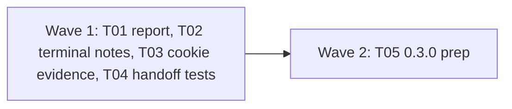

# Plan for 0.3.0

This is the checklist for `0.3.0`. The goal is a release the maintainer can use as the go/no-go gate before publishing a web and a server GTM workspace together, and whose report can be shown to people outside the team. So 0.3.0 gets only correctness bugs and report text that would mislead a reader. Everything else is in the `0.4.0` milestone (see `docs/plan-0.4.md`).

Each item is one small PR. A PR is done when its acceptance test passes in CI, an adversarial review reports no blockers or majors, and it is squash-merged to main. The target is `0.3.0`, published on `latest` by the maintainer.

## What the rc.2 field test found

| Finding | Issue | What was wrong |
| --- | --- | --- |
| The suite verdict said "4 failed expectations" for a run whose only failure was the accepted `sandboxPageUrl` check. | #511 | A reader sees accepted built-in checks as failed rules, and the verdict does not name them. |
| "meta send hits" | #505 | Plural verb for one vendor. |
| Vendor keys (`ga4`, `sgtm`) in the verdict and timelines. | #512 | Readers outside the team do not know the keys. |
| The suite report title is `Suite suite_...`. | #513 | The title says nothing a reader can use. |
| A passing `mustNot` on a plain name that exists only nested printed `PASS` with no hint. | #510 | The `nestedNameOnly` note is in the record and the report, not in the terminal. |

Found while checking the issues against the code:

| Finding | Issue | What is wrong |
| --- | --- | --- |
| A rejected `Set-Cookie` for a cookie that was already there reads "stored by the browser". | #470 | `storedState` in `packages/expect/src/evaluate.ts` never looks at the checkpoints before the response. |
| The stale not-waiting answer that hid the Done pill is fixed on main, but no test fails when the fix is undone. | #500, #501 | The e2e waits 1500 ms before it checks. |

## Scope

In `0.3.0`:

| Group | Issues | Size |
| --- | --- | --- |
| Report verdict, names and title | #511, #505, #512, #513, #497, #503 | M |
| Terminal notes | #510 | S |
| Cookie storage evidence | #470, #485 | S |
| Handoff regression tests | #500, #501 | S |
| Release prep | #466, plus the #180 known-limitation text | S |

Not in `0.3.0`:

| Issue | Why it waits |
| --- | --- |
| #180 recorder misses a redirect hop | Real, but rare: 4 misses in 30 live-mode probe runs, none seen in about 220 CI runs of the stub-mode redirect tests. The root cause is unknown and needs a bisect. 0.3.0 states it as a known limitation. Fix in 0.4.0. |
| #144 release setup | rc.1 and rc.2 shipped with the current flow. 0.3.0 can too. |
| #256, #261, #323 | Labels and a warning flag only. None changes a verdict or the exit code. |
| Everything else | See `docs/plan-0.4.md`. |

## Order and waves

Four independent PRs, then the version. One-line summary: the four fixes touch different files and run in parallel; T05 writes the final CHANGELOG and sets the version.

## Rules for every PR

The rules in `AGENTS.md`, `docs/plan-0.3.md` and `docs/plan-0.3-rc.2.md` still hold. In short: fake IDs and fake identities only; names and counts only in records, messages, the report and `suite.json`; the report runs no script and loads nothing; payments and log-ins on a hosted site stay `handoff` steps; e2e tests only against `fixtures/site` in `stub` mode; context-level hooks, no CDP, no new browser flags; no record schema bump (`recordSchemaVersion` stays 2).

More for 0.3.0:

- **Each PR adds a regression test** that fails when the fix is removed. The PR description says how it checked.
- **New e2e tests go in new files.** The one named exception is T01, which tightens the two loose verdict assertions in `e2e/suite-cells.e2e.test.ts` (#503) and updates the timeline row-header regexes in `e2e/report.e2e.test.ts` and `e2e/report-marks.e2e.test.ts` for the `Name (key)` headers (#512).
- **CHANGELOG.** This plan PR adds the `## 0.3.0` heading with one marker per PR, each pair separated by a blank line, as in rc.2. Each PR replaces only its own marker. T05 removes leftover markers.
- **Docs.** Each PR edits only its own section of `docs/cli.md`, named in its Touches line.

## PRs

### Wave 1

**T01 Report verdict, vendor names and title (#511, #505, #512, #513, #497, #503).** Touches: `packages/cli/src/report/verdict.ts`, `packages/cli/src/report/suite.ts`, `packages/cli/src/report/render.ts`, a new `packages/cli/src/report/names.ts`, their unit tests, `e2e/suite-cells.e2e.test.ts` (the two verdict assertions only), `e2e/report.e2e.test.ts` and `e2e/report-marks.e2e.test.ts` (the row-header regexes only), a new `e2e/report-verdict.e2e.test.ts` with scenarios under `e2e/scenarios/` or a suite under `e2e/suites/`, `docs/cli.md` (the `report` section), `CHANGELOG.md` (the T01 marker).
- **#511.** `addFindings` counts every failed result, rule or built-in check, as one "failed expectation". Split the count: every result except `kind: 'builtin'` (`must`, `mustNot` and unreadable rules) is counted as a rule, the same way the suite cell does in `packages/cli/src/suite.ts`, and built-in checks are named, with the number of runs they failed or warned in. Example for a suite variant: `no leaks; built-in check sandboxPageUrl failed in 4 runs`. Example with a rule: `no leaks; 1 rule failed; built-in check sandboxPageUrl failed in 4 runs`. The same split applies to warnings and to the single-run verdict. `deniedIdentifiers` is not counted again when the identifiers sentence already says which vendors received identifiers. The `no leaks` test in `report/suite.ts` keeps working. Existing unit tests that pin the old row headers or verdict strings (`render.test.ts`, `suite.test.ts`) are updated.
- **#505.** One vendor takes `sends`, more take `send`.
- **#512.** A `VENDOR_NAMES` map in `names.ts`: `ga4` Google Analytics 4, `google-ads` Google Ads, `meta` Meta, `pinterest` Pinterest, `sgtm` server container, `linkedin` LinkedIn, `microsoft-uet` Microsoft UET, `reddit` Reddit, and every other built-in vendor key the decoders define. A key with no entry (a `--tracker-list` vendor) prints as the key. The verdict uses the plain name. Timeline and fields row headers use `Name (key)`. Lists sort by display name. Expectation text keeps the keys, because that is scenario syntax. A unit test checks every key in `vendorKeys` and the tracker list has an entry, so a new decoder cannot be added without a name.
- **#513.** The suite report title and `<title>`: `Pingwright suite: published vs workspace on shop.example.com, 2026-10-31`, from the manifest's variants, the site host and the date of `startedAt`. The single-run report: `Pingwright run: <scenario name> on <host>, <date>`. The suite ID moves into the definition list. All parts are HTML-escaped. No `--title` flag in 0.3.0.
- **#497.** The marks legend for `unchecked` also names identifier names whose consent signal is unknown.
- **#503.** The verdict assertions in `e2e/suite-cells.e2e.test.ts` match exact lines, not `[^<]*` fragments.
Regression test: unit tests for the sentence builder (rules only with a failing `must` and a failing `mustNot`, checks only, both, warnings, one vendor, two vendors, `deniedIdentifiers` named once, an unknown vendor key). The new e2e runs a suite against the fixture's sandboxed-pixel page with no `builtins` override, so `sandboxPageUrl` fails in every run, and asserts the verdict line names `sandboxPageUrl` and does not contain `failed expectation`. It also asserts a plain vendor name in the verdict and the readable `<title>`. The leak test asserts the fake email and its hash appear nowhere in the HTML.
Acceptance: `pnpm test` and `pnpm e2e` pass. The new e2e fails on the old `addFindings` (it prints `failed expectations`).

**T02 Notes on passing results in the terminal (#510).** Touches: `packages/cli/src/summary.ts`, `packages/cli/src/summary.test.ts`, a new `e2e/terminal-notes.e2e.test.ts`, `docs/cli.md` (the run summary section), `CHANGELOG.md` (the T02 marker).
- `Summary.results` carries `note`. The text summary prints the fixed note text from `NOTE_TEXT` (imported from `packages/cli/src/report/model.ts`, not edited) on the line under the result, for passing and failing results. `--json` gets an optional `note` field on each result. It holds the note code only, never a value.
- Field names that the note text quotes come from the record's message, which already passed `guardFieldName`.
Regression test: a summary unit test for a passing result with `nestedNameOnly` and one with `stubNoCookies`. The e2e runs the existing `e2e/scenarios/leaf-nested-plain.yml` and asserts the note text is under the `PASS` line and that `--json` has `note: nestedNameOnly`.
Acceptance: the e2e fails on the old summary, which prints `PASS` with no note.

**T03 Cookie storage evidence when the cookie was already there (#470, #485).** Touches: `packages/expect/src/evaluate.ts` (`storedState`, `storageText` and the comment), `packages/expect/src/cookie-rules.test.ts`, `fixtures/site/src/index.ts`, `fixtures/site/README.md`, `fixtures/site/public/` (one new page), a new `e2e/cookie-already-set.e2e.test.ts` and its scenario, `docs/cli.md` (the cookie rule section), `CHANGELOG.md` (the T03 marker).
- **#470.** `storedState` also reads the checkpoints taken before the request. When one of them already has a same-named cookie on a matching domain, the message says `the cookie was already set before this response`, with no storage claim and no `cookieNotStored` note. In every other case the text is as today: `stored by the browser` when a later checkpoint has the cookie, `no later checkpoint has it` when later checkpoints lack it, and no claim when there is no later checkpoint. So a cookie set on the first page load, which has no earlier checkpoint, still reads `stored by the browser`, and `e2e/stored-cookie-evidence.e2e.test.ts` and `e2e/scenarios/cookie-stored.yml` are not changed.
- **#485.** The record has no response time and 0.3.0 adds none (no schema bump). The docs wording is already fixed. What is left is the margin: `storedState` ignores checkpoints taken within a stated margin after the request time, so a checkpoint that ran while the response was still arriving does not count as evidence. Name the margin as a constant. Fix the comment that says "after the response" to say "after the request".
- The rule still fails on the attempt. Counts stay request counts.
- New fixture page `/set-cookie-already`: page JS sets a first-party cookie with a fake value, a checkpoint can run, then the page requests the always-rejected endpoint from `/set-cookie-unstored` for a cookie with the same name.
Regression test: unit tests for the cases above, plus a checkpoint inside the margin that has the cookie and is ignored. The e2e runs the new page and asserts the message does not say `stored by the browser`. The leak test asserts the fake cookie value appears in no message, note or report.
Acceptance: the e2e fails on the old `storedState`, which says `stored by the browser`.

**T04 Handoff polling regression tests (#500, #501).** Touches: `packages/recorder/test/e2e/handoff-polling.e2e.test.ts`, `packages/recorder/src/handoff-overlay.test.ts`. Test only. No CHANGELOG line.
- #500: after the first handoff is released and the second begins, sample the pill count every 20 ms for 400 ms and assert it never drops to 0. Or, in the vm harness, give the fake host a `parentNode` that `append` sets and `remove` clears, and assert a stale `not waiting` answer does not call `remove`. Use whichever fails reliably when the `began !== generation` guard is moved below `hide()`.
- #501: record the state-call count before `clickDone` in the first handoff, wait one second, and assert it rose.
Acceptance: both new assertions fail when the guard in `packages/recorder/src/handoff-overlay.ts` is moved below `hide()` or polling is disabled during the first handoff. The PR description says how this was checked.

### Wave 2

**T05 0.3.0 prep.** Touches: the root `package.json` version (the workspace packages are private at `0.0.0` and stay), `packages/cli/src/summary.test.ts` (the `readVersion` expectation), `CHANGELOG.md`, `README.md`, `docs/guide/first-run.md`, `docs/cli.md` (the Install section), `docs/design.md` (the status line and §15 item 3), `.vitepress/theme/GetStartedPrompt.vue`, `docs/release.md`, the docs text test if it pins the install line.
- Version `0.3.0`.
- `## 0.3.0` summarises 0.3.0-rc.1, rc.2 and the T01 to T03 changes for someone upgrading from 0.2.0. Leftover markers are removed.
- `### Known in 0.3.0` lists the issues still open that a user can meet, in plain words. It includes #180 with this text: under the recorder, Playwright sometimes does not report a redirect response or the cross-origin request after it (4 of 30 runs in a live-mode probe; not seen in about 220 CI runs of the stub-mode redirect tests). A hit or cookie reached only through such a hop can be missing from the record, so a `mustNot` rule or a before-consent check can pass without seeing it, and in `stub` mode the hop can reach the network with no `stubBypass` flag. `--net-log` in live mode recovers the request. It also corrects the rc.2 wording for #256 and #323 (only requests inside a navigation window are labelled `unload`) and #261 (the alias table exists; two gaps remain).
- #466: `README.md`, `docs/guide/first-run.md`, the Install section of `docs/cli.md` and the get-started prompt say `npm i -g pingwright` installs 0.3.0. The `pingwright@next` notes go. `docs/design.md` says release `0.3.0`, not `0.3.0-rc.2`.
- `docs/release.md`: a plain `npm publish` moves `latest`; release candidates use `--tag next`.
Acceptance: `pnpm lint`, `pnpm typecheck`, `pnpm test`, `pnpm e2e`, `pnpm docs:build` and `pnpm docs:test` pass. `pingwright --version` from a packed tarball prints `0.3.0`.

## After the PRs

The maintainer's session runs `scripts/release.sh 0.3.0`, pushes the tag, installs from the tag and runs the fixture smoke test. The maintainer publishes with `npm publish` (it moves `latest` to 0.3.0). No GitHub release without the maintainer's say-so.

## Issues to close (maintainer decides)

These are open but need no code. Each is listed with the reason. Nothing is closed before the maintainer says yes.

| Issue | Reason |
| --- | --- |
| #465, #467, #468, #469, #471, #472, #473, #474 | Plan-document nits on `docs/plan-0.3-rc.2.md`. Every entry they refer to is merged (#477, #482, #484, #487, #491, #494, #499, #502, #508, #509), and the code matches or the nit was already handled. |
| #404, #504, #486 | Process notes on merged PRs (#406, #508, #509). No code to change. |
| #398 | Fixed by #447 and #494. The e2e in `packages/recorder/test/e2e/handoff-overlay.e2e.test.ts` runs the attack from the issue. |
| #492 | Fixed by #494: the label goes through a captured `String`. |
| #323 | What is left is the same as #256. Close as a duplicate. |

#466 closes with T05. #500 and #501 close with T04.
