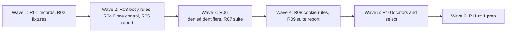
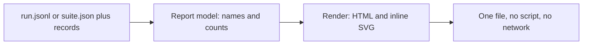

# Plan for milestone 0.3

This is the checklist for 0.3. The scope comes from the field tests of 0.2 on a real Shopify store, filed as enhancement issues #350 to #362. Each item is one small PR. A PR is done when its acceptance test passes in CI, an adversarial review reports no blockers or majors, and it is squash-merged to main. The target is `0.3.0-rc.1`.

## The question 0.3 answers

> A data tag, a cookie or an identifier leaked before consent, and no rule could say so. Make Pingwright able to say it in one line, run a whole set of scenarios against several container builds in one command, and show the result to people who do not read JSONL.

## What the field test found

| Finding | Issue | What was missing |
| --- | --- | --- |
| A data tag forwarded the whole dataLayer (checkout email, phone, address and cookies) while consent was denied. | #350 | No rule reads the fields of a hit. |
| A server container may set a client-ID cookie before consent. | #351 | Cookie names are recorded, but no rule uses them. |
| `user_id`, `uid`, `external_id`, hashed `user_data.*` and client-ID hashes went out on denied hits. | #352 | `ids.user_id` covers GA4 User-ID only. |
| Every field test needed a shell script to run scenarios against the published container and a workspace, then diff by hand. | #353 | No suite command. |
| Legal and marketing could not read the result. | #354 | No report. |
| A theme change broke every scenario with a 30 s timeout. A `fill` on a select did nothing. People finished a handoff in the browser and then went back to the terminal. | #355, #356, #357 | Scenario ergonomics. |

## Scope

In 0.3.0:

| Priority | Issue | PR | Decision |
| --- | --- | --- | --- |
| 1 | #350 `body.has` and `body.only` | R03 | In. |
| 1 | #351 cookie rules and Set-Cookie names | R08 | In. Includes a minimal `server` network mode (see the flagged concerns). |
| 1 | #352 `deniedIdentifiers` built-in check | R06 | In. |
| 1 | #353 `suite` command | R07 | In. |
| 1 | #354 HTML report | R05, R09 | In. Built in two steps: one run first, then suites. |
| 2 | #355 robust locators | R10 | In. |
| 2 | #356 `select` step | R10 | In. |
| 2 | #357 visible Done control | R04 | In. |

Moved to 0.4:

| Issue | Why it waits |
| --- | --- |
| #358 server-container visibility | Options 1 and 2 need the tag-firing reporter (design §8.1, §8.3). It is not built, and it needs a Community Template Gallery publication with its own review time. Option 3 reads sGTM preview data with a preview token. That token is a secret like `gtmAuth`, and the preview data format is not documented as an API. Both need a design pass of their own. 0.3 only adds `serverHosts` (R08), which makes server-set cookies visible. |
| #359 baselines | The baseline stores the hit shape, so it should use the `Hit.fields` names that R01 introduces. Count tolerance needs real run data from the 0.3 field runs. `suite` plus `diff` already cover drift between two builds. A baseline covers drift over time, and nobody asked for that in the field test. |
| #360 multi-store runs | `suite` gets a variant axis in R07. A store axis is a second axis on the same table and the same manifest. It needs the `vars` per store design and field data from a second market. R07 keeps the manifest generic so the axis can be added without a format change. |
| #361 WebKit | Needs a probe first. The design rests on `context.route` reaching the collector origin from sandboxed iframes, workers and unload, and that was only probed on Chromium 156. The Playwright WebKit build is not Safari, and nobody has shown that it applies ITP cookie caps. Without that, a cookie-lifetime report could mislead. See the table of what WebKit would need below. |
| #362 MCP server | Adds a dependency (`@modelcontextprotocol/sdk`) and a long-lived surface that an agent controls. Inline YAML means an agent chooses the site, so the handoff and loopback rules must be enforced inside the server, and a handoff has no human at stdin. It should be shaped by the `suite` summary (R07) and the report model (R05) after they have been used in the field. |

What WebKit would need, for the 0.4 probe PR:

| Area | Needed |
| --- | --- |
| Launch | `webkit.launch()` with no flags. A normal Safari-like user agent, never an automation marker. |
| Capture | Context hooks only. Probe `context.route` for the collector origin from fetch, `sendBeacon`, dedicated workers, sandboxed `srcdoc` and cross-site iframes. Service-worker capture is Chromium only, so the coverage record says so. |
| Net log | Not available. `--net-log` is refused with `--browser webkit`. |
| Consent | Check that autoconsent (unmodified) runs. |
| ITP | Show that the Playwright build caps script-set cookies. If not, say so in the docs and do not ship a lifetime report. |
| Rules | New browser name in `Run.browser`. Some rules that depend on unload capture become "cannot evaluate". |

## Order and waves



The waves run left to right. PRs in one wave touch different files, so they can be built in parallel.

Why this order:

- R01 and R02 come first because every rule needs the new record fields and a fixture page that leaks on purpose.
- The three rule PRs (R03, R06, R08) all change `packages/expect/src/scenario.ts` and `evaluate.ts`. They are in separate waves, so they do not collide. R10 changes `scenario.ts` too, so it is also on its own.
- `body.has` (R03) goes first because it is the biggest field-test leak and `deniedIdentifiers` reuses its field names.
- R05 reads only the records, so it does not wait for the new rules. It shows rule results as they are.
- R09 waits for R07 (the suite manifest) and R06 (the leak status).

## Package layout

No new packages:

- **Record fields:** `packages/core`.
- **Field names:** `packages/decoders`.
- **Rules and built-in check:** `packages/expect`.
- **`suite`, `report`, flags:** `packages/cli`. The report lives in `packages/cli/src/report/`.
- **Handoff overlay, locators, `select`, `server` mode:** `packages/recorder`.

No new dependency. The report is built with template strings and hand-written SVG. No script runs in it.

## Rules for every PR

The 0.1 and 0.2 rules still hold (docs/plan-0.1.md, docs/plan-0.2.md, AGENTS.md):

- fake IDs only: GA4 `G-PWTEST0001`, Google Ads `AW-000000001`, Meta `100000000000001`, GTM `GTM-PWTEST1` and `GTM-PWNOVER`, hosts under `.invalid` or `example.com`;
- context-level hooks only, a normal Chrome user agent, no browser flags in the default launch;
- e2e tests against `fixtures/site` in `stub` mode (R08 adds one `server` mode test against the fixture's loopback server host, still on this machine);
- payments and log-ins are handoff steps on any non-loopback host;
- Pingwright never calls the GTM API and runs no service;
- the `gtmAuth` value never appears in a record, a log line, an error message or test output.

More for 0.3:

- **Names and counts only, for what 0.3 adds.** No cookie value, no identity value (plain or hashed) and no `gtmAuth` appears in `Hit.fields`, `Hit.idFields`, a rule or check message, the terminal summary, `suite.json` or the HTML report. Evidence is request, hit and result IDs and field names. Older record fields still hold values: `Request.url`, `Request.postData` and `Hit.params` (for example the hashed email that the Meta and server decoders copy into `params` for `identity.hashesMatch`). 0.3 does not change them. See concern 22.
- **Field names are data too.** A data tag can use a value as a JSON key. The guard checks each dotted segment of a name. A segment is stored as `(other)` when it is over 64 characters, has characters outside `A-Z a-z 0-9 _ [ ] -`, is hex of 32 or more characters, is a digest-shaped token of 22 or more base64url characters that mixes upper case, lower case and a digit (a snake_case name such as `usernest_tracking_mode` or `customer_accepts_marketing` is kept), is six or more digits, or contains `@`. This keeps hashes, phone numbers, customer numbers and emails out of `fields`, the messages and the report.
- **Each PR names its leak test.** A test feeds a fake email (`pw-fixture@example.com`), its SHA-256 and a fake cookie value through the feature, and asserts none of them appears in what that PR adds (see the names rule above).
- **Each rule PR proves its e2e fails when the feature is broken.** The PR description says how it checked.
- **New fixture pages only.** Existing fixture pages and e2e tests do not change. One named exception: R06 adds `builtins: { deniedIdentifiers: warn }` to the R03 `/sgtm-leak` scenario, because that page sends a client-ID hash while consent is denied.

## Record changes

`recordSchemaVersion` goes from 1 to 2.

Why. Version 2 adds `Hit.fields` and `Hit.idFields`. A version 1 record has no such fields. A reader must be able to tell "this hit had no extra fields" from "field names were not recorded". Without the bump, `body.only` and `deniedIdentifiers` would pass without checking anything on an old record. Rules run when a record is written, so 0.3 does not re-evaluate old records. The readers that matter are `report` and `diff`, and they print "not recorded" for version 1 records. The reader code from Q01 already warns on a newer version.

| Change | Where | Used by |
| --- | --- | --- |
| `Hit.fields?: string[]` | `packages/core` records, filled by the decoders | #350, #352 |
| `Hit.idFields?: string[]` | same | #352, #354 |
| `Checkpoint.t: number` | `packages/core`, set where checkpoints are created | #351 |
| `Result.note?: 'stubNoCookies' \| 'cannotEvaluateBody' \| 'fieldsNotRecorded'` | `packages/core`, set by the evaluator (R03, R06, R08) | #350, #351, #352, #354 |
| `Run.variant?: string` | `packages/core`, set by `suite` | #353, #354 |
| `suite.json` manifest, with its own `suiteSchemaVersion: 1` | written by `suite`, not a JSONL record | #353, #354 |

No new record type. `Response.setCookieNames` already exists.

### `Hit.fields`

The sorted, unique names of non-empty fields in the decoded payload of that one hit. The payload is the query string that the request shares, the body (JSON or form-encoded) and the decoded `dtdc` object. For a GA4 request with a batched body, each line is its own hit. Its `fields` are the shared query fields plus that line's own fields.

- Nested names use dots: `user_data.email_address`. Array items collapse to `[]`: `items[].price`.
- A field is non-empty when its value is not `""`, `null`, `undefined`, `[]` or `{}`.
- Values are never stored.
- A field that only one line of a batched GA4 body has is never put on the other lines' hits.

### `Hit.fieldsComplete`

`false` when the decoder could not see the whole payload: the body was cut at the 64 KiB `postData` cap, a JSON body failed to parse, or the body is `null` because the request was captured from the net log. `true` otherwise. It is undefined on version 1 records. A rule or check that reads `fields` from a hit with `fieldsComplete: false` reports `cannot evaluate: body not fully recorded` and never passes. A body is cut when `postData.length >= MAX_POST_DATA`. The recorder slices to that cap, so a body of exactly the cap length counts as cut. R01 moves `MAX_POST_DATA` from `packages/recorder` to `packages/core`, which the decoders can import (recorder depends on decoders, not the reverse). `Request` gets no new field. A `/data` POST whose body was cut cannot pass the JSON signature test in `sgtm-data-client`, so R01 also makes that decoder match a `/data` POST on a body that starts with `{` and is cut, and gives it a hit with `fieldsComplete: false` and no fields. Without this, a cut body would make no hit, would pass through unstubbed, and a `mustNot body.has` would select nothing and pass. This matters most for the case the field test found, a data tag that forwards the whole dataLayer and every cookie, which is the body most likely to pass the cap.

### `Hit.idFields`

The subset of `fields` that the decoder takes to be an identifier:

- a name on the decoder's identifier list (table in the R06 entry), or
- a field whose value is 64 hex characters, under any name, or
- a field under a listed identity key (`ud[*]`, `user_data.*`, `em`, `ph`, the client-ID hash names) whose value is a base64 or base64url digest.

The check happens in the decoder. Only the name is stored. This is the same split as `possibleRealData` (design §13): a base64 digest under another key cannot be told from a 43-character slug, token or event ID, so it is not flagged.

## Design notes

### #350 `body.has` and `body.only`

Scenario schema. Two new keys on an expectation entry, next to `vendor`, `event`, `ids`, `params`:

```yaml
expect:
  mustNot:
    - { vendor: sgtm, body.has: [email, phone, "user_data.*", clientIdHash], in: epoch(denied) }
  must:
    - { vendor: sgtm, event: page_viewed, body.only: [event_name, page_location, page_title, page_referrer] }
```

- `body.has` is a list of names. The filter matches a hit that has any listed name in `Hit.fields`. A name may use `*` as a glob over zero or more characters, with the shared `globToRegExp` helper in `packages/core` (R01 moves it there from `packages/recorder/src/flags.ts`, where `unloadGapIgnore` uses it), so `cookie*` matches `cookie`.
- `body.only` is an allowlist. See the semantics below.
- Both read the decoded payload (query, body and `dtdc`), not only the body. The key keeps the name the issue asked for. See the flagged concerns.
- Default ignore list for `body.only`: transport fields that every hit of that vendor carries. GA4: `v`, `tid`, `gtm`, `_p`, `_s`, `sid`, `sct`, `seg`, `dl`, `dr`, `dt`, `en`, `cid`, `ul`, `sr`, `_eu`, `_et`, `gcs`, `gcd`, `npa`, `dma`, `are`, `frm`, `pscdl`, `tfd`, `ec`. Meta: `id`, `ev`, `dl`, `rl`, `if`, `ts`, `sw`, `sh`, `v`, `r`, `ec`, `o`, `fbp`, `it`, `coo`, `rqm`. The server-container data client: `v`, `tid`, `event`, `en`, `dtdc`. The lists live in the decoders and are documented. `body.only` can add to them with `body.ignore: [names]`.
- Without `body.only` or `body.has` nothing changes. A rule with neither key never reads `Hit.fields`.

Semantics of `body.only`. A `must` entry normally passes when at least one hit matches. With `body.only` in the filter, that is wrong: one clean hit would hide a leaking one. So `body.only` is not part of the match. The other keys select the hits. Then:

- if no hit is selected, a `must` fails as usual;
- if any selected hit has a field outside the list, the entry fails, in `must` and in `mustNot`;
- a `mustNot` with `body.only` fails when a selected hit has an outside field.

Evidence. The hit IDs, and the offending field names in the message: `hit_x has fields outside body.only: email, phone (2 of 14)`.

CLI flags. None.

Record changes. `Hit.fields`.

### #351 cookie rules

Scenario schema. A new key `cookie` on an entry. It stands alone: it cannot be mixed with `vendor`, `event` or `body.*` in the same entry (a scenario error says so).

```yaml
expect:
  mustNot:
    - { cookie: _dcid, before: consent }
    - { cookie: "_ga*", in: epoch(denied) }
  must:
    - { cookie: pw_consent, after: consent }
```

- `cookie` is a name or a glob (`*` matches zero or more characters, the same `packages/core` helper as `body.has`, so `_ga*` matches `_ga` and `_ga_PWTEST`). A list is allowed.
- `before: consent`, `after: consent`, `in: epoch(...)` and `after: <step label>` work as on hit rules. For a cookie set by a response, the time is the request time. For a cookie seen at a checkpoint, the time is `Checkpoint.t`.
- Two sources of evidence:
  1. `Response.setCookieNames` on any response. Evidence is the request ID and so shows which request set the cookie. This already exists, for all hosts, for passed requests.
  2. `Checkpoint.cookies`, for cookies set by scripts (`document.cookie`). A checkpoint can only say "present at this time", not when it was set. A rule that finds a cookie on a checkpoint says so in the message.
- Cookie values are never read for the rule. `CheckpointCookie` has no value field.

Stub-mode limit. A stubbed endpoint sets no cookies. Responses to stubbed requests record `setCookieNames: []`. So in `stub` mode the rule sees only cookies from requests that pass (first-party pages, scripts) and from scripts. When a `cookie` rule passes in `stub` mode, the message ends with `stub mode: stubbed endpoints set no cookies`. To test a server container for real, use `--network server` (below) or `live`.

`server` network mode. The design lists `server` (§5.3), and the CLI refuses it today. R08 builds the smallest version: `options.serverHosts: [host or *.domain]`. It is `stub` plus passing through requests to those hosts. Loopback fixture hosts are allowed. A hosted host is allowed only with `serverHosts` set by the user. It prints a warning on stderr, like `live`. Without `serverHosts`, `--network server` exits 2 with a message that says what to set. No tag-firing reporter, no preview header.

Record changes. `Checkpoint.t`. Nothing else.

### #352 `deniedIdentifiers`

A built-in check, in the same list as `unknownDestination`, `sandboxPageUrl` and `possibleRealData`. `BUILTIN_NAMES` gets a fourth name. It respects `options.builtins` severity (`fail` or `warn`). Default severity is `fail`, like the others. See the flagged concerns about turning on a new failing check.

What it flags. A hit that has a field in `Hit.idFields` while the consent signal for that field class is `denied`. "Denied" is the hit's own consent state when it is known, and the epoch's state when the hit's state is `unknown`. `unknown` in both is not flagged.

| Class | Names (exact, or glob) | Signal that must not be denied |
| --- | --- | --- |
| Analytics id | `user_id`, `uid`, `up.user_id`, any other field with a 64-hex value | `analytics` |
| Ads identity | `external_id`, `ud`, `ud[*]`, `user_data`, `user_data.*`, `em`, `ph`, `hashed_email`, `customer_hashed`, `cookieData` | `adUserData`, or `ads` for vendors that have no `adUserData` (Meta) |
| Client-ID hash | `clientIdHash`, `client_id_hash`, `cid_hash` | `analytics` |

Not flagged on purpose: `cid`, `client_id`, `_ga`, `fbp`, `fbc`, `gclid`. GA4's cookieless pings carry a random `cid`, and the click IDs are the subject of other rules. A user can add names with `options.identifierFields: [names or globs]`, matched against `Hit.fields`, with the analytics class.

The decoders fill `idFields` from these lists. The lists live in `packages/decoders/src/identifiers.ts`. The check in `packages/expect` reads only the record.

Evidence. Hit IDs. Message: `3 hits carry identifiers while consent is denied: sgtm user_data.email_address (adUserData denied), ga4 uid (analytics denied)`. Names and counts only.

CLI flags. None.

Record changes. `Hit.idFields`. `Result` for the check follows `builtin: deniedIdentifiers`.

Relation to `possibleRealData`. That check asks "is this hash a hash of something that is not my run identity?" This one asks "should an identifier be here at all?" Both can report the same hit. Neither replaces the other.

### #353 `suite`

```
pingwright suite <dir> --site <url> [--variant published] [--variant workspace=override.json]
                 [--out runs/] [--with-handoff] [--json] [--network stub|live|server]
                 [--var k=v] [--seed n] [--tracker-list file] [--autoconsent-rules file]
```

- `<dir>` is scanned, not recursively, for `*.yml` and `*.yaml`. Every file is parsed first. If any file is an invalid scenario, the command exits 2 before a browser opens, and lists each problem.
- `--variant` can repeat. `published` is a reserved name for "no override". `name=file` is an override file in the `--gtm-override` format. With no `--variant`, the suite runs `published` only. A variant name matches `^[a-z0-9][a-z0-9_-]*$`. Only the name goes into the record and the manifest, never the file path.
- Every scenario runs once per variant, one after another, one browser at a time. No parallel jobs in 0.3. All variants of a scenario use the same seed, so runs repeat and the identity hashes are equal for `identity.hashesMatch`. The diff compares consent and ID presence, not values, so it does not depend on the seed.
- A scenario with a `handoff` step is skipped with the status `skipped`, unless `--with-handoff` is given. Then it runs headed, and the person answers. Skipped is not a failure.
- Output goes to `<out>/suite_<id>/`:
  - `<scenario>.<variant>.jsonl`, one record per run, with `Run.variant` set;
  - `suite.json`, the manifest.
- After all runs, for each scenario with two or more variants, the suite runs the `diff` engine of the first variant against each other one. The diff uses the same options as the `diff` command defaults. The manifest keeps a count summary per pair: hits added, removed, changed, flag counts changed.
- The table, printed on stdout:

```
scenario        published   workspace   diff (published -> workspace)
checkout        PASS        FAIL        +1 added, 1 changed
consent-reject  PASS        PASS        no change
checkout-pay    SKIPPED     SKIPPED
```

  Each row has the record paths below the table.
- The exit code is the worst result. Order, worst first: 2 (a run failed, or a usage error), 1 (an expectation or built-in check failed), 0. A diff never changes the exit code. A `skipped` scenario counts as 0.
- `--json` prints the manifest on stdout.
- A run that exits 2 (for example, banner not shown) does not stop the suite. Its row says `ERROR` with the message. The other scenarios still run.

Manifest, `suite.json` (`suiteSchemaVersion: 1`):

```json
{
  "suiteSchemaVersion": 1,
  "id": "suite_...",
  "startedAt": 0,
  "site": "https://shop.example.com",
  "variants": ["published", "workspace"],
  "cells": [
    { "scenario": "checkout", "variant": "published", "labels": {}, "status": "pass", "exitCode": 0, "record": "checkout.published.jsonl" }
  ],
  "diffs": [
    { "scenario": "checkout", "from": "published", "to": "workspace", "added": 1, "removed": 0, "changed": 1, "flagsChanged": 0 }
  ],
  "exitCode": 1
}
```

`labels` is empty in 0.3. It is where the 0.4 store axis goes (#360). The manifest holds no URL paths, no query values, no override file path and no message text from runs.

Record changes. `Run.variant`. The manifest is a new file kind.

Implementation note. `suite` calls the same run function as `run`. It does not shell out. The override file is read once per variant and handed over in memory.

### #354 HTML report

```
pingwright report <run.jsonl | suite dir> --html out.html
```

`--html` is required in 0.3. It is a flag so a later `--md` or `--json` fits.



The report model is built from the records. The renderer sees only the model. This is the one place a leak could enter, so the model type has no value fields.

Contents:

1. **Header.** Scenario name, variant, run ID, date, network mode, host of the site (no path, no query), Pingwright version, record schema version.
2. **Timeline per vendor.** One row per vendor, one segment per consent epoch (`undecided`, `granted`, `denied`, `withdrawn`, `mixed`). A hit's state is its own consent state, or the epoch's state when its own is `unknown`. Each segment has one mark:
   - `full`: hits whose state is granted;
   - `ping`: hits whose state is denied and that have no `idFields`. It ignores `ids.client_id` and the other names that R06 leaves alone on purpose (`cid`, `fbp`, click IDs), because a GA4 cookieless ping carries a random `cid`;
   - `nothing`: no hit;
   - `leak`: a hit that `deniedIdentifiers` flags, or a hit named in the evidence of a failed `mustNot`. The model uses the class-to-signal function from `packages/decoders/src/identifiers.ts` (R01), the same one R06 uses. A `user_id` hit with only ads denied is not a leak, in the report or in the check.

   A segment with hits of several kinds takes the worst mark: `leak`, then `mixed`, then `full`, then `ping`. `leak` always wins, so a segment with one leaking hit and one granted hit shows `leak`. A segment that holds both granted and denied hits but no leak (a `mixed` epoch label, or hits of both states) gets the mark `mixed` and the label "granted and denied hits". A hit with a state of `unknown` in an `undecided` epoch counts as `full` with the label "before an answer". The mark has a text label next to the colour, so it reads without colour. A hit count sits in each segment.
3. **Expectations.** Each `Result` with PASS, WARN or FAIL, the expectation text as written in the scenario, the evidence IDs (up to five and a count) and the severity. The result `message` is not shown, because a message could carry a value. Instead, `Result.note` (a value-free code) is rendered as a fixed string: `stubNoCookies` as "stub mode: stubbed endpoints set no cookies, so this pass says nothing about server cookies", `cannotEvaluateBody` as "cannot evaluate: body not fully recorded", `fieldsNotRecorded` as "cannot evaluate: field names not recorded". A result with a note shows it next to the status, and a cannot-evaluate result shows as "cannot evaluate", not as a plain FAIL.
4. **Flags.** Kind, count, hosts.
5. **Diff, for a suite.** Per scenario and variant pair: added, removed and changed hits per epoch, vendor and event, from the same engine as `diff`. Names and counts.
6. **Fields.** For each vendor, the field names seen in the denied epoch, from `Hit.fields`. Names only. On a version 1 record the section says `not recorded (record schema version 1)`.

Never shown: request URLs, query values, bodies, page URLs or paths, cookie values, `ids` values, hashes, identity values, `Result.message` (only the fixed note strings above), `DataLayerEvent.args`, step error text.

Self-contained and offline:

- No `<script>`, no `<link>`, no ``, no `@import`, no `url()`, no web font. One inline `<style>`. SVG is inline.
- A `<meta http-equiv="Content-Security-Policy" content="default-src 'none'; style-src 'unsafe-inline'">` makes a browser enforce it.
- Every string from the records (event names, step labels, scenario text, vendor keys, field names) is HTML-escaped. A scenario file is untrusted input, and the file opens from disk.
- The page works at phone width and in light and dark mode through `prefers-color-scheme`.

CLI flags. `--html <file>`. The command opens no browser and reads no network.

Record changes. None beyond R01.

### What the report test checks

A unit test renders a run record whose request bodies, hit params and cookie list contain the fake email, its SHA-256, a fake cookie value and the redacted `gtmAuth` marker. The record also has a data tag field keyed by the SHA-256 and one keyed by a phone number. It asserts that none of them is in the output, that the output has no `http:` or `https:` text inside an attribute or `url()`, and that it has no `<script`. An e2e runs a scenario on the fixture and checks the report the same way.

## Smallest design that would have caught each problem

### #350: the data tag that forwarded the dataLayer

What happened. A server data tag sent the whole dataLayer, with raw email, phone, address and cookies, for visitors who had denied consent.

Smallest design. `Hit.fields` (names of non-empty fields) and the `body.has` and `body.only` keys. One line catches it:

```yaml
mustNot:
  - { vendor: sgtm, body.has: [email, phone, address, cookie*], in: epoch(denied) }
```

An allowlist under `must` catches the next, unknown field too.

Left out on purpose:

- matching on values or patterns (regular expressions over values would put values into rule messages);
- JSONPath or deep selectors;
- response bodies;
- reading the dataLayer to compare. `unloadGap` already compares events, and the field names are enough here;
- a separate "payload" record. The names live on the hit.

Cost. One new optional field on `Hit`. Two keys in the scenario schema. No flag.

### #351: the cookie set before consent

What happened. It could not be tested whether the server container sets a client-ID cookie before consent.

Smallest design. The data is mostly there: `Response.setCookieNames` is recorded on every passed response. Add `Checkpoint.t`, the `cookie` key with `before`, `after` and `in`, and a minimal `server` mode so the server container's responses are not stubbed.

Left out on purpose:

- cookie values, expiry checks and lifetime reports (those are #361);
- watching `document.cookie` writes with an injected script. Checkpoints cover script cookies at the moments a scenario chooses;
- first-party filtering. All hosts count, since third-party `Set-Cookie` names are also useful;
- any tag-firing reporter or preview header.

Cost. One new field (`Checkpoint.t`). One rule key. One option (`serverHosts`) and the `server` mode that the design already named.

### #352: identifiers on denied hits

What happened. `ids.user_id` covered GA4 User-ID only. Other identifiers went out as custom parameters, hashed `user_data.*` and client-ID hashes.

Smallest design. The decoders flag identifier-like fields into `Hit.idFields`, by a documented name list and by 64-hex values. One built-in check compares them with the consent state. It uses the severity machinery that exists.

Left out on purpose:

- matching hashes against the run identity (that is `possibleRealData`, which exists);
- flagging `cid`, `client_id`, `fbp` and click IDs;
- any value is stored. Only the name and the fact that the value looked like a hash;
- a per-vendor rule language. Extra names go in one option list.

Cost. One new optional field on `Hit`. One name in `BUILTIN_NAMES`. One option, `identifierFields`.

### #353: the hand-written shell script

What happened. Each field test needed a script to run every scenario against the published container and a workspace override, then diff.

Smallest design. `suite` calls the run function and the diff engine that exist. It adds a variant name to the run, a manifest and a table.

Left out on purpose:

- parallel runs. One browser at a time keeps output readable and avoids rate limits on a real store;
- a failure on diff. Differences between builds are expected. The expectations decide pass or fail;
- stores, baselines and retries;
- reading scenarios recursively or by glob;
- a different `--site` per variant.

Cost. One new command. Flags: `--variant`, `--with-handoff`, plus the `run` flags it passes through. One optional field on `Run`. One manifest file.

### #354: the report for people who do not read JSONL

What happened. The picture was rebuilt by hand each time.

Smallest design. One static HTML file made from the records: a timeline per vendor and epoch, the expectations, flags, and the diff. It has no script, so offline holds by construction, and a CSP meta line makes the browser enforce it.

Left out on purpose:

- any interactivity, filters or sorting (they need script);
- request-level detail, URLs, bodies and messages (values could leak);
- PDF, Markdown or JSON output;
- charts over several runs;
- editing or sharing. The user shares the file.

Cost. One new command with one flag. No new dependency. No record change beyond R01.

## PRs

### Wave 1

**R01 Record schema version 2 and hit field names.** Touches: `packages/core`, `packages/decoders`, the checkpoint creation line in `packages/recorder`, and `packages/recorder/src/flags.ts` (import only).
Exports `globToRegExp` from `packages/core` (a new `glob.ts`) and makes `packages/recorder/src/flags.ts` import it. `packages/expect` cannot import from the recorder, which depends on it, so R03 and R08 take the helper from `core`. Sets `RECORD_SCHEMA_VERSION` to 2 and updates its doc comment. Moves `MAX_POST_DATA` to `packages/core` (the recorder imports it from there). Adds the class-to-signal function to `packages/decoders/src/identifiers.ts` (R05 and R06 both use it) and the optional `Result.note` code (below). Adds `Hit.fields`, `Hit.fieldsComplete`, `Hit.idFields`, `Checkpoint.t` and `Run.variant` as optional fields. The decoders (`ga4`, `google-ads`, `meta`, `pinterest`, `sgtm-data-client`, `tracker`) fill `fields` per hit from the query, JSON and form bodies, that hit's own GA4 body line and `dtdc`, with the dot and `[]` naming, the empty-value rule and the field-name guard. They fill `idFields` from `packages/decoders/src/identifiers.ts`, which holds the name lists of the R06 table and the hash-shape check. `body.only` ignore lists are exported from each decoder. A reader that meets a version 1 record leaves the new fields undefined. Design §4 and the README of `core` get the new fields.
Acceptance: a unit test for `globToRegExp` in `core` (`*` matches zero or more characters, regex characters in the pattern are literal), and the existing `unloadGapIgnore` tests still pass. Unit tests for each decoder's `fields` (nested names, arrays, empty values, a batched GA4 body where each line's hit has only its own line's fields plus the query, a `dtdc` payload, name segments that look like values stored as `(other)`: over 64 characters, hex of 32 or more, a digest-shaped token of 22 or more characters that mixes cases and digits, six or more digits, or an `@`; and names that must be kept: `usernest_tracking_mode`, `customer_accepts_marketing`, `allow_ad_personalization_signals`); a `/data` POST over 64 KiB that matches only by body signature (no `dtdc`, `v` or `event` in the query) gives a hit with `fieldsComplete: false`; `fieldsComplete: false` for a body over 64 KiB (a cut JSON body), for an unparsable JSON body and for a `postData: null` net-log request, and `true` for a normal body; `idFields` for a name match, for a 64-hex value under a neutral name, and for a 43-character base64url value under a neutral name (not flagged) and under `user_data.*` (flagged); a test that no value appears in any `Hit` (a fake email and its SHA-256 sent in a body are present in the request and absent from the hit JSON); reading a version 1 file gives undefined fields and no error; reading a newer version still warns.

**R02 Fixture pages for 0.3.** Touches: `fixtures/site`.
New pages and routes, each added to the router map in `fixtures/site/src/index.ts` and so served without an extension (`/sgtm-leak`, not `/sgtm-leak`). Existing pages do not change. The new pages load the banner and a Consent Mode default, but not the sandboxed pixel and not the unknown pixel, so `sandboxPageUrl` and `unknownDestination` stay quiet and an exit 0 is possible. If a scenario needs a page that does load `site.js`, it sets `builtins: { sandboxPageUrl: warn }`. Each page's README entry names the consent step a scenario needs (accept or reject), because Meta and server hits are judged by the epoch. All values are fake: the identity is the run's generated one, with `example.com` mail. The pages:

- `/sgtm-leak`: a data tag that posts the whole fake dataLayer (`event_name`, `page_location`, `page_title`, `email`, `phone`, `address`, `cookie_data`, `clientIdHash` as a fake 64-hex) to the mock Stape host as `sgtmUrl/data?v=2&event=<name>` with a JSON body, in every mode, so a hit exists whatever the body. `?mode=allowlist` posts only `event_name`, `page_location`, `page_title`, `page_referrer`. `?mode=huge` posts the leaking body padded over 64 KiB. It sends once on load (undecided epoch) and again after the consent answer.
- `/identifiers`: sends, per `?state=denied|granted`, a GA4 `/g/collect` hit with `uid` and a custom `ep.token` holding a 64-hex, a Meta `/tr` hit with `ud[em]` and `external_id`, and an sgtm `/data` hit with `user_data.email_address` and `external_id`. The page hashes the identity typed into a form, as `/checkout?pattern=1` does through `pw_checkout` in sessionStorage: `ep.token` is the SHA-256 of the typed fake email, and the Meta and sgtm hashes are too. Design §13 treats a 64-hex value as the run identity's own hash then, so `possibleRealData` stays quiet and exit 0 is possible. The R06 scenarios fill the form (identity steps) before the consent step. A negative control sends a `cid`-only GA4 hit and a Meta hit with `fbp`.
- `/cookies` and routes: the shop host answers `/session/start` with `Set-Cookie: _pwid=<fake>` (a non-collection path, so it passes in stub mode). `?when=before` calls it before the banner is answered, `?when=after` only after. A script sets `_ga_PWTEST` through `document.cookie`. A page script requests the Stape loader form `sgtmUrl/pwstape?pk=<base64 of /data?v=2&event=page_view>` on the mock Stape host. The host answers it with `Set-Cookie: _pwdcid=<fake>`. Stub mode stubs it, because the decoder matches the loader form, so only a `server` mode run lets the cookie through. The scenario sets `allowUnknownDestination` for the mock host, or lists it in `serverHosts`, so the unknown-destination check does not fire.
- `/tiles`: colour tiles titled `White (01)` and `Black (02)`. `?theme=button` uses `role=button`. `?theme=radio` uses `role=radio`. `?theme=plain` uses a `div` with a `title`.
- `/select`: a `<select name=countryCode>` with options by value and label (`DE` / `Germany`). `?send=hash` sends a sgtm hit with the SHA-256 of the chosen value. `?broken=1` has a handler that resets the select to its default after a change, like a framework that overrides it. A `div` shows the current value for the test.
- `/handoff`: a small form and a link to a second page, so a navigation during a handoff can be tested.

The fixture README lists pages, query switches and the expected hits.
Acceptance: fixture unit tests for each route's headers and bodies (the `Set-Cookie` on `/session/start`, the leaking body, the allowlist body). A raw Playwright e2e loads each new page in `stub` mode and asserts that the expected requests are recorded, and that the sgtm leak body has the fake `email` field. No Pingwright feature is used.

### Wave 2

**R03 Rules on payload fields (#350).** Touches: `packages/expect`, `docs/cli.md`.
Adds `body.has`, `body.only` and `body.ignore` to the schema parser and the evaluator, as in the design notes. Unknown shapes are scenario errors with a line number (a string where a list is needed, an empty list, a name over 64 characters, `body.only` with `body.has` in one entry). The semantics of `body.only` over all selected hits are in `evaluate.ts`. A rule on a hit with `fields` undefined (a version 1 record) fails with `cannot evaluate: field names not recorded` for `must` and does not pass silently for `mustNot`. Both cases set `Result.note` (`fieldsNotRecorded`, `cannotEvaluateBody`). The same holds for a selected hit with `fieldsComplete: false`, with the message `cannot evaluate: body not fully recorded`, in `must`, `mustNot` and `body.only`. docs/cli.md gets a "Rules on payload fields" section with the default ignore lists.
Acceptance: unit tests for the parser and for the evaluator: `body.has` with a plain name, a dotted name, a glob (`cookie*` matches a field named `cookie`); `body.only` where one of two selected hits has an outside field (must fails); `mustNot` plus `body.has` in an epoch; the ignore lists; `fields` undefined; a selected hit with `fieldsComplete: false` (a body over 64 KiB) in `mustNot body.has`, which must not pass. A leak test asserts the failure message holds the field names and never the values. E2E: a scenario on `/sgtm-leak` with `mustNot body.has [email, phone] in epoch(denied)` exits 1, the `mustNot` result has `pass: false`, and the evidence is the leaking hit IDs with `email` and `phone` in the message; no other expectation result fails (built-in checks are excluded, because R06 adds `deniedIdentifiers`, which also fires on this page). The same scenario on `?mode=allowlist` exits 0 and the result has `pass: true`. A `body.only` entry exits 0 for the allowlist page and 1 for the leaking one. `/sgtm-leak?mode=huge` posts the leaking body padded over 64 KiB; the `mustNot` there ends as `cannot evaluate`, not as a pass. The `huge` hit exists because the page uses the `?v=2&event=` form. The e2e fails when `Hit.fields` is empty (checked by temporarily clearing it in the PR's own run).

**R04 Done control for handoff steps (#357).** Touches: `packages/recorder` (`steps.ts` handoff branch, `recorder.ts` for the init script and bindings, and a new `handoff-overlay.ts`). Its docs go to R11.
In the headed window a small fixed pill shows the handoff text and a "Done" button. Design:

- It is installed with `context.addInitScript` and stays dormant. A context-level `exposeBinding` (`__pwHandoffState`) tells it whether a handoff is waiting, and `__pwHandoffDone` ends the wait. The init script asks the binding at every document start in the top frame, and then polls it every 500 ms, so a document that is already open when the handoff begins shows the pill within half a second, and the pill survives navigations during the handoff. Polling stops when the handoff ends. It is never added in sandboxed iframes.
- It lives in a closed shadow root on a single host element with the id `pingwright-handoff`. It is a corner pill (collapsed to one line, draggable), so it does not cover checkout fields. It makes no network request. It is not drawn outside the page DOM: that would need CDP or a browser flag, and AGENTS.md forbids both. This is the known cost.
- Enter in the terminal keeps working. The first of the two ends the wait. While waiting, a reminder line prints to the terminal every 60 s (`Still waiting for the handoff: <text>`).
- The host and the root stop propagation of pointer, mouse, click and key events, so document- and window-level bubble listeners (a GTM All Elements click trigger, GA4 enhanced measurement, a web pixel) do not see a click on the pill. Known limit: capture-phase listeners on `window` or `document` still see the event. A closed root also keeps the pill away from session-replay tools that read open roots.
- During a handoff the recorder already redacts bodies. The overlay adds no recorded request, and its DOM is not read.
Acceptance: unit tests for the state machine (done from the button, done from stdin, both, reminders on a fake clock). E2E on `/handoff` through `launchRecorder` plus `playScenario` with `headed: false` (not `recordScenario`, which forces a headed window for any handoff scenario and CI has no display): the handoff waits, the pill appears on the document that was already open, the test clicks the pill's Done button without navigating, the run goes on. A second case navigates to the second page during the handoff and the pill is there. A third asserts no request in the record has the overlay host in its URL. A fourth puts a document-level (bubble) click listener on `/handoff` that sends a fixture GA4 hit, clicks Done and asserts that no hit is recorded; if a capture-phase listener is used instead, the test documents that the hit is recorded (the known limit). The test fails if the binding is not exposed.

**R05 HTML report for one run (#354).** Touches: `packages/cli/src/report/` (new), `packages/cli/src/main.ts`, `packages/cli/src/args.ts`. Its docs go to R11.
Builds the report model and the renderer for a single `.jsonl` file, with `--html`. The timeline marks `full`, `ping`, `nothing`, `leak`, `mixed`. A `leak` mark is a hit that the class-to-signal function from R01 flags, plus the evidence of failed `mustNot` results. R05 and R06 share that function, so the report and the check agree on every hit. A version 1 record renders with `not recorded` notes. Exit code 2 for a missing file or a file that is not a run record, as `diff` does.
Acceptance: unit tests for the model (epoch splitting, the marks, counts, the worst-mark order, a `mixed` segment, a segment with one leaking hit and one granted hit that shows `leak`, a `user_id` hit with only ads denied that is not a leak, an `unknown` Meta hit in a denied epoch taking the epoch state, and a real decoded GA4 G100 hit with `cid` that gives `ping`), the renderer (escaping of a scenario with `<script>` in an event name and a step label; no `<script`, no `http` inside an attribute or `url()`; the CSP meta tag present), a stub-mode cookie PASS that shows the `stubNoCookies` caveat, a cannot-evaluate result that is not shown as a plain FAIL, and the leak test described above. E2E: run a fixture scenario on `/identifiers?state=denied`, then `report --html`. The file exists, has a `leak` mark for the sgtm row, and contains none of the fake email, its hash or the fake token. It fails if the renderer prints `params`.

### Wave 3

**R06 `deniedIdentifiers` built-in check (#352).** Touches: `packages/expect`, `packages/decoders/src/identifiers.ts` (list only, no logic change), `docs/cli.md`.
Adds `builtins: { deniedIdentifiers: warn }` to the R03 `/sgtm-leak` e2e scenario (the named exception to the fixture rule; R03 asserts on expectation results only). Adds the name to `BUILTIN_NAMES`, the check in `evaluate.ts`, the `options.identifierFields` option and its validation, and the docs table of identifier names and their consent signals. The check uses the hit's consent state first and the epoch state when the hit's state is `unknown`.
Acceptance: unit tests for each class in the table (flagged when denied, not flagged when granted, not flagged when unknown in both), the negative controls (`cid`, `fbp`), `identifierFields`, `builtins: { deniedIdentifiers: warn }` giving `severity: "warn"` and exit 0, a version 1 record and a hit with `fieldsComplete: false` (the check reports `cannot evaluate` with the matching `Result.note`; a denied hit with a cut body is never silently clean). The leak test asserts no value in the message, and covers hash-keyed and digit-keyed field names. E2E: `/identifiers?state=denied` after a reject step, exits 1, the `deniedIdentifiers` result has `pass: false`, and the evidence is the GA4, Meta and server hit IDs with the field names `uid`, `ud[em]`, `external_id`. `?state=granted` after an accept step exits 0 and the result passes (the hashes are the run identity's own, so `possibleRealData` does not fire). With `warn`, exit 0 and the result is `WARN`. It fails if `idFields` is cleared.

**R07 `suite` command (#353).** Touches: `packages/cli/src/suite.ts` (new), `packages/cli/src/run.ts`, `packages/cli/src/main.ts`, `packages/cli/src/args.ts`. Its docs go to R11.
As in the design notes. The scenario scan, the up-front validation, variants, the table, the manifest, the diff summary and the exit code. `run.ts` exports a function the suite calls; the refactor keeps `run` behaviour and its tests unchanged.
Acceptance: unit tests for argument parsing (variant names, `name=file`, the reserved `published`, duplicate names), the scan (non-YAML files ignored, one invalid scenario exits 2 before any run), the exit code order, the table text, a skipped handoff scenario, and a manifest that holds no path or value (the override file path and a fake `gtmAuth` are absent). E2E on the fixture container pages (Q02): two scenarios by two variants (`published` and a `workspace` override file with fake values). The manifest has four cells, the diff between `published` and `workspace` shows the `workspace_only` event as added, the table has four cells, and the exit code is 1 when the workspace run breaks a rule and 0 when it does not. `gtmAuth` appears nowhere in the output directory. The e2e asserts that the per-variant records of one scenario have the same `Run.identitySeed`, and fails if the suite draws a seed per variant.

### Wave 4

**R08 Cookie rules and `server` mode (#351).** Touches: `packages/expect`, `packages/cli/src/run.ts`, `packages/recorder` (the stub decision for `serverHosts`), `docs/cli.md`, `docs/design.md` §5.3.
Adds the `cookie` key and its time logic, the stub-mode message (also set as `Result.note: stubNoCookies`), `options.serverHosts` with its validation, and the `server` network mode: `stub` plus pass-through for the listed hosts. Removes the "not available yet" exit for `server` when `serverHosts` is set. A hosted host in `serverHosts` prints a warning on stderr. The `serverHosts` hosts are first party for the unknown-destination check only if they already are by the rule in design §5.3.
Acceptance: unit tests for glob matching (`_ga*` matches `_ga` and `_ga_PWTEST`; `cookie*` matches `cookie`), `before`, `after` and `in` on response cookies, on checkpoint cookies (with `Checkpoint.t`), the stub-mode message, and `serverHosts` validation. A leak test sets a fake cookie value and asserts it appears nowhere. E2E: `/cookies?when=before` with `mustNot { cookie: _pwid, before: consent }` exits 1, the cookie result has `pass: false`, and the evidence is the request ID of `/session/start`. `?when=after` exits 0 and the result passes. `_ga_PWTEST` is found through a checkpoint. In `stub` mode, `_pwdcid` from the loader request on the mock Stape host is not seen, the result passes, and the pass message says why and the result has `note: stubNoCookies`. With `--network server` and `serverHosts` set to the mock host, the same rule has `pass: false` and exit 1. The e2e fails if the stubbed response is allowed to carry cookies, or if `server` mode stubs the host.

**R09 Report for a suite (#354).** Touches: `packages/cli/src/report/` only. Its docs go to R11.
`report <suite dir>` reads `suite.json` and the records it names, and renders one page with a section per scenario and a diff section per variant pair, from the `diff` engine. A missing record in the manifest is a warning in the page, not a crash. The page header gets the variant names and the exit code.
Acceptance: unit tests for the multi-run model and for a manifest that points at a missing record. E2E on the R07 suite output: the page lists both variants, shows `workspace_only` as added, and passes the same no-value and no-network assertions as R05. It fails if the diff section is empty.

### Wave 5

**R10 Robust locators and a `select` step (#355, #356).** Touches: `packages/expect/src/scenario.ts` (step parsing), `packages/recorder/src/steps.ts`, `docs/cli.md`.
Locators. The `click`, `wait` and `select` steps accept an object as well as a selector string:

```yaml
- click: { role: radio, name: "White (01)" }
- click: { any: ['[role=radio][title$="White (01)"]', 'text=White (01)'] }
```

- `role` and `name` map to `getByRole(role, { name, exact })`. `exact: true` is optional.
- `any` tries the selectors in order and uses the first that matches an element within the step timeout. The record's step label tells which one was used by index, not by text.
- `fill` keeps a selector-to-value map, because a YAML map key cannot be an object. It is not changed.
- On a timeout, the error lists up to ten controls of the same role family that are on the page: role and accessible name (cut at 60 characters). The role families are button, radio, checkbox, link, tab, option. Names come from the accessibility tree of controls only, never from text content or form values. In a handoff step the list is not made.

Select. `select: { "select[name=countryCode]": DE }` chooses by value, then by label. `select` runs the same `isSensitiveField` check as `fill` (for example `autocomplete=cc-exp-month` and `cc-exp-year`) and fails with `HANDOFF_REQUIRED` on a host that is not loopback. After the change it reads the select's value and checks it. If it is not the requested option, the step fails with `value not applied (still: <option label>)`. The option label may be a country or size name. It is a label, not a typed value. The chosen option value and its label join `identity.extra` under the same rule as a literal `fill` into a non-sensitive field (`steps.ts`), so `identity.hashesMatch` accepts a hashed country and `possibleRealData` does not flag it. Using `fill` on a select is unchanged.

Acceptance: unit tests for the parser (valid and invalid objects, empty `any`), `getByRole` mapping on a fake page, `any` order, the closest-match list (cap, cut, families), `select` success and failure messages, and the guard (a `<select autocomplete=cc-exp-month>` is refused on a non-loopback host and allowed on localhost). E2E: `/tiles?theme=button` and `?theme=radio` both pass with `{ role: radio, name }` only on the radio theme, and the `any` list passes on both. A scenario with a wrong role times out and the error lists `White (01)` and `Black (02)`. `/select` passes with `select: DE`, and `?broken=1` fails with `value not applied (still: …)`. A `<select autocomplete=cc-exp-month>` page on a non-loopback host name is refused with `HANDOFF_REQUIRED`, and the same page on localhost passes. A further e2e selects a country on a fixture page (`/select?send=hash`) that then sends a hashed country; `hashesMatch` passes and `possibleRealData` does not fire. The e2e fails if `select` does not read the value back or does not add the value to `identity.extra`.

### Wave 6

**R11 Docs and rc.1 prep.** Touches: `README.md`, `docs/` (including `docs/cli.md`), `package.json` files.
- writes the docs/cli.md sections for the Done control (R04), `report` (R05, R09) and `suite` (R07), because only one PR per wave touches docs/cli.md (R03, R06, R08, R10);
- updates the README: what 0.3 covers, a `suite` and `report` quick start, the new rules;
- rewrites design §15 to match this plan (see concern 23): items 3 to 5 and "Deferred" are changed, and §15.3 "Differences in 0.3" is added with the 0.4 list from this plan. It marks as built only what was built;
- marks each PR in this plan with its number;
- confirms `docs/plan-*.md` is still excluded from the docs site;
- checks every R-entry has landed;
- sets the version to `0.3.0-rc.1` in every place the version lives.

Acceptance: an adversarial review checks the docs against the code. Every (verify) claim below has a result.

Then run `scripts/release.sh 0.3.0-rc.1` on main and push the tag. Then do a field run on a real store, in `stub` mode, with a person at every handoff. The rc.1 field run is the first real use of `suite`, `report`, the Done control and the new rules.

## (verify) claims

| Claim | Where | Resolved in |
| --- | --- | --- |
| `Response.setCookieNames` is recorded for every passed response, for all hosts, and is empty for stubbed ones | #351 | Checked in code for 0.3 planning: `recorder.ts` `recordResponse` and the stub path (empty list). R08 asserts it in a unit test. |
| Each line of a GA4 batched body gives its own hit with only its own fields plus the shared query, and no value is read | R01 | R01 unit test. |
| An `addInitScript` overlay survives navigations in the top frame and does not cover Shopify checkout fields | R04 | R04 e2e covers navigation on the fixture. Covering fields is a field question for the rc.1 run. |
| A closed shadow root host is enough to keep site CSS from changing the overlay and site listeners from seeing the click | R04 | R04 e2e. |
| `getByRole` plus the accessibility tree gives the role and name list for the closest matches in Playwright 1.64.1 | R10 | R10 e2e. |
| Playwright's WebKit applies ITP cookie caps like Safari | #361 | Not resolved. A 0.4 probe. |
| An sGTM preview token can be sent with `x-gtm-server-preview` without calling a GTM API | #358 | Not resolved. A 0.4 design pass. |

## Flagged concerns

These are points in the issues that are wrong, conflict with the design or the rules, or should not be built as written.

1. **#350: the key name `body.*` is too narrow.** The decoded payload that the rule reads includes the query string and the `dtdc` object. GA4 sends most fields in the query. This plan keeps `body.has` and `body.only` as asked and documents them as covering the whole decoded payload. The alternatives are `fields.has` and `fields.only`, or `payload.*`. The maintainer should choose before R03 starts, since the name is public once released.
2. **#350: `body.only` under `must` would pass when one hit is clean.** In the issue's example, a `must` with `body.only` matches if any hit has only the listed fields, so a second hit that leaks would not fail. This plan makes `body.only` apply to all hits that the other keys select (see the semantics above).
3. **#350: "non-empty value" must be defined.** The issue leaves it open. This plan defines it (not `""`, `null`, `[]`, `{}`), because a data tag often sends empty fields.
4. **#351: Set-Cookie names are already recorded.** `Response.setCookieNames` exists and covers all hosts, not only first-party ones. The issue's "record Set-Cookie names on first-party responses" is mostly built. The missing parts are the rule, a time on checkpoints, and a way to see server-container responses at all.
5. **#351: the rule cannot work in `stub` mode against a server container.** Stubbed endpoints set no cookies. The cookie rule is useful against the real field-test case only with `live` or the `server` mode that the design names and that the CLI still refuses. R08 therefore builds a minimal `server` mode with `serverHosts`. This is a scope increase over the issue text. Without it, #351 would pass in stub mode for the wrong reason, which is the exact failure the field test showed. The stub-mode message in the result is the guard.
6. **#351: script-set cookies are visible only at checkpoints.** A checkpoint says "present now". It cannot say when the cookie was set. `before: consent` on a script cookie means "present at a checkpoint that is before consent". The docs say so. Watching `document.cookie` writes would need an injected script on every page, which is not worth the risk of changing site behaviour.
7. **#352: "client-ID-like fields" is too vague, and `cid` must not be flagged.** GA4 cookieless pings carry a random `cid` by design, and `cid` is on every hit. This plan lists the client-ID hash names explicitly and flags hash-shaped values. It does not flag `cid`, `client_id`, `fbp` or click IDs.
8. **#352: the consent signal per identifier class is not "denied" in general.** A GA4 hit with `user_id` while only `ads` is denied is allowed. The plan maps each class to its signal. Meta has no Consent Mode signal on its hits, so Meta hits use the epoch state.
9. **#352: a new failing check changes the exit code of existing scenarios.** Every user who upgrades and has a denied hit with a hash-shaped custom parameter will see exit 1. The plan keeps `fail` as the default to match the other built-in checks, and puts the change at the top of the 0.3 release notes with the `warn` setting. The alternative is a default of `warn` for 0.3 and `fail` in 0.4. The maintainer should decide before R06.
10. **#353: `--with-handoff` in a suite is awkward.** Several handoff scenarios in one run wait for a person each. It is kept because the Done control (R04) makes it practical, but the suite runs the non-handoff scenarios first. A diff between two handoff runs depends on a person typing the same values, which `identity` handles only if the scenario declares them.
11. **#353: a diff difference is not a failure.** The issue says the worst result is the exit code. This plan reads that as the worst expectation result, not as any diff. A new event in a workspace is the point of the test, not an error. A rule decides.
12. **#354: the report must not show `Result.message`.** The issue says names and counts only, but a message such as a `possibleRealData` finding or a step error can carry a value. 0.3 shows the expectation text, status, severity and evidence IDs, and no message. A value-free `Result.note` code carries the caveats (stub-mode cookies, cannot evaluate) as fixed strings. All strings from the records are escaped, because a scenario file is untrusted input and the report opens from disk.
13. **#354: "leak" and "cookieless ping" are interpretations.** Pingwright can know that a denied hit carries identifier names. It cannot know that a hit is a Google cookieless ping. The mark is `ping` and the legend says "hit sent while denied, no identifiers recorded". The report does not claim legal compliance.
14. **#355: the closest-match list reads page content.** It is limited to the accessible names of controls, at most ten, cut at 60 characters, and it is off during a handoff. A control named with a customer's email on a logged-in page is possible, so the limit is the guard. Also `fill` cannot take an object, because it is a map from selector to value. It keeps strings.
15. **#356: warning on `fill` of a select is left out.** It needs a DOM check in `fill`, and `fill` on a custom (non-`<select>`) control must keep working. `select` plus the docs is enough.
16. **#357: "drawn outside the page DOM where possible" is not possible with the rules.** A native overlay or a browser-chrome control needs CDP or a browser flag, and AGENTS.md allows neither. The overlay is a corner pill in the page, in a shadow root, installed by a context init script. It makes no request. A second window with the control is the alternative, and it would be a page that the context records. Not chosen.
17. **#358: option 3 needs a preview token, which is a secret.** It must follow the `gtmAuth` rules (never in a record or output). The preview data comes from an interface that is not documented as an API, and the rule "Pingwright never calls the GTM API" needs a careful reading. Options 1 and 2 need the reporter, which is not built. Moved to 0.4 for a design pass.
18. **#359: baselines overlap with `diff`.** A baseline is a stored half of a diff. The plan waits to see whether the `diff` JSON result is enough as a baseline file, before adding a second format.
19. **#360: per-store `vars` is not enough for a multi-market suite.** Banners, delivery countries and checkout flows differ per market, so the scenario also needs the country and consent tweaks per store. That needs field data from a second market. Moved to 0.4. R07's manifest has `labels` for it.
20. **#361: the Playwright WebKit build is not Safari.** The claim that it shows ITP behaviour is unproven. A cookie-lifetime report that is wrong is worse than none. A probe PR comes first.
21. **#362: an inline-YAML tool lets an agent choose what the browser visits.** The server must refuse non-loopback payment steps, run no handoff, never write override values to disk, and return summaries only. It adds a dependency. All of that is shaped by what `suite` and `report` output. Moved to 0.4.
22. **Existing, not in the issues.** `DataLayerEvent.args` stores pushed arguments, which can hold values (for example a `purchase` event with an email). The report never reads it. A later PR should decide whether the record should keep values at all, since the rule "names and counts only" now covers more of the tool. Not built in 0.3. The same holds for `Request.url`, `Request.postData` and `Hit.params`: the 0.3 rule covers only the new fields, messages, manifest and report.
23. **The plan changes the design §15 roadmap.** Design §15 lists 0.3 as the MCP server, the web tag-firing reporter template, expected tag lists and the `microsoft-uet` decoder, 0.4 as the Shopify custom pixel bridge and collector origin bridge, 0.5 as `server` mode, the server reporter, the sink reader and the server preview header, and the HTML report as deferred. This plan: (a) moves a minimal `server` mode from 0.5 into 0.3 (R08), only for `serverHosts` pass-through; the server reporter, sink reader and preview header stay in 0.5 or later; (b) moves the HTML report from deferred into 0.3 (R05, R09); (c) moves the MCP server from 0.3 to 0.4, because the record schema is only frozen after #350 to #353 land; (d) moves the web tag-firing reporter template and `expectedTags` evaluation to 0.4 with #358, since the maintainer's priorities for 0.3 do not include them; (e) leaves the full `microsoft-uet` decoder to 0.4 (the tracker list still covers it). R11 rewrites §15 items 3 to 5 and "Deferred" to match.
