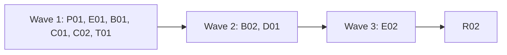

# Plan for 0.4.0-rc.2

The second release candidate fixes what the 0.4.0-rc.1 field test on a Shopify store found (#610 to #615), and the review-minor issues that are still true after a check against the code. #614 is already fixed by #625. Each item is one small PR. A PR is done when its acceptance test passes in CI, an adversarial review reports no blockers or majors, and it is squash-merged.

## Goals this release serves

From `docs/goals.md`:

- **Make it easy to change a GTM config reliably.** Baselines that drift on timing noise (#618), on a file name (#612) or on key order (#591) give false alarms. B01 and B02 fix that.
- **The first run shows where the setup likely breaks consent rules.** A hit that carries personal data or an identifier before the visitor answers the banner must be flagged on a page with no consent default (#626, D01). `possibleRealData` must name where a value was found (#610) and not flag random bytes (#614, done).
- **Be safe by default.** The test payment stays opt-in per host and per run. Its page marker becomes stricter (P01).
- **Expose all of this to agents through the CLI.** A usage error prints one line, not the full help (#613).

Non-goals this release comes close to: none. P01 changes a safety rule in `AGENTS.md`, which is the maintainer's decision (see "The payment rule").

## Findings

| Finding | Issue | What is wrong |
| --- | --- | --- |
| A JSON body finding says "in the body" | #610 | Only decoded hit params get a path. Body leaves of a JSON or form body are scanned as one text. |
| The payment step cannot confirm test mode on Shopify Payments | #611 | The checkout shows no marker, so the step always fails closed. Today's markers also match any text on the page. |
| Baseline warns on "accept" against "accept.yml" | #612 | `run` stores the file name, `suite` stores the name without extension, and the compare uses raw strings. |
| A bad `--viewport` prints the full help | #613 | `main.ts` prints the whole usage text after every usage error. |
| The suite summary prints a skipped handoff scenario twice | #615 | Not reproduced on `main`. A regression test is added. |
| A run drifts against its own baseline | #618 | A hit that fires next to the consent click lands in a different epoch on some runs. |

## Scope

In:

| Group | Issues | Size |
| --- | --- | --- |
| P01 Shopify test payment | #611, #603, #604 | L |
| E01 Body paths in possibleRealData | #610, #623, #620, #622 | M |
| B01 Baseline compare | #612, #589, #591, #618 (moved epoch) | M |
| C01 Short usage errors | #613, #569 (docs) | S |
| C02 CI checks the alias | #606 | S |
| T01 Test gaps | #601, #599, #598, #615 | S |
| B02 Baseline e2e and the pass flag | #618 (test), #588, #590 | M |
| D01 Identifiers before any consent answer | #626 | M |
| E02 One binary check, identity wording | #624, #595 | M |
| R02 Release prep | | S |

Not in:

| Issue | Why it waits |
| --- | --- |
| #552 | A fixture page makes one extra request. No effect on results. 0.5.0. |
| #256 | Mostly fixed. What is left is a timing guess for srcdoc frames. 0.5.0. |
| #180 | The `possibleRedirectHop` flag covers it. The cause is in Playwright. 0.5.0. |
| #535 | Masking page paths in `--by-page` baselines. The docs already warn. 0.5.0. |

Closed when this plan merges, each with a comment that gives the reason: #607 (tagreeve is on npm), #570 (the leak test can fail now), #144 (tag workflow and npm package exist), #526, #531, #533, #536 and #538 (notes on the 0.4 plan text, which has shipped), and #619 as wontfix (real gzip output cannot hold the email bytes the e2e test needs).

## Order and waves



Wave 1 runs six PRs. Apart from the append-only overlaps listed below, they edit separate files. Wave 2 holds the two that edit files wave 1 changes. Wave 3 holds E02, which edits `evaluate.ts` after D01. R02 comes last.

- **`packages/expect/src/evaluate.ts`** changes in E01 (the body scan), D01 (a new check next to `deniedIdentifiersCheck`) and E02 (the binary check and the identity message). They are in waves 1, 2 and 3. D01 comes before E02 because it serves a goal directly.
- **`e2e/baseline.e2e.test.ts`** changes in B01 (the #612 case) and B02. B02 is in wave 2.
- **`packages/cli/src/summary.test.ts`** changes in P01 (the new TEST PAYMENT line), B02 (in wave 2) and R02 (the version line only). T01 puts its #599 test in a new file, `packages/cli/src/summary-skipped-fields.test.ts`, and its #615 case in `suite.test.ts`, so it does not touch this file.
- **`fixtures/site/src/index.ts`** and **`fixtures/site/README.md`** also change in D01 (wave 2), which adds its own page.
- **`packages/expect/src/diff.ts`** changes only in B01.
- **Append-only overlaps in wave 1.** These files are shared, and each PR edits only its own part, so merge order does not matter: the route table in `fixtures/site/src/index.ts` and the page list in `fixtures/site/README.md` (P01 and E01 each add their own pages); `docs/design.md` (P01 edits §4, §5.4, §10.1, §13 and the payment bullet of §15.4, E01 edits §13's body rule, B01 edits §11 and the baseline bullet of §15.4; P01 and E01 touch different sentences of §13, and P01 and B01 touch different bullets of §15.4); `CHANGELOG.md` (one marker per PR).
- **`packages/cli/src/run.ts`** changes in P01 (the declaration hint in the failure text, wave 1) and B02 (the pass flag, wave 2). They edit different code, and B02 comes after P01.
- **`docs/cli.md`** changes in P01 (payment step), E01 (possibleRealData paragraph), B01 (baseline section), C01 (wait step) and B02 (summary fields). Each PR edits only its own section.

## The payment rule

`AGENTS.md` says the opt-in `payment` step types a test card only when three checks hold: `--allow-test-payment <host>` names the `--site` host, the host is in the allowlist file, and the provider's test-mode marker is on the page. On 2026-11-02 the maintainer decided that the user chooses whether to use test payments, and that the tool must make them work without a manual step on each run. So for a host the user declares, the user's declaration replaces the page marker.

- P01 changes the rule in `AGENTS.md` and the design in the same PR as the code.
- **P01 needs the maintainer's explicit OK before it merges.** A bot approval is not enough. The PR body says so in its first line.
- Log-ins stay `handoff` steps on every hosted site. Only documented test card values from the provider table are typed. The `fill`, `select` and `evaluate` guards do not change.

## Rules for every PR

The rules in `AGENTS.md` and the earlier plans still hold. In short:

- fake IDs and fake identities only: GA4 `G-PWTEST0001`, Google Ads `AW-000000001`, Meta `100000000000001`, GTM `GTM-PWTEST1` and `GTM-PWNOVER`, hosts under `.invalid` or loopback. A fixture page sends only to `.invalid` hosts, so nothing leaves the machine;
- names and counts only in what a PR adds. No cookie value, identity value, card value or `gtmAuth`. Each PR that adds output has a leak test that feeds a fake email (`pw-fixture@example.com`), its SHA-256 and a fake cookie value through the feature and asserts none of them appears;
- e2e tests run only against `fixtures/site` or an in-test loopback server, in `stub` mode (the one `server` mode test `AGENTS.md` allows, whose pass-through host is the fixture's own loopback host, stays allowed);
- context-level hooks only, no CDP, no new browser flags;
- no publish to npm and no GitHub release without the maintainer's say-so.

More for rc.2:

- Each PR adds a regression test that fails when the change is removed. The PR description says how that was checked. C02 is the one exception: its validation is a CI run against a deliberately broken alias (see C02).
- Each negative test checks that its input really contains what the check looks for. A test that passes because the input never had it proves nothing.
- New e2e tests go in new files. Named exceptions: D01 updates `e2e/report-marks.e2e.test.ts`, E01 adds a case to `e2e/identity-messages.e2e.test.ts`, T01 tightens `e2e/identity-country.e2e.test.ts`, B01 and B02 change `e2e/baseline.e2e.test.ts`, and C01 changes `e2e/viewport.e2e.test.ts` and `e2e/cli-flags.e2e.test.ts` where they assert the usage text.
- No record schema bump. `recordSchemaVersion` stays 2. P01 adds one optional field (see below).
- CHANGELOG: this plan PR turns `## Unreleased` into the `## 0.4.0-rc.2` heading, keeps the #614 line, and adds one marker per PR with a user-visible change, a blank line between each pair. Each PR replaces only its own marker. C02 and T01 add no CHANGELOG line. R02 removes leftover markers.

```markdown
## 0.4.0-rc.2

<!-- P01 -->

<!-- E01 -->

<!-- B01 -->

<!-- C01 -->

<!-- B02 -->

<!-- D01 -->

<!-- E02 -->
```

## PRs

### Wave 1

**P01 Shopify test payment (#611, #603, #604).** Touches: `packages/recorder/src/payment.ts`, `packages/recorder/src/payment.test.ts`, `packages/cli/src/test-payment-hosts.ts`, `packages/cli/src/test-payment-hosts.test.ts`, `packages/core/src/records.ts` (one optional field), `packages/cli/src/summary.ts`, `packages/cli/src/summary.test.ts`, `packages/cli/src/run.ts` (the failure text only), `packages/cli/src/suite-test-payment.test.ts`, `e2e/test-payment-declared.e2e.test.ts` (new), `e2e/test-payment.e2e.test.ts` (named exception: it asserts the old `payment` object and summary line), the fixture payment pages in `fixtures/site/public/`, `fixtures/site/src/index.ts`, `fixtures/site/src/pages-0.4.test.ts`, `fixtures/site/README.md`, `docs/cli.md` (payment step), `docs/shopify-checkout.md`, `docs/guide/what-it-checks.md` (the test payment paragraph), `README.md` (the payment sentence in the safety list), `docs/design.md` (§4 rows for `Step.payment` and `Run.testLoopbackHosted`, the payment paragraph in §5.4, §10.1, the payment sentence in §13 and the payment bullet in §15.4), `AGENTS.md` (the payment rule), `CHANGELOG.md` (the P01 marker).
- **Declared test mode.** An allowlist entry can be a host string, as today, or an object `{ "host": "<host>", "testMode": "<provider id>" }`. The file may mix both. A declaration names one provider from the table and applies only to that host. An unknown provider id is an error that names the file and the entry index, never other content. A loopback host or the `fixture` provider in a declaration is an error too, with one exception: when `TAGREEVE_TEST_LOOPBACK_IS_HOSTED=1` is set (recorded as `Run.testLoopbackHosted`), a declaration may name the `fixture` provider for a loopback host. This lets the e2e reach the declared branch on the fixture site. A unit test checks that the same declaration is refused without the seam.
- **The run.** With a declaration for the `--site` host and the step's provider, the step skips the page marker. Everything else stays: `--allow-test-payment` must name the host, the page host must equal it, and each card frame must be served from the provider's card host. Without a declaration, the marker check runs as today, but stricter (next point).
- **A stricter marker.** The step finds the card frames first, without typing. The marker must be visible inside the nearest element that contains every card frame. Text elsewhere on the page does not count, so merchant copy cannot pass the check.
- **The record.** `Step.payment` gains `testMode: "declared" | "marker"`. The summary line keeps the provider and host and adds the source: `TEST PAYMENT: <provider> on <host> (test mode declared)` or `(test mode on page)`. The JSON `testPayment` summary object gains the same `testMode` field.
- **#603.** `Step.payment` is set only after the first key is typed. A failure before that leaves it unset. The failure message names the field kind, never a value.
- **#604.** Unit tests for the `shopify-test` and `shopify-bogus` runtimes on fake pages. They check the order of the checks, that nothing is typed on a wrong card host, and that a name-fill failure names the field.
- **Errors.** Without a declaration and without a marker in the card container, the recorder's error stays `test mode not detected`. The CLI, which knows the allowlist path (`testPaymentHostsPath`), adds one line after it: `Declare it in <file> with { "host": "<host>", "testMode": "<provider>" } if this store is in test mode.` The recorder does not depend on the CLI and never sees the path. The line is added in `runCommand` in `packages/cli/src/run.ts`, where a step error becomes the `Run failed:` text, and `suite` reaches the same text through `deps.run`. The declared-mode e2e asserts that stderr holds the hint and holds neither the card number nor the fake email.
- **The seam.** The §4 row for `Run.testLoopbackHosted` says the seam now also lets an allowlist declaration name the `fixture` provider for a loopback host, for the e2e only.
Regression test: `payment.test.ts` and `test-payment-hosts.test.ts` cover a declared host (typed), the same page without a declaration (nothing typed), a declaration for another provider (nothing typed), marker text outside the card container (nothing typed) and inside it (typed), and a first fill that throws (`payment` unset). The new e2e runs under the `TAGREEVE_TEST_LOOPBACK_IS_HOSTED` seam. It declares `{ "host": "localhost", "testMode": "fixture" }` in a temp allowlist file and runs the fixture payment page that has card frames and no marker, once with the declaration and once without. The existing `e2e/test-payment.e2e.test.ts` keeps covering the marker path and is updated for the new `testMode` field and summary line. `shopify-test` and `shopify-bogus` are covered by unit tests on fake pages in `payment.test.ts`, because the e2e may not use a real store.
Acceptance: `pnpm exec vitest run --project e2e e2e/test-payment-declared.e2e.test.ts` passes. With the declaration check removed, the declared run types nothing and the test fails.
QA: a declared host with `--allow-test-payment` naming another host (refused); a mixed allowlist file; a declaration with a typo in the provider id; a marker page where the marker sits outside the card form; `suite --with-test-payment`.

**E01 possibleRealData names body paths (#610, #623, #620, #622).** Touches: `packages/expect/src/evaluate.ts` (`findForeignData` and the body texts only), `packages/expect/src/identity-values.test.ts`, `packages/decoders/src/fields.ts` and `packages/decoders/src/fields.test.ts` (a shared multipart helper), `packages/decoders/src/meta.ts` (uses the helper), `e2e/identity-messages.e2e.test.ts`, `e2e/scenarios/identity-json-body.yml` (new), a fixture page that sends a JSON POST and a multipart POST to a `.invalid` host (`fixtures/site/public/`, `fixtures/site/src/index.ts`, `fixtures/site/README.md`), `docs/cli.md` (possibleRealData paragraph), `docs/design.md` (§13, the body-skip rule), `CHANGELOG.md` (the E01 marker).
- When a body parses as JSON or as a form (the decoders' `bodyEntries` and `jsonEntries` in `packages/decoders/src/fields.ts`), each leaf is scanned on its own, and its finding names the path, for example `in customerHashed.country`. A path segment that looks like a value prints as `(other)`, as for hit params. Each leaf is scanned as `name=value`, so a key that holds an email is still found. Any body that yields no entries, and any part of a body that is not an entry (for example a plain-text body, or a form body with names only), is scanned as one text, `in the body`, as today. `bodyEntries` marks only unparsable JSON as `parsed: false`, so the code checks for empty entries too.
- A multipart body is split at its boundary by one exported helper in `packages/decoders/src/fields.ts` that returns each part's headers and body. The boundary parse and part split that `packages/decoders/src/meta.ts` has today (`multipartFields` and the boundary regex in `bodyFields`) move into it, and `meta.ts` and `findForeignData` both call it, so the two cannot drift apart. Meta decoding does not change, and its tests stay green. A body with several lines is split at line breaks. The binary check runs per part, and text parts are scanned. A body that is binary as a whole is still skipped.
- The docs say exactly when a body or part is skipped: a content-encoding other than identity, a binary content type, or 10% or more control or replacement characters in a part of 16 or more characters (#620). A unit test pins that a text body padded with many control characters is skipped, and the docs name that trade-off (#622).
Regression test: unit tests for a JSON body with a foreign hash under `customerHashed.country`, a form body, a multipart body with a binary file part and a text field with an email, a plain-text body that is only the email, a name-only form body and a form key that is the email (each still produces a finding), and a JSON header line followed by a compressed line. Each asserts the input holds the value before it asserts the finding. The e2e adds the JSON POST case.
Acceptance: the e2e and unit tests pass, and on the old code the JSON case reports `in the body`, so the test fails. No finding holds the value.

**B01 Baseline compare (#612, #589, #591, #618).** Touches: `packages/cli/src/baseline.ts`, `packages/cli/src/baseline.test.ts`, `packages/expect/src/diff.ts` (`diffShapes` and its key building), `packages/expect/src/diff.test.ts`, `e2e/baseline.e2e.test.ts` (the warning assertion only), `docs/cli.md` (baseline section), `docs/design.md` (§11 baseline sentence and the baseline bullet of §15.4, which says a key that appears or disappears gives exit code 1: it must now name the moved-warning exception), `CHANGELOG.md` (the B01 marker).
- **#612.** The compare strips `.yml` and `.yaml` from both scenario names. Records and baseline files keep what they store, so old baselines still work.
- **#589.** `added`, `removed` and `countChanges` come from the diff lists, not from deduplicated text lines. Count lines carry the tuple label, so two tuples with the same change are two lines. The tests go in `packages/cli/src/baseline.test.ts` and `packages/expect/src/diff.test.ts`. The `diff` command's output (`diff-counts.test.ts`) does not change.
- **#591.** Key and tuple strings are built from a fixed field order, so a baseline saved by another tool with sorted keys (`jq -S`) compares the same.
- **#618, moved epoch.** The move is judged at count level. For one vendor and event (and page with `--by-page`), take its hit counts per epoch in the baseline and in the run. If the total is the same, and the only differences are between two epochs that sit on either side of one consent answer, the hits moved: report a moved warning for each shift and no drift. This covers a whole key that moved (baseline granted 1, run undecided 1) and a partial move (baseline undecided 1 and granted 1, run granted 2). It works in both directions, whichever side the baseline caught. The consent fields of the moved tuples may differ, because the consent state changed. Tuples that did not move are compared as today. Each move is a warning that names the vendor, the event and both epochs, for example `moved meta PageView from undecided to granted`. Any other change of epoch is still drift. The order of the answers comes from the current run's consent epochs, which the CLI passes into the expect-layer compare (`diffShapes` or a sibling). The baseline file format and `BASELINE_SCHEMA_VERSION` do not change. A label that appears more than once in that order is drift, not a move. When the move goes into the undecided epoch, the warning says the hit now fires before the consent answer. The consent checks that exist today (`deniedIdentifiers` and the scenario's own consent rules) run as before.
Regression test: unit tests for each point. Two tuples with the same count change give `countChanges: 2`. A `jq -S` copy of a baseline gives no drift. A whole-key move across one consent answer gives no drift and one warning, in each direction. A partial move (undecided 1 and granted 1 against granted 2) gives no drift and one warning. A move across two answers is drift, and a total that changes (undecided 1 and granted 1 against granted 1) is drift.
Acceptance: the unit tests pass. On the old code the sorted baseline drifts and the moved case drifts.

**C01 Short usage errors (#613, #569).** Touches: `packages/cli/src/main.ts`, `packages/cli/src/main.test.ts` (new if missing), `e2e/viewport.e2e.test.ts`, `e2e/cli-flags.e2e.test.ts`, `docs/cli.md` (wait step), `CHANGELOG.md` (the C01 marker).
- A usage error prints the message and one line, `Run tagreeve --help for the options.` (or `tagreeve <command> --help` when a command is known). It exits 2, as today. `--help` still prints the full text.
- #569: the docs say `wait: { url }` matches the URL of any open page, like `handoff until`. The code does not change: matching only the first page could break checkouts that open payment in a popup.
Regression test: a unit test on the error output for an unknown flag, a missing `--site` and `--viewport mobile`.
Acceptance: `tagreeve run x.yml --site http://127.0.0.1:1 --viewport mobile` exits 2 with fewer than three lines on stderr and no usage block. On the old code the test fails on the line count.

**C02 CI checks the alias (#606).** Touches: `.github/workflows/ci.yml`, `.github/workflows/release-tag.yml`, `scripts/no-old-name.test.ts` (the `allowedLines` entries for those two workflows).
- CI and the tag workflow check that `pingwright --version` prints the package version on stdout, and the rename notice on stderr, read separately.
- `scripts/no-old-name.test.ts` scans every tracked file for the old name. The edits move the notice check onto a line its current `ci.yml` regex does not match, and add an alias check to `release-tag.yml`, which has no entry. The allowlist stays as narrow as today's line: it matches the `bin/pingwright" --version` text and nothing wider.
Regression test: none possible in the unit suite. The PR shows a CI run of the new step against a deliberately broken alias on a scratch commit, then reverts it.
Acceptance: the new CI step passes on the branch, and it failed on the scratch commit.

**T01 Test gaps (#601, #599, #598, #615).** Touches: `packages/cli/src/suite.test.ts`, `packages/cli/src/summary-skipped-fields.test.ts` (new), `e2e/scenarios/identity-country-se.yml`, `e2e/identity-country.e2e.test.ts`.
- #601: a test that `suite` passes `--viewport` to each run.
- #599: a leak test for `skippedFields` in the text summary and the `--json` summary, with the fake email as the optional fill value. It goes in the new file, so it does not collide with P01 and B02 in `summary.test.ts`.
- #598: the SE scenario accepts consent and reaches `/thank-you`, and the test asserts a hit carries the SE phone and `hashesMatch` passes, so the `possibleRealData` assertion can fail.
- #615: a suite test with a skipped handoff scenario next to two others asserts one row per scenario.
Regression test: these are the tests.
Acceptance: each test fails with the line it guards removed. The PR description lists the line for each.

### Wave 2

**B02 Baseline e2e and the pass flag (#618, #588, #590).** Touches: `e2e/baseline.e2e.test.ts`, `e2e/scenarios/baseline-*.yml` (new or changed), `packages/cli/src/run.ts`, `packages/cli/src/summary.ts`, `packages/cli/src/summary.test.ts`, `docs/cli.md` (summary fields), `CHANGELOG.md` (the B02 marker).
- #618: the "matches its own baseline" test uses a scenario whose hits do not race the consent click, for example a wait before the consent step.
- #588: the leak test uses a scenario that visits `/shared-hashes` and `/set-cookie-already`, and asserts each secret is in the run records before it asserts the baseline file does not hold it.
- #590: a drift sets `pass` to false as well as `ok`. The docs for both fields change.
Regression test: the e2e changes above, and a summary unit test for `pass` on drift.
Acceptance: the same scenario against its own baseline exits 0 on 20 of 20 local runs (the PR description gives the loop it ran). The leak test fails when `buildBaseline` is changed to include the hash. On the old code the drift case has `pass: true`.

**D01 Identifiers before any consent answer (#626).** Touches: `packages/expect/src/evaluate.ts` (a new `earlyIdentifiersCheck` next to `deniedIdentifiersCheck`), `packages/expect/src/scenario.ts` (`BUILTIN_NAMES` and the default severity), `packages/expect/src/evaluate.test.ts`, `packages/expect/src/scenario.test.ts`, `packages/cli/src/report/model.ts`, `packages/cli/src/report/verdict.ts`, `packages/cli/src/report/render.ts` (the `leak` legend text), `packages/cli/src/report/model.test.ts`, `packages/cli/src/report/verdict.test.ts`, `packages/cli/src/report/render.test.ts`, `e2e/report-marks.e2e.test.ts` (named exception), `e2e/early-identifiers.e2e.test.ts` (new), `e2e/scenarios/early-identifiers.yml` (new), a fixture page with no Consent Mode default that sends a Meta hit with `em` before the banner is answered (`fixtures/site/public/`, `fixtures/site/src/index.ts`, `fixtures/site/README.md`), `docs/cli.md` (the `builtins` row and a new `earlyIdentifiers` section after `deniedIdentifiers`), `docs/design.md` (§11, the built-in checks, and the report bullet of §15.3 that names the sources of a `leak` mark), `CHANGELOG.md` (the D01 marker).
- **What it flags.** A hit in the undecided epoch (before the first consent answer) that carries an identifier field whose consent signal is unknown. It uses the same field classes and signals as `deniedIdentifiers` (`identifierClass`, `identifierSignal`, `identifierFields`). The names that check ignores on purpose (`cid`, `client_id`, `_ga`, `fbp`, `fbc`, `gclid`) are ignored here too, so an anonymous hit before the answer stays clean.
- **What it does not flag.** A denied signal: that is `deniedIdentifiers`, so a hit is never reported by both. A hit after an answer, whatever its signal. A granted signal.
- **Message.** `<n> hit(s) carry identifiers before the consent answer: meta em, ph (adUserData unknown)`. It names vendor, field names and signal, never a value. Evidence is the hit IDs. A hit before the answer without recorded field names reports `cannot evaluate`, as `deniedIdentifiers` does.
- **Severity.** The default is `warn` for this check only, so no exit code changes in rc.2. `options.builtins: { earlyIdentifiers: fail }` makes it fail. It is the first built-in check whose default is not `fail`: `scenario.ts` holds one default per name, and the docs table shows each default.
- **Report.** The `leak` mark stays, and its legend text and the §15.3 bullet widen to cover identifiers sent before an answer. `model.ts` gets a second label, `identifiers sent before an answer`, next to `IDENTIFIER_LEAK`. `namedLeaks` treats a non-passing `earlyIdentifiers` result like `deniedIdentifiers`, and the label from `deniedIdentifiers` wins when a hit has both. `verdict.ts` sorts the new label into the identifier findings, with the sentence `identifiers go out to <vendor> in the undecided state`, not into the generic `sends hits in the <state> state` bucket. An early hit with `em` is marked `leak`, and one with only `fbp` stays `early`.
- **Existing e2e.** A default-`warn` result is added to every run, and it carries severity `warn` whether it passes or fails. `e2e/report-marks.e2e.test.ts` asserts that every result has severity `fail`, and its `report-marks.yml` scenario visits `/sgtm-data-tag` with no consent step, so its server-container hit with a 64-hex `email_address` is flagged and gets a `leak` mark. D01 updates that test. Before the PR opens, the implementer runs the full e2e suite once, lists every existing assertion on `results`, `severity` or `failed` that the new check changes (scenarios without a consent step, such as stable-ids and shared-hashes, are likely), and fixes each in the PR description's list.
Regression test: unit tests for a Meta hit with `em` in the undecided epoch and unknown consent (flagged, warn), the same hit with only `fbp` (not flagged), the report marks and verdict sentence described above, the same hit after accept (not flagged), a denied default (left to `deniedIdentifiers`, not flagged here) and `earlyIdentifiers: fail` (a failed result). Each asserts the hit really holds the field first. The e2e runs the fixture page in stub mode and asserts a `WARN` result for `earlyIdentifiers` with the hit as evidence, and a leak test asserts the fake email and its hash appear nowhere in the output.
Acceptance: `pnpm exec vitest run --project e2e e2e/early-identifiers.e2e.test.ts` passes. On the old code there is no `earlyIdentifiers` result, so the test fails.
QA: a page with no consent default and a Meta Purchase with hashed email before the click; the same with `fbp` only; a page with a denied default; `--json` output; the HTML report verdict.

### Wave 3

**E02 One binary check, and the identity wording (#624, #595).** Touches: `packages/core/src/identity.ts`, `packages/core/src/index.ts`, `packages/core/src/identity.test.ts`, `packages/expect/src/evaluate.ts` (`isBinaryBody` and the identity message), `packages/expect/src/identity-values.test.ts`, `packages/expect/src/evaluate.test.ts`, `CHANGELOG.md` (the E02 marker, only if behaviour changes).
- Core exports one `binaryShare(text)` that both the base64 decoder and the body filter use, each with its own threshold.
- #595: the "carried no identity fields" message fires only when a hit has no identity field at all. Plain address fields (city, postal code, country) count.
Regression test: tests that pin the result of both callers on borderline inputs (just under and just over each threshold, C1 characters, edge characters), and a server hit with only `city`.
Acceptance: the borderline tests pass on the old and the new code, except where the PR description names an intended change. The `city` case fails on the old code.

**R02 Release prep.** Touches: `package.json` and the workspace `package.json` versions, `packages/cli/src/summary.test.ts` (the `readVersion()` line only), `docs/cli.md` (the version sentence near the top: it stays true that the first Tagreeve release is `0.4.0-rc.1`, and any other backticked version equals `package.json`), `CHANGELOG.md` (intro line, leftover markers, a "Known in 0.4.0-rc.2" list), `README.md` (status block), and any other test or doc that pins the version, found with a search for `0.4.0-rc.1`.
Acceptance: `pnpm lint`, `pnpm typecheck`, `pnpm test` and `pnpm docs:test` pass, and `scripts/release.sh 0.4.0-rc.2` runs on `main` after merge. The maintainer publishes.

## Flagged concerns

- **P01 on a real store.** The fixture cannot reproduce Shopify. The card frame titles and the card host match the rc.1 field test, but the inner input selector, the expiry format (`12/40` against a masked "MM / YY" field) and the name field were never typed on a real checkout. After merge, a supervised field test on the staging store runs P01 with a declared host. If the expiry field rejects `12/40`, the fix is a follow-up PR.
- **B01 moved epoch.** The maintainer chose on 2026-11-02: a hit that lands on the other side of the consent click is timing, not a change of setup, so it is a warning, not drift. A move across more than one answer, or one where the count changes, stays drift. Whether a hit before consent is allowed is for the consent checks, not the baseline. `deniedIdentifiers` skips unknown consent on purpose, so D01 (#626) adds `earlyIdentifiers` for a hit with identifiers before the answer. Until D01 merges in wave 2, such a hit is judged only by a scenario's own `before: consent` rule.
- **D01 severity.** `earlyIdentifiers` is `warn` by default in rc.2 so no exit code changes. The rc.2 field test decides whether it becomes `fail` for 0.4.0.
- **#615 did not reproduce.** T01 adds a regression test only. The field tester is asked for the suite folder layout.
