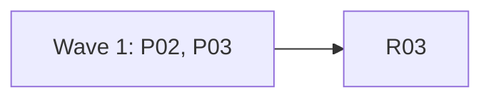

# Plan for 0.4.0-rc.3

The third release candidate fixes what the 0.4.0-rc.2 field test on a Shopify Payments dev store found (#682). The test-mode declaration from rc.2 works, but the payment step then fails with `card field number could not be filled`, 46 ms after the step starts, and the message hides the cause. rc.3 also takes the open review-minor issues about the same payment step (#646, #647, #648, #649) and the release notes gap (#680). Each item is one small PR. A PR is done when its acceptance test passes in CI, an adversarial review reports no blockers or majors, and it is squash-merged.

## Goals this release serves

From `docs/goals.md`:

- **Make it easy to change a GTM config reliably.** A checkout test that types the test card on its own is what lets a user rerun a purchase scenario after each change. Today it fails on the one real store it was tried on (#682). P02 fixes that.
- **Expose all of this to agents through the CLI.** An agent can only fix a failed step if the error says why it failed. P02 keeps the reason in the step error. P03 makes the declaration hint name the step that failed and never suggest an entry the file refuses.
- **Be safe by default.** Nothing about the three gates changes. The step still fails closed, types only the documented test card, and never shows a typed value.

Non-goals this release comes close to: none.

## Findings

| Finding | Issue | What is wrong |
| --- | --- | --- |
| The payment step fails on a Shopify Payments checkout | #682 | `cardFrameServed` finds the frame with `page.locator(field.frame).first()`. The fill uses `page.frameLocator(field.frame).locator(field.input)` with no `.first()`. The Shopify selectors are `iframe[title*="Card number" i]` and a bare `input`. If either matches more than one element, Playwright's strict mode throws at once, which fits the 46 ms. This is the likely cause, not a confirmed one. |
| The step error hides the cause | #682 | The `catch` around the fill drops the Playwright error. The message cannot say whether it was strict mode, a hidden field or a time-out. |
| The payment unit tests cannot catch a wrong selector | #648 | The fake `page.locator()` ignores its selector. The Shopify marker path never runs. The multi-frame container walk never runs against a real DOM. |
| The declaration hint can suggest an entry the file refuses | #646 | On a loopback host, or for the `fixture` provider, without the test seam, `parseEntry` refuses the exact entry the hint prints. |
| The declaration hint names the wrong provider | #647 | It uses the scenario's first `payment` step, not the one that failed. |
| The declared-payment e2e leak check is narrow | #649 | It does not check the SHA-256 of the fake email or a fake cookie value. |
| The rc.2 Known list drops rc.1 limits that are still true | #680 | Release notes. |

## Scope

In:

| Group | Issues | Size |
| --- | --- | --- |
| P02 Card fields on a real checkout | #682, #648 | M |
| P03 Declaration hint and leak checks | #646, #647, #649 | S |
| R03 Release prep | #680 | S |

Not in: every other open issue in the 0.4.0 milestone. They wait for the 0.4.0 plan after this field test. rc.3 exists so the field tester can rerun the same Shopify scenario soon.

## Order and waves



Wave 1 runs P02 and P03 in parallel. Then R03 makes the release.

- **P02** edits the recorder (`packages/recorder/src/payment.ts`), the fixture site and a new e2e file. **P03** edits the CLI (`packages/cli/src/run.ts`) and the existing declared-payment e2e. They share no file except `CHANGELOG.md`, where each replaces its own marker.
- P02 must not edit `e2e/test-payment-declared.e2e.test.ts` or `e2e/test-payment.e2e.test.ts`. If its fixture changes would break them, it keeps the old fixture pages working and adds new ones.

## The payment rule

`AGENTS.md` and design §5.4 do not change. P02 changes how the step finds and types into the card fields, after every gate has passed. It does not touch the gates.

- **P02 needs the maintainer's explicit OK before it merges**, as P01 did. A bot approval is not enough. The PR body says so in its first line.

## Rules for every PR

The rules in `AGENTS.md` and the earlier plans still hold. In short:

- fake IDs and fake identities only: GA4 `G-PWTEST0001`, Google Ads `AW-000000001`, Meta `100000000000001`, GTM `GTM-PWTEST1` and `GTM-PWNOVER`, hosts under `.invalid` or loopback;
- no cookie value, identity value, card value or `gtmAuth` in any output. A PR that adds output has a leak test with the fake email (`pw-fixture@example.com`), its SHA-256 and a fake cookie value;
- e2e tests run only against `fixtures/site` or an in-test loopback server, in `stub` mode;
- context-level hooks only, no CDP, no new browser flags;
- no publish to npm and no GitHub release without the maintainer's say-so.

More for rc.3:

- Each PR adds a regression test that fails when the change is removed. The PR description says how that was checked. R03 is the exception.
- New e2e tests go in new files. The named exception: P03 adds assertions to `e2e/test-payment-declared.e2e.test.ts`.
- No record schema change.
- CHANGELOG: this plan PR adds a `## 0.4.0-rc.3` heading above `## 0.4.0-rc.2`, with one marker per PR and a blank line between them. Each PR replaces only its own marker. R03 removes leftover markers.

```markdown
## 0.4.0-rc.3

<!-- P02 -->

<!-- P03 -->
```

## PRs

### Wave 1

**P02 Card fields on a real checkout (#682, #648).** Touches: `packages/recorder/src/payment.ts`, `packages/recorder/src/payment.test.ts`, new fixture pages in `fixtures/site/public/` (and `card-frame.html` only if the old pages still work unchanged), `fixtures/site/src/index.ts` (routes only, including new GET routes in `paymentFrameHandler` for per-field frame documents), `fixtures/site/src/pages-0.4.test.ts`, `fixtures/site/README.md` (the page list and the `paymentFrameUrl` row), `e2e/test-payment-frames.e2e.test.ts` (new), `e2e/scenarios/test-payment-frames-*.yml` (new; P03's new scenario names start with `test-payment-declared-`, so the two never collide), `docs/cli.md` (the payment step: what the error says), `docs/design.md` (the sentence in §5.4 that says the step types "through frame locators"), `CHANGELOG.md` (the P02 marker).
- **One element for check and fill.** The step types into the content frame of the exact iframe element that the frame check verified. It no longer builds a second `frameLocator` from the selector. Right before each fill it checks again that this frame's URL host is the provider's card host. If the frame has gone or moved to another host, the step fails closed and types nothing more.
- **Which frame.** The frame check takes the first matching iframe that is visible and whose document is served from the card host. A hidden duplicate, or one served from another host, is skipped. If none qualifies before the deadline, the step fails with `card frame not found (<kind>)` as today.
- **Which input.** Inside the frame, the step uses the provider's input selector, filtered to visible elements. Exactly one visible match is typed into. Zero or more than one is a fail-closed error that says how many matched, for example `card field number could not be filled: 2 visible inputs match`. The step never picks one of several on a guess.
- **The reason.** A fill error keeps the cause: `card field <kind> could not be filled: <reason>`. The reason is the first line of the Playwright error, with every value the step types (the card number, expiry, CVC, the name, and the first and last name on their own) replaced before it is shown. A typed value never reaches the message, a record or a log. The rc.2 fake already throws `fill("<value>")`, so the unit test uses that shape. `card frame not found` gets a reason too (`not visible`, `served from another host` or `not found`). It never prints the other host's name.
- **#648.** The fake in `payment.test.ts` records every selector it is asked for, so a wrong `shopifyFields` selector fails a test. A test asserts the order: host check, frame lookup, marker (when not declared), hold, fill. A `shopify-test` case runs in marker mode.
- **Fixture.** New fixture pages, each with its own route, so the old pages and their e2e tests do not change:
  - duplicate card frames: a hidden iframe that matches the fixture frame selector (it gets the same selector match as the real one, for example by sharing its id or by a broadened fixture selector that the old pages still match) and is served from `paymentFrameUrl`, so on rc.2 code the frame check passes and `frameLocator` throws a strict-mode error at the fill. The hidden duplicate comes first in DOM order or not; the test covers both orders. Also an extra hidden input inside the card frame.
  - split card frames: one iframe per field, each in its own wrapper, with the marker inside the nearest common ancestor on one page and outside it on another. This runs the container walk against a real DOM.
  If the fixture provider's selectors must change to cover these pages, the old pages must still match them. The e2e for the old pages must stay green unchanged.
Regression test: unit tests for each point above. Each negative test checks first that its fake really has the duplicate, the hidden element or the value in the error. One unit test feeds an error whose first line holds the card number, the expiry and the name, and asserts the message holds none of them and still names the field. The e2e runs the duplicate-frames page and the two split-frames pages in stub mode with `--allow-test-payment`, as `e2e/test-payment.e2e.test.ts` does. It asserts the card is submitted on the duplicate and split-inside pages, that nothing is typed on the split-outside page, and that stdout and stderr hold none of the card number, the fake email, its SHA-256 or a fake cookie value. Records never hold cookie values (a `Response` keeps `setCookieNames` only) and the cookie jar is gone when the run ends, so the scenarios put the values into recorded requests, as `e2e/scenarios/baseline-leak.yml` does: after a page that sets a cookie readable on the site host (for example `/set-cookie-already`), an `evaluate` step sends `encodeURIComponent(document.cookie)` and the email hash in the query of a request the record keeps. The scenario sets `options.builtins: { possibleRealData: warn }`, as `baseline-leak.yml` does, so that request does not change the exit code. Each leak assertion checks first that the value is in a request URL of that run's record.
Acceptance: `pnpm exec vitest run --project e2e e2e/test-payment-frames.e2e.test.ts` passes. On the old `payment.ts`, the duplicate-frames case fails with `card field number could not be filled` (the hidden duplicate is served from the card host, so the old frame check passes). A leak assertion fails on old code only if a value is printed; the PR description says how each was shown to be non-vacuous. The PR description shows that run.
QA: run the three new fixture pages; a fixture page where the card frame is served from another loopback host than the card host (for example `localhost` instead of `127.0.0.1`; the card-host check compares hostnames, not ports); a scenario where the step's timeout is short; check that no error line on stderr holds a typed value.

**P03 Declaration hint and leak checks (#646, #647, #649).** Touches: `packages/cli/src/run.ts` (`declarationHint` and its call), `packages/cli/src/test-payment-hosts.ts` (one exported predicate, used by `parseEntry`), `packages/cli/src/test-payment-hosts.test.ts`, `packages/cli/src/suite-test-payment.test.ts`, `e2e/test-payment-declared.e2e.test.ts` (named exception), `e2e/scenarios/test-payment-declared-leak.yml` (new), `CHANGELOG.md` (the P03 marker). P02 touches none of these, so the two PRs share only `CHANGELOG.md`.
- **#647.** The hint names the provider of the `payment` step that failed. The step error carries the step label; if it cannot identify the step, the hint lists each distinct payment provider in the scenario.
- **#646.** Show the hint only when `parseEntry` would accept `{ host, testMode }`. The accept/refuse rule is pulled out of `parseEntry` into one exported predicate in `test-payment-hosts.ts`, and both `parseEntry` and the hint call it, so the two cannot drift. `parseEntry` accepts a non-loopback host with a non-fixture provider, or, with `TAGREEVE_TEST_LOOPBACK_IS_HOSTED` set, a loopback host with the `fixture` provider. Nothing else.
- **#649.** The declared-payment e2e also asserts that stdout and stderr hold neither the SHA-256 of `pw-fixture@example.com` nor a fake cookie value, and that stdout holds no email in the no-declaration case. The existing declared scenario loads no scripts and sets no cookie, so the new assertions run on a new scenario, `e2e/scenarios/test-payment-declared-leak.yml`, which puts the cookie value and the email hash into a recorded request URL before the payment step, in the same way as P02's scenarios (an `evaluate` step after a cookie-setting page, with `possibleRealData: warn`). Each new negative assertion checks first that the value is in a request URL of that run's record.
Regression test: unit cases in `suite-test-payment.test.ts` for a failing second payment step with another provider; a hosted host with the `fixture` provider (no hint; this replaces the current expectation in the existing hint test, which expects a hint for `shop.example.com` with `fixture`); a loopback host with `fixture` and no seam (no hint); the same with the seam (hint); a loopback host with `shopify-test` and the seam (no hint). A case in `test-payment-hosts.test.ts` covers the predicate.
Acceptance: the unit cases pass. On the old code the second-step case names the first provider and the hosted-`fixture` case prints a hint, so both fail. The leak assertions in the declared e2e pass only with their precondition checks in place.

**R03 Release prep (#680).** Touches: `package.json` and the workspace `package.json` versions, `packages/cli/src/summary.test.ts` (the `readVersion()` line only), `docs/cli.md` (the version sentence near the top), `CHANGELOG.md` (intro line, leftover markers, a "Known in 0.4.0-rc.3" list that keeps every rc.1 and rc.2 limit still true, #680), `README.md` (status block), and any other test or doc that pins the version, found with a search for `0.4.0-rc.2`.
Acceptance: `pnpm lint`, `pnpm typecheck`, `pnpm test` and `pnpm docs:test` pass, and `scripts/release.sh 0.4.0-rc.3` runs on `main` after merge. The maintainer publishes.

## Flagged concerns

- **The cause in #682 is likely, not confirmed.** The fixture cannot reproduce Shopify. If the real cause is something else, such as an input with another name or a field that only accepts typed keys, rc.3 still fails closed, and the error now says why. The field tester reruns scenario F on the same store with the declaration in place, and the next fix follows from that message.
- **The Shopify input selector stays `input`.** P02 narrows it to the visible inputs in the verified frame, and does not guess field names it cannot check against a real checkout.
- **The expiry format** (`12/40` against a masked "MM / YY" field) is still not checked on a real store (#648 and the rc.2 Known list).
