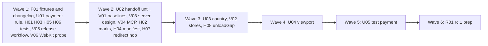

# Plan for 0.4.0-rc.1

This is the checklist for `0.4.0-rc.1`. The theme of 0.4.0 is unattended runs and the server side. A checkout run should not need a person at the end of every handoff, a CI job should catch drift without a hand-written rule, and the report should say plainly what Pingwright can and cannot see of the server container.

The work starts after `0.3.0` is merged and released (`docs/plan-0.3.0.md`). Nothing from that plan is repeated here. Each item is one small PR. A PR is done when its acceptance test passes in CI, an adversarial review reports no blockers or majors, and it is squash-merged to main. The target is `0.4.0-rc.1`, published on `next` by the maintainer. The maintainer then field-tests it on a real store.

## What this release answers

| Need | Issue | What is missing today |
| --- | --- | --- |
| A checkout handoff ends by itself at the thank-you page. | #515 | A handoff ends only on Done or Enter. If the person presses too early, the purchase hits are cut off. |
| A checkout can run in CI with a test card. | #463 | Every payment is a handoff, so the purchase path always needs a person. |
| Mobile layouts and mobile tags can be tested. | #514 | Every run uses the default desktop viewport. |
| A scenario can use a fake identity for its market. | #32 | The country is never passed to `createIdentity`, and only US and SE have local formats. |
| CI can catch drift that no rule names. | #359 | Drift shows only when someone runs `diff` by hand. |
| One suite runs against several storefronts. | #360 | Each store is a separate run, and `suite.json` `labels` are always empty. |
| A reader knows what the server container sends on. | #358 | The browser never sees it, and the docs do not say what is observable. |
| An agent reads runs without parsing JSONL. | #362 | There is no MCP server. |
| Safari cookie behaviour. | #361 | Nobody has shown that Playwright's WebKit applies ITP. |
| A release can be checked from its tag. | #144 | No CI job builds or checks the tag, and the npm steps are not written down. |

Carried over and found while checking the issues against the code:

| Finding | Issue | What is wrong |
| --- | --- | --- |
| A redirect response and its cross-origin hop are sometimes missing. | #180 | 4 of 30 runs in a live-mode probe. The cause is in the recorder's context setup and is not known. |
| `unloadGap` warns although a hit was recorded, and misses the end of a run. | #261 | An event is skipped only when no hit carries its exact name. If another vendor sent that literal name and GA4 sent a different custom name, the warning is false. Closing the browser is not an unload point (`packages/recorder/src/flags.ts`, `buildUnloadGapFlags`). |
| An early hit hides `mixed`. | #496 | `segmentOf` in `packages/cli/src/report/model.ts` returns `mixed` only when the worst mark is `full`. |
| A bad `failed` field in `suite.json` throws a `TypeError`. | #506 | `isManifest` in `packages/cli/src/report/suite.ts` does not check `cell.failed`. |
| Tests that pass for the wrong reason. | #488, #493, #495, #498, #441 | Each is a weak or missing assertion. |
| Docs that say more than the code does. | #490, #476 | Locator fallback roles; the data-tag fixture fallback email. |

## Scope

In `0.4.0-rc.1`:

| Group | Issues | Entries | Size |
| --- | --- | --- | --- |
| Handoff that ends itself, and `wait: { url }` | #515 | U02 | M |
| Test payment step | #463 | U01 (rule), U05 (code) | S + L |
| Country of the fake identity | #32 | U03 | S |
| Viewport | #514 | U04 | M |
| Baselines | #359 | V01 | M |
| Several stores in one suite | #360 | V02 | M |
| Server-side visibility, design only | #358 | V03 | S |
| MCP server, read-only first slice | #362 | V04 | M |
| Release workflow and npm steps | #144 | V05 | S |
| WebKit probe | #361 | V06 | S |
| Redirect hop | #180 | H07 | M |
| `unloadGap` | #261 | H08 | S |
| Review minors | #488, #490, #495, #496, #498, #476, #506, #441, #493 | F01, H01 to H06 | S each |
| Release prep | none | R01 | S |

Not in `0.4.0-rc.1`:

| Issue or item | Why it waits |
| --- | --- |
| #256, #323 net-log `unload` label on early `srcdoc` requests | The net log timestamps cannot tell an early `srcdoc` send on a later page from an unload send. No cheap second signal is known: the request's initiator origin is opaque for both. It stays in the 0.4.0 milestone. If a signal is found, it becomes its own PR. #323 is a duplicate of #256. |
| #358, the rest | The web and server tag-firing reporters (§8.1, §8.3), `TagReport` ingestion, `expectedTags` and `tags.mustFire` evaluation, the server preview header, and the sink reader. See concern 8. |
| #362, the rest | `run_scenario` and any tool that makes the browser visit a site, `explain_failure`, and tools that return request URLs, bodies or `Hit.params`. See concern 18. |
| #361, a WebKit profile | Only if the V06 probe shows that ITP applies. Then it is a new plan entry. |
| #360, `run --stores` | `suite` covers it with a one-scenario directory. |
| #359, `suite --baseline-dir` and a count tolerance | `run --baseline` first. Counts are reported, not checked. |
| #514, a device list | rc.1 has `mobile` and `<W>x<H>`. |
| #463, wallets, 3-D Secure and live payment methods | Handoff only, as the issue says. |
| #32, NL, DK, NO and other countries | No regulator range for fictional phone numbers was found for them (concern 13). |
| #144, npm provenance and publishing from CI | Provenance needs a publish from CI. Publishing stays manual (concern 20). |
| Design §15 items for 0.4 that no issue asks for | The Shopify custom pixel bridge, the collector origin bridge, the web tag-firing reporter template and the full `microsoft-uet` decoder. R01 moves them in the §15 roadmap. |

## Order and waves



The waves run left to right. PRs in one wave touch different files, so they can be built in parallel. One-line summary: fixtures, the rule change and test-only fixes first, then the independent features, then the ones that share the scenario parser and the CLI flags one at a time, then the version.

Why this order:

- **F01 first.** It creates the `## 0.4.0-rc.1` heading and one marker per PR with a user-visible change, and adds every fixture page that later waves need. Every later PR fills in its own marker, so the markers must exist first. Wave 1 PRs add no CHANGELOG line.
- **U01 in wave 1, U05 in wave 5.** U01 changes the rule in `AGENTS.md` and the design. It needs the maintainer's explicit OK before it merges (see "The payment rule"). U05 depends on U01 being merged. Writing U01 early gives the maintainer the most time to decide.
- **U02 before U05.** The test payment flow ends with `wait: { url: "/thank-you" }`, which U02 adds. U02 also adds the shared URL and locator matcher.
- **The scenario parser is one file.** `packages/expect/src/scenario.ts` changes in U02, U03, U04 and U05. They are in waves 2, 3, 4 and 5. `packages/recorder/src/steps.ts` changes in U02, U03 and U05.
- **The CLI flags are three files.** `packages/cli/src/args.ts`, `run.ts` and `suite.ts` change in V01, V02, U04 and U05. They are in waves 2, 3, 4 and 5. V01 does not touch `suite.ts`, and V02 does not touch `run.ts`.
- **The recorder is one file.** `packages/recorder/src/recorder.ts` changes in H07, H08, U04 and U05. They are in waves 2, 3, 4 and 5.
- **U03 and V02 share wave 3.** V02 sets `identity.country` from the stores file. U03 makes that field choose the formats. They touch different files, so they share wave 3. V02's e2e checks only the recorded country, and U03's e2e checks the formats.
- **R01 last.** It sets the version and writes the "Known in 0.4.0-rc.1" list from what is still open.

## Which issues share code

| Shared code | Issues | PRs |
| --- | --- | --- |
| `packages/expect/src/scenario.ts` (step and option parsing) | #515, #32, #514, #463 | U02, U03, U04, U05 |
| `packages/recorder/src/steps.ts` (step runner, `scenarioIdentity`) | #515, #32, #463 | U02, U03, U05 |
| `packages/recorder/src/recorder.ts` | #180, #261, #514, #463 | H07, H08, U04, U05 |
| `packages/cli/src/args.ts`, `run.ts`, `suite.ts` | #359, #360, #514, #463 | V01, V02, U04, U05 |
| `packages/core/src/records.ts` (optional fields) | #515, #514, #463 | U02, U04, U05 |
| A URL and locator matcher, new in `packages/recorder/src/conditions.ts` | #515, #463 | U02 builds it, U05 uses `wait: { url }` |
| `packages/expect/src/diff.ts` (match keys) | #359 | V01 |
| `packages/cli/src/report/suite.ts` | #506, #360 | H04, V02 |
| `packages/cli/src/report/model.ts` | #495, #496 | H02 |
| `fixtures/site/src/index.ts`, `fixtures/site/README.md` | #515, #463, #514, #261, #476 | F01 |

## The payment rule

Today `AGENTS.md` says payments and log-ins are always `handoff` steps on any hosted site. Design §2 (goal 7), §5.4, §10.1 and §13 say the same. #463 asks for an exception. That is a change to a safety rule of the project, so it is its own PR (U01) and it needs the maintainer's explicit OK.

- U01 is opened as a ready PR like any other. It is not merged on a bot approval. It merges only after the maintainer writes an explicit approval on the PR.
- U05 starts only after U01 is merged. If the maintainer says no, U05 is dropped, wave 5 is empty, and R01 lists #463 under "Known in 0.4.0-rc.1". U02 is useful on its own.
- Log-ins stay `handoff` steps on every hosted site. The exception covers only documented test card values of a named payment provider.
- The `fill`, `select` and `evaluate` guards do not change. `inspectField` still refuses a card or password field with `HANDOFF_REQUIRED`, and `SENSITIVE_WRITE_TRAP` still traps writes in hosted frames. The `payment` step is a separate code path.

## Package layout

- **Handoff `until`, `wait: { url }`, `payment` step:** `packages/recorder` (`conditions.ts` and `payment.ts`, both new) and `packages/expect` (parsing, and the provider table in a new `payment-providers.ts`, data only).
- **Country formats:** `packages/core/src/identity.ts`.
- **Viewport:** `packages/recorder/src/recorder.ts` and `user-agent.ts`.
- **Baselines and stores:** `packages/cli` (`baseline.ts` and `stores.ts`, both new) and `packages/expect/src/diff.ts`.
- **MCP server:** a new private workspace package `packages/mcp`, built into `dist/mcp.js` with a second bin, `pingwright-mcp`.

## Dependency decision for #362

One new runtime dependency, for V04 only.

- **Choice.** `@modelcontextprotocol/server` (Apache-2.0). Its only dependencies are `@modelcontextprotocol/core` and `zod`. The 1.x package `@modelcontextprotocol/sdk` (MIT) pulls in `express`, `hono`, `cors`, `jose` and more, for HTTP transports that a stdio server does not use.
- **Version.** On 2026-10-31 the newest version at least two weeks old is `2.3.1` (2026-10-05). `2.4.0` (2026-10-23) is too new. `zod` is pinned too, at the newest 4.x that is at least two weeks old when the PR is built (`4.6.7`, 2026-10-12, on 2026-10-31). The PR checks both with `npm view <pkg> time --json` on the day it is built, and pins exact versions. `pnpm-workspace.yaml` already has `minimumReleaseAge: 20160` (14 days).
- **Bundling.** `scripts/build.ts` marks every root `dependencies` entry as external, so both are installed with the package and are not inlined into `dist`.
- **Alternative.** A hand-written stdio JSON-RPC loop for five read-only tools needs no dependency. It is more code to keep in step with the protocol. The plan uses the SDK. The maintainer can choose the other way before V04 starts.

## Rules for every PR

The rules in `AGENTS.md` and in `docs/plan-0.3.md`, `docs/plan-0.3-rc.2.md` and `docs/plan-0.3.0.md` still hold. In short:

- fake IDs and fake identities only: GA4 `G-PWTEST0001`, Google Ads `AW-000000001`, Meta `100000000000001`, GTM `GTM-PWTEST1` and `GTM-PWNOVER`, hosts under `.invalid`, `example.com` or loopback;
- names and counts only in what a PR adds: records, messages, the terminal summary, `--json`, `suite.json`, baseline files, MCP tool results and the report. No cookie value, identity value, card value or `gtmAuth`. Each PR's leak test feeds a fake email (`pw-fixture@example.com`), its SHA-256 and a fake cookie value through the feature and asserts none of them appears in what the PR adds;
- the report loads nothing from the network and runs no script;
- payments and log-ins on a hosted site stay `handoff` steps. The one change is U05, and only after U01 is merged with the maintainer's OK;
- e2e tests run only against `fixtures/site` or an in-test loopback server, in `stub` mode, plus the loopback `server` mode test that already exists;
- context-level hooks only, no CDP, no new browser flags, a normal Chrome user agent that never contains `HeadlessChrome`;
- Pingwright never calls the GTM API and runs no service;
- no publish to npm and no GitHub release without the maintainer's say-so.

More for 0.4:

- **Each PR adds a regression test** that fails when the feature or fix is removed. The PR description says how it checked.
- **New e2e tests go in new files.** Two named exceptions: H03 tightens `e2e/report-marks.e2e.test.ts` and its scenario (#498), and H06 tightens `packages/recorder/test/e2e/handoff-hardening.e2e.test.ts` (#493).
- **Handoff e2e tests** run with `launchRecorder` plus `playScenario` and `headed: false`, as `packages/recorder/test/e2e/handoff-overlay.e2e.test.ts` does, because a scenario with a handoff launches headed and CI has no display.
- **No record schema bump.** `recordSchemaVersion` stays 2. 0.4 adds only optional fields whose absence means the old behaviour: `Step.handoffEnd` (U02), `Run.viewport` (U04), `Step.payment` and `Run.testLoopbackHosted` (U05). Each PR adds its own field to `packages/core/src/records.ts` and its row in design §4. Those PRs are in different waves.
- **`suite.json` goes to `suiteSchemaVersion: 2`** in V02, because a store axis changes what `site` means. The reader accepts 1 and 2.
- **Docs.** Each PR edits only the parts of `docs/cli.md` and `docs/design.md` named in its Touches line. No two PRs in one wave name the same part.

## CHANGELOG and docs without collisions

F01 adds the heading and one marker per PR with a user-visible change, in a fixed order, with a blank line between each pair. Each PR replaces only its own marker. With the blank lines, two PRs never edit the same or a neighbouring line, so a merge has no conflict, even inside one wave. Each PR keeps the blank lines around its block. R01 removes leftover markers.

```markdown
## 0.4.0-rc.1

<!-- U02 -->

<!-- U05 -->

<!-- U04 -->

<!-- U03 -->

<!-- V01 -->

<!-- V02 -->

<!-- V04 -->

<!-- V03 -->

<!-- H07 -->

<!-- H08 -->

<!-- H02 -->

<!-- H04 -->

<!-- R01 -->
```

The heading goes above `## 0.3.0`. The order matches the final text: unattended runs, then CI and the server side, then fixes, then the known-issues list.

Rule for conflicts: a PR that conflicts with `main` merges `main` into its branch and adds a commit. It never rebases a pushed branch and never force-pushes. This matters most for U01, which can stay open for a while.

## PRs

### Wave 1

**F01 Fixture pages for 0.4, the CHANGELOG markers and #476.** Touches: `fixtures/site/src/index.ts`, `fixtures/site/README.md`, `fixtures/site/public/` (new pages), a new `fixtures/site/src/pages-0.4.test.ts`, `CHANGELOG.md` (the heading and markers only).
- Adds the `## 0.4.0-rc.1` heading and the markers above. F01 adds no line of its own.
- `/handoff/until`: a page with a link `#pw-to-thank-you` to `/thank-you-late`, for U02.
- `/thank-you-late`: sends a GA4 `purchase` hit for `G-PWTEST0001` 2 s after load, so a handoff that ends at the match without a settle time misses it. For U02.
- `/checkout/test-payment`: a top page on `localhost` with a card iframe served from a new loopback server, `paymentFrameUrl` (`http://127.0.0.1:<port>/card-frame`), so the card fields are cross-origin and out of process, as on a real checkout. The page has a test-mode marker element `#pw-test-mode`, a plain `#card-number` input on the top page (to test the `fill` guard) and a `#pay` button that posts the form and redirects to `/thank-you-late`. `?marker=off` leaves out the marker. The card frame has `#cc-number`, `#cc-exp` and `#cc-csc` fields (autocomplete `cc-*`) and posts them to its own origin when the page asks it to pay. `FixtureSite` gets `cardSubmits: string[]`, one entry per submit with the posted card number (a test card value), as `receivedGtmAuth` does. For U05, which reads it and needs no change to `fixtures/site/src/index.ts`.
- `/viewport`: pushes a dataLayer event `layout_mobile` when `innerWidth` is below 600 and `layout_desktop` otherwise, and sends a GA4 hit with that event name. It pushes `ua_mobile: true` when `navigator.userAgent` contains `Mobile`. For U04.
- `/unload-gap?mode=custom`: the embedded frame pushes `custom_add`, sends a non-GA4 hit with the literal name `custom_add` (the sgtm `/data` hit, as the current `/unload-gap` page does for `item_added`), then sends a GA4 hit named `custom_add_ga`, all from the same frame, before the page navigates. On main the non-GA4 hit makes `buildUnloadGapFlags` keep the event, no GA4 hit has a matching or standard name, and it warns. `/unload-gap?mode=close`: the frame pushes `add_to_cart`, holds the hit, and the page does not navigate. For H08.
- #476: the README says that the fallback email `pw-fixture@example.com` in `sgtm-data-tag.html` applies to every form, not only `nested` and `flat-email`. The page does not change. The README is F01's file in this wave, so the #476 wording is here and not in H03.
- The `paymentFrameUrl` server answers only `/card-frame` and the card frame's submit path. It is listed in the README's servers table.

Regression test: unit tests in the fixture package that each new route answers, that `/checkout/test-payment` frames a page from a different origin than its own, that `?marker=off` has no `#pw-test-mode`, that a submit to the card server adds the card number to `cardSubmits`, and that the README table lists every route in `index.ts` (the existing route-table test). The README test also fails if the #476 sentence names only two forms.
Acceptance: `pnpm test` passes, and the route-table test fails when a new route has no README row.

**U01 The payment rule: an opt-in test payment exception (#463, design and AGENTS.md only).** Touches: `AGENTS.md` (the "Payments and log-ins" rule and the "Releasing" field-test sentence), `docs/design.md` (§2 goal 7; §5.4 the payment and loopback sentences of the handoff paragraph; §10.1 the checkout bullet; §13 the "never enters passwords or payment data" bullet), `scripts/docs-text.docs.test.ts`. No code. No CHANGELOG line: U05 writes the user-facing text.
- **This PR needs the maintainer's explicit OK before it merges.** A bot approval is not enough. The PR body says so in its first line.
- New rule text, in plain words: payments and log-ins on a hosted site are `handoff` steps. One exception: an opt-in `payment` step may type a payment provider's documented test card on a hosted store, when all of these hold before anything is typed: the CLI flag `--allow-test-payment <host>` names the exact `--site` host; that host is in the user-level allowlist file; and the provider's test-mode marker is on the page. Log-ins are never automated on a hosted site. Loopback hosts keep their current exemption.
- The design text also says: the `payment` step has its own code path, and the `fill`, `select` and `evaluate` guards do not change; only values from the provider table are typed; typed values never reach a record; the gates stop mistakes, not a person who sets all three on purpose.
- `AGENTS.md`, "Releasing": a field test of a test payment is supervised by a person, like any other field test, on a store the maintainer allowlisted.
- Design §12 has no payment text, so it does not change.

Regression test: the docs tests. `scripts/docs-text.docs.test.ts` gets a check that `AGENTS.md` and design §13 still say log-ins are handoff steps on a hosted site. Fixture: none.
Acceptance: `pnpm lint`, `pnpm docs:build` and `pnpm docs:test` pass. The maintainer's approval comment is on the PR before the merge.

**H01 Locator tests and the fallback roles (#488, #490).** Touches: `packages/recorder/src/locators.test.ts`, `docs/cli.md` (the "Locators" paragraph only).
- #488: a `rankByName` case where shared prefix and edit distance disagree: wanted `Blackberry`, candidates `Blxckberry` then `Black`. It fails when `y.prefix - x.prefix` is removed from the sort.
- #490: a `timeoutMessage` test for a role outside `ROLE_FAMILIES` (`textbox`), which gets the general `Controls on the page:` list. The docs say the role-filtered list covers button, radio, checkbox, link, tab and option, and any other role gets the general list.
- No code change. No CHANGELOG line.

Acceptance: `pnpm test` passes. The PR shows the #488 case failing with the prefix key removed.

**H03 Report marks leak test can fail (#498).** Touches: `e2e/report-marks.e2e.test.ts`, `e2e/scenarios/report-marks.yml` (the `start` line only). Named exception to "new e2e tests go in new files".
- `start: /meta-early?em=pw-fixture@example.com`, so the plain fake email is in the traffic.
- Before the absence checks, the test asserts the record's request URLs contain the email. Then it asserts the HTML does not.
- The `data-tag` fallback in `sgtm-data-tag.html` is not limited (#476 is a docs fix in F01).

Acceptance: the e2e passes. The PR shows the new presence assertion fails on the old `start` line, so the absence assertion now has something to catch.

**H05 Suite errors table with a record path (#441).** Touches: `packages/cli/src/suite.test.ts`. Test only.
- A fake run that returns code 2 with a record path and an error that carries `pw-fixture@example.com`. The Errors line has `details in <joined record path>`, and neither the error text nor the email is in the table.

Acceptance: `pnpm test` passes, and the case fails when the record branch of `formatSuiteTable` prints the stderr text instead.

**H06 The 390 px pill test checks the Done button (#493).** Touches: `packages/recorder/test/e2e/handoff-hardening.e2e.test.ts`. Named exception to "new e2e tests go in new files".
- The shadow root is closed, so the test cannot read the button. Two ways: compare the pill width with the label's 300 px cap plus the button's width measured on a wide viewport, or click 4 px inside the button's expected left edge and assert that the click ends the wait. Use whichever fails when `flex-shrink: 0` is removed from the button.

Acceptance: the e2e passes, and fails with `flex-shrink: 0` removed. The PR says how it checked.

**V05 Release workflow and npm steps (#144).** Touches: a new `.github/workflows/release-tag.yml`, a new `scripts/release-workflow.test.ts`, `docs/release.md`. No CHANGELOG line.
- The workflow runs on a pushed tag `v*`, with `permissions: contents: read`. It checks out the tag, checks that `package.json` has the tag's version and that `dist/cli.js` exists, runs `npm pack`, installs the tarball globally, runs `pingwright --version` and one fixture smoke scenario, and runs `npm publish --dry-run --tag next` for a `-rc.N` tag or `--tag latest` otherwise. It holds no npm token and never publishes.
- `docs/release.md` gets the npm steps in order: merge the version bump, run `scripts/release.sh <version>`, push the tag, wait for the tag workflow, then the maintainer runs `npm publish --tag next` (release candidate) or `npm publish` (final) from the tag commit with the one-time password, checks `npm view pingwright dist-tags`, and installs with `npm i -g pingwright@next` or `npm i -g pingwright`.
- No provenance in rc.1 (concern 20).

Regression test: `scripts/release-workflow.test.ts` parses the workflow YAML and fails if it has `id-token: write`, an `npm publish` without `--dry-run`, or any secret. Fixture: none.
Acceptance: `pnpm test` passes. The maintainer can push a throwaway tag on a fork to see the workflow run. Agents do not push tags.

**V06 WebKit probe (#361).** Touches: a new `scripts/probe-webkit.ts`, `docs/design.md` (§5.1 the `webkit` row, and §14 a new item). No CHANGELOG line. No product code.
- The probe is a script run by hand, not part of `pnpm e2e`: `pnpm exec playwright install webkit` then `node scripts/probe-webkit.ts`. It starts `fixtures/site` and follows the checklist in `docs/plan-0.3.md` ("What WebKit would need"):
  - `webkit.launch()` with no flags. Does it start on macOS and on Linux?
  - `context.route` for the collector origin from `fetch`, `sendBeacon`, a dedicated worker, a sandboxed `srcdoc` iframe and a cross-site iframe, 20 runs each.
  - autoconsent, unmodified, answers the fixture banner.
  - ITP: a script sets a cookie with a one-year expiry on the top site and in a cross-site frame. The probe reads `context.cookies()` and reports the stored expiry. A cap at 7 days or less means ITP applies.
- The PR body has the result table. Design §5.1 and §14 state what was measured, on which WebKit and Playwright versions.
- If ITP does not apply, the PR says #361 can close with that result. If it does, a WebKit profile becomes a new entry after rc.1.

Acceptance: `pnpm lint` and `pnpm typecheck` pass, and the PR has the table from a real run on the maintainer's Mac. If WebKit does not start there, the table says so and gives the Linux result.

### Wave 2

**U02 Handoff that ends itself, and `wait: { url }` (#515).** Touches: `packages/expect/src/scenario.ts`, `packages/expect/src/scenario.test.ts`, a new `packages/recorder/src/conditions.ts` and `conditions.test.ts`, `packages/recorder/src/steps.ts`, `packages/recorder/src/steps.test.ts`, `packages/recorder/src/handoff-overlay.ts` (`waitForHandoff` only, not the page script), `packages/recorder/src/handoff-overlay.test.ts`, `packages/core/src/records.ts` (`Step.handoffEnd`), a new `packages/recorder/test/e2e/handoff-until.e2e.test.ts`, a new `e2e/wait-url.e2e.test.ts` and `e2e/scenarios/wait-url.yml`, `docs/cli.md` (the "Locators" paragraph for `wait`, and the handoff paragraph), `docs/design.md` (§4 the `Step` row; §5.4 a new paragraph after the handoff redaction paragraph, so the handoff paragraph that U01 edits is not touched), `CHANGELOG.md` (the U02 marker). Fixture pages from F01.
- **Syntax.** A step has one key, so the options go in a mapping. The string form stays.

  ```yaml
  - handoff:
      text: "Pay with the test card."
      until: { url: "/thank-you*" }      # or { role: heading, name: "Thank you" }
      settle: 10s
      timeout: 10m
  ```

  `until` is `{ url: <path glob> }`, `{ url: { matches: <regex> } }` or a locator mapping (`role` and `name`, `any`, or `selector`). A path glob uses `globToRegExp` from `packages/core/src/glob.ts` and is matched against the path and query of the top-level URL. `matches` is matched against the whole URL. `settle` and `timeout` take durations. `settle` is 5 s by default when `until` is set. `settle` without `until` is a scenario error. `timeout` works with or without `until`, and has no default.
- **`wait: { url: ... }`** takes the same URL forms. It waits up to the action timeout for the top-level URL of the active page to match.
- **One matcher.** `conditions.ts` holds the URL matcher and the locator check, used by both. It reads the top-level URL of each page in the context, and for a locator it checks only that the element is attached and visible. It never reads a field value or lists controls.
- **Ending.** `waitForHandoff` takes an optional `until` promise and returns what ended the wait: `done`, `enter`, `until` or `timeout`. After a match, recording goes on for `settle`, then the step ends. Done or Enter still end the step at any time, also during `settle`. The redaction window (`recorder.setHandoff(true)`) stays open until the step ends.
- **Timeout.** The step fails with `handoff did not reach <until as written> within 10m`, or `handoff timed out after 10m` without `until`. The run is written up to that step, as for any failed step.
- **Record.** `Step.handoffEnd` is set on the handoff step record. Absent on older records.
- The terminal prints one line when the handoff ends by itself: `Handoff ended: reached /thank-you*` (the condition as written, never a URL from the page).

Regression test: unit tests for the parser (both forms, every error case), for the matcher (glob, `matches`, locator on a second page), and for `waitForHandoff` with a fake `until` promise (each of the four end reasons). The handoff e2e on `/handoff/until`: the test clicks `#pw-to-thank-you` after 500 ms, the resolver never resolves, and the step ends by itself with `handoffEnd: until`. With `settle: 3s` the record has the `purchase` hit from `/thank-you-late`. A second case with `timeout: 1s` and no click fails with the timeout message and `handoffEnd: timeout`. A third case clicks Done and gets `handoffEnd: done`. The CLI e2e runs a scenario that clicks a link to `/thank-you-late` and then `wait: { url: "/thank-you-late" }`. The leak test checks the fake email typed during the handoff is not in the step record or the printed line.
Acceptance: the handoff e2e fails when the `until` watcher is removed (the step does not end within the test's 10 s bound) and when `settle` is ignored (no `purchase` hit). The CLI e2e fails on main, where `wait: { url }` is a scenario error (exit 2).

**V01 Baselines for drift checks (#359).** Touches: a new `packages/cli/src/baseline.ts` and `baseline.test.ts`, `packages/expect/src/diff.ts`, `packages/expect/src/diff.test.ts`, `packages/cli/src/args.ts`, `packages/cli/src/args.test.ts`, `packages/cli/src/main.ts`, `packages/cli/src/run.ts`, a new `e2e/baseline.e2e.test.ts`, `e2e/scenarios/baseline-*.yml`, `docs/cli.md` (the `run` options table, a new `pingwright baseline` section after the `diff` section, and the exit codes table), `docs/design.md` (§11, the `diff` paragraph), `CHANGELOG.md` (the V01 marker).
- **The format is not the diff JSON.** The diff result compares two runs and holds hit IDs, times, step labels and page URLs. A baseline is one side of a diff: the match keys that `diffRuns` already uses (epoch label, vendor, event, and the page path with `--by-page`), each with the compared consent fields, the ID presence booleans and a hit count. No hit ID, no time, no URL, no query, no value.
- **Shape.** `diff.ts` keeps `diffRuns` as it is, because it reports per-hit refs (hit ID, time, step label, page) that a shape does not hold. It gains `hitShape(records, options)`, which groups hits by match key plus the tuple of consent fields (including raw `gcs` and `gcd`) and the ID presence booleans, with a count per tuple, and `diffShapes(a, b)`, used only for the baseline compare. Drift is a key or tuple present on one side only. A count difference is not drift.
- **Commands.** `pingwright baseline save <run.jsonl> <baseline.json> [--by-page]` writes `{ baselineSchemaVersion: 1, scenario, site (host only), byPage, keys: [...] }`, sorted, so a change reads well in git. There is no `approve` command: to accept a change, save again and review the file diff in the PR.
- `pingwright run ... --baseline <baseline.json>` compares the new run with the file after the expectations. An added or removed key or tuple (a changed consent field or ID presence shows as one tuple removed and one added) is drift. A count change is listed and is not drift. The summary gets a "Baseline" block with the changes, and `--json` a `baseline` field with counts. Drift makes the exit code at least 1. A missing or invalid file is exit 2 before the browser launches.

Regression test: unit tests for `hitShape` and `diffShapes` (same run, added key, removed key, consent change, count only), and a test that a baseline saved from run A and compared with run B finds drift exactly where `diffRuns(A, B)` reports changed hits or added and removed keys. The existing `diffRuns` tests do not change. The e2e saves a baseline from a fixture run, runs the same scenario with `--baseline` (exit 0), then runs a scenario that also clicks `#add-to-cart` with the same baseline (exit 1, the summary names `ga4 add_to_cart` as added). The leak test runs with `?em=pw-fixture@example.com` in the start URL and asserts the baseline file has no email, hash, cookie value or query.
Acceptance: the e2e fails on main (`baseline` is an unknown command, exit 2) and when drift no longer changes the exit code.

**V03 What the server container sends on: design (#358).** Touches: `docs/design.md` (a new §8.5), `docs/cli.md` (the GTM override paragraph, the `expectedTags` sentence only), `CHANGELOG.md` (the V03 marker, under docs). No code.
- §8.5 says what is observable without the GTM API and without a hosted service:
  - What the browser sends to the server container: already recorded and decoded (`sgtm`).
  - What the server container answers: in `server` mode, status and `Set-Cookie` names for `serverHosts`. Already built.
  - What the server container sends on to vendors: not visible from the browser. Two ways can show it, and both need an endpoint the user runs: the server tag-firing reporter (§8.3), which reports tag status per event, and a user-run test sink that the server container's vendor tags point at in a test workspace. Pingwright reads either only through the sink reader (§9), which is not built.
  - Server preview (`X-Gtm-Server-Preview`): the header puts the traffic in preview, but only a signed-in person in the GTM UI sees the preview data. Pingwright cannot read it without the GTM API. The header value is a secret like `gtmAuth`.
  - Out of scope: Stape logs and any hosted service's API.
- `expectedTags`: it is stored and not evaluated, because no code writes a `TagReport` (`tagReports: []` in `Recorder.close`) and no rule reads one. The cli.md sentence says so and links §8.5.

Regression test: the docs build and link check. Fixture: none.
Acceptance: `pnpm docs:build` and `pnpm docs:test` pass.

**V04 MCP server, read-only first slice (#362).** Touches: a new `packages/mcp/` (`package.json`, `src/bin.ts`, `src/server.ts`, `src/tools.ts`, unit tests), the root `package.json` (two dependencies and the `pingwright-mcp` bin), `pnpm-lock.yaml`, `scripts/build.ts` (a second entry point to `dist/mcp.js`), `README.md` (the "Not built yet" line, the MCP paragraph and the packages table row), `docs/cli.md` (a new `pingwright-mcp` section after the `report` section), `docs/design.md` (§12, the MCP tools table and the stale sentence "The MCP output schema is frozen before 0.2"), a new `e2e/mcp.e2e.test.ts`, `CHANGELOG.md` (the V04 marker).
- **Start.** `pingwright-mcp --runs <dir>` serves MCP over stdio. It reads only that directory. Tools take run IDs and suite IDs, never paths. An ID that does not match `^run_[0-9A-HJKMNP-TV-Z]{26}$` or `^suite_[0-9A-HJKMNP-TV-Z]{26}$` is refused.
- **Tools.** `list_runs` (ID, scenario name, site host, time, variant, `ok`), `get_summary` (a reduced summary: `runId`, `pass`, `ok`, hit counts, epochs, flag kinds with counts, and each result as expectation, `pass` and severity only; no `path`, no result `message`, no `evidence`, no flag `detail`, because flag details hold whole request URLs and page values), `get_hits` (filter by vendor, event, epoch label; each hit has its ID, vendor, event, epoch label, consent, ID presence, field names and step label), `diff_runs` (the diff result with page values cut to the path), `get_suite` (the manifest).
- **Values.** No tool returns `Request.url`, `Request.postData`, `Request.headers`, `Hit.params`, `Hit.page` as recorded, `DataLayerEvent.args` or a result message. The results go to the agent's model provider (§13).
- **Not in this slice.** No `run_scenario`, no tool that makes the browser visit anything, no handoff and no payment. Every result has `schemaVersion: 1`.
- §12: the table lists the five tools as built, and `run_scenario`, `get_record` and `handoff_status` as planned. The stale sentence becomes: tool results carry `schemaVersion`, and a breaking change bumps it.
- Dependencies: see "Dependency decision for #362".

Regression test: unit tests for each tool over a fake records directory, for ID refusal (`../x`, an absolute path, a bad ULID), and for the value filter. A `get_summary` unit test feeds a summary with a `stubBypass` flag and a `sandboxPageUrl` flag whose details carry the fake email and asserts it is absent. The e2e runs a fixture scenario with `?em=pw-fixture@example.com` in its start URL into a temp directory, starts `pingwright-mcp` from `dist/mcp.js` (built by `e2e/global-setup.ts`, as `dist/cli.js` is) as a child process, calls each tool over stdio, on a fixture page that fires a flag with the URL in its detail (a stub bypass or a sandbox page URL), so the leak assertion can fail. It asserts the hits are there and no result holds the email, its hash or the fake cookie value.
Acceptance: the e2e passes, and fails when the value filter is removed (the raw `Hit.page` has the email). `pnpm build` writes `dist/mcp.js`, and the CI package job installs it.

**H02 Report model fixes (#495, #496).** Touches: `packages/cli/src/report/model.ts`, `packages/cli/src/report/model.test.ts`, `CHANGELOG.md` (the H02 marker).
- #495: the test uses `idFields: []` and `fields: ['custom_id']` with `identifierFields: ['custom_id']`. It asserts `leak` with the `deniedIdentifiers` result and `ping` without it.
- #496: `segmentOf` returns `mixed` when the segment has both `full` and `ping` and the worst mark is `early` or `full`.

Acceptance: `pnpm test` passes. The #495 test fails when `namedLeaks` stops reading the result, and the #496 test fails on the old `segmentOf`.

**H04 `isManifest` checks `cell.failed` (#506).** Touches: `packages/cli/src/report/suite.ts`, `packages/cli/src/report/suite.test.ts`, `CHANGELOG.md` (the H04 marker).
- `failed` is accepted only when absent, or when `rules` is a finite non-negative number and `checks` is an array of strings. Anything else gives the "is not a suite manifest" error.

Acceptance: a test with `failed: { checks: 5 }` gets the error and not a `TypeError`. It fails on the old `isManifest`.

**H07 The recorder misses a redirect hop (#180).** Touches: `packages/recorder/src/recorder.ts`, a new `packages/recorder/test/e2e/redirect-hop.e2e.test.ts`, `docs/design.md` (§5.3, the "Limit: redirects" paragraph), `CHANGELOG.md` (the H07 marker).
- **Bisect first.** With the probe from the issue, run 30 times each with one part of the context setup left out: the dataLayer init script and binding, the unload init script and binding, autoconsent, the handoff bindings, the `**/*` route. The PR body has the table. The bisect uses local patches that are not committed.
- **Probe in stub mode.** The shape is a chain that Chromium follows on its own, so it does not depend on the same-origin hop-following: a child frame on `localhost` runs `fetch('/r')`, and `/r` answers 302 to `http://127.0.0.1:<port>/g/collect?...`. This is the `/redirect-frame` shape in `network-modes.e2e.test.ts`, with an in-test loopback server. The probe checks: every hop the server saw is in the record or has a `stubBypass` flag.
- **Second signal.** On `requestfinished` and `requestfailed` of a recorded request, walk `request.redirectedTo()` and record each request that has no record yet, with its response from `request.response()`. A hop found this way is flagged as usual.
- Design §5.3 drops the #180 exception if the probe shows no miss in 30 runs after the fix. Otherwise it gives the new rate.

Regression test: a deterministic unit test in the recorder's tests. It feeds the recorder a fake request whose `redirectedTo()` chain has a hop that never raised `request`, and asserts the hop is recorded and flagged `stubBypass`. It fails when the `redirectedTo()` walk is removed. `redirect-hop.e2e.test.ts` runs the probe 30 times with an explicit test timeout (the e2e default is 60 s). It fails if any run has a hop that the server saw and the record lacks. It is evidence, not the gate: the 4-in-30 rate was measured live, `docs/plan-0.3.0.md` records no miss in about 220 CI runs of the stub-mode redirect tests, and with a 4-in-30 rate a build without the fix passes all 30 runs about 1.4 percent of the time.
Acceptance: the unit test passes with the fix and fails without it, and the probe passes 30 of 30. The PR shows the miss rate without the second signal. H07 does not merge with only a probe that cannot fail. If the miss does not reproduce in stub mode, the unit test is the gate (see concern 15).

### Wave 3

**U03 Country of the fake identity (#32).** Touches: `packages/core/src/identity.ts`, `packages/core/src/identity.test.ts`, `packages/recorder/src/steps.ts` (`scenarioIdentity` only), `packages/recorder/src/scenario-identity.test.ts`, `packages/expect/src/scenario.ts` (`FICTIONAL_PHONE` only), `packages/expect/src/scenario.test.ts`, `docs/cli.md` (the "Run identity" paragraph and its list of fictional ranges), `docs/design.md` (§13, the "Fake identities" paragraph), a new `e2e/identity-country.e2e.test.ts` and `e2e/scenarios/identity-country-*.yml`, `CHANGELOG.md` (the U03 marker).
- `scenarioIdentity` passes `scenario.identity.country` to `createIdentity`. A two-letter value is upper-cased.
- New formats, each with a comment that cites the regulator page, like the US and SE ones:
  - GB: Ofcom drama numbers, mobile `+44 7700 900000` to `900999`; Faker `en_GB` names, addresses and postcodes.
  - DE: a range from the Bundesnetzagentur list of drama numbers ("Rufnummern für Medienproduktionen"); Faker `de` names, addresses and postcodes. The PR copies one range from that page and cites it.
- `FICTIONAL_PHONE` in `scenario.ts` gets the DE range, so a DE drama number written in `identity.phone` gets no warning, as the US, SE and GB ones do.
- A country with no format keeps US-shaped data under its label, as today, and the run prints a warning: `identity.country DK has no local format; name, address, zip and phone are US-shaped`. NL, DK and NO are added only if the PR finds a regulator range for fictional numbers and cites it (concern 13).
- Postcodes come from Faker's patterns for the locale. They can be real postcodes. A postcode alone is not personal data, and the identity is fake.

Regression test: unit tests for GB and DE (phone in the cited range, postcode shape, seed stability) and the warning. `scenarioIdentity` with `country: SE` gives a `+4670174` phone. The e2e fills the `/checkout` form with `identity: { country: SE }` and asserts the run identity has a Swedish phone and zip. The leak test is the existing scanner: the run's own values are not flagged, and no other value appears.
Acceptance: the e2e fails on main, where the phone starts with `+1`.

**V02 Several stores in one suite (#360).** Touches: a new `packages/cli/src/stores.ts` and `stores.test.ts`, `packages/cli/src/args.ts`, `packages/cli/src/args.test.ts`, `packages/cli/src/suite.ts`, `packages/cli/src/suite.test.ts`, `packages/cli/src/report/suite.ts`, `packages/cli/src/report/suite.test.ts`, `docs/cli.md` (the `suite` section), a new `e2e/stores.e2e.test.ts`, `e2e/stores/two-stores.json`, `e2e/suites/stores/`, `CHANGELOG.md` (the V02 marker).
- `pingwright suite <dir> --stores <stores.json>` instead of `--site`. Giving both is a usage error.
- The file is a JSON array of `{ name, site, vars?, country?, autoconsentRules? }`. `name` follows the variant name rule. `site` is an http or https URL. Names are unique. A path in `autoconsentRules` is relative to the stores file.
- Per store: `vars` override the scenario's declared vars, and `--var` overrides both. An undeclared name is exit 2, as for `--var`. `country` sets `identity.country`; if a scenario declares another one, the store value wins and the run prints a warning. "Consent per store" is read as `autoconsentRules`, because the consent answer is a scenario step (concern 12).
- Each cell has `labels: { store }`. Records are named `<scenario>.<store>.<variant>.jsonl`, through the existing `fileStem`, so `run.ts` does not change. Diffs compare variants within one store only. The same seed is used across stores and variants of one scenario.
- `suite.json` has `suiteSchemaVersion: 2` and a `stores: [{ name, site }]` list (origins only). `site` is the first store's origin. Without `--stores`, `stores` is one entry from `--site`. `isManifest` accepts version 1 and 2.
- The terminal table and the report have one row per scenario and store.

Regression test: unit tests for the stores file (every error case), for vars precedence, and for the manifest. The e2e runs a two-scenario suite against two stores on the same fixture server: `a` at `http://localhost:<port>` and `b` at `http://127.0.0.1:<port>` with `country: SE`. It asserts four cells, the record names, `labels.store`, `run.identity.country` of `SE` for store `b`, and two rows per scenario in the report. The leak test asserts the manifest and the report have no email, hash or path.
Acceptance: the e2e fails on main (`--stores` is unknown, exit 2) and when the store label is dropped from the cells.

**H08 `unloadGap` at the end of a run and in the same frame (#261).** Touches: `packages/recorder/src/flags.ts`, `packages/recorder/src/flags.test.ts`, `packages/recorder/src/recorder.ts` (the `buildUnloadGapFlags` call and the dataLayer binding), `docs/design.md` (§5.3, the `unloadGap` bullet), a new `e2e/unload-gap-close.e2e.test.ts`, `e2e/scenarios/unload-gap-custom.yml`, `e2e/scenarios/unload-gap-close.yml`, `CHANGELOG.md` (the H08 marker).
- **Close is an unload point.** The close time of the run is added to the navigation times that `buildUnloadGapFlags` reads. An embedded frame that pushed a tracking event up to 10 s before close, with no covering GA4 hit, gets the warning.
- **Same frame.** The recorder keeps, in memory only, the frame URL of each embedded push. A GA4 hit whose request has the same `frameUrl`, sent after the push and before the unload point plus 1 s of slack, covers the event, whatever its name. Nothing new is written to the record.
- The flag text for the close case says the run ended before the frame sent the hit, and advises a `wait` step after the last action.

Regression test: unit tests for both changes and for the cases that must not change, including one for exactly the F01 `mode=custom` input: a non-GA4 hit named `custom_add` and a same-frame GA4 hit named `custom_add_ga` (warns on main, clear with the same-frame rule). The e2e runs `/unload-gap?mode=custom` (no warning now; main warns) and `/unload-gap?mode=close` (a warning now; main has none).
Acceptance: the e2e fails on main for both pages.

### Wave 4

**U04 Viewport (#514).** Touches: `packages/expect/src/scenario.ts`, `packages/expect/src/scenario.test.ts`, `packages/recorder/src/recorder.ts` (`newContext` and the run record), `packages/recorder/src/user-agent.ts`, `packages/recorder/src/user-agent.test.ts`, `packages/core/src/records.ts` (`Run.viewport`), `packages/cli/src/args.ts`, `packages/cli/src/args.test.ts`, `packages/cli/src/run.ts`, `packages/cli/src/suite.ts`, `packages/cli/src/report/render.ts`, `packages/cli/src/report/render.test.ts`, `docs/cli.md` (the `run` options table, the scenario options table, the `suite` options row, the report header bullet), `docs/design.md` (§4 the `Run` row, §5.1 "Every profile"), a new `e2e/viewport.e2e.test.ts` and `e2e/scenarios/viewport-*.yml`, `CHANGELOG.md` (the U04 marker).
- `options.viewport` in the scenario: `{ width, height }` or `mobile`. `--viewport <W>x<H>` or `--viewport mobile` on `run` and `suite`. The flag wins. Width and height are integers from 200 to 4000.
- `mobile` is 390 by 844, `isMobile: true`, `hasTouch: true`, `deviceScaleFactor: 3`, and a mobile Chrome user agent from a new `chromeMobileUserAgent(version)`: `Mozilla/5.0 (Linux; Android 10; K) AppleWebKit/537.36 (KHTML, like Gecko) Chrome/<major>.0.0.0 Mobile Safari/537.36`. It never contains `HeadlessChrome`.
- These are `browser.newContext` options. No browser flag and no CDP session.
- `Run.viewport: { width, height, mobile }` is set when a viewport was asked for. Absent means the Playwright default.
- The report header shows `Viewport: 390x844 (mobile)` when it is set.

Regression test: unit tests for parsing, for the mobile user agent (no `HeadlessChrome`, the browser's major version), and for the report line. The e2e runs `/viewport` with `--viewport mobile` and asserts the `layout_mobile` hit, `ua_mobile` in the dataLayer record, `Run.viewport`, and that the request's user agent header has `Mobile` and not `HeadlessChrome`. A desktop run gets `layout_desktop` and no `Run.viewport`. The PR also records what `navigator.userAgentData.mobile` and `platform` say on the mobile run, and the docs state it (concern 14).
Acceptance: the e2e fails on main (`--viewport` is unknown, exit 2) and when the context option is dropped (`layout_desktop`).

### Wave 5

**U05 Test payment step (#463).** Starts only after U01 is merged with the maintainer's OK, and after U02. Touches: `packages/expect/src/scenario.ts`, `packages/expect/src/scenario.test.ts`, a new `packages/expect/src/payment-providers.ts`, a new `packages/recorder/src/payment.ts` and `payment.test.ts`, `packages/recorder/src/steps.ts`, `packages/recorder/src/steps.test.ts`, `packages/recorder/src/guard.ts` (the test seam), `packages/recorder/src/recorder.ts` (`Run.testLoopbackHosted`), `packages/core/src/records.ts` (`Step.payment`, `Run.testLoopbackHosted`), a new `packages/cli/src/test-payment-hosts.ts` and test, `packages/cli/src/args.ts`, `packages/cli/src/args.test.ts`, `packages/cli/src/run.ts`, `packages/cli/src/suite.ts`, `packages/cli/src/summary.ts`, `packages/cli/src/summary.test.ts`, `docs/cli.md` (the `run` and `suite` options, a new "Test payments" paragraph after the payments sentence, and the exit codes table), `docs/shopify-checkout.md`, `docs/guide/what-it-checks.md`, `README.md` (the "No payments or log-ins" bullet), `docs/design.md` (§4 the `Step` and `Run` rows, §5.4 the step list), a new `e2e/test-payment.e2e.test.ts` and `e2e/scenarios/test-payment-*.yml`, `CHANGELOG.md` (the U05 marker). Fixture pages from F01.
- **Step.** `payment: { provider: shopify-bogus, card: "1" }`. The submit is a normal `click` step after it, and the thank-you page a `wait: { url }` step (U02).
- **Providers.** `payment-providers.ts` is data: id, a link to the provider's own docs, the allowed card values, and fixed expiry and CVC values from those docs. `shopify-bogus` (Bogus Gateway: `1`, `2`, `3`), `shopify-test` (Shopify Payments test mode: the published test card numbers), and `fixture` (the F01 page; allowed only when the real `--site` host is loopback). Any other card value is a scenario error. The error does not repeat the value. The name on the card comes from the run identity. The frame selectors, the card-data hosts and the test-mode marker of each provider are in `payment.ts`.
- **Gates, all before anything is typed:**
  1. `--allow-test-payment <host>` on `run` names the exact `--site` host. A scenario with a `payment` step and no flag, or a flag that names another host, exits 2 before the browser launches.
  2. The host is in the user-level file `$XDG_CONFIG_HOME/pingwright/test-payment-hosts.json`, else `~/.config/pingwright/test-payment-hosts.json`: a JSON array of exact hosts. The file must not be writable by group or others. Else exit 2 before launch.
  3. At the step: the top page's host is the allowed host, the provider's test-mode marker is visible, and the card frame's URL host is the provider's card host exactly. Else the step fails with `test mode not detected` or `card frame not found`, and nothing is typed.
- **Typing.** Through `page.frameLocator(...)` and `fill`, into the provider's named fields only. The step never calls `inspectField`, `fillField` or `evaluateGuarded`, and those keep refusing card fields on hosted pages.
- **Not recorded.** Before the first key, the step calls `recorder.setHandoff(true)` and leaves the window open until the run ends, so every later request that is not a tracking hit is stored with `redacted: handoff`. The card frame's submit, sent by the later Pay click, is covered too. No message includes a typed value.
- **Record and output.** `Step.payment: { provider, mode: 'test' }` on the step. The text summary prints `TEST PAYMENT: <provider> on <host>`, and `--json` has `testPayment: { provider, host }`. `suite` runs a scenario with a `payment` step only with `--with-test-payment` and `--allow-test-payment <host>`; otherwise the cell is `SKIPPED`.
- **Test seam.** `PINGWRIGHT_TEST_LOOPBACK_IS_HOSTED=1`, read only from the environment, makes the `fill`, `select` and `evaluate` guards treat loopback hosts as hosted. It never makes a hosted host count as loopback. The run records `testLoopbackHosted: true` and prints a warning. It does not change the `fixture` provider rule.

Regression test: unit tests for each gate, the provider table, the allowlist file (missing, bad JSON, wrong mode, host not listed), and that no gate failure calls `fill`. The e2e runs in `stub` mode on `/checkout/test-payment` with the seam on and a temp `XDG_CONFIG_HOME`:
1. All gates pass: exit 0, `Step.payment`, the `TEST PAYMENT` line, and `cardSubmits` on the fixture site holds the card value.
2. No flag: exit 2, no browser. Flag for `127.0.0.1` with `--site` on `localhost`: exit 2. Host not in the file: exit 2.
3. `?marker=off`: the step fails with `test mode not detected`, and `cardSubmits` is empty.
4. With the seam on, `fill: { "#card-number": ... }` on the top page exits 2 with `HANDOFF_REQUIRED`, and an `evaluate` that writes the top page's `#card-number` fails with an error containing `HANDOFF_REQUIRED` (the script set a card or password field). A top-frame script cannot reach the cross-origin card frame, so the check uses a field it can reach. A control run without the seam does the same write on loopback and succeeds. This proves the guards still refuse.
5. A card value outside the list is a scenario error, exit 2.
The leak test asserts the card value, expiry, CVC and fake email appear in no record, summary or report.
Acceptance: the e2e fails when the marker check is removed (case 3), when the host check is removed (case 2), when the window is closed at the end of the step (the Pay click's submit body, which reaches `cardSubmits`, is stored unredacted with the card value), and when the seam is ignored by the guards (case 4).

### Wave 6

**R01 `0.4.0-rc.1` prep.** Touches: `package.json`, `CHANGELOG.md`, `README.md`, `docs/cli.md` (read only, fixed where wrong), `docs/release.md` (only if V05 left a gap), `docs/design.md` (the header, §12 the CLI command list, §15 and a new §15.4), `docs/plan-0.4.md`, the docs text test if it pins the release-candidate version.
- Version `0.4.0-rc.1`. The `packages/*/package.json` files stay at `0.0.0`.
- CHANGELOG: removes leftover markers, adds `Install it with npm i -g pingwright@next`, and writes `### Known in 0.4.0-rc.1` from what is still open: at least #256, the parts of #358 and #362 that are not built, #361 unless V06 closed it, #463 if U01 was not approved, any country without a format, and each `review-minor` issue the rc.1 reviews filed.
- README: the 0.4 sections need `npm i -g pingwright@next` until 0.4.0.
- Design: revision 9; §12 lists `baseline` and `pingwright-mcp`; §15 moves 0.4 to built and moves the items in "Not in 0.4.0-rc.1" to 0.4.0 or later; §15.4 "Differences in 0.4".
- Marks each entry in this plan as merged, with the PR numbers.

Acceptance: `pnpm lint`, `pnpm typecheck`, `pnpm test`, `pnpm e2e`, `pnpm docs:build` and `pnpm docs:test` pass, `pingwright --version` prints `0.4.0-rc.1`, and a clean clone installs and runs the e2e suite.

## After the PRs

The maintainer's session runs `scripts/release.sh 0.4.0-rc.1` and pushes the tag. The V05 workflow checks the tag. The maintainer publishes with `npm publish --tag next` and the one-time password. Agents do not tag or publish. No GitHub release without the maintainer's say-so.

The field test on a real store is supervised, in `stub` mode, with a person at every handoff. It tries: a checkout handoff with `until` and `settle`; `--viewport mobile`; `baseline save` and `run --baseline`; `--stores` if the store has a second market; `pingwright-mcp` over the field-test runs. If U05 merged: a test payment on a development store with the Bogus Gateway, which the maintainer has put in the allowlist, with a person watching. It checks that the Shopify frame selectors and the test-mode marker work, and that the step refuses on a store that is not in test mode.

## Issues to close (maintainer decides)

| Issue | Reason |
| --- | --- |
| #323 | A duplicate of #256 (proposed in `docs/plan-0.3.0.md` too). |
| #361 | If V06 shows that ITP does not apply in Playwright's WebKit. |
| #32 | When U03 merges, if the maintainer accepts that NL, DK and NO wait for a regulator range. |

The other issues close with their PRs. #358 and #362 stay open for the parts that are not built.

## Flagged concerns

1. **#463 changes a safety rule.** U01 needs the maintainer's explicit approval as a comment on the PR. The usual merge rule (CI plus a Gitar or CodeRabbit approval) is not enough for it. U05 waits for it. If the answer is no, U05 is dropped and the rest of the plan does not change.
2. **The gates stop mistakes, not intent.** In CI the same person or job controls the flag, the allowlist file and the scenario. The file permission check and the runtime marker are the parts a scenario or a CI variable alone cannot set. The docs say this plainly.
3. **The Shopify parts of #463 are not verified.** The card frame selectors, the card host and the test-mode marker for `shopify-bogus` and `shopify-test` come from Shopify's docs and must be checked in the field test. The e2e covers only the `fixture` provider. The step fails closed: if a selector or the marker is wrong, it types nothing.
4. **The redaction window after a test payment stays open until the run ends.** The card frame's submit happens on a later click, so closing the window at the end of the step would record the card value. The cost is that later non-tracking requests are stored redacted. The label stays `handoff`, so no new record value. A `payment` label is a small change if the maintainer prefers it.
5. **#463 asks for `payment` on the run record.** The plan puts it on the step record, because the step code already holds that record and a run can have more than one payment step. The summary and `--json` show it per run.
6. **#515's YAML shows `until`, `settle` and `timeout` beside `handoff`.** A step has exactly one key plus `label`, so the plan uses a mapping under `handoff`. The string form stays.
7. **#515's locator check reads the page during a handoff.** It checks only that an element is attached and visible. It never reads a value or lists controls. A URL match reads only the top-level URL.
8. **#358: `expectedTags` cannot be evaluated in rc.1.** Evaluating it needs `TagReport` records, and nothing writes one: `Recorder.close` sets `tagReports: []`, and `tags.mustFire` is not parsed. The reporter templates (design §8.1, §8.3) do not exist. rc.1 has the design section only (V03). Building the receiving end first (collector-origin tag reports, then `expectedTags` read as "cannot evaluate" without reports) is possible after rc.1, but it has no producer until a template exists.
9. **The server preview header does not show anything to Pingwright.** It needs a preview token that is a secret like `gtmAuth`, and the preview data is visible only in the GTM UI. It stays in 0.5 with the server reporter.
10. **#359: the diff JSON is not a baseline as it is.** It compares two runs and holds hit IDs, times, step labels and page URLs. The plan stores the match keys that `diff` uses and reuses its engine. There is no `approve` command: save again and review the file in git.
11. **#359 widens exit code 1.** With `--baseline`, exit 1 also means drift. The exit codes table says so.
12. **#360 reads.** The issue asks for `run --stores` too; the plan does `suite` only. "Consent per store" is read as per-store autoconsent rule files. A store's `country` overrides a scenario's `identity.country`, with a warning. `suite.json` goes to version 2, so a 0.3 reader refuses a 0.4 manifest instead of showing the wrong site.
13. **#32: no fictional phone range was found for NL, DK or NO.** GB (Ofcom) and DE (Bundesnetzagentur) have published ranges. A number outside a reserved range may belong to someone, and a checkout may text it. So those countries wait for a regulator source, and their runs warn that the data is US-shaped.
14. **#514: mobile emulation is not a phone.** Playwright sets the viewport, touch, the scale factor and the user agent string. The user agent client hints (`navigator.userAgentData`, `Sec-CH-UA-Platform`) may still say desktop. U04 measures this and the docs state it. A site that checks the hints can serve the desktop tags.
15. **#180 may not reproduce in stub mode.** The issue measured live mode. If the stub-mode probe in H07 shows no miss before the fix, the regression probe would have to run in `live` mode on loopback, as `packages/recorder/test/e2e/net-log.e2e.test.ts` already does. That is an exception to "e2e tests run in stub mode" and needs the maintainer's OK. If the answer is no, the deterministic unit test on a fake `redirectedTo()` chain is the gate. A 30-run probe also adds about a minute to the e2e suite, and with a 4-in-30 rate it misses a regression about 1.4 percent of the time.
16. **#261's same-frame rule can hide a real gap.** A GA4 hit from the same frame for event B now clears a warning for event A. It is a warning only, and the case still open today is a custom event whose literal name another vendor sent while GA4 sent a different custom name. The maintainer can keep only the close-point half.
17. **#256 and #323 have no cheap signal.** They stay out of rc.1 and in the 0.4.0 milestone.
18. **#362 first slice only.** An agent that can choose what the browser visits needs the handoff and payment rules inside the server, and a handoff has no person at stdin. rc.1 is read-only over a configured directory and returns no recorded value. The SDK choice (2.x server package, Apache-2.0, two dependencies, against 1.x with a large HTTP tree) is a maintainer call. Design §12 still says the MCP output schema "is frozen before 0.2"; V04 fixes that.
19. **Design §12 has no payment rule.** The text that U01 changes is in §2, §5.4, §10.1 and §13.
20. **#144: provenance needs a publish from CI.** `npm publish --provenance` works only from a CI job with an OIDC token (`id-token: write`). Publishing stays manual with the maintainer's one-time password, so rc.1 has no provenance. Moving the publish to CI needs the maintainer's say-so and an npm trusted-publisher setup. The tag workflow never publishes.
21. **Six waves.** The parser, the step runner, the recorder and the CLI flag files each change in four PRs, so those PRs are in four waves. If U01 is not approved, wave 5 is empty and R01 follows U04.
22. **#476 moved.** The brief grouped #476 with #498. The README is F01's file in wave 1, so the #476 sentence is in F01, and H03 changes only the e2e test and its scenario.
