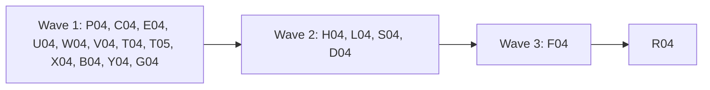

# Plan for 0.5.0-rc.2

The second release candidate of 0.5.0 finishes what the 0.4 line left open and fixes what the 0.5.0-rc.1 field test and the 0.5 reviews found. There is no 0.4.0 final: the maintainer decided on 2026-11-03 that the 0.4 work ships in 0.5, because 0.5.0-rc.1 holds everything in 0.4.0-rc.3 and the field tester saw the same results on both. The 0.4.0 milestone is closed and its open issues are in 0.5.0.

The headline is #788: the payment step still cannot type the test card on a Shopify Payments checkout. The rc.3 fix kept the reason, and the reason is now `card field number could not be filled: 8 visible inputs match`.

Each item is one PR. A PR is done when its acceptance test passes in CI, an adversarial review reports no blockers or majors, and it is squash-merged.

## Goals this release serves

From `docs/goals.md`:

- **Make it easy to change a GTM config reliably.** A purchase scenario that types the test card on its own is what lets a user rerun checkout after each change (#788). `from: <label>` (#789) lets a rule count a visit's own hits, so it does not flake on a boundary of a few milliseconds.
- **The first run shows where the setup likely breaks consent rules.** Container calls made just after a handoff must be redacted (#772). The identity checks must say what they read (#790).
- **Be safe by default.** Output must not carry query values of flagged requests (#679).
- **Expose all of this to agents through the CLI.** Usage errors and per-command help (#640, #641, #657).

Non-goals this release comes close to: none.

## Triage

Read-only agents checked all 92 open 0.5.0 issues against `main` at 3052dac on 2026-11-03. Their tables are the source of every claim below.

Closed, or to be closed with a comment, with no code change:

| Issue | Why |
| --- | --- |
| #644, #685, #688, #695, #740, #659, #779 | Fixed already by later PRs. |
| #651, #652 | Moot: A01 removed the alias. |
| #558, #632 | Moot: no markers left; the text is in a shipped plan. |
| #689, #707, #738 | Process notes, no code change. |
| #180, #256 | Known limits, closed with the maintainer's OK. The Known list keeps them. |
| #720 | The maintainer approved the `@types/node-forge` dev dependency (types only, not published). |

Waiting, not in rc.2:

| Issue | Why |
| --- | --- |
| #719 | `node-forge` 1.4.2 is two weeks old on 2026-11-10. Bump then. |
| #585 | No Shopify page names a checkout or payments host yet. |

## Decisions

- **No 0.4.0 final.** The 0.4 work ships in 0.5 (maintainer, 2026-11-03).
- **`earlyIdentifiers` and `deniedIdentifiers` read hit fields only** (#790). Identifiers that go out only in a request's `Cookie` header are left to the cookie rules. The docs say so. No code change.
- **`@types/node-forge`** stays as a dev dependency (#720).

## Order and waves

Twelve PRs in wave 1, four in wave 2, one in wave 3, then release prep. The later waves exist because of shared files:

- **`packages/expect/src/evaluate.ts`** changes in E04 (the body scan and Conversions API hashes, wave 1), H04 (the `sandboxPageUrl` message, wave 2) and F04 (`from:`, wave 3).
- **`packages/recorder/src/recorder.ts`** changes in C04 (container routing, wave 1) and L04 (the frame of each push, wave 2).
- **`packages/cli/src/main.ts`** changes in U04 (per-command help, wave 1) and S04 (the build Docker check, wave 2).
- **`packages/recorder/src/flags.ts`** changes only in L04.
- **Append-only overlaps.** Each PR edits only its own part: `docs/cli.md` (B04 the `--by-page` rows; D04 the identifier checks, Meta field names, the declaration hint, the suite output paragraph, the exit-code table and the summary fields; H04 the flag detail text; F04 the rule keys), `docs/design.md` (B04 the `--by-page` paragraph; D04 the decoder and stub rows, the unknown destination exception, the container header sentence, the server-hit rule paragraph; F04 the rule-key row), `fixtures/site/src/index.ts` (each PR adds its own routes), `fixtures/site/README.md` (each PR its own rows), and `CHANGELOG.md` (one marker per PR).

## Rules for every PR

The rules in `AGENTS.md` and the earlier plans still hold: fake IDs and identities only; no cookie value, identity value, card value, `gtmAuth` or container config in any output, with a leak test for each PR that adds output; e2e only against `fixtures/site` (and the stand-in container, with no Docker and no network); context-level hooks only.

More for rc.2:

- Each PR adds a regression test that fails when the change is removed, and the PR description says how that was checked. R04 and the docs-only parts of D04 and G04 are the exceptions.
- Each negative test checks first that its input really holds what the check looks for. On a run that exits 2, read the record named by the `Record:` line on stderr.
- New e2e tests go in new files, unless the entry names an existing file.
- No record schema change. `recordSchemaVersion` stays 3.
- Tests never need a running Docker daemon. Agents run with Docker stopped, as CI does.
- CHANGELOG: this plan PR adds a `## 0.5.0-rc.2` heading above `## 0.5.0-rc.1` with one marker per PR that has a user-visible change, a blank line between each pair. Each PR replaces only its own marker. R04 removes leftover markers. W04, T04, T05, X04 and G04's test part add no CHANGELOG line.

## PRs

### Wave 1

**P04 Shopify card fields by name (#788, #691, #684).** Touches: `packages/recorder/src/payment.ts`, `packages/recorder/src/payment.test.ts`, new fixture pages and card-frame documents in `fixtures/site/public/`, `fixtures/site/src/index.ts` (routes and the card frame list only), `fixtures/site/src/pages-0.5.test.ts`, `fixtures/site/README.md`, `e2e/test-payment-frames.e2e.test.ts`, `e2e/test-payment-declared.e2e.test.ts` (#684 preconditions only), `docs/cli.md` (the payment step error text), `CHANGELOG.md` (the P04 marker).
- **Per-field inputs.** Each card field has its own input selector: number `input[autocomplete="cc-number"], input[name="number"]`; expiry `input[autocomplete="cc-exp"], input[name="expiry"]`; CVC `input[autocomplete="cc-csc"], input[name="verification_value"]`; name `input[autocomplete="cc-name"], input[name="name"]`. The visible-and-exactly-one rule from rc.3 still applies to that selector. A bare `input` is never used for Shopify.
- **Frame by document path.** `CardField` gains the document path of its frame (for Shopify: a path ending in `number-ltr.html`, `expiry-ltr.html`, `verification_value-ltr.html`, `name-ltr.html`, with `-rtl` accepted). `cardFrameServed` checks the path as well as the title and the card host. A frame with the right title and host but another path is skipped, as a hidden frame is. Never print the host.
- **The reason.** When the count of matching visible inputs is not 1, the reason names the frame's URL path and, for each visible input, its `name`, `autocomplete` and `type`. Never a value, a placeholder or a label text. For example: `card field number could not be filled: 2 visible inputs match in /build/<hash>/number-ltr.html: [name=number autocomplete=cc-number type=text] [name=autofill-name autocomplete=cc-name type=text]`. It stays an `OwnReason`, so the scrubber does not touch it.
- **#691.** The host re-check runs again just before the key strokes, after the wait for the input, not only before the wait.
- **The fixture provider** uses the same per-field selector form and a document path on its own frames, so the e2e exercises the Shopify code path. The old fixture pages keep working.
- **#684.** The declared-payment e2e checks first that `site.cardSubmits` holds the card and that a recorded request holds `encodeURIComponent(EMAIL)`, before asserting they are absent from the output.
Regression test: unit tests with Shopify-shaped fake frames: a number document with eight visible autofill inputs and one `cc-number` input (typed into the right one); a decoy frame titled "Card number" on the card host with another path (skipped); a reason that lists the frame path and the inputs' attributes and holds no value; the host re-check after the wait. Fixture pages for both cases in the e2e.
Acceptance: `pnpm exec vitest run --project e2e e2e/test-payment-frames.e2e.test.ts` passes. On the old `payment.ts`, the extra-autofill-inputs page fails with `N visible inputs match`.
QA: run the new fixture pages with `--allow-test-payment`; check stderr holds no typed value.

**C04 Container routing and handoff redaction (#772, #768, #770).** Touches: `packages/recorder/src/recorder.ts` (`routeToContainer` and the container capture callback only), `packages/recorder/src/server-container/capture.ts` (only if the link to the browser request is needed), `packages/recorder/test/e2e/server-container.e2e.test.ts` (new; the server-container tests move here from `recorder.e2e.test.ts`), `packages/recorder/test/e2e/recorder.e2e.test.ts` (the moved block removed), `docs/design.md` (the handoff sentence of the server-container part of §5.4 only), `CHANGELOG.md` (the C04 marker).
- **#772.** A container call is redacted when the browser request that went to the container was inside the handoff window, judged by that browser request's time, not by the call's arrival at the proxy. Because the link may be missing, a container call that arrives within `QUIET_MS` after the window closes is redacted too. A container call is never stored with a query or body that a redacted browser request carried.
- **#768.** When the browser sends no `Cookie` header, the container gets no `Cookie` header. The fetch to the container still never reads or writes Playwright's own jar (keep the separate request context and pass the header list explicitly).
- **#770.** The server-container recorder tests move to their own file.
Regression test: a recorder e2e with the stand-in: a form submit inside a handoff whose container call arrives after `setHandoff(false)` (the stand-in delays it) is stored redacted; a request with no browser cookies reaches the stand-in with no `Cookie` header (the stand-in logs header presence, not values).
Acceptance: the new e2e file passes. On the old code the late container call is stored with its body, so the test fails.

**E04 Body scan and Conversions API hashes (#667, #668, #669, #670, #673, #712, #714, #715).** Touches: `packages/expect/src/evaluate.ts` (`mergeEdgeReadings`, `leafTexts`, `bodyTexts`, the `texts.push` spread, `idValue`, `checkHashes` only), `packages/expect/src/evaluate.test.ts`, `packages/expect/src/identity-values.test.ts`, `packages/expect/src/meta-capi.test.ts`, `packages/core/src/identity.ts` (`binaryShare` only), `packages/core/src/identity.test.ts`, `packages/decoders/src/meta-capi.ts`, `packages/decoders/src/meta-capi.test.ts`, `docs/cli.md` (the `identity.hashesMatch` paragraph only), `CHANGELOG.md` (the E04 marker).
- #667: merge two edge readings only when one equals the other after trimming, not when one contains the other. #668: scan a JSON path prefix as a name only, never as value text. #669: a part typed as binary in a text body keeps its field name. #670: build the text list without spreading a large array into `push`. #673: `binaryShare` counts code points.
- #712: every value of a multi-value `em` or `ph` is kept and checked. #714: `matchesIdentity` is computed for `ids.hashes` fields. #715: plain `ct`, `zp` and `country` on a Conversions API event are not treated as matching hashed identity; the plain-address rule applies only where the vendor documents plain fields.
Regression test: one unit case per issue, each failing on the old code.
Acceptance: the unit tests pass, and each fails with its line reverted.

**U04 Usage errors and per-command help (#640, #641, #657).** Touches: `packages/cli/src/args.ts`, `packages/cli/src/args.test.ts`, `packages/cli/src/main.ts` (the help dispatch only), `docs/cli.md` (no change unless a help text is quoted), `CHANGELOG.md` (the U04 marker).
- #640: an unknown option prints one short line, `Unknown option --bogus.`, not Node's raw message. #641: `tagreeve <command> --help` prints that command's options for every command. #657: a mistyped option before the command keeps the command name in the usage hint.
Regression test: unit tests for each.
Acceptance: `tagreeve diff --help` prints the `diff` options; `tagreeve run --sitee x.yml` names `run` in the hint.

**W04 Release workflow and marker tests (#698, #701, #702, #703).** Touches: `scripts/changelog-markers.test.ts`, `scripts/release-workflow.test.ts`.
- #698: the marker test asserts the first `## ` heading equals the `package.json` version, so it checks a real section. #701: `permissions: read-all` is read-only. #702: a reusable-workflow job (`uses`, no `steps`) does not crash the checker, and its `uses` is checked. #703: backslash continuations are joined before the publish lines are checked.
Regression test: inline cases for each.
Acceptance: the cases pass and fail with each fix reverted.

**V04 Stores fixes (#735, #736, #737).** Touches: `packages/cli/src/suite.ts`, `packages/cli/src/suite.test.ts`, `packages/cli/src/stores.ts`, `packages/cli/src/stores.test.ts`, `CHANGELOG.md` (the V04 marker).
- #735: `--allow-test-payment` that matches no store is a usage error (exit 2) that names the flag, not a silent skip. #736: a test that store and `--var` values stay out of `suite.json`. #737: a missing `autoconsentRules` file is found when the stores file is read.
Regression test: unit tests for each.
Acceptance: the tests pass and fail on the old code.

**T04 Baseline tests that can fail (#653, #654, #676, #677).** Touches: `e2e/baseline.e2e.test.ts`, `e2e/scenarios/baseline-leak.yml`, `packages/cli/src/baseline.test.ts`.
- #653: an e2e case for a baseline saved under a scenario name without `.yml`. #654: a leak test through the moved-warning and tuple-label output. #676: the same-baseline case asserts no `moved` warning. #677: preconditions for the encoded email and the other hash.
Acceptance: each new assertion fails when the guarded behaviour or value is changed; the PR description lists how.

**T05 Identity and cookie test gaps (#642, #660, #661, #709, #710).** Touches: a new fixture page for the SE plain phone and zip (`fixtures/site/public/`, its route in `fixtures/site/src/index.ts`, `fixtures/site/README.md`), `e2e/scenarios/identity-country-se.yml`, `e2e/identity-country.e2e.test.ts`, `packages/expect/src/early-identifiers.test.ts`, `e2e/early-identifiers.e2e.test.ts`, `e2e/cookie-already-set.e2e.test.ts`, `e2e/stored-cookie-evidence.e2e.test.ts`, `e2e/report-marks.e2e.test.ts`.
- #642: the SE e2e reaches a plain phone and zip. #660: the denied-default test uses an `undecided` epoch first. #661: a fake cookie value and stderr in the leak test. #709: the cookie tests check the record (names) and the run, not the fixture. #710: the precondition checks a hit param.
Acceptance: each test fails with the line it guards removed.

**X04 Stand-in container tests (#755, #787, #754, #757).** Touches: `fixtures/site/src/stand-in-container.ts`, `fixtures/site/src/stand-in-container.test.ts`, `e2e/server-container-runner.e2e.test.ts`, `fixtures/site/README.md` (the stand-in rows).
- #787: the stand-in reads its CA once at start and `close()` waits for pending work, so no ENOENT after cleanup. #755: the stand-in logs what a careless container would (the config, the access token URL, `HTTP_PROXY`) so the leak checks can fail. #754: the embedded-Dockerfile check runs on x64 CI too. #757: the README says both start-up URLs are logged.
Acceptance: `pnpm test` passes 20 times in a row with no unhandled error (the PR shows the loop); each leak check fails with the scrub removed.

**B04 By-page masking and platform hosts in diff (#705, #706, #743).** Touches: `packages/expect/src/diff.ts`, `packages/expect/src/diff.test.ts`, `packages/cli/src/diff.ts`, `docs/cli.md` (the `--by-page` rows), `docs/design.md` (the `--by-page` paragraph), `CHANGELOG.md` (the B04 marker).
- #705: a path segment that holds `@`, is percent-encoded, or is a value kind (email, phone, hash) is masked. #706: the docs describe the rules exactly, including the over-64 and mixed-case rules. #743: `allowUnknownDestination` and the hidden-flags message cover `platformHost` too.
Acceptance: unit tests for each shape fail on the old code.

**Y04 Verdict names both identifier checks (#663).** Touches: `packages/cli/src/report/verdict.ts`, `packages/cli/src/report/verdict.test.ts`, `CHANGELOG.md` (the Y04 marker).
- A failed `deniedIdentifiers` stays in the failed list when `earlyIdentifiers` findings are named.
Acceptance: the unit test fails on the old code.

**G04 Server container guide (#773, #774, #775, #776, #777).** Touches: `docs/guide/server-container.md`, `scripts/server-container-guide.docs.test.ts`.
- #773: amd64 users pull Google's image; arm64 users rebuild after each Tagreeve upgrade. #774: with `--server-container`, non-load hits to `serverHosts` go to the local container; only loads and pages use the network. #775: the report section matches the built report (a row per server vendor, placed in its via hit's epoch, an unlinked column after the epochs). #776: keep the config file out of the repository, for example under `~/.config/tagreeve/`. #777: the guide test runs its checks on a copy with a planted fake config and `gtm_auth=` value and shows they fail.
Acceptance: `pnpm docs:test` passes; the planted copy fails the checks.

### Wave 2

**H04 No query values in flag output (#679).** Touches: `packages/cli/src/summary.ts`, `packages/cli/src/summary.test.ts`, `packages/expect/src/evaluate.ts` (the `sandboxPageUrl` message only), `packages/expect/src/evaluate.test.ts`, a new fixture page and route, `e2e/flag-detail-privacy.e2e.test.ts` (new), `e2e/scenarios/flag-detail-privacy.yml` (new), `docs/cli.md` (the flag detail text), `CHANGELOG.md` (the H04 marker).
- The text summary and the `--json` summary show a flag's request as `METHOD scheme://host/path` with query names only (`?a&b`), never values. Records keep the full detail, as today, because they are the user's own data on their own machine; the record rule is unchanged. The `sandboxPageUrl` message names the page by host and path only.
- The places that parse the host out of a flag detail (`summary.ts`, `evaluate.ts`) keep working, because the shape stays `METHOD url`.
Regression test: an e2e with a fixture page that triggers `stubBypass`, `possibleRedirectHop` (if reachable in stub mode; else a unit test), `unknownDestination` and `sandboxPageUrl` with the fake email in the query, asserting the email, its hash and a fake cookie value are in the record and absent from stdout, stderr and `--json`.
Acceptance: the e2e passes; on the old code the email is in the `--json` flags, so it fails.

**L04 unloadGap frames and tests (#722, #723, #724, #725).** Touches: `packages/recorder/src/flags.ts` (`buildUnloadGapFlags` only), `packages/recorder/src/flags.test.ts`, `packages/recorder/src/recorder.ts` (the frame of each push only), a new fixture page for `checkout_completed` (`fixtures/site/public/`, its route, `fixtures/site/README.md`, `fixtures/site/src/pages-0.5.test.ts`), `e2e/unload-gap-close.e2e.test.ts`, a new scenario, `CHANGELOG.md` (the L04 marker).
- #723: a push and a hit match by frame identity (a per-frame id the recorder assigns), not by frame URL string, so two `about:srcdoc` frames never cover each other. The handoff half of the issue does not hold and is not changed.
- #722: the same-frame and run-end unit tests use an event the old rule does not cover. #724: the negative e2e checks its input was recorded. #725: a browser-level e2e for a `checkout_completed` run end.
Acceptance: each test fails on the old code.

**S04 Proxy guard and the build Docker check (#718, #791).** Touches: `packages/recorder/src/server-container/proxy.ts`, `packages/recorder/src/server-container/proxy.test.ts`, `packages/recorder/src/server-container/image.ts`, `packages/recorder/src/server-container/image.test.ts`, `packages/cli/src/main.ts` (the build message only), `CHANGELOG.md` (the S04 marker).
- #718: the wildcard guard parses the address and refuses every spelling of the unspecified address (`::`, `::0`, `0:0:0:0:0:0:0:0`, `0`, `0.0.0.0`), and checks `server.address()` after listen. #791: `build` runs the same Docker check as `run --server-container` before the build, with one message for both: `Docker is needed for --server-container`, and the install link.
Acceptance: unit tests for each spelling and for a fake `docker` whose `info` fails.

**D04 Docs for the checks and the CLI (#662, #664, #674, #716, #790, #686, #739, #756, #744, #745, #746, #747, #769, #780).** Touches: `docs/cli.md` (the sections listed in "Order and waves"), `docs/guide/reading-results.md`, `README.md`, `docs/design.md` (the sections listed), `site/src/lib/annotations.ts`, `scripts/site-docs.docs.test.ts`.
- One sentence or table row each, as the triage tables say. #664 changes the sample summary in three places that pin it (the guide, the site annotation and its docs test). #790 follows the decision above. #769 says the container gets every request header except `Host`, and no `Cookie` header when the browser sends none (after C04). #780 says what a failing `mustNot` reports.
Acceptance: `pnpm docs:build` and `pnpm docs:test` pass; the docs reviewer checks each sentence against the code.

### Wave 3

**F04 `from: <label>` (#789).** Touches: `packages/expect/src/scenario.ts`, `packages/expect/src/scenario.test.ts`, `packages/expect/src/evaluate.ts` (the hit and cookie rule windows only), `packages/expect/src/evaluate.test.ts`, `packages/expect/src/cookie-rules.test.ts`, `docs/cli.md` (the rule keys), `docs/design.md` (the rule-key row), `e2e/from-label.e2e.test.ts` (new), `e2e/scenarios/from-label.yml` (new), `CHANGELOG.md` (the F04 marker).
- `from: <label>` starts a rule's window at the labelled step's start, so it includes the step's own hits. `after: <label>` keeps its meaning (from the step's end), and the docs say so with the visit example. A rule may use one of `from` and `after`, not both (a scenario error that names the rule).
Regression test: unit tests on hits a few milliseconds before and after a visit step's end; the e2e uses a visit step whose own page-load hit a `from:` rule counts and an `after:` rule does not.
Acceptance: the e2e passes; on the old code `from:` is an unknown key, so it fails.

### Release

**R04 Release prep (#782, #783, #784, #785).** Touches: `package.json` (the version), `packages/cli/src/summary.test.ts` (the `readVersion()` line only), `docs/cli.md` (the version sentence), `CHANGELOG.md` (intro line, leftover markers, a "Known in 0.5.0-rc.2" list), `README.md` (status block), `site/src/components/home/Hero.astro` and `scripts/docs-site.docs.test.ts` (the release pill, #785), and any other test or doc that pins `0.5.0-rc.1`.
- The Known list is new for rc.2; the rc.1 section is not edited. It names #585 (platform hosts) and #719 (node-forge bump), says the flag detail keeps query values in records only (#679 fixed the output, #782), says link rule 2 is not built (#783), cites only open issues (#784), and says whether #788's fix is confirmed on a real checkout (it is not until the field test).
Acceptance: `pnpm lint`, `pnpm typecheck`, `pnpm test` and `pnpm docs:test` pass; `scripts/release.sh 0.5.0-rc.2` runs on `main` after merge. The maintainer publishes.

## After the PRs

The maintainer field-tests `0.5.0-rc.2`: scenario F on the Shopify Payments dev store with the declaration in place (#788), the published suite, and the local server container with Check C0 items 1 to 3 from the 0.5 plan. Then 0.5.0 final.

## Flagged concerns

- **#788's cause is likely, not confirmed.** The field test gave a count, not the DOM. The per-field selectors and the frame path fix both explanations in the issue, and the new reason names the frame path and the inputs' attributes, so the next run shows the real DOM if it still fails.
- **#772 is a privacy fix.** C04 is reviewed with `sensitive: true`.
- **#679 changes output, not records.** Records keep full URLs because they stay on the user's machine. If the maintainer wants records to drop query values too, that is a record schema change for a later release.
