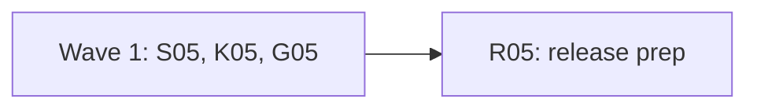

# Plan for 0.5.0

0.5.0 is the final release of the 0.5 line. It ships everything in 0.5.0-rc.1 and 0.5.0-rc.2, plus four items from the rc.2 field test on a real Shopify store (custom pixel, GTM web container, a server workspace run locally with `--server-container`). There is no rc.3: each item is small, keeps existing scenarios working, and is tested without Docker or the network. Each item is one PR. A PR is done when its acceptance test passes in CI, an adversarial review reports no blockers or majors, and it is squash-merged.

## Goals this release serves

- **Expected behaviour as data, checked on every run:** S05 lets a hit rule say who sent the hit, so a browser-only rule keeps its meaning when `--server-container` is on (#900).
- **Be safe by default:** K05 makes a missing server container image a clear, early stop for a whole suite (#898). R05 makes the Known list cite only open issues (#893).
- **Users: Shopify stores first:** G05 shows how to test an unpublished server workspace through its preview environment (#899).

## Triage

The four field-test issues, checked against `main` at 0bb7ec2:

| Issue | Finding | Entry |
| --- | --- | --- |
| #900 | Still valid. A hit decoded from a server container call has a request with `captured: 'serverContainer'` (`isServerHit` in `packages/expect/src/evaluate.ts`), but no rule key can select on it. A browser-only `mustNot` on a Google host fails on the container's own forwarding. | S05 |
| #898 | Mostly fixed already. `runSuite` calls `prepareServerContainer` once, before any scenario starts, and exits 2 on a missing image (`packages/cli/src/suite.ts`). No test pins that. The message does not say which `tagreeve-sgtm` images exist. The ten failures in the issue were ten separate `run` calls. | K05 |
| #899 | Still valid. Tagreeve passes the container config to the container as it is, so a config built from a workspace's preview environment serves the workspace build. The rc.2 Known list says unpublished workspaces are not available. | G05 (guide), R05 (Known list) |
| #893 | Still valid. The rc.2 Known list cites closed issues (#783, #782, #788, #679), and no open issue tracked link rule 2. #901 now tracks it, in 0.6.0. | R05 |

## Decisions

Maintainer decisions, 2026-11-03:

- **0.5.0 is the final release, with no rc.3.** Before publishing, the maintainer installs from the `v0.5.0` tag and reruns the field-test accept scenario with `sentBy: browser`.
- **`sentBy` defaults to both senders.** A rule without `sentBy` matches browser hits and server container calls, as today.
- **#898: no fallback image and no `--version` note.** Running an older version's image could silently run a build that does not match this version, and a note on `--version` would print on every call. The server container guide already says arm64 users rebuild after each upgrade.
- **Open `review-minor` issues move to 0.6.0.** None changes what a user can rely on beyond what the Known list says.
- **Link rule 2 is 0.6.0** (#901). **The node-forge bump** (#719) cannot land before 2026-11-10 and stays in the Known list.

## Order and waves

Summary: three PRs in parallel, then the release prep.

The wave 1 entries share no file except `CHANGELOG.md`, where S05 and K05 each replace their own marker. R05 removes the leftover markers and writes the rest of the 0.5.0 section.

## Rules for every PR

The rules in `AGENTS.md` and the earlier plans still hold: fake IDs and identities only; no cookie value, identity value, card value, `gtmAuth` or container config in any output, with a leak test for each PR that adds output; e2e only against `fixtures/site` (and the stand-in container, with no Docker and no network); context-level hooks only.

More for 0.5.0:

- Each PR adds a regression test that fails when the change is removed, and the PR description says how that was checked. G05's guide test and R05 are the exceptions.
- No record schema change. `recordSchemaVersion` stays 3.
- Tests never need a running Docker daemon. A test that needs a `docker` command puts a fake one on `PATH`, as `packages/recorder/src/server-container/runner.test.ts` does.
- CHANGELOG: this plan PR adds a `## 0.5.0` heading above `## 0.5.0-rc.2` with the R05 marker, then a `### Since rc.2` heading with one marker each for S05 and K05, a blank line between each pair. Each PR replaces only its own marker. G05 adds no CHANGELOG line.

## PRs

### Wave 1

**S05 `sentBy` on hit rules (#900).** Touches: `packages/expect/src/scenario.ts` (`VENDOR_KEYS` and the `sentBy` parse only), `packages/expect/src/scenario.test.ts`, `packages/expect/src/evaluate.ts` (`matchesFilter` only, using the existing `isServerHit`), `packages/expect/src/evaluate.test.ts`, `packages/cli/src/report/model.ts` (`SHOWN_VALUE_KEYS` only, add `sentBy`), `packages/cli/src/report/model.test.ts`, `e2e/sent-by.e2e.test.ts` (new), `e2e/scenarios/sent-by.yml` (new), `docs/cli.md` (the rule keys), `docs/design.md` (one row in the §11 rule-key table, next to `from:`, and one sentence in the §11 Server hits paragraph), `CHANGELOG.md` (the S05 marker).
- `sentBy: browser` matches only hits whose request the browser sent. `sentBy: server` matches only hits decoded from a server container call. Without `sentBy`, a rule matches both, as today. Any other value is a scenario error that names the rule.
- `sentBy` works in `must` and `mustNot` hit rules, alongside every other filter key. Cookie rules do not take it (a scenario error, like any unknown key).
- A rule with `sentBy: browser` never judges a server container call, so the `serverSendUnlinked` and `serverSendProbableLink` notes do not apply to it. Without `--server-container`, `sentBy: server` matches nothing, and the docs say so.
Regression test: unit tests for the parse (both values, a bad value, a cookie rule with `sentBy`) and for `matchesFilter` on a browser hit and a server hit. The e2e runs `--server-container` with the fixture's stand-in container, where the browser and the stand-in both send GA4 hits to the same host. Precondition: the record holds a GA4 hit of each sender. `mustNot { vendor: ga4, host: <that host>, sentBy: browser }` passes while the same rule without `sentBy` fails (the #900 case), and `must { vendor: ga4, sentBy: server }` passes.
Acceptance: the e2e passes. On the old code `sentBy` is an unknown key, so the scenario fails to load.

**K05 Server container image check in a suite (#898).** Touches: `packages/recorder/src/server-container/runner.ts` (the `imageMissing` message in `checkServerContainerHost` only), `packages/recorder/src/server-container/runner.test.ts`, `packages/cli/src/suite.test.ts` (one new case), `CHANGELOG.md` (the K05 marker).
- When the image is missing, the message lists the local `tagreeve-sgtm` tags, from `docker image ls --format {{.Tag}} tagreeve-sgtm` through `runDocker`, tags only: `The image tagreeve-sgtm:0.5.0 is not available. Local tagreeve-sgtm images: 0.5.0-rc.2, 0.5.0-rc.1. Run: tagreeve server-container build`. With none, it says `none`. When the list call fails, the message is the old one.
- Pin the existing behaviour: `suite --server-container` with a missing image exits 2 before any scenario starts and prints the message once.
Regression test: `runner.test.ts` cases with a fake `docker` on `PATH` (tags listed, no tags, list call fails). The `suite.test.ts` case uses a fake `docker` whose `image inspect` fails and asserts exit 2, one message, and that no scenario ran.
Acceptance: the tests pass, and the listing case fails on the old message.

**G05 Workspace preview in the server container guide (#899).** Touches: `docs/guide/server-container.md` (the "Set up" section), `scripts/server-container-guide.docs.test.ts`.
- Show the two configs side by side: the live container's config, and a config built from a server workspace's preview environment. Both are the base64 of `id=<container>&env=<env id>&auth=<auth>`. For a workspace, `env` and `auth` come from its preview environment. Say that the preview environment must exist, and that a quick preview creates it.
- Placeholders only, never a real-looking value: `GTM-PWTEST1`, `<env id>`, `<auth>`. The config stays a secret file outside the repo, mode 0600, as the guide already says.
Acceptance: `pnpm docs:test` passes, and the guide test's planted fake config and `gtm_auth=` value still make the checks fail.

### Release

**R05 Release prep (#893, #899).** Touches: `package.json` (the version), `packages/cli/src/summary.test.ts` (the `readVersion()` line only), `CHANGELOG.md` (the 0.5.0 section and leftover markers), `README.md` (status block and install line), `docs/cli.md` (the version sentence), `docs/design.md` (the status line), `site/src/components/home/Hero.astro` and `scripts/docs-site.docs.test.ts` (the release pill), and any other test or doc that pins `0.5.0-rc.2` as the current version.
- Version `0.5.0`. The install line is `npm i -g tagreeve`.
- The 0.5.0 section follows the 0.3.0 final section: what the release adds (everything in the 0.4.0 and 0.5.0 candidates below, plus "Since rc.2"), an "Upgrading from 0.3.0" list (the last final release), the "Since rc.2" lines, and a "Known in 0.5.0" list. The rc sections below it are not edited.
- The Known list cites only open issues, or names a closed one only in a clear "fixed by" clause (#893). It cites #901 for link rule 2. It says Stape-only features are missing from the local container, and that an unpublished server workspace can be tested through its preview environment (#899). It keeps #585, #719, #845 and every other limit from the rc.2 list that is still true and still open.
Acceptance: `pnpm lint`, `pnpm typecheck`, `pnpm test` and `pnpm docs:test` pass; `scripts/release.sh 0.5.0` runs on `main` after merge. The maintainer publishes.

## After the PRs

The maintainer installs from the `v0.5.0` tag, reruns the field-test accept scenario with `sentBy: browser` on the GA4 host rule, and publishes with `npm publish` (dist-tag `latest`). Then 0.6.0-rc.1 starts.

## Out of scope

| Item | Why it waits |
| --- | --- |
| Link rule 2 (#901) | A linking change with ranking rules to design. 0.6.0. |
| Project layout defaults, config and `tagreeve init` (#811), the unticked-checkbox failure (#810), `network: live` in scenarios (#815) | 0.6.0, as decided for #811 and #810. |
| #898 fallback image and `--version` note | Declined (see Decisions). |
| node-forge bump (#719) | Not before 2026-11-10. |
| Open `review-minor` issues | Moved to 0.6.0. |
