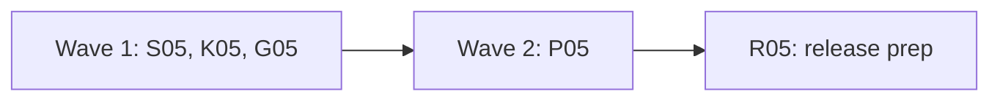

# Plan for 0.5.0

0.5.0 is the final release of the 0.5 line. It ships everything in 0.5.0-rc.1 and 0.5.0-rc.2, plus four items from the rc.2 field test on a real Shopify store (custom pixel, GTM web container, a server workspace run locally with `--server-container`) and one batch of output privacy fixes found in the rc.2 reviews. There is no rc.3: each item is small, keeps existing scenarios working, and is tested without Docker or the network. Each item is one PR. A PR is done when its acceptance test passes in CI, an adversarial review reports no blockers or majors, and it is squash-merged.

## Goals this release serves

- **Expected behaviour as data, checked on every run:** S05 lets a hit rule say who sent the hit, so a browser-only rule keeps its meaning when `--server-container` is on (#900).
- **Be safe by default:** K05 makes a missing server container image a clear, early stop for a whole suite (#898). R05 makes the Known list cite only open issues (#893). P05 stops the text and `--json` summaries from printing a value from a flag's URL (#870, #871, #869, #874).
- **Users: Shopify stores first:** G05 shows how to test an unpublished server workspace through its preview environment (#899).

## Triage

The four field-test issues, checked against `main` at 0bb7ec2:

| Issue | Finding | Entry |
| --- | --- | --- |
| #900 | Still valid. A hit decoded from a server container call has a request with `captured: 'serverContainer'` (`isServerHit` in `packages/expect/src/evaluate.ts`), but no rule key can select on it. A browser-only `mustNot` on a Google host fails on the container's own forwarding. | S05 |
| #898 | Mostly fixed already. `runSuite` calls `prepareServerContainer` once, before any scenario starts, and exits 2 on a missing image (`packages/cli/src/suite.ts`). No test pins that. The message does not say which `tagreeve-sgtm` images exist. The ten failures in the issue were ten separate `run` calls. | K05 |
| #899 | Still valid. Tagreeve passes the container config to the container as it is, so a config built from a workspace's preview environment serves the workspace build. The rc.2 Known list says unpublished workspaces are not available. | G05 (guide), R05 (Known list) |
| #893 | Still valid. The rc.2 Known list cites closed issues (#783, #782, #788, #679), and no open issue tracked link rule 2. #901 now tracks it, in 0.6.0. | R05 |
| #870, #871, #869, #874, #853 | Still valid (from the 0.6.0 minors triage). `redactFlagDetail` in `packages/cli/src/summary.ts` rewrites only `scheme://` tokens, so a relative or protocol-relative `sandboxPageUrl` page keeps its query (#870). Path segments are not masked, so `/account/<email>` prints (#871; `isValueSegment` is private to `packages/expect/src/diff.ts`). `queryName` shows a bare query item with no `=` as a name (#869) and prints the decoded form (#874). The by-page masking test's phone value passes on the old code (#853). | P05 |
| #892, #894, #895, #896 | Still valid for the next Known list: the rc.2 list and README paragraph leave out open issues users can meet, the #719 line does not say which release is two weeks old, and the test-mode marker, expiry format and frame path limits are missing. | R05 |

## Decisions

Maintainer decisions, 2026-11-03:

- **0.5.0 is the final release, with no rc.3.** Before publishing, the maintainer installs from the `v0.5.0` tag and reruns the field-test accept scenario with `sentBy: browser`.
- **`sentBy` defaults to both senders.** A rule without `sentBy` matches browser hits and server container calls, as today.
- **#898: no fallback image and no `--version` note.** Running an older version's image could silently run a build that does not match this version, and a note on `--version` would print on every call. The server container guide already says arm64 users rebuild after each upgrade.
- **The output privacy fixes (P05) are in 0.5.0** (maintainer, 2026-11-03). A final release does not ship a known leak in its summaries. Records are unchanged: they keep the full flag detail, as before.
- **The other open `review-minor` issues move to 0.6.0.** None changes what a user can rely on beyond what the Known list says. R05 settles #892, #894, #895 and #896, which are about the Known list itself.
- **Link rule 2 is 0.6.0** (#901). **The node-forge bump** (#719) cannot land before 2026-11-10 and stays in the Known list.

## Order and waves

Summary: three PRs in parallel, then the privacy fixes, then the release prep.

The wave 1 entries share no file except `CHANGELOG.md`, where S05 and K05 each replace their own marker. P05 is a wave of its own because it edits `packages/expect/src/evaluate.ts`, `docs/cli.md` and `docs/design.md`, which S05 also edits. R05 removes the leftover markers and writes the rest of the 0.5.0 section.

## Rules for every PR

The rules in `AGENTS.md` and the earlier plans still hold: fake IDs and identities only; no cookie value, identity value, card value, `gtmAuth` or container config in any output, with a leak test for each PR that adds output; e2e only against `fixtures/site` (and the stand-in container, with no Docker and no network); context-level hooks only.

More for 0.5.0:

- Each PR adds a regression test that fails when the change is removed, and the PR description says how that was checked. G05's guide test and R05 are the exceptions.
- No record schema change. `recordSchemaVersion` stays 3.
- Tests never need a running Docker daemon. A test that needs a `docker` command puts a fake one on `PATH`, as `packages/recorder/src/server-container/runner.test.ts` does.
- CHANGELOG: this plan PR adds a `## 0.5.0` heading above `## 0.5.0-rc.2` with the R05 marker, then a `### Since rc.2` heading with one marker each for S05, K05 and P05, a blank line between each pair. Each PR replaces only its own marker. G05 adds no CHANGELOG line.

## PRs

### Wave 1

**S05 `sentBy` on hit rules (#900).** Touches: `packages/expect/src/scenario.ts` (`Filter`, `VENDOR_KEYS` and the `sentBy` parse only), `packages/expect/src/scenario.test.ts`, `packages/expect/src/evaluate.ts` (`Context` and its construction for the server-hit id set, `matchesFilter`, `describeSelector`, `asBrowserHits`; using the existing `isServerHit`), `packages/expect/src/evaluate.test.ts`, `packages/cli/src/report/model.ts` (`SHOWN_VALUE_KEYS` only, add `sentBy`), `packages/cli/src/report/model.test.ts`, `e2e/sent-by.e2e.test.ts` (new), `e2e/scenarios/sent-by.yml` (new), `e2e/scenarios/sent-by-both.yml` (new), `docs/cli.md` (the rule keys), `docs/design.md` (add `sentBy` (`browser` or `server`, default both) to the §11 "Filters support ..." sentence, not to the rule table, and one sentence in the §11 Server hits paragraph), `CHANGELOG.md` (the S05 marker).
- `sentBy: browser` matches only hits whose request the browser sent. `sentBy: server` matches only hits decoded from a server container call. Without `sentBy`, a rule matches both, as today. Any other value is a scenario error that names the rule.
- The sender is fixed before the probable-link counterfactual: `asBrowserHits` must not change what `sentBy` selects. The ids of server hits are recorded before it rewrites the requests, and `sentBy` reads that set. A scoped (`before`, `in`, `after`, `from` or `consent.*`) `sentBy: browser` rule therefore never gets a `serverSendProbableLink` note.
- `sentBy` works in `must` and `mustNot` hit rules, alongside every other filter key. Cookie rules do not take it (a scenario error, like any unknown key).
- A rule with `sentBy: browser` never judges a server container call, so the `serverSendUnlinked` and `serverSendProbableLink` notes do not apply to it. Without `--server-container`, `sentBy: server` matches nothing, and the docs say so.
Regression test: unit tests for the parse (both values, a bad value, a cookie rule with `sentBy`) and for `matchesFilter` on a browser hit and a server hit. Add a unit test for a scoped `sentBy: browser` rule with a probable-linked server hit: no note. The e2e runs `--server-container` with the fixture's stand-in container. `e2e/scenarios/sent-by.yml` has an `evaluate` step that does a `fetch` POST of a GA4 hit to `/g/collect?v=2&tid=G-PWTEST0001&en=page_view` on `sgtmUrl`, so the GA4 decoder records a browser hit at the container's loopback host and `fixtures/site/public/server-container.html` stays unchanged. That path is in the stand-in's `TRIGGER_PATHS`, so the stand-in sends GA4 to `www.google-analytics.com`. Preconditions, checked on the record first: one GA4 hit sent by the browser to the loopback host, one GA4 hit decoded from a container call to `www.google-analytics.com`, and no browser request to the Google host. The scenario holds these rules side by side, and the test reads each rule's result from the `--json` summary:
- `must { vendor: ga4, host: <loopback host>, sentBy: browser }` passes. This is the positive browser match, so the test fails when `sentBy: browser` matches nothing.
- `mustNot { vendor: ga4, host: <loopback host>, sentBy: server }` passes.
- `mustNot { vendor: ga4, host: www.google-analytics.com, sentBy: browser }` passes, and `must { vendor: ga4, host: www.google-analytics.com, sentBy: server }` passes.
- A second scenario has the same Google-host `mustNot` rule without `sentBy`. It fails, and the run exits 1 with only that rule failed (the #900 case).
Acceptance: the e2e passes. On the old code `sentBy` is an unknown key, so the scenario fails to load.

**K05 Server container image check in a suite (#898).** Touches: `packages/recorder/src/server-container/runner.ts` (the `imageMissing` message in `checkServerContainerHost` only; `IMAGE_REPOSITORY` imported from `image.ts`), `packages/recorder/src/server-container/runner.test.ts`, `packages/recorder/src/server-container/fake-docker.test-helper.ts` (the script gains an `images` field of tag lines and a `listFail` flag, and `image ls` is logged like the other calls; `image.test.ts` and `runner.test.ts` keep passing), `packages/cli/src/suite.test.ts` (one new case), `CHANGELOG.md` (the K05 marker).
- When the missing image is in `IMAGE_REPOSITORY` (the arm64 case, `tagreeve-sgtm:<version>`), the message lists the local `tagreeve-sgtm` tags, from `docker image ls --format {{.Tag}} tagreeve-sgtm` through `runDocker`, tags only: `The image tagreeve-sgtm:0.5.0 is not available. Local tagreeve-sgtm images: 0.5.0-rc.2, 0.5.0-rc.1. Run: tagreeve server-container build`. With none, it says `none`. When the list call fails, the message is the old one. When the missing image is Google's digest reference or an override (amd64), the message stays the old one and no `docker image ls` call is made.
- Pin the existing behaviour: `suite --server-container` with a missing image exits 2 before any scenario starts and prints the message once.
Regression test: `runner.test.ts` cases with a fake `docker` on `PATH` (tags listed, no tags, list call fails, and a missing non-`tagreeve-sgtm` image that asserts no `docker image ls` call and the old message). The `suite.test.ts` case uses a fake `docker` whose `image inspect` fails and asserts exit 2, one message, and that no scenario ran.
Acceptance: the tests pass, and the listing case fails on the old message.

**G05 Workspace preview in the server container guide (#899).** Touches: `docs/guide/server-container.md` (the "Set up" section, and the "What it does not show" bullet on unpublished workspaces, which is replaced by the preview-environment note or moved into "Set up"), `docs/guide/reading-results.md` (the last sentence of the server-hit paragraph: unpublished workspaces), `scripts/server-container-guide.docs.test.ts`.
- Show the two configs side by side: the live container's config, and a config built from a server workspace's preview environment. Both are the base64 of `id=<container>&env=<env id>&auth=<auth>`. For a workspace, `env` and `auth` come from its preview environment. Say that the preview environment must exist, and that a quick preview creates it.
- Reword the `reading-results.md` sentence to match: with the live config the local container does not show unpublished workspaces. The summary line (`SERVER_CONTAINER_LIMITS` in `summary.ts`) and the report line (`SERVER_CAVEAT` in `render.ts`) stay as they are, so no CLI output changes and `site/demo/` is not re-recorded. They describe the live config, which is what a run uses by default.
- Placeholders only, never a real-looking value: `GTM-PWTEST1`, `<env id>`, `<auth>`. The config stays a secret file outside the repo, mode 0600, as the guide already says.
Acceptance: `pnpm docs:test` passes, and the guide test's planted fake config and `gtm_auth=` value still make the checks fail.

### Wave 2

**P05 No values from a flag's URL in the summaries (#870, #871, #869, #874, #853).** Touches: `packages/cli/src/summary.ts` (`redactFlagDetail`, `redactUrl`, `queryName` and the path masking), `packages/cli/src/summary.test.ts`, `packages/expect/src/diff.ts` (export `isValueSegment`, no behaviour change), `packages/expect/src/diff.test.ts` (#853: a phone value the old rule does not mask), `packages/expect/src/index.ts` (the export), `packages/expect/src/evaluate.ts` (`pageWithoutQuery` only), `packages/expect/src/evaluate.test.ts`, `e2e/flag-detail-privacy.e2e.test.ts` and `e2e/scenarios/flag-detail-privacy.yml` (the new cases), `docs/cli.md` (the flag detail sentence in the run summary paragraph), `docs/design.md` (the §13 flag detail sentence), `CHANGELOG.md` (the P05 marker).
- #870: the URL in a flag detail is redacted whatever its form: absolute, protocol-relative (`//host/path?q`), relative (`/path?q`), or one with a space in it. Only the URL is changed, so the `METHOD url`, `...: <url>` and `<vendor> received <url> as the page` shapes stay, and the parsers in `summary.ts` and `flagHost` in `evaluate.ts` keep working.
- #871: a path segment that `isValueSegment` calls a value reads `(other)`, in the summaries and in the `sandboxPageUrl` message (`pageWithoutQuery`). The cli package imports `isValueSegment` from `@tagreeve/expect`. It does not copy it.
- #869: a bare query item with no `=` is shown as a name only when `guardFieldName` keeps it; otherwise it reads `(other)`. #874: a query name is checked and shown in its raw form, so a decoded `&`, `=`, `?` or space cannot break the shape, and redaction stays idempotent.
- Records keep the full flag detail, as before, except the `sandboxPageUrl` message, which now also masks value-like path segments.
Regression test: unit cases for each URL form, for a path holding a fake email, a phone and a hash, for a bare value-like query item, for a percent-encoded `&` in a name, and redaction run twice gives the same text. The e2e adds a `sandboxPageUrl` page with a relative URL whose query and path hold the fixture's fake email. Precondition: the record holds the email. Assert the email, its hash and the fake cookie value are absent from stdout, stderr and `--json`.
Acceptance: the e2e and unit tests pass. On the old code the relative page's query and the email path segment appear in `--json`, so they fail.

### Release

**R05 Release prep (#893, #899, #892, #894, #895, #896).** Touches: `package.json` (the version), `packages/cli/src/summary.test.ts` (the `readVersion()` line only), `CHANGELOG.md` (the 0.5.0 section and leftover markers), `README.md` (status block and every install line), `docs/cli.md` (the version sentence, the first paragraph and the Install block), `docs/guide/first-run.md` (the install command), `site/src/lib/prompt.ts` (`INSTALL_COMMAND` and the agent prompt text), `scripts/docs-text.docs.test.ts` (`installProblem` and its negative cases), `scripts/docs-site.docs.test.ts` (the hero button and clipboard assertions, and the release pill), `docs/design.md` (the status line and its revision; §8.5 and §15.5 now say a server workspace runs through its preview-environment config; the §8.5 sentence "The local container does not show ... unpublished workspaces", worded with the live config only, for example: "With the live config the local container does not show unpublished workspaces; a config from a server workspace's preview environment serves that workspace"; one sentence in the §8.2 "Server workspaces" paragraph saying that with `--server-container` the caller passes a preview-environment config, while the `X-Gtm-Server-Preview` header stays unbuilt), `site/src/components/home/Hero.astro` (the release pill), and any other test or doc that pins `0.5.0-rc.2` as the current version.
- Version `0.5.0`. The install command is the bare `npm i -g tagreeve` everywhere it is written. The docs test turns around: `installProblem` now requires the bare command and rejects `@next` in `README.md`, `docs/guide/first-run.md`, the Install section of `docs/cli.md` and `site/src/lib/prompt.ts`, with negative cases for both. The next release candidate (0.6.0-rc.1) turns it back to `@next`.
- The 0.5.0 section follows the 0.3.0 final section: what the release adds (everything in the 0.4.0 and 0.5.0 candidates below, plus "Since rc.2"), an "Upgrading from 0.3.0" list (the last final release), the "Since rc.2" lines, and a "Known in 0.5.0" list. The rc sections below it are not edited.
- The Known list cites only open issues, or names a closed one only in a clear "fixed by" clause (#893). It cites #901 for link rule 2. It says Stape-only features are missing from the local container, and that an unpublished server workspace can be tested through its preview environment (#899). It keeps #585, #719, #845 and every other limit from the rc.2 list that is still true and still open. It adds the open issues users can meet that the rc.2 list left out (#892), at least #816, #848, #850 and #886. It says which release the #719 wait is for: node-forge 1.4.2, published 2026-10-27, so the bump lands on or after 2026-11-10 (#894). It names the unconfirmed Shopify test-mode marker, the expiry format and the inferred card frame paths (#895). The README status paragraph says the summaries show query names only and mask value-like path segments, and that records keep the full detail (#896, after P05).
Acceptance: `pnpm lint`, `pnpm typecheck`, `pnpm test` and `pnpm docs:test` pass; `scripts/release.sh 0.5.0` runs on `main` after merge. The maintainer publishes.

## After the PRs

The maintainer installs from the `v0.5.0` tag, reruns the field-test accept scenario with `sentBy: browser` on the GA4 host rule, and publishes with `npm publish` (dist-tag `latest`). Then 0.6.0-rc.1 starts.

## Out of scope

| Item | Why it waits |
| --- | --- |
| Link rule 2 (#901) | A linking change with ranking rules to design. 0.6.0. |
| Project layout defaults, config and `tagreeve init` (#811), the unticked-checkbox failure (#810), `network: live` in scenarios (#815) | 0.6.0, as decided for #811 and #810. |
| #898 fallback image and `--version` note | Declined (see Decisions). |
| node-forge bump (#719) | Not before 2026-11-10. |
| Open `review-minor` issues, except P05's and R05's | Moved to 0.6.0. |
