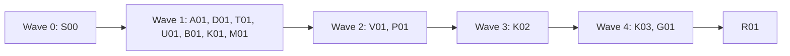
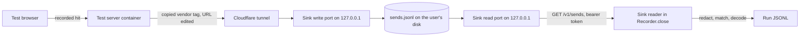

# Plan for 0.5.0

The headline of 0.5.0 is #358: show what the server container sends on to vendors. The browser sees only the first hop. Tagreeve 0.5.0 ships `tagreeve sink serve`, a sink that runs on the user's machine and is reached through a Cloudflare tunnel. A test server container whose vendor tags point at it lets Tagreeve record the second hop too, decode it and check it like a browser hit. The release also runs one suite across several stores (#360), stops Shopify's own hosts from drowning `unknownDestination` (#585), fixes `unloadGap` at the end of a run (#261), masks tokens in `--by-page` page paths (#535), removes the `pingwright` command alias, and fixes the review-minor issues that are still true after a check against the code. The target is `0.5.0-rc.1`, field-tested on a real store before `0.5.0`. Each item is one small PR. A PR is done when its acceptance test passes in CI, an adversarial review reports no blockers or majors, and it is squash-merged.

The work starts after `0.4.0` is released. The `0.4.0` work edits `CHANGELOG.md`, the `package.json` versions, `packages/cli/src/run.ts`, `packages/cli/src/summary.ts` and `e2e/baseline.e2e.test.ts`, and this plan's entries edit them too.

## Goals this release serves

From `docs/goals.md`:

- **Record what a site sends to each tracking vendor.** Today the record stops at the server container (design §8.5). K01, M01, K02, K03 and G01 record what it sends on, when its vendor tags point at the sink.
- **Express expected behaviour as data, and report pass or fail with evidence.** Server sends become hits, so rules, `identity.hashesMatch` and the identifier checks run on them (K03).
- **Make it easy to change a GTM config reliably.** One suite covers every storefront of a merchant (V01). `--by-page` baselines stop drifting on checkout tokens (B01).
- **The first run shows where the setup likely breaks consent rules, and what to fix first.** On a Shopify store, 85 to 110 platform requests per run bury the unknown destinations that matter (P01).
- **Be safe by default.** The sink holds full vendor payloads. It drops vendor access tokens and header values before it stores a send (K01), and the reader redacts the tester's IP before anything is written (K02). Leak tests that could not fail now can (T01). A committed baseline no longer holds an order token (B01).
- **Expose all of this to agents through the CLI.** One command name, `tagreeve` (A01). Every new feature has `--json` output.

Non-goals this release comes close to:

- **A hosted service.** K01 adds `tagreeve sink serve`. It runs on the user's machine, its read API answers on loopback only, and its files stay on that machine. With `--tunnel` it starts the user's own `cloudflared`, so the server container can reach it. Tagreeve still runs no hosted service. K01 rewords design §8.4 and the `AGENTS.md` rule to say so.
- **Every unknown destination flagged** (goal 7). P01 moves platform hosts to their own flag kind, `platformHost`. They are still flagged and listed, and a scenario can turn the list off.

## Findings

| Finding | Issue | What is wrong |
| --- | --- | --- |
| The field test could not answer the open questions about ads conversions and Conversions API data | #358 | The browser never sees the server container's outgoing requests. `Recorder.close` writes no server-side record. |
| A merchant with one store per market runs each scenario per store by hand | #360 | `suite` takes one `--site`, and every cell has empty `labels`. |
| `unknownDestination` flags 85 to 110 requests per run on a Shopify store | #585 | Shopify's telemetry, CDN and checkout hosts are unknown destinations. Only `allowUnknownDestination` and the diff filter help. |
| `unloadGap` stays quiet when a frame pushes an event just before the run ends | #261 | Only navigations are unload points. A custom dataLayer name outside the Shopify table is compared literally. |
| A `--by-page` baseline on a checkout drifts on every run and commits the order token | #535 | The page path goes into the key as it is. |
| Leak tests and a suite test cannot fail | #543, #565, #593 | They skip the report, miss the URL-encoded email, or never put an invalid child beside a valid one. |
| The design overstates WebKit results and the server preview header | #555, #560, #561, #563 | The text claims things the code and the probe do not show. |

## Triage

Every open issue in the 0.5.0 milestone, plus #552, #256, #180 and #535, which the rc.2 plan deferred. Each was checked against `main` at `9593533`.

| Issue | Still valid | Evidence | Size | Entry |
| --- | --- | --- | --- | --- |
| #358 | Yes | `docs/design.md:315` says the server-to-vendor hop is not visible, `:331` says the sink reader is not built. `packages/recorder/src/recorder.ts:844` sets `tagReports: []`. | L | K01, M01, K02, K03, G01 |
| #360 | Yes | `packages/cli/src/suite.ts:266` sets `labels: {}` on every cell. The manifest has one `site` (`suite.ts:37-46`). | M | V01 |
| #585 | Yes | `packages/recorder/src/flags.ts:83-87` flags every undecoded data request to a host that is not first party. No platform list exists in `packages/decoders/src`. | M | P01 |
| #261 | Yes, in part | `recorder.ts:832` passes only `this.navigations` as unload points. `flags.ts:174` and `:178` compare names literally outside `GA4_ALIASES`. The rest was fixed in #330. | M | U01 |
| #543 | Yes | `e2e/cookie-already-set.e2e.test.ts:20` and `e2e/stored-cookie-evidence.e2e.test.ts:18` check stdout, stderr and results, never the report. | S | T01 |
| #546 | Yes | `scripts/release-workflow.test.ts:22-24` checks top-level permissions only, `:37-41` uses a narrow publish regex, `:27-30` misses `github.token`, `:43-46` does not check the publish line. | S | A01 |
| #550 | Yes, until #261 is fixed | `CHANGELOG.md:131` names custom names but not browser close. U01's 0.5.0 line names both gaps. Release history is not edited. | S | U01 |
| #552 | Yes | `fixtures/site/public/unload-gap.html:12-16` parses the iframe with its plain `src`, then a script appends `?mode=`. | S | U01 |
| #555 | Yes | `docs/design.md:283` says server mode sends `X-Gtm-Server-Preview`. `:333` and `:470` say it is not sent. No code sends it. | S | D01 |
| #558 | No | The 0.4.0-rc.1 section of `CHANGELOG.md` has no markers, and `fixtures/site/src/pages-0.4.test.ts:150` asserts that. | - | Close on merge |
| #560 | Yes | `docs/design.md:421` starts with `1a.`, which is not a list marker. `:98` links to §14.1a. | S | D01 |
| #561 | Yes | `docs/design.md:98` says no Safari tracking prevention. `:421` reports a third-party cookie block and carries PR notes ("#361 can close", who runs Linux). | S | D01 |
| #562 | Yes | `scripts/probe-webkit.ts:13-14` sends any name other than `chromium` to WebKit and prints the given name. | S | D01 |
| #563 | Yes | `docs/design.md:420` says WebKit routes "from the same sources" as §9, which lists seven. The probe tested five. `:342` still says WebKit was not tested. | S | D01 |
| #565 | Yes | `e2e/report-marks.e2e.test.ts:60` has the literal and hashed email but not `encodeURIComponent(fixtureEmail)`. | S | T01 |
| #571 | Yes | No test checks the blank lines around CHANGELOG markers. Only `pages-0.4.test.ts:150` and `scripts/docs-text.docs.test.ts:51` look for leftover markers. | S | S00 |
| #593 | Yes | `packages/cli/src/report/suite.test.ts:287-293` has one child without `suite.json`, alone. `:275` has two valid children. | S | T01 |
| #535 | Page paths: yes. MCP: no. | There is no MCP server (`AGENTS.md`, #362). `packages/expect/src/diff.ts:310` and `:319-324` put the raw path in the key. `docs/cli.md:255` only warns. | S | B01 |
| #256 | Yes, as a known limit | `packages/recorder/src/netlog.ts:163` labels by timing only. `docs/cli.md:44` and design §5.3 say so. The 0.4 plan found no signal that tells the two cases apart. | - | None (see Flagged concerns) |
| #180 | Yes, upstream | The cause is Playwright's request interception (design §5.3, "Limit: redirects"). `possibleRedirectHop` (`flags.ts:94-100`) flags the misses. | - | None (see Flagged concerns) |

## Scope

In:

| Group | Issues | Size |
| --- | --- | --- |
| S00 CHANGELOG section and marker test | #571 | S |
| A01 Remove the `pingwright` alias, stricter release workflow test | #546 | S |
| D01 Design text and the WebKit probe | #555, #560, #561, #562, #563 | S |
| T01 Tests that could not fail | #543, #565, #593 | S |
| U01 `unloadGap` at run end and in the same frame | #261, #550, #552 | M |
| B01 Masked page paths in `--by-page` keys | #535 | S |
| K01 `tagreeve sink serve` with `--tunnel` | #358 | L |
| M01 Meta Conversions API decoder and the sink destination table | #358 | S |
| V01 Several stores in one suite | #360 | M |
| P01 Platform hosts | #585 | M |
| K02 Sink reader | #358 | L |
| K03 Checks, summary and report for server sends | #358 | M |
| G01 Recipe: point server tags at the sink | #358 | S |
| R01 Release prep | | S |

Not in:

| Issue | Why it waits |
| --- | --- |
| #256 | No signal tells an early `srcdoc` send on a later page from an unload send. The docs say the label is a guess. |
| #180 | The cause is in Playwright. The flag covers it. A Playwright upgrade would be the next test, and the version is pinned. |
| Goals 2 and 8 | No issues yet. They are proposals for the maintainer below. |
| #358's other options: the server tag reporter, the run token, the server preview header, `expectedTags` | The maintainer answered #358 with the test-sink path. These are part of goal 2 (design §8.1, §8.3, §8.2). See "For the maintainer to decide". |
| GA4 and Google Ads server tags through `HTTP_PROXY` | They cannot be pointed at the sink (see "Research: pointing server tags at the sink"). A proposal is in "For the maintainer to decide". |
| #514 `mobile` preset, the Shopify bridge, a full `microsoft-uet` decoder, the collector origin bridge | Listed in design §15 item 5, but not in the 0.5.0 milestone. R01 updates §15 to what 0.5.0 builds. |

Close on merge, each with a comment that gives the reason:

- #558: the 0.4.0-rc.1 section has no markers, and `pages-0.4.test.ts:150` asserts that. Nothing is left to do.

## Order and waves



S00 goes first alone, then seven PRs in wave 1, two in wave 2, the sink reader, its checks with the recipe, and release prep.

S00 adds the CHANGELOG markers that every other PR replaces, so it merges first. Wave 1 holds the PRs that edit separate files. The later waves exist because of shared files:

- **`packages/cli/src/args.ts`** changes in K01 (the `sink serve` command), V01 (`--stores`) and K02 (`--sink`). They are in waves 1, 2 and 3.
- **`packages/cli/src/suite.ts`** changes in V01 and K02 (passing `--sink` on). V01 is in wave 2, K02 in wave 3.
- **`packages/recorder/src/flags.ts`** changes in U01 (`buildUnloadGapFlags`), P01 (`buildFlags`) and K02 (sink requests are never unknown destinations). They are in waves 1, 2 and 3.
- **`packages/recorder/src/recorder.ts`** changes in U01 (the unload points and the frame of each push), P01 (passing the option) and K02 (the sink read in `close`). They are in waves 1, 2 and 3.
- **`packages/cli/src/summary.ts`** and **`packages/cli/src/report/model.ts`** change in P01 and K03. They are in waves 2 and 4.
- **`packages/cli/src/run.ts`** changes in P01 (the option plumbing only) and K02. They are in waves 2 and 3.
- **`packages/expect/src/diff.ts`** changes in B01 (`pagePath`) and K03 (the epoch lookup in `hitShape`). They are in waves 1 and 4.
- **`fixtures/site/src/index.ts`** changes in U01 (wave 1) and K02 (wave 3). U01 creates `fixtures/site/src/pages-0.5.test.ts`, and K02 adds to it.
- **`packages/core/src/records.ts`** changes in K02 and K03 (two `ResultNote` values). They are in waves 3 and 4. `packages/core/src/sink.ts` is new in K01, and K02 only imports it.
- **`.vitepress/config.ts`** changes in K01 (the `docs/sink.md` link) and G01 (the recipe link). They are in waves 1 and 4.
- **Append-only overlaps.** Each PR edits only its own part of these files, so merge order does not matter: `docs/design.md` (D01 edits §5.1, the last paragraph of §8.2, the collector bullet of §9 and §14 items 1 and 1a; U01 the `unloadGap` bullet of §5.3; M01 the §6 decoder table; B01 the last paragraph of §11; K01 the §3 diagram, the sink bullet of §8.3, §8.4, the "Test sink as the vendor endpoint" bullet of §8.5, the CLI list of §12 and the secrets bullet of §13; V01 none; P01 the unknown destination rule of §5.3 and §10.1; K02 the §4 rows, the `recordSchemaVersion` paragraph and the `t` sentence of §4, the "One clock" bullet of §7.3, the sink reader sentence of §8.5, the sink reader and Correlation bullets of §9 and a new last paragraph of §13; K03 the §8.5 table and a new paragraph after the §11 rules table; R01 the status line and §15), `docs/cli.md` (each PR its own section), `docs/sink.md` (K01 creates it, K02 adds the reader section), `packages/decoders/src/index.ts` (M01 adds two export lines, P01 one) and `CHANGELOG.md` (one marker per PR).

## Research: pointing server tags at the sink

Checked on 2026-11-02. No common server-side GTM vendor template has an endpoint field. Each one hardcodes the vendor host and limits its `send_http` permission to that host.

| Tag template | Endpoint | Source |
| --- | --- | --- |
| Meta Conversions API, official | The `API_ENDPOINT` constant (L154). `send_http` at L556 is allowed for that host only. The access token goes in the URL (L474). | [facebookincubator template](https://github.com/facebookincubator/ConversionsAPI-Tag-for-GoogleTagManager/blob/HEAD/template.tpl) |
| Meta Conversions API, Stape | The Meta host, at L1798 and L2115. | [stape-io/facebook-tag](https://github.com/stape-io/facebook-tag/blob/HEAD/template.tpl) |
| TikTok, official and Stape | Hardcoded vendor host. | |
| Snapchat (Stape), Pinterest (Stape), LinkedIn (Stape) | Hardcoded vendor host. | |
| Stape JSON HTTP Request | A Destination URL field, and `send_http` allows any URL. | [stape-io/json-http-request-tag](https://github.com/stape-io/json-http-request-tag/blob/HEAD/template.tpl) |
| Built-in GA4 and Google Ads server tags | Not a template. They cannot be pointed at another host. The only route out is the documented outgoing proxy, `HTTP_PROXY` on Cloud Run or in `gtm-cloud-image`. Their bodies go over HTTPS, so a proxy sees them only with TLS interception, which Google does not document. | [Proxy setup guide](https://developers.google.com/tag-platform/tag-manager/server-side/proxy-setup-guide) |

What follows from it:

- **A vendor template must be copied to point at the sink.** The user copies the template, then edits the endpoint URL and the `send_http` allowed URLs. Google says a gallery template that is edited no longer gets the publisher's updates ([GTM help](https://support.google.com/tagmanager/answer/9454109)). So the copy drifts from the template the production container runs.
- **Stape's JSON HTTP Request tag works as it is.** It needs no copy, but it sends the JSON the user sets up, not a vendor's payload.
- **Vendor test modes are no substitute.** Meta says events sent with `test_event_code` are not dropped and are used for targeting and measurement. Only Snapchat offers an API to read test events back.
- **Most Stape templates skip a hit whose `page_location` starts with `https://gtm-msr.appspot.com/`.** A hit from GTM's own tooling page therefore never reaches the sink. Tagreeve's hits carry the staging page's URL, so they are not skipped.

What the plan takes from it:

- **A separate test server container, not a test workspace.** A server workspace runs only in preview, which needs the `X-Gtm-Server-Preview` header, and Tagreeve does not send it. Publishing the workspace would send production traffic to the sink. K01's docs and G01 recommend a test server container with its own tagging URL.
- **A docs recipe (G01)** for copying the official and the Stape Meta Conversions API templates and editing the URL and `send_http`, and for Stape's JSON HTTP Request tag as it is.
- **The sink drops secrets before it stores a send (K01).** The values of `access_token` and `appsecret_proof` are replaced, and no header value other than `Content-Type` is kept, so `Authorization` and `Access-Token` never reach the file. K01 has a leak test for it.
- **A named tunnel on the user's own domain is the recommended setup (K01).** The reason is in "The tunnel" below.
- **GA4 and Google Ads through `HTTP_PROXY`** is a proposal in "For the maintainer to decide", not in the waves.
- **Template drift** is in "Flagged concerns".

## Design: what the server container sends on (#358)

The maintainer decided on 2026-11-02 to answer #358 with the test-sink path of design §8.5. Tagreeve ships the sink (K01), the destination table and a decoder (M01), the reader (K02), the checks and output (K03) and a setup recipe (G01). The server tag reporter, the run token, the preview header and `expectedTags` are part of the goal 2 proposal below. The reporter would reuse the sink and the reader.



The browser hit reaches the test server container, its copied vendor tags send through the tunnel to the sink's write port, and the reader fetches the matching sends from the read port, which the tunnel never reaches.

**How the traffic flows.** The user runs a test server container with its own tagging URL. It is a separate container, not a workspace of the production one (see the research above). The staging site's browser hits must reach it, for example through a web workspace loaded with `--gtm-override` whose server container URL is the test container's. The run uses `--network server` with that host in `serverHosts`. In `stub` mode those hits are stubbed and the sink usually gets nothing, so `--sink` prints a warning. Real vendors receive nothing from the test container only if every vendor tag in it points at the sink. The built-in GA4 and Google Ads server tags cannot point at it, so they stay out of the test container. The docs say both.

**The sink (K01).** `tagreeve sink serve --dir <dir> [--port <n>] [--read-port <n>] [--tunnel quick | --tunnel <name> --hostname <host>]`.

- **Two listeners, both on `127.0.0.1`.** The write port (`--port`) answers only `/in/...`. The read port (`--read-port`) answers only `GET /v1/sends`, and only when the `Host` header is a loopback host. The tunnel points at the write port only, so the read API is never reachable from outside the machine. `0` picks a free port. Both default to `0`.
- On first start it writes `<dir>/sink.json` with mode 0600: `{ "sinkSchemaVersion": 1, "writeKey": "...", "readToken": "..." }`, each 32 random bytes in base64url. It refuses to start when that file can be read by others. It prints the local write and read addresses, the public origin when a tunnel runs, and the path of `sink.json`, never a key. The docs show how to read the write key from the file.
- **Write.** A request to `/in/<writeKey>/<destination>/<rest>` is stored as one line in `<dir>/sends.jsonl`: `{ receivedAt, method, destination, path: "/<rest>", query, contentType, headerNames, body, bodyComplete }`. `destination` matches `^[a-z0-9][a-z0-9-]{0,31}$`. The sink does not need to know the destination. The answer is `200` with `{}`. A wrong key gets `404`, so the key's existence is not confirmed. More than 600 writes in a minute get `429` and are not stored.
- **Secrets are dropped before a send is stored.** The values of `access_token` and `appsecret_proof` in the query, in a JSON body at any depth and in a form body become `[redacted]`. A body that does not parse gets the same names replaced by a text match, so a cut or broken body keeps no token. Redaction runs before the body is cut at 64 KiB (`bodyComplete: false`). No header value except `Content-Type` is stored: `headerNames` holds names only, so `Authorization` and `Access-Token` values never reach the file.
- **Read.** `GET /v1/sends?since=<ms>&until=<ms>` with `Authorization: Bearer <readToken>` returns `{ "sinkSchemaVersion": 1, "sends": [...] }`. A wrong or missing token gets `401`. The write key is never in a send.
- **Retention.** Sends older than 24 hours are dropped at start and every hour. The file keeps at most 10 000 sends.
- **Shared types.** The send and read types, `SINK_SCHEMA_VERSION`, the write path parser and the secret names live in `packages/core/src/sink.ts`. K01's command in `cli` and K02's reader in `recorder` both import them from `@tagreeve/core`, since `recorder` cannot import from `cli`.
- `docs/sink.md` documents the protocol, so a user can run another sink (for example a Worker in their own account) that answers the same read API.

**The tunnel (K01).** `--tunnel` starts the user's installed `cloudflared`, found on `PATH`. Tagreeve does not ship, download or pin it. Without it the command exits 2 and links to Cloudflare's install page.

- `--tunnel quick` runs `cloudflared tunnel --no-autoupdate --url http://127.0.0.1:<write port>`. That is a quick tunnel on `trycloudflare.com`: no account, and a new host on every start. Tagreeve reads the host from cloudflared's output and prints it. It is for trying the sink.
- `--tunnel <name> --hostname <host>` runs `cloudflared tunnel --no-autoupdate run --url http://127.0.0.1:<write port> <name>` on a named tunnel the user created and routed to `<host>` on their own domain. The URL is stable. It is the recommended setup for repeated and CI runs. `--hostname` is required with a name, since Tagreeve cannot read the route. cloudflared refuses `--url` when its config file has ingress rules (verify on a real tunnel, K01 QA). Tagreeve then prints cloudflared's error.
- cloudflared's own log is not printed, except its last lines when it exits. When cloudflared exits, the sink stops with exit 1. Ctrl-C stops both.
- **Why a named tunnel is safer.** The copied tag's `send_http` permission must allow the sink's host. A quick tunnel's host changes on each start, so the permission would have to allow `*.trycloudflare.com`. Anyone's quick tunnel matches that, so the permission no longer limits where the tag can send, and the write key in the path is the only gate on what reaches the sink. When a quick tunnel stops, the tag keeps sending to a host that is no longer the user's until someone edits the URL. A named tunnel lets the permission name one exact host on a domain the user controls. Cloudflare Access can sit in front of it, but the plan does not rely on it.

**Write auth and design §8.3.** §8.3 says the sink authenticates the template, accepts only run IDs Tagreeve issued and rate-limits writes. A vendor send carries no run ID, and a copied vendor tag only changes its URL, so the write key in the path is how K01's sink authenticates a write. It caps the write rate and the stored count. The run ID check stays a rule for reporter writes (goal 2). K01 rewrites the §8.3 sink bullet to say this.

**The reader (K02).** `run` and `suite` take `--sink <url>`, the sink's read URL: an http URL on a loopback host for Tagreeve's own sink, or an https URL for another sink, with no userinfo, query or fragment. The read token comes from `TAGREEVE_SINK_TOKEN` only, never a flag, so it stays out of shell history and process lists. Without the variable the command exits 2 and names it. `--sink-wait <ms>` (0 to 60000, default 5000) is the time to wait after the last step for late sends.

- In `Recorder.close()`, after the browser has closed and before decoding, the recorder waits `--sink-wait` and reads the sends from `run.startedAt` minus 2 s to now.
- **Redaction first.** Before a send becomes a record, the reader replaces the values of the core secret names (`access_token`, `appsecret_proof`) and of `client_ip_address`, `ip`, `ip_override`, `uip` and `_uip`, in the query and in a JSON or form body, with `[redacted]`. It redacts the secret names again because another sink may not drop them. The IP address is the tester's real address, which the server container forwarded.
- **Matching.** A send belongs to this run when its query or body holds one of the run's own values: the plain email of the run identity or a SHA-256 of its normalised email or phone; or a value of `fbp`, `cid`, `client_id`, `eid` or `event_id` that a browser hit of this run sent. Values shorter than 8 characters do not count. The values are read from the raw records in memory and never written. A send that matches only by the identity counts only when its `receivedAt` is after this run's first hit to a `serverHosts` host (with the same 2 s slack, since another sink may run on another clock), because a suite gives every run of a scenario the same seed. A send that does not match is counted, never stored.
- **Time.** Design §4 puts every `t` on one shared clock. A send's `receivedAt` is on the sink's clock, so it is not a `t`. The `Request` and its hits get as `t` the shared-clock time the reader read the sends, which is after every browser record. `Request.sinkReceivedAt` keeps the sink's time, for the matching window and to order sends among themselves. No epoch is looked up by a server hit's own `t` (K03).
- **Records.** Each matched send becomes a `Request` with `captured: "sink"`, `outcome: "passed"` and `stepId: null`. Its URL is rebuilt from the destination table in `@tagreeve/decoders` (`sinkDestinations`, M01): `meta-capi` gives `https://graph.facebook.com/<rest>`. A destination the table does not know gives `https://sink.tagreeve.invalid/<destination>/<rest>`, which no decoder matches, so the request is recorded and scanned but gives no hit. The decoders run on it as on any request.
- **`via`, the link to a browser hit.** Each hit decoded from a sink request gets `via: { hitId, by, confidence }`. `by: "eventId"` with `confidence: "exact"` when the send's event ID equals the event ID of exactly one browser hit of this run. Otherwise the link is `confidence: "probable"`, `by: "clientId"` or `"identity"`, to the latest browser hit to a `serverHosts` host or `sgtm` hit that holds the matched value, else the latest browser hit that holds it. A server hit with no such browser hit has no `via` and is unlinked. This follows the probable-link rule of design §4.
- `Run.sink` is `{ origin, read, matched, unmatched }`. When the read fails, the run is still written, `Run.sink.error` holds the HTTP status or the error code, and a `sinkUnreadable` flag is added.
- `possibleRealData` and the `gtmAuth` scrub run on sink requests like on any other. A sink request is never an `unknownDestination`, `firstPartySubdomain` or `stubBypass`.

**Checks and output (K03).**

- **One time for epochs.** `judgedAt(hit, records)` in `packages/expect/src/evaluate.ts` returns a browser hit's own `t`, a linked server hit's via hit `t`, and nothing for an unlinked server hit. Every epoch lookup and every time filter uses it: in `evaluate` (`epochOf`, `effectiveConsentAt`, `before: consent`, `in: epoch(...)`, `after:`, `deniedIdentifiers`, `earlyIdentifiers` and the epoch map of non-Google hits), in `hitShape` in `diff.ts` (so `diff` and `baseline` too), and in the report model. A linked server hit takes its consent signals from its via hit. An unlinked server hit has the diff epoch key `server`.
- **Confidence decides what a link can do.** Only an `exact` link can fail a run. A result whose failing evidence holds only server hits on a `probable` link is written with `severity: warn` and the note `serverSendProbableLink`. With any other failing hit it fails as usual. A consent-scoped rule or identifier check that meets an unlinked server hit cannot judge it: that part is `cannot evaluate` at `severity: warn`, with the note `serverSendUnlinked`. A pass that rests on a probable link carries `serverSendProbableLink` too.
- So `in: epoch(denied)`, `before: consent`, `deniedIdentifiers` and `earlyIdentifiers` judge a Conversions API event by the browser hit that led to it, and a guessed link only warns.
- The summary gets a `Server sends` line (`4 read from the sink, 3 matched this run, 1 not matched; 2 linked by event ID, 1 probable`), and `--json` gets `sink` with the same counts. The report shows a server vendor as its own timeline row, for example `Meta Conversions API (meta-capi), sent by the server container`, placed in its via hit's epoch, with probable links marked and unlinked hits after the last epoch.

**What it adds.**

- Record: `recordSchemaVersion` 3. `Request.captured` gains `"sink"`. `Request.sinkReceivedAt` (optional). `Hit.via` (optional `{ hitId, by, confidence }`). `Run.sink` (optional). Flag kind `sinkUnreadable`. `ResultNote` values `serverSendProbableLink` and `serverSendUnlinked`. A 0.4 reader warns on version 3, as it does for any newer version. A version 2 record reads as before.
- CLI: the command `tagreeve sink serve` with `--dir`, `--port`, `--read-port`, `--tunnel` and `--hostname`; `--sink` and `--sink-wait` on `run` and `suite`; the environment variable `TAGREEVE_SINK_TOKEN`; the `Server sends` summary line and the `sink` JSON field.
- Files: `sink.json` and `sends.jsonl` in the sink folder, the sink protocol `sinkSchemaVersion` 1.
- Code: `packages/core/src/sink.ts` (K01); the `meta-capi` decoder and the `sinkDestinations` table in `@tagreeve/decoders` (M01). The destination key equals the decoder's vendor key, so `meta-capi` is the only new name next to `meta`.
- Docs: a new page `docs/sink.md`, a new recipe `docs/guide/server-sends.md`, the `run` options table, the report section, `AGENTS.md`, and design §3, §4, §7.3, §8.3, §8.4, §8.5, §9, §11, §12 and §13.

## Design: several stores in one suite (#360)

This follows V02 in `docs/plan-0.4.md`, which was not built, with three changes: the stores file has a version, the manifest is always version 2, and no new `Run` field is added.

- **Command.** `tagreeve suite <dir> --stores <stores.json>` instead of `--site`. Giving both, or neither, is a usage error. `run --stores` is not built: a suite folder with one scenario does the same.
- **Stores file.** `{ "storesSchemaVersion": 1, "stores": [{ "name", "site", "vars"?, "country"?, "autoconsentRules"? }] }`, with 1 to 50 stores. `name` follows the variant name rule (`^[a-z0-9][a-z0-9_-]*$`) and is unique. `site` is an http or https URL. `vars` override the scenario's declared vars, and `--var` overrides both. A store var that no scenario declares exits 2 and names the store and the var, never the value. `country` sets `identity.country`, and a scenario that sets another one gets a warning. `autoconsentRules` is a path relative to the stores file. An error names the file and the store index, never a value.
- **Axis name.** The axis is `store`. Each cell has `labels: { "store": "<name>" }`, using the field that exists and is empty today. Without `--stores`, `labels` stays `{}`.
- **Records.** `<scenario>.<store>.<variant>.jsonl`, through the existing `fileStem`, so `run.ts` and the recorder do not change. `Run.site` already says which store a record is from.
- **Manifest.** `suiteSchemaVersion: 2`. It adds `stores: [{ name, site }]`, with origins only, and `SuiteDiff.store`. `site` is the first store's origin. Without `--stores`, `stores` is `[]` and the rest is as in version 1. `report` reads version 1 and 2. Store vars are not written to the manifest.
- **Runs.** One scenario uses one seed across all stores and variants. Diffs compare variants within one store only. A comparison between stores is not built. `--allow-test-payment <host>` still names one host: a payment scenario runs only for the store whose host equals it, and its other cells are `SKIPPED`. The exit code is the worst cell, as today.
- **Output.** The terminal table gets a `store` column after `scenario`, only with `--stores`, and one row per scenario and store. The report's results table gets a Store column, its run sections are headed `<scenario> on <store>, <variant>`, and it has one verdict per store and variant.

**What it adds.** CLI: `--stores` on `suite`. Files: `stores.json` with `storesSchemaVersion` 1. Manifest: `suiteSchemaVersion` 2, `stores`, `SuiteDiff.store`, `labels.store`. Record: nothing. Docs: the `suite` and `report` sections of `docs/cli.md`.

## New concepts for the architecture review

| Concept | Kind | Entry |
| --- | --- | --- |
| `tagreeve sink serve`, `--dir`, `--port`, `--read-port`, `--tunnel`, `--hostname` | Command | K01 |
| `sink.json`, `sends.jsonl`, `sinkSchemaVersion` 1, `/in/<writeKey>/<destination>/...`, `GET /v1/sends` on the read port | Files and protocol | K01 |
| `packages/core/src/sink.ts`: send and read types, write path parser, secret names | Shared code | K01 |
| `meta-capi`, `sinkDestinations` | Vendor key, destination table | M01 |
| `--sink`, `--sink-wait`, `TAGREEVE_SINK_TOKEN` | Flags, env | K02 |
| `recordSchemaVersion` 3, `Request.captured: "sink"`, `Request.sinkReceivedAt`, `Hit.via`, `Run.sink`, flag `sinkUnreadable` | Record | K02 |
| `judgedAt`, `ResultNote` values `serverSendProbableLink` and `serverSendUnlinked`, `sink` in the `--json` summary | Evaluation, record, output | K03 |
| `docs/guide/server-sends.md` | Docs page | G01 |
| `--stores`, `stores.json`, `storesSchemaVersion` 1 | Flag, config file | V01 |
| `suiteSchemaVersion` 2, `stores`, `SuiteDiff.store`, `labels.store` | Manifest | V01 |
| `platformHost` flag kind, `options.platformHosts` | Flag, scenario option | P01 |

## Rules for every PR

The rules in `AGENTS.md` and the earlier plans still hold. In short:

- fake IDs and fake identities only: GA4 `G-PWTEST0001`, Google Ads `AW-000000001`, Meta `100000000000001`, GTM `GTM-PWTEST1` and `GTM-PWNOVER`, hosts under `.invalid` or loopback. A fixture page sends only to `.invalid` hosts or to the fixture's own loopback hosts, so nothing leaves the machine;
- names and counts only in what a PR adds to the summary, the report, a baseline or a manifest. No cookie value, identity value, card value, `gtmAuth`, sink write key, sink read token, vendor access token or `appsecret_proof`. Each PR that adds output has a leak test that feeds a fake email (`pw-fixture@example.com`), its SHA-256, its URL-encoded form and a fake cookie value through the feature and asserts none of them appears. K01 and K02 also assert that no key or token appears in stdout, stderr or the records;
- e2e tests run only against `fixtures/site` or an in-test loopback server, in `stub` mode. The one `server` mode test `AGENTS.md` allows stays as it is, and no PR adds another;
- no test starts a real `cloudflared` or opens a tunnel. K01's tests put a fake `cloudflared` script, written by the test into its temp folder, first on `PATH`;
- context-level hooks only, no CDP, no new browser flags;
- Tagreeve never calls the GTM API and runs no hosted service. `tagreeve sink serve` runs on the user's machine. CLI only (#362);
- no publish to npm and no GitHub release without the maintainer's say-so.

More for 0.5.0:

- Each PR adds a regression test that fails when the change is removed. The PR description says how that was checked. D01's #555, #560, #561 and #563 parts are text only and have none. R01 has none either.
- Each negative test checks that its input really contains what the check looks for. A test that passes because the input never had it proves nothing.
- New e2e tests go in new files. Named exceptions: T01 changes `e2e/cookie-already-set.e2e.test.ts`, `e2e/stored-cookie-evidence.e2e.test.ts` and `e2e/report-marks.e2e.test.ts`. U01 may change existing e2e assertions that the new unload point changes, and lists each in its PR description.
- Record schema: only K02 bumps `recordSchemaVersion`, to 3. K03 adds two `ResultNote` values. No other PR changes `packages/core/src/records.ts`.
- CHANGELOG: S00 adds the `## 0.5.0-rc.1` heading as the first section, above the 0.4.0 notes, with one marker per PR with a user-visible change, a blank line between each pair. Each PR replaces only its own marker, with plain bullet lines and no `###` heading of its own. R01 sorts the lines under `### Added`, `### Changed`, `### Fixed` and `### Removed`, and removes leftover markers. D01, T01 and G01 add no line.

```markdown
## 0.5.0-rc.1

<!-- A01 -->

<!-- U01 -->

<!-- B01 -->

<!-- K01 -->

<!-- M01 -->

<!-- V01 -->

<!-- P01 -->

<!-- K02 -->

<!-- K03 -->
```

## PRs

### Wave 0

**S00 The 0.5.0 CHANGELOG section and the marker test (#571).** Touches: `CHANGELOG.md` (the new heading and markers only), `scripts/changelog-markers.test.ts` (new).
- The heading and markers above, as the first section of the file.
- The test exports `markerProblems(text)`, which returns each `<!-- [A-Z]\d{2} -->` line in the newest section that has no blank line before or after it. The test runs it on `CHANGELOG.md` and on inline strings.
Regression test: a marker glued to the line above, a marker glued to the line below, two markers on neighbouring lines, and a section with no markers (no problems).
Acceptance: `pnpm test` passes. With the blank-line check removed from `markerProblems`, the glued cases pass through and the test fails.

### Wave 1

**A01 Remove the `pingwright` alias, and a stricter release workflow test (#546).** Touches: `package.json` (the `bin` entry), `scripts/build.ts`, `packages/cli/src/alias-bin.ts` (deleted), `packages/cli/src/alias-bin.test.ts` (deleted), `.github/workflows/ci.yml`, `.github/workflows/release-tag.yml`, `scripts/no-old-name.test.ts`, `scripts/release-workflow.test.ts`, `scripts/package-bin.test.ts` (new), `README.md` (the rename notice), `CHANGELOG.md` (the A01 marker).
- `package.json` keeps one bin, `tagreeve`. `scripts/build.ts` builds `dist/cli.js` only. The alias source and its test go.
- CI and the tag workflow drop the alias step (`ci.yml:88-91`, `release-tag.yml:33-35`).
- `scripts/no-old-name.test.ts` drops the allowlist entries for `package.json`, `scripts/build.ts` and the two workflows, and the `alias-bin` pattern in `wholeFiles`. The `README.md` entry stays. `pingwrightVersion` stays allowed: design §4 explains why the record key keeps its name.
- The README notice keeps its first sentence and the npm and CHANGELOG pointers, and drops "The command `pingwright` still works until 0.5.0."
- `scripts/package-bin.test.ts` asserts that the `bin` keys are exactly `["tagreeve"]` and that `scripts/build.ts` has one entry point.
- #546: the workflow test asserts that every job has no `permissions` or read-only ones, flags any `npm`, `pnpm` or `yarn` line that holds `publish` without `--dry-run`, rejects a `uses:` value that holds `publish` or `release`, forbids `github.token`, and asserts the publish line holds `--tag "$dist_tag"`. Each new rule has a case on an inline workflow string that must fail.
Regression test: `package-bin.test.ts`; the narrower `no-old-name` allowlist (with the old `package.json` line it reports `package.json:<n>`); the inline workflow cases for each #546 point.
Acceptance: `pnpm build` leaves no `dist/pingwright.js`, and `pnpm test` passes. On the old code `package-bin.test.ts` and the narrowed `no-old-name` test fail on the `pingwright` bin.

**D01 Design text and the WebKit probe (#555, #560, #561, #562, #563).** Touches: `docs/design.md` (§5.1 webkit row, the "Server workspaces" paragraph of §8.2, the last sentence of the collector bullet in §9, §14 items 1 and 1a), `scripts/probe-webkit.ts`, `scripts/probe-webkit.test.ts` (new).
- #555: the §8.2 paragraph says the server preview header is planned and not built, and points to §8.5.
- #560: the WebKit result becomes item 10 at the end of §14. §5.1 and item 1 link to it.
- #561: the §5.1 row says the probe found no 7-day cap on script-set cookies, and that a cookie set in a cross-site frame was not stored. The frame result is reported as observed, with the 500 ms wait named, not as a cause. The PR notes ("#361 can close", who runs Linux) leave the design.
- #563: item 1 and the new item name the five sources the probe measured. The §9 sentence says Firefox was not tested and WebKit was probed by hand for five sources.
- #562: the probe accepts only `webkit` or `chromium`. Any other name prints `Usage: node scripts/probe-webkit.ts [webkit|chromium]` on stderr and exits 2, before a browser starts.
Regression test: `probe-webkit.test.ts` runs the script with `firefox` and asserts exit 2, the usage line, and no browser output. It needs no browser installed.
Acceptance: `pnpm test` and `pnpm docs:build` pass. On the old code the probe test does not exit 2.

**T01 Tests that could not fail (#543, #565, #593).** Touches: `e2e/cookie-already-set.e2e.test.ts`, `e2e/stored-cookie-evidence.e2e.test.ts`, `e2e/report-marks.e2e.test.ts` (named exceptions), `packages/cli/src/report/suite-dir.test.ts` (new).
- #543: both cookie tests render `tagreeve report` on their run record, as `report-marks.e2e.test.ts` does, and assert the HTML has no `pw-fixture-cookie-value`. Each first asserts the cookie value is in the raw records.
- #565: `encodeURIComponent(fixtureEmail)` joins the secrets list. The test first asserts the encoded form is in a recorded hit param.
- #593: in the new file, a parent with `suite_a` (no `suite.json`) next to a valid `suite_b` exits 0, names `suite_b` on stderr, and the HTML holds the suite title. It goes in a new file so it does not collide with V01's changes to `report/suite.test.ts`.
Regression test: these are the tests.
Acceptance: each test fails with the line it guards removed: the report render, the encoded secret, the `suite.json` check in `resolveSuiteDir`. The PR description lists the line for each.

**U01 `unloadGap` at run end and in the same frame (#261, #550, #552).** Touches: `packages/recorder/src/flags.ts` (`buildUnloadGapFlags` only), `packages/recorder/src/flags.test.ts`, `packages/recorder/src/recorder.ts` (the `buildUnloadGapFlags` call and the dataLayer binding), `fixtures/site/public/unload-gap.html`, `fixtures/site/src/index.ts` (the `/unload-gap` route), `fixtures/site/src/pages-0.5.test.ts` (new), `fixtures/site/README.md` (the `/unload-gap` row), `e2e/unload-gap-close.e2e.test.ts` (new), `e2e/scenarios/unload-gap-close.yml` (new), `e2e/scenarios/unload-gap-custom.yml` (new), `docs/design.md` (the `unloadGap` bullet of §5.3), `docs/cli.md` (the `unloadGapIgnore` row), `CHANGELOG.md` (the U01 marker).
- **Run end.** The time `Recorder.close()` starts is an unload point next to the navigations. An embedded frame that pushed a tracking event up to 10 s before it, with no covering GA4 hit up to 1 s after it, gets the warning. Its text says `before the run ended` instead of `before the page navigated`.
- **Same frame.** The recorder keeps the frame URL of each embedded push in memory only. A GA4 hit whose request has the same `frameUrl`, sent after the push and before the unload point plus 1 s, covers the event whatever its name. Nothing new is written to the record.
- **#552.** For `/unload-gap?mode=<m>`, the server writes the mode into the iframe `src` and leaves out the inline script. Without a mode, the page is served byte for byte as today.
- **#550.** The CHANGELOG line names both gaps that are now closed. The 0.3.0 history is not edited.
- **Existing e2e.** A run that ends soon after a frame push can now get an `unloadGap` warning. The flag never changes the exit code. Before the PR opens, the implementer runs the full e2e suite once and fixes and lists each assertion on `flags` that changed.
Regression test: unit tests for a push 3 s before close with no GA4 hit (flagged, run-end text), the same with a covering GA4 hit (not flagged), a custom name `my_add` covered by a GA4 `add_to_cart` from the same frame (not flagged), the same hit from another frame (flagged), and a push 12 s before close (not flagged). A fixture test reads `/unload-gap?mode=x` and asserts one iframe whose `src` holds the mode and no inline script, and that `/unload-gap` matches the file on disk. The e2e runs the gap page with a push and no navigation, then ends.
Acceptance: `pnpm exec vitest run --project e2e e2e/unload-gap-close.e2e.test.ts` passes. On the old code close is not an unload point, so there is no `unloadGap` flag and the test fails.
QA: a Shopify custom pixel that pushes `checkout_completed` on the thank-you page and the run ends there; `options.unloadGapIgnore` on the same; `--network live --net-log`.

**B01 Masked page paths in `--by-page` keys (#535).** Touches: `packages/decoders/src/fields.ts` (`looksLikeValueToken`), `packages/decoders/src/fields.test.ts`, `packages/expect/src/diff.ts` (`pagePath`), `packages/expect/src/diff.test.ts`, `packages/cli/src/baseline.test.ts`, `docs/cli.md` (the `--by-page` rows of `diff` and `baseline save`), `docs/design.md` (the last paragraph of §11), `CHANGELOG.md` (the B01 marker).
- `pagePath` replaces each path segment that looks like a value with `*`. It uses the value-shape tests of the field name rule (design §4), split out of `looksLikeValue` in `fields.ts` as an exported `looksLikeValueToken`, which both callers use: over 64 characters, hex of 32 or more, six or more digits, mostly digits, or a mixed-case token of 22 or more characters with a digit. The character check of the field rule is not used, because a path segment may hold a dot (`about.html`). `/checkouts/cn/<token>` becomes `/checkouts/cn/*`, and `/<digits>/orders/<hex>` becomes `/*/orders/*`.
- The record keeps the raw page. `diff` still shows `recorded as <page>` when it differs from the key.
- A `--by-page` baseline saved before this change on a page with a token drifts once. The CHANGELOG line says to save it again. `BASELINE_SCHEMA_VERSION` does not change: keys of pages without tokens are the same.
- The docs drop the warning against `--by-page` on checkout pages and say which segments are masked.
Regression test: unit tests for the Shopify checkout and order status shapes, a UUID, a plain `/products/fake-tee` and `/pages/about.html` (both unchanged) and the sandbox prefix (still stripped). The field name tests in `fields.test.ts` stay green. A leak test saves a `--by-page` baseline from records whose page holds a fake token and asserts the file does not hold it. Each first asserts the records hold the token.
Acceptance: the unit tests pass. On the old code the baseline file holds the token, so the leak test fails.

**K01 `tagreeve sink serve` with `--tunnel` (#358).** Touches: `packages/core/src/sink.ts` (new), `packages/core/src/sink.test.ts` (new), `packages/core/src/index.ts` (one export line), `packages/cli/src/sink-serve.ts` (new), `packages/cli/src/sink-serve.test.ts` (new), `packages/cli/src/sink-tunnel.ts` (new), `packages/cli/src/sink-tunnel.test.ts` (new), `packages/cli/src/args.ts` (the `sink` command), `packages/cli/src/args.test.ts`, `packages/cli/src/main.ts` (dispatch), `packages/cli/src/main.test.ts`, `docs/sink.md` (new), `.vitepress/config.ts` (the sidebar link), `docs/cli.md` (a new `tagreeve sink serve` section), `docs/design.md` (the §3 diagram, the sink bullet of §8.3, §8.4, the "Test sink as the vendor endpoint" bullet of §8.5, the CLI list of §12, the secrets bullet of §13), `AGENTS.md` (the "No hosted service" rule), `e2e/sink-serve.e2e.test.ts` (new), `CHANGELOG.md` (the K01 marker).
- The command, the two listeners, the secret drop, the tunnel and the write auth as in "Design: what the server container sends on". `--dir` is required. `--hostname` is required with `--tunnel <name>` and refused otherwise. It never runs a browser.
- `packages/core/src/sink.ts` holds the send and read types, `SINK_SCHEMA_VERSION`, `parseSinkWritePath` and `SINK_SECRET_NAMES` (`access_token`, `appsecret_proof`). It has no Node-only import.
- Node's `http` and `child_process` modules only. No new dependency.
- Design §8.4 says Tagreeve ships a local sink, `tagreeve sink serve`, which runs on the user's machine and is reached through the user's own Cloudflare tunnel, and that Tagreeve still runs no hosted service. Its table lists the named tunnel (recommended), the quick tunnel (to try it) and another sink that answers the same read API. The deferred setup commands line goes. The §8.5 bullet says a separate test server container, not a test workspace, with the reason. The §8.3 bullet says how writes are authenticated, as above. §12 lists `tagreeve sink serve`. §13 names the sink write key, the read token, vendor access tokens and `appsecret_proof` as secrets, and says the sink drops them before it stores a send. The §3 diagram labels the arrow into the sink `tag reports or vendor sends`.
- `AGENTS.md`: "No hosted service. Tagreeve never calls the GTM API. It ships a local sink, `tagreeve sink serve`, that each user runs on their own machine. Tagreeve runs no hosted service."
- `docs/sink.md` covers what the sink is for, the two ports, the write path, the read API, the secret drop, retention, the tunnel options and why a named tunnel is safer, and the safety rules: a separate test server container only, every vendor tag in it pointed at the sink, no built-in GA4 or Google Ads server tag in it, test identities only, and a private folder, because `sends.jsonl` holds what the tags send, the tester's IP included.
Regression test: unit tests for `parseSinkWritePath` (good path, wrong key, bad destination); the write path (stored line, cut body, wrong key 404, 429 after 600 writes); the secret drop for `access_token` and `appsecret_proof` in a query, a nested JSON body, a form body and a body that does not parse, and for `Authorization` and `Access-Token` headers (name kept, value gone); each case first asserts its input holds the secret; the read port (window, wrong token 401, non-loopback `Host` refused, no write key in the answer); the write port answers no read and the read port no write; retention; the `sink.json` mode check; the tunnel argument lists for `quick` and for a name; the quick host read from fake cloudflared output; a missing cloudflared (exit 2); cloudflared exiting (exit 1). The e2e starts the command with `--tunnel quick --port 0 --read-port 0` in a temp folder, with a fake `cloudflared` on `PATH` that records its arguments and prints a fake `https://pw-fixture.trycloudflare.com` line. It asserts the printed public origin and that the fake got the write port, not the read port. It posts a fake Meta Conversions API body with the fake email's hash, `access_token=pw-fixture-access-token` in the query and the body, `appsecret_proof=pw-fixture-proof`, and an `Authorization: Bearer pw-fixture-auth` header to the write port, then reads it back from the read port with the token. It asserts that `sends.jsonl`, the read answer, stdout and stderr hold none of the three secrets and neither key, that the hash is still in `sends.jsonl`, and that `sink.json` has mode 0600.
Acceptance: `pnpm exec vitest run --project e2e e2e/sink-serve.e2e.test.ts` passes. On the old code `sink` is an unknown command, exit 2, and the test fails. With the secret drop removed, `sends.jsonl` holds the access token and the test fails.
QA: start it twice on one folder (the second reuses `sink.json`); `chmod 644 sink.json` (refused); `--tunnel quick` with a real cloudflared; `--tunnel <name> --hostname <host>` on a real named tunnel, with and without ingress rules in the cloudflared config; a real test server container sending through it, supervised.

**M01 Meta Conversions API decoder and the sink destination table (#358).** Touches: `packages/decoders/src/meta-capi.ts` (new), `packages/decoders/src/meta-capi.test.ts` (new), `packages/decoders/src/sink-destinations.ts` (new), `packages/decoders/src/sink-destinations.test.ts` (new), `packages/decoders/src/registry.ts`, `packages/decoders/src/registry.test.ts`, `packages/decoders/src/decoder.ts` (`vendorKeys`), `packages/decoders/src/ignore-lists.ts` and `packages/decoders/src/ignore-lists.test.ts` (a `meta-capi` row), `packages/decoders/src/index.ts` (two export lines), `docs/design.md` (the §6 decoder table), `docs/cli.md` (the built-in key list in the tracker-list paragraph, and the ignore-list table row), `CHANGELOG.md` (the M01 marker).
- Matches `POST https://graph.facebook.com/v<n>/<id>/events` with a JSON body, or a form body whose `data` field is JSON. Each item of `data` is one hit: vendor `meta-capi`, event `event_name`, page `event_source_url`, `ids.hashes` for `user_data.em`, `ph`, `fn`, `ln`, `ct`, `zp`, `country` and `external_id` (with `matchesIdentity`), and presence for `fbp`, `fbc` and `event_id`. Consent is `unknown`. `fields`, `fieldsComplete` and `idFields` as for other decoders.
- It is a collection endpoint, so a browser request to it is stubbed in `stub` mode and is no longer an unknown destination. In 0.5.0 its main input is the sink (K02).
- `sinkDestinations: readonly { key, origin, source }[]` maps a sink destination key to the vendor origin it stands for. It has one row: `meta-capi`, `https://graph.facebook.com`, with a link to Meta's Conversions API docs. A unit test asserts every key is in `vendorKeys`, so a destination never adds a name of its own.
- The fixture body uses the Meta ID `100000000000001` and fake hashes only.
Regression test: unit tests for a JSON body with two events, a form body with `data`, an `em` that matches the run identity and one that does not, a body that does not parse (`fieldsComplete: false`), and a request to another path on the host (no match). Each asserts the input holds the field first. The table test above.
Acceptance: the unit tests pass. On the old code `decodeRequest` gives no hit for the request, so they fail.

### Wave 2

**V01 Several stores in one suite (#360).** Touches: `packages/cli/src/stores.ts` (new), `packages/cli/src/stores.test.ts` (new), `packages/cli/src/args.ts` (`--stores`), `packages/cli/src/args.test.ts`, `packages/cli/src/suite.ts`, `packages/cli/src/suite.test.ts`, `packages/cli/src/report/suite.ts`, `packages/cli/src/report/suite.test.ts`, `docs/cli.md` (the `suite` and `report` sections), `e2e/stores.e2e.test.ts` (new), `e2e/suites/stores/` (new scenarios), `CHANGELOG.md` (the V01 marker).
- The feature as in "Design: several stores in one suite".
- The stores file is written by the test, because the fixture port is known only at run time.
Regression test: unit tests for the stores file (each error case, and that an error names the index, not a value), var precedence (scenario, store, `--var`), the `country` warning, the manifest (version 2, `stores` origins only, `labels.store`, `SuiteDiff.store`, no var values) and the table. The e2e runs a two-scenario suite against two stores on one fixture server: `a` at `http://localhost:<port>` and `b` at `http://127.0.0.1:<port>` with `country: SE`. It asserts four cells, the record names, `labels.store`, `run.identity.country` of `SE` for store `b`, diffs within a store only, and one report row per scenario and store. Its leak test asserts the manifest and the report hold no email, hash, cookie value or path.
Acceptance: `pnpm exec vitest run --project e2e e2e/stores.e2e.test.ts` passes. On the old code `--stores` is unknown (exit 2), so the test fails. With `labels.store` left out of the cells, it fails too.
QA: `--stores` with `--site` (usage error); a store whose host matches `--allow-test-payment` next to one that does not; `report` on a 0.4 suite folder (version 1); `--json`.

**P01 Platform hosts (#585).** Touches: `packages/decoders/src/platform-hosts.ts` (new), `packages/decoders/src/platform-hosts.test.ts` (new), `packages/decoders/src/index.ts` (one export line), `packages/recorder/src/flags.ts` (`buildFlags` only), `packages/recorder/src/flags.test.ts`, `packages/recorder/src/recorder.ts` (passing the option to `buildFlags`), `packages/cli/src/run.ts` (the option plumbing only), `packages/expect/src/scenario.ts` (`options.platformHosts`), `packages/expect/src/scenario.test.ts`, `packages/cli/src/summary.ts`, `packages/cli/src/summary.test.ts`, `packages/cli/src/report/model.ts`, `packages/cli/src/report/render.ts`, `packages/cli/src/report/model.test.ts`, `packages/cli/src/report/render.test.ts`, `docs/cli.md` (the options table and the `unknownDestination` text), `docs/design.md` (the unknown destination rule in §5.3, and §10.1), `CHANGELOG.md` (the P01 marker).
- **The list.** `platformHosts: readonly PlatformHostEntry[]`, with `{ platform: "shopify", host, paths?, purpose: "telemetry" | "cdn" | "checkout" | "payments", source }`. `host` is exact or `*.domain`. `source` is an https link on `shopify.dev` or `help.shopify.com` that names the host. A host that no Shopify page names stays out of the list. Third-party payment SDKs (PayPal, Stripe, Klarna and so on) are not Shopify's and stay unknown destinations. A unit test checks every `source` domain, as `trackerDocsDomains` does for trackers. No block list is a source (`AGENTS.md`).
- **The flag.** A request that would be an `unknownDestination` and matches an entry gets the flag `platformHost` instead, with the same detail. It never fails a run, and the `unknownDestination` check does not count it.
- **The option.** `options.platformHosts: false` turns the list off for a scenario, and those requests are unknown destinations again. The default is on, on every site.
- **Output.** The summary shows one line per platform: `platformHost: shopify, 96 requests to 7 hosts (telemetry 60, checkout 30, cdn 6)`. The report shows the kind in a closed `<details>` element with counts per host. The JSON flag list keeps its shape.
Regression test: unit tests on `buildFlags` with fake requests to listed Shopify hosts, an unlisted Shopify subdomain, a third-party payment host and a listed host with `platformHosts: false`; the summary line; the report group. An e2e is not possible: a fixture page cannot send to a real Shopify host in stub mode without the request leaving the machine.
Acceptance: the unit tests pass. On the old code each listed host is an `unknownDestination`, so they fail.
QA: a run on a Shopify staging store, supervised: the count of `unknownDestination` before and after, and that every host left is not Shopify's.

### Wave 3

**K02 Sink reader (#358).** Touches: `packages/recorder/src/sink-reader.ts` (new), `packages/recorder/src/sink-reader.test.ts` (new), `packages/recorder/src/recorder.ts` (the option and the read in `close`), `packages/recorder/src/flags.ts` (sink requests skip the destination flags), `packages/recorder/src/flags.test.ts`, `packages/core/src/records.ts`, `packages/core/src/store.ts`, `packages/core/src/store.test.ts`, `packages/cli/src/args.ts` (`--sink`, `--sink-wait`), `packages/cli/src/args.test.ts`, `packages/cli/src/run.ts`, `packages/cli/src/run.test.ts`, `packages/cli/src/suite.ts` (passing the options on), `packages/cli/src/suite.test.ts`, `fixtures/site/src/index.ts` (a `sinkForward` option and a forward route), `fixtures/site/public/sgtm-forward.html` (new), `fixtures/site/src/pages-0.5.test.ts`, `fixtures/site/README.md`, `e2e/server-sends.e2e.test.ts` (new), `e2e/scenarios/server-sends.yml` (new), `docs/sink.md` (the reader section), `docs/cli.md` (the `run` and `suite` option rows), `docs/design.md` (the §4 rows, the `recordSchemaVersion` paragraph and the `t` sentence of §4, the "One clock" bullet of §7.3, the sink reader sentence of §8.5, the sink reader and Correlation bullets of §9, a new last paragraph of §13 on server sends), `CHANGELOG.md` (the K02 marker).
- The reader as in "Design: what the server container sends on": redaction, matching, time, records, `via` with its confidence, `Run.sink` and `sinkUnreadable`. It imports the protocol types and `SINK_SECRET_NAMES` from `@tagreeve/core` and `sinkDestinations` from `@tagreeve/decoders`.
- `recordSchemaVersion` becomes 3. `readRun` reads 0 to 3 and warns above 3, as today.
- Design §4 and §7.3 say a sink request's `t` is the time of the read and `sinkReceivedAt` is on the sink's clock. §9 Correlation says server sends are matched by the run's own values (event ID, client ID, identity hash), since the run ID cookie and the run token are not built.
- **The e2e stands in for the server container in stub mode.** The test starts `tagreeve sink serve` (K01) with `--port 0 --read-port 0` and no tunnel, and its own fixture site with `sinkForward` set to the sink's local write URL, so the write key stays in the test process and the fixture's memory, never in a page or a record. The page `/sgtm-forward` sends an `sgtm` hit and a Meta pixel hit with an event ID (both stubbed and recorded), then a same-origin request to a fixture route that is not a collection path. The fixture posts a Conversions API body with the same event ID, the fake email's hash, `client_ip_address: "192.0.2.10"` (a documentation address, so it cannot be confused with the loopback hosts in the record) and `access_token=pw-fixture-access-token` to the sink. A second body with an unrelated event ID and hash is posted too.
Regression test: unit tests for the redaction of each listed name in query, JSON and form bodies, on a raw send that still holds `access_token` (another sink may not drop it); matching by event ID, by `fbp`, by the identity hash only before and after the first server hit, and a value under 8 characters; `via` choice and confidence (one browser hit with the event ID gives `exact`, two give `probable`, a client ID match gives `probable`); the `t` and `sinkReceivedAt` of a sink request; the rebuilt URL for `meta-capi` and for an unknown destination; a 401 and a refused connection (`sinkUnreadable`, run still written); `--sink` validation and a missing `TAGREEVE_SINK_TOKEN` (exit 2). The e2e asserts one `meta-capi` hit `Purchase` with `via` set to the pixel hit and `confidence: "exact"`, `Run.sink` of `{ read: 2, matched: 1, unmatched: 1 }`, and that the records, stdout and stderr hold neither the access token, the IP, the write key nor the read token. It first asserts that `sends.jsonl` holds the IP, and that the sink dropped the access token there.
Acceptance: `pnpm exec vitest run --project e2e e2e/server-sends.e2e.test.ts` passes. On the old code `--sink` is unknown (exit 2). With the reader's IP redaction removed, the IP is in the records and the test fails.
QA: `--sink` in stub mode (warning); a sink that answers slowly; `suite --sink`; `--sink-wait 0`; a real test server container through a named tunnel, supervised.

### Wave 4

**K03 Checks, summary and report for server sends (#358).** Touches: `packages/expect/src/evaluate.ts` (`judgedAt`, every epoch lookup and time filter, the confidence rule), `packages/expect/src/server-sends.test.ts` (new), `packages/expect/src/diff.ts` (the epoch lookup in `hitShape`), `packages/expect/src/diff.test.ts`, `packages/core/src/records.ts` (`ResultNote` values `serverSendProbableLink` and `serverSendUnlinked`), `packages/cli/src/baseline.test.ts`, `packages/cli/src/summary.ts`, `packages/cli/src/summary.test.ts`, `packages/cli/src/report/model.ts`, `packages/cli/src/report/names.ts`, `packages/cli/src/report/verdict.ts`, `packages/cli/src/report/render.ts`, `packages/cli/src/report/model.test.ts`, `packages/cli/src/report/verdict.test.ts`, `packages/cli/src/report/render.test.ts`, `e2e/server-sends-consent.e2e.test.ts` (new), `e2e/scenarios/server-sends-denied.yml` (new), `docs/cli.md` (the summary fields and the report section), `docs/guide/reading-results.md` (a short paragraph on server sends), `docs/design.md` (the §8.5 table, and a new paragraph after the §11 rules table on how rules judge server hits), `CHANGELOG.md` (the K03 marker).
- The checks and output as in "Design: what the server container sends on". `evaluate`, `diff` (and through it `baseline`) and the report model all place a server hit with `judgedAt`. None of them reads a server hit's own `t` for an epoch.
- The §8.5 table row "Server container to vendors" says: yes, with the test sink (§8.4), for the vendor tags that point at it. The §11 paragraph says a server hit is judged by its via hit, that only an exact link can fail a run, and what the two notes mean.
- The report and the summary say what the sink cannot show: a vendor tag that does not point at the sink, the built-in GA4 and Google Ads server tags, and every send that did not match the run.
Regression test: unit tests for a `meta-capi` hit with `em` on an exact link to a via hit in the denied epoch with `ad_user_data` denied (`deniedIdentifiers` fails and names `meta-capi`); the same on a probable link (`warn`, `serverSendProbableLink`); the same with a granted via hit (passes); an unlinked server hit (`cannot evaluate` at `warn`, `serverSendUnlinked`); `in: epoch(denied)` and `after:` on the via hit's time while the server hit's own `t` is in a later epoch; `hitShape` putting the server hit in the via epoch, and the unlinked one under `server`; a baseline that does not drift when only the read time of a server hit changes; the report model placing it in the via epoch's column; the summary line and JSON field, the report row and the verdict sentence. Each placement test first asserts the server hit's own `t` falls in another epoch than its via hit.
The e2e reuses K02's fixture with a reject scenario and asserts a failed `deniedIdentifiers` result whose evidence holds the `meta-capi` hit, and a leak test on the report and `--json`.
Acceptance: `pnpm exec vitest run --project e2e e2e/server-sends-consent.e2e.test.ts` passes. On K02's code the server hit is placed by its own `t`, in the last epoch with unknown consent, `deniedIdentifiers` passes, and the test fails.
QA: the HTML report of a suite with a sink; `--json`; a run where the sink was unreadable; a run whose sends link only by client ID.

**G01 Recipe: point server tags at the sink (#358).** Touches: `docs/guide/server-sends.md` (new), `.vitepress/config.ts` (the sidebar link), `scripts/sink-recipe.docs.test.ts` (new).
- The page walks through the setup from "Research: pointing server tags at the sink": a separate test server container and why not a workspace; starting `tagreeve sink serve` with a named tunnel, or a quick tunnel to try it, and why the named tunnel is safer; reading the write key from `sink.json`; copying the official Meta Conversions API template and the Stape one, and the two edits in each (the endpoint URL and the `send_http` allowed URL), with the template lines from the research table; using Stape's JSON HTTP Request tag as it is, whose sends are recorded and matched but give no hit in 0.5.0; running `tagreeve run --network server --sink <read URL>` with `TAGREEVE_SINK_TOKEN`.
- It says what the recipe cannot cover: the built-in GA4 and Google Ads server tags, other vendor templates (each needs the same two edits and a decoder), vendor test modes, and that a copied template no longer gets the publisher's updates, so the user copies it again when the production template changes.
- Examples use fake IDs, `sink.example.com` and a placeholder in place of the write key.
Regression test: `sink-recipe.docs.test.ts` parses every sink write URL in the page's code blocks with `parseSinkWritePath` from `@tagreeve/core` and asserts each destination key is in `sinkDestinations`, so the page breaks the docs tests when the protocol changes. It also asserts the page holds no value shaped like a real key (43 base64url characters).
Acceptance: `pnpm docs:build` and `pnpm docs:test` pass. With the destination in an example changed to `meta`, the test fails.

### Release

**R01 Release prep.** Touches: `package.json` and the workspace `package.json` versions, `packages/cli/src/summary.test.ts` (the `readVersion()` line only), `docs/cli.md` (the version sentence near the top), `CHANGELOG.md` (sorting the lines into `###` groups, leftover markers, the install line, a "Known in 0.5.0-rc.1" list), `README.md` (the status block), `docs/design.md` (the status line, §15 item 5, and a new §15.5 "Differences in 0.5"), and any other test or doc that pins the version, found with a search for `0.4.0`.
- §15 item 5 lists what 0.5 builds. The items it lists today that are not built move to a "Later" item: the server tag reporter, the preview header, the web reporter and expected tag lists, a full `microsoft-uet` decoder, the Shopify bridge, the collector origin bridge and the `mobile` preset.
- "Known in 0.5.0-rc.1" lists at least #256 and #180, the vendor tags that cannot point at a sink (the built-in GA4 and Google Ads server tags), that copied templates drift, and each `review-minor` issue the 0.5 reviews filed.
Acceptance: `pnpm lint`, `pnpm typecheck`, `pnpm test` and `pnpm docs:test` pass, and `scripts/release.sh 0.5.0-rc.1` runs on `main` after merge. The maintainer publishes.

## After the PRs

The maintainer field-tests `0.5.0-rc.1` on a real store, in `stub` mode for the browser checks and with a person at every handoff. The sink part is a supervised `server` mode run against the store's staging site and a separate test server container. Its Meta tag is a copy of the template, edited as in the G01 recipe to send to `tagreeve sink serve --tunnel <name>` on the maintainer's own domain. It checks that the sends match the run, that the sink dropped the access token and `appsecret_proof`, that the reader redacted the IP, and that `deniedIdentifiers` judges the Conversions API event by its browser hit. If the store has a second market, it also runs a suite with `--stores`, and it counts `unknownDestination` with and without `platformHosts`.

## For the maintainer to decide

These have no issue yet and are not in the waves. Each is a proposal.

**Tag-firing reports (goal 2).** This holds #358's other options. Ship the web reporter template (§8.1) and the server reporter template (§8.3) as `.tpl` files in the repo, with GTM's own template tests. The recorder sets the debug cookie for the web reporter, which posts to the collector origin. In `server` mode it adds the signed run token header (§8.3, §9) to requests for `serverHosts`, and the server reporter posts tag statuses to the sink built in K01, under a destination key of its own. The reader from K02 turns them into `TagReport` records, which the schema already has. Then `expectedTags` is evaluated, `tags.mustFire` and `tags.mustNotFire` are parsed (§11), and the summary lists tags that fired, failed or did not fire per event. The server preview header (§8.2) fits here too: it is a secret like `gtmAuth` and only routes traffic to the workspace. The templates can be tested only in the GTM UI, so a person must check them, and a Community Template Gallery listing is the maintainer's call. Size L, about four PRs. Serves goals 2 and 3.

**GA4 and Google Ads server tags through the outgoing proxy (#358).** The built-in tags cannot be pointed at the sink. The only documented route is `HTTP_PROXY` on the test server container (Cloud Run or `gtm-cloud-image`). Their bodies go over HTTPS, so the proxy sees only the host of each `CONNECT` unless it intercepts TLS, which needs a CA the container trusts, and Google does not document that. A first step could be a proxy mode in `tagreeve sink serve` that records the `CONNECT` host and time only, with no interception. That shows which Google hosts the test container calls per run, without any payload. Body capture would wait for a documented way to trust a CA. The proxy must be set on the test container only, never on a production one. Size M for the host-only step. Serves goal 1.

**One-prompt setup and a useful first run (goal 8).** Add `tagreeve init --site <url> [--dir <dir>]`. It writes a starter folder: an accept, a reject and a no-answer scenario, and the Shopify checkout pattern when the site looks like Shopify. It then runs them as a suite and prints a "first findings" block, worst first: hits before the consent answer, identifiers sent when denied or before an answer, unknown destinations by host, and `possibleRealData`. Each finding has one "fix first" line and the evidence IDs. The get-started prompt on the docs site (`GetStartedPrompt.vue`) changes to call `init`. The wording says "likely" and never claims a law is broken, to stay clear of the legal advice non-goal. Size M, two PRs. Serves goal 8.

## Flagged concerns

- **Start after 0.4.0.** The 0.4.0 work and this plan edit the same CHANGELOG, `package.json`, `run.ts`, `summary.ts` and baseline e2e. S00 runs after the 0.4.0 release commit is on `main`. If 0.4.0 does not fix #651 and #652 (the alias check), A01 makes them moot.
- **Copied templates drift.** Pointing a vendor tag at the sink means copying its template, and Google says an edited gallery template stops getting the publisher's updates. The test container then runs an older copy than production, and the sink shows what the copy sends. A fix in the vendor's template, or a new bug in it, is not seen until the user copies it again. G01 and `docs/sink.md` say so, and the R01 known list names it. Tagreeve cannot read which template version a container runs.
- **Most vendor tags cannot reach the sink without a copy, and GA4 and Google Ads cannot reach it at all.** 0.5.0 decodes Meta Conversions API sends only. A test container that holds a built-in GA4 or Google Ads server tag sends those hits to Google for real. The docs say to leave them out.
- **K01 starts a program the user installed.** Tagreeve does not pin cloudflared. K01 reads the quick tunnel host from one line of cloudflared's output, and a new cloudflared could change it. Then K01 exits 1 with a message. The named tunnel command with `--url` is from cloudflared's docs and has not been run on a real tunnel yet (verify, K01 QA).
- **A quick tunnel is for trying only.** Its host changes on every start, and a `send_http` permission for `*.trycloudflare.com` matches anyone's quick tunnel. The write key in the path is then the only gate, and a tag left pointing at a stopped quick tunnel keeps sending to a host that is not the user's. `docs/sink.md` and G01 recommend a named tunnel.
- **Traffic to a test server container.** A test workspace is not an option: it runs only in preview, which needs the header Tagreeve does not send, and publishing it sends production traffic to the sink. The plan needs a separate test container that the staging site's hits reach. The docs say so.
- **A guessed link only warns.** A server hit on a `probable` link cannot fail a run. A real leak through a Conversions API event without an event ID is then only a warning. Sending the same `event_id` from the pixel and the server tag gives exact links.
- **Same seed in a suite.** Every run of a scenario in a suite has the same fake identity, so a late send could match the next run by its hash. K02 counts an identity-only match only after the run's first server hit, and prefers event IDs and client IDs.
- **The tester's IP stays in `sends.jsonl`.** The sink drops the access token and `appsecret_proof` before it stores a send, but it keeps the IP fields. The reader redacts them before any record, and `docs/sink.md` says the folder is private. The maintainer could ask K01 to drop the IP fields too. K02's e2e would then prove the reader's IP redaction with a raw send in a unit test only.
- **Record schema 3.** Only K02 bumps it. `Run.pingwrightVersion` keeps its name (design §4), and A01 does not touch it.
- **P01 is on by default, on every site.** Shopify's own telemetry then never fails `unknownDestination`. It is still flagged as `platformHost` and listed, and `options.platformHosts: false` restores the old behaviour. P01 has no e2e, because a fixture cannot reach a real Shopify host without the request leaving the machine.
- **U01's same-frame rule can hide a real gap.** A GA4 hit from the same frame for event B clears a warning for event A (0.4 plan, concern 16). It is a warning only. The maintainer can keep only the run-end half.
- **B01 changes `--by-page` keys.** A baseline saved on a page with a token drifts once and must be saved again. Pages without tokens keep their keys.
- **V01 builds `suite --stores` only.** `run --stores` is a suite folder with one scenario. A diff between stores is not built.
- **#256 and #180 have no entry.** Both are true, documented limits with no fix in Tagreeve: no signal for #256, and the cause of #180 is in Playwright, with a pinned version. The plan proposes closing both as known limits, listed in "Known in 0.5.0-rc.1". The main session closes them only with the maintainer's OK. Otherwise they stay open without a milestone.
- **#535's MCP half is stale.** There is no MCP server. B01 fixes the page path half and closes the issue.
