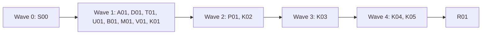
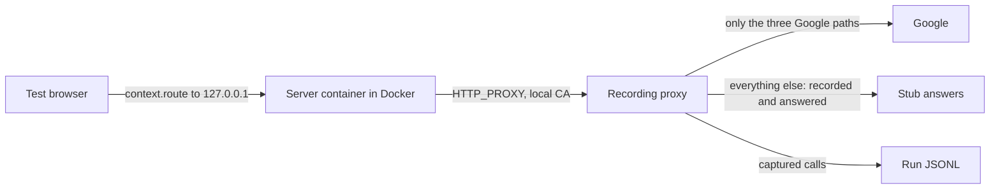

# Plan for 0.5.0

The headline of 0.5.0 is #358: show what the server container sends on to vendors. The browser sees only the first hop. Tagreeve 0.5.0 runs the user's own published server GTM container on the user's machine, in Docker, and records every call it makes to a vendor. Each call is decoded and checked like a browser hit, and none of them leaves the machine. The feature is opt-in. It replaces the test sink and tunnel design of the earlier draft: there is no `tagreeve sink serve`, no tunnel and no edited template copy. The release also runs one suite across several stores (#360), stops Shopify's own hosts from drowning `unknownDestination` (#585), fixes `unloadGap` at the end of a run (#261), masks tokens in `--by-page` page paths (#535), removes the `pingwright` command alias, and fixes the review-minor issues that are still true after a check against the code. The release ships as `0.5.0-rc.1`, and its field test is the field test of the local container, on a real store, before `0.5.0`. Each item is one small PR. A PR is done when its acceptance test passes in CI, an adversarial review reports no blockers or majors, and it is squash-merged.

The work starts after `0.4.0` is released. The `0.4.0` work edits `CHANGELOG.md`, the `package.json` versions, `packages/cli/src/run.ts`, `packages/cli/src/summary.ts` and `e2e/baseline.e2e.test.ts`, and this plan's entries edit them too. `0.4.0-rc.3` is in progress and edits `packages/recorder/src/payment.ts`, `packages/cli/src/run.ts`, `packages/cli/src/test-payment-hosts.ts` and the fixture payment pages. Every entry below was checked against `main` at `7ab9b04`, after rc.2 and the rc.3 plan.

## Goals this release serves

From `docs/goals.md`:

- **Record what a site sends to each tracking vendor.** Today the record stops at the server container (design §8.5). K01 to K04 record what it sends on, for the built-in GA4 and Google Ads tags and for template tags.
- **Express expected behaviour as data, and report pass or fail with evidence.** Server sends become hits, so rules, `identity.hashesMatch` and the identifier checks run on them (K04).
- **Make it easy to change a GTM config reliably.** One suite covers every storefront of a merchant (V01). `--by-page` baselines stop drifting on checkout tokens (B01). A server container change can be tested before it reaches production vendors, because nothing the local container sends goes on.
- **The first run shows where the setup likely breaks consent rules, and what to fix first.** On a Shopify store, 85 to 110 platform requests per run bury the unknown destinations that matter (P01).
- **Be safe by default.** The container config is a secret like `gtmAuth` (K02, K03). Every vendor call is answered by Tagreeve and never forwarded. Captured calls go through the same decoding, redaction and leak rules as browser hits (K03). Leak tests that could not fail now can (T01). A committed baseline no longer holds an order token (B01).
- **Expose all of this to agents through the CLI.** One command name, `tagreeve` (A01). Every new feature has `--json` output.

Non-goals this release comes close to:

- **A hosted service.** The container runs on the user's machine, under the user's Docker, with the user's own container config. Tagreeve never calls the GTM API and runs nothing for anyone else. The container itself downloads its configuration from Google, as it does everywhere it runs (see "What reaches Google"). The "No hosted service" rule in `AGENTS.md` and design §2 and §8.4 say "each user runs their own sink". That wording was wrong for this feature, and K02 rewords it (Decision 2).
- **Every unknown destination flagged** (goal 7). P01 moves platform hosts to their own flag kind, `platformHost`. They are still flagged and listed, and a scenario can turn the list off. Calls the server container makes to a host that no decoder knows are flagged `unknownDestination` too, and are answered, never forwarded.

## Findings

| Finding | Issue | What is wrong |
| --- | --- | --- |
| The field test could not answer the open questions about ads conversions and Conversions API data | #358 | The browser never sees the server container's outgoing requests. `Recorder.close` writes no server-side record. |
| A merchant with one store per market runs each scenario per store by hand | #360 | `suite` takes one `--site`, and every cell has empty `labels`. |
| `unknownDestination` flags 85 to 110 requests per run on a Shopify store | #585 | Shopify's telemetry, CDN and checkout hosts are unknown destinations. Only `allowUnknownDestination` and the diff filter help. |
| `unloadGap` stays quiet when a frame pushes an event just before the run ends | #261 | Only navigations are unload points. A custom dataLayer name outside the Shopify table is compared literally. |
| A `--by-page` baseline on a checkout drifts on every run and commits the order token | #535 | The page path goes into the key as it is. |
| Leak tests and a suite test cannot fail | #543, #565, #593 | They skip the report, miss the URL-encoded email, or never put an invalid child beside a valid one. |
| The design overstates WebKit results and the server preview header | #555, #560, #561, #563 | The text claims things the code and the probe do not show. |

## Triage

Every open issue in the 0.5.0 milestone (20 on 2026-11-02), including #552, #256, #180 and #535, which the rc.2 plan deferred. Each was checked against `main` at `7ab9b04`. Where a line number could move, the table names the function.

| Issue | Still valid | Evidence | Size | Entry |
| --- | --- | --- | --- | --- |
| #358 | Yes | `docs/design.md` §8.5 says the server-to-vendor hop is not visible and the sink reader is not built. `Recorder.close` in `packages/recorder/src/recorder.ts` sets `tagReports: []`. A supervised spike on 2026-11-02 ran a real container locally and captured its GA4 and Google Ads calls (see "Design"). | L | M01, K01, K02, K03, K04, K05 |
| #360 | Yes | `packages/cli/src/suite.ts` sets `labels: {}` on every cell. The manifest has one `site`. | M | V01 |
| #585 | Yes | `buildFlags` in `packages/recorder/src/flags.ts` flags every undecoded data request to a host that is not first party. No platform list exists in `packages/decoders/src`. | M | P01 |
| #261 | Yes, in part | `Recorder.close` passes only `this.navigations` to `buildUnloadGapFlags`. `buildUnloadGapFlags` compares names literally outside `GA4_ALIASES`. The rest was fixed in #330. | M | U01 |
| #543 | Yes | `e2e/cookie-already-set.e2e.test.ts` and `e2e/stored-cookie-evidence.e2e.test.ts` check stdout, stderr and results, never the report. | S | T01 |
| #546 | Yes | `scripts/release-workflow.test.ts` checks top-level permissions only, uses a narrow publish regex, misses `github.token`, and does not check the publish line. | S | A01 |
| #550 | Yes, until #261 is fixed | The 0.3.0-rc.2 line in `CHANGELOG.md` names custom names but not browser close. U01's 0.5.0 line names both gaps. Release history is not edited. | S | U01 |
| #552 | Yes | `fixtures/site/public/unload-gap.html` parses the iframe with its plain `src`, then a script appends `?mode=`. | S | U01 |
| #555 | Yes | `docs/design.md` §8.2 says server mode sends `X-Gtm-Server-Preview`. §8.5 and §15.3 say it is not sent. No code sends it. | S | D01 |
| #558 | No | The 0.4.0-rc.1 section of `CHANGELOG.md` has no markers, and `fixtures/site/src/pages-0.4.test.ts` asserts that. | - | Close on merge |
| #560 | Yes | `docs/design.md` §14 starts an item with `1a.`, which is not a list marker. §5.1 links to §14.1a. | S | D01 |
| #561 | Yes | `docs/design.md` §5.1 says no Safari tracking prevention. §14 item 1a reports a third-party cookie block and carries PR notes ("#361 can close", who runs Linux). | S | D01 |
| #562 | Yes | `scripts/probe-webkit.ts` sends any name other than `chromium` to WebKit and prints the given name. | S | D01 |
| #563 | Yes | `docs/design.md` §14 item 1 says WebKit routes "from the same sources" as §9, which lists seven. The probe tested five. The §9 collector bullet still says WebKit was not tested. | S | D01 |
| #565 | Yes | `e2e/report-marks.e2e.test.ts` has the literal and hashed email but not `encodeURIComponent(fixtureEmail)`. | S | T01 |
| #571 | Yes | No test checks the blank lines around CHANGELOG markers. Only `fixtures/site/src/pages-0.4.test.ts` and `scripts/docs-text.docs.test.ts` look for leftover markers. | S | S00 |
| #593 | Yes | `packages/cli/src/report/suite.test.ts` has one child without `suite.json`, alone. It has two valid children in another case. | S | T01 |
| #535 | Page paths: yes. MCP: no. | There is no MCP server (`AGENTS.md`, #362). `pagePath` in `packages/expect/src/diff.ts` puts the raw path in the key. `docs/cli.md` only warns. | S | B01 |
| #256 | Yes, as a known limit | `packages/recorder/src/netlog.ts` labels by timing only. `docs/cli.md` and design §5.3 say so. The 0.4 plan found no signal that tells the two cases apart. | - | None (see Flagged concerns) |
| #180 | Yes, upstream | The cause is Playwright's request interception (design §5.3, "Limit: redirects"). `possibleRedirectHop` flags the misses. | - | None (see Flagged concerns) |

All 20 open issues are in this table. The next section lists what is not built and why.

## Scope

In:

| Group | Issues | Size |
| --- | --- | --- |
| S00 CHANGELOG section and marker test | #571 | S |
| A01 Remove the `pingwright` alias, stricter release workflow test | #546 | S |
| D01 Design text and the WebKit probe | #555, #560, #561, #562, #563 | S |
| T01 Tests that could not fail | #543, #565, #593 | S |
| U01 `unloadGap` at run end and in the same frame | #261, #550, #552 | M |
| B01 Masked page paths in `--by-page` keys | #535 | S |
| M01 Meta Conversions API decoder and stub answer | #358 | S |
| K01 Recording proxy and per-run CA | #358 | L |
| V01 Several stores in one suite | #360 | M |
| P01 Platform hosts | #585 | M |
| K02 Container image build, runner and stand-in container | #358 | L |
| K03 `--server-container` on `run` and `suite`: routing, records, links | #358 | L |
| K04 Checks, summary and report for server sends | #358 | M |
| K05 Guide: run the server container locally | #358 | S |
| R01 Release prep | | S |

Not in:

| Issue | Why it waits |
| --- | --- |
| #256 | No signal tells an early `srcdoc` send on a later page from an unload send. The docs say the label is a guess. |
| #180 | The cause is in Playwright. The flag covers it. A Playwright upgrade would be the next test, and the version is pinned. |
| Goal 2 (tag-firing reporter templates, `expectedTags`) and goal 8 (`tagreeve init`) | Deferred to 0.6.0 by the maintainer. No issues yet. |
| #358's other options: the server tag reporter, the run token, the server preview header, `expectedTags` | The maintainer answered #358 with the local container. These belong to goal 2 (design §8.1, §8.3, §8.2), deferred to 0.6.0. |
| Unpublished server workspaces (preview) | The container loads a published version or a named environment. A workspace needs the preview header and the GTM UI. See Decision 4. |
| Stape-only hosting features | The local container is Google's image. Stape's loaders, power-ups and logs do not exist in it. See "What will not exist locally". |
| #514 `mobile` preset, the Shopify bridge, a full `microsoft-uet` decoder, the collector origin bridge | Listed in design §15 item 5, but not in the 0.5.0 milestone. R01 updates §15 to what 0.5.0 builds. |

Close on merge, each with a comment that gives the reason:

- #558: the 0.4.0-rc.1 section has no markers, and `pages-0.4.test.ts` asserts that. Nothing is left to do.

## Order and waves



S00 goes first alone, then eight PRs in wave 1, two in wave 2, the wiring in wave 3, the checks with the guide in wave 4, and release prep. Check C0 is not a PR. Its item 4 and the containment check were done on 2026-11-02 (C0a). Items 1 to 3 need a person with a real container and run in the 0.5.0-rc.1 field test (see "Check C0"), so no wave waits for them.

This plan PR adds the CHANGELOG markers that every other PR replaces. S00 adds the test that guards them, so it merges first. Wave 1 holds the PRs that edit separate files. The later waves exist because of shared files:

- **`packages/cli/src/args.ts`** changes in V01 (`--stores`), K02 (the `server-container build` command) and K03 (`--server-container`, `--server-container-config`). They are in waves 1, 2 and 3.
- **`packages/cli/src/suite.ts`** changes in V01 and K03 (passing the options on). V01 is in wave 1, K03 in wave 3.
- **`packages/recorder/src/flags.ts`** changes in U01 (`buildUnloadGapFlags`), P01 (`buildFlags`) and K03 (container requests are not stub bypasses). They are in waves 1, 2 and 3.
- **`packages/recorder/src/recorder.ts`** changes in U01 (the unload points and the frame of each push), P01 (passing the option) and K03 (routing and the close step). They are in waves 1, 2 and 3.
- **`packages/cli/src/summary.ts`** and **`packages/cli/src/report/model.ts`** change in P01 and K04. They are in waves 2 and 4.
- **`packages/cli/src/run.ts`** changes in P01 (the option plumbing only) and K03. They are in waves 2 and 3.
- **`packages/expect/src/diff.ts`** changes in B01 (`pagePath`) and K04 (the epoch lookup in `hitShape`). They are in waves 1 and 4.
- **`fixtures/site/src/index.ts`** changes in U01 (wave 1), K02 (wave 2, the stand-in start helper only) and K03 (wave 3, the container pages). U01 creates `fixtures/site/src/pages-0.5.test.ts`, and K02 and K03 add to it.
- **`packages/core/src/records.ts`** changes in K03 and K04 (two `ResultNote` values). They are in waves 3 and 4.
- **`package.json`, `packages/recorder/package.json` and `pnpm-lock.yaml`** change in K01 (the certificate package). `scripts/build.ts` marks only the root `dependencies` as external, so the package goes in the root file. A01 edits the `bin` entry of the root file and R01 the version, each in its own part (see the append-only list). K01 and A01 are both in wave 1.
- **`scripts/build.ts`** changes in A01 (wave 1, one entry point) and K02 (wave 2, only if the build checks the embedded Dockerfile).
- **`fixtures/site/src/stand-in-container.ts`** changes in K02 (wave 2, creates it) and K04 (wave 4, the delay control).
- **`packages/recorder/src/stub.ts`** changes in M01 (the Conversions API answer, wave 1) and K03 (an exported collection test, wave 3).
- **`packages/recorder/src/redact.ts`** changes in K03 only.
- **Append-only overlaps.** Each PR edits only its own part of these files, so merge order does not matter: `docs/design.md` (D01 edits §5.1, the last paragraph of §8.2, the collector bullet of §9 and §14 items 1 and 1a; U01 the `unloadGap` bullet of §5.3; M01 the §6 decoder table; B01 the last paragraph of §11; K02 the §3 diagram and the sentence under it, the §2 hosted-service line, §8.4, the "Test sink as the vendor endpoint" bullet and the closing line of §8.5, the secrets bullet of §13 and the CLI list of §12; V01 none; P01 the unknown destination rule of §5.3 and §10.1; K03 the §4 rows other than the Result row, the `recordSchemaVersion` paragraph, the "One clock" bullet of §7.3, the `server` row of the §5.3 table and one sentence after the unknown destination rule, the sink reader, Correlation and Authorisation bullets of §9 and a new last paragraph of §13; K04 the §8.5 table, the §8.5 diagram and the sink reader paragraph, the Result row of §4, the "Not visible" bullet of §8.3 and a new paragraph after the §11 rules table; R01 the status line, §15 and a new §15.5), `docs/cli.md` (each PR its own section), root `package.json` (A01 the `bin` entry, K01 `dependencies`, R01 the version), `packages/decoders/src/index.ts` (M01 adds export lines, P01 one) and `CHANGELOG.md` (one marker per PR).

## Design: what the server container sends on (#358)

The maintainer decided on 2026-11-02 to answer #358 by running the user's own published server container locally and recording what it would send to each vendor. A supervised spike the same day proved the path with a real container. The notes are kept outside the repository, because they hold real IDs and hosts. The facts below are what the plan builds on.



The browser's requests for the server container's domain are routed to the local container. The container's own outgoing calls go through Tagreeve's recording proxy. The proxy forwards three kinds of Google request, so the container can load its configuration, and answers every other call itself.

**The image.** Google's `gcr.io/cloud-tagging-10302018/gtm-cloud-image:stable` (4.6.0 in the spike; Node 24, distroless) is linux/amd64 only. It is a small loader, `server_bin.js` (copyright Google, all rights reserved, no open licence), and npm dependencies. The only native dependency is `re2`.

- **On an amd64 machine** Tagreeve runs Google's image as it is. The user pulls it under Google's terms.
- **On an arm64 machine** (Apple silicon) the image builds locally from Google's image: copy `/app/package.json`, `server_bin.js` and `health_checker_bin.js` out of it, run `npm install` on `node:24`, and use a distroless `nodejs24` base. A product build should instead copy Google's `node_modules` and rebuild only `re2`, and pin the Google image by digest. The pin is the plan's choice for K02. The spike used `npm install`.
- **Tagreeve ships the Dockerfile inside its own code and builds on the user's machine. It never publishes or redistributes an image that holds Google's files.** The root `package.json` ships only `dist`, so the Dockerfile is a string constant in `image.ts` that `build` writes into a temp folder. It is not read from the repository at run time. No workflow pushes an image, and K02 adds a test that fails when a workflow or script runs `docker push`, `docker login` or `docker buildx ... --push`, or when the Dockerfile `COPY`s a Google file from the repository.
- The build is an explicit command, `tagreeve server-container build`, because it pulls large images. `run --server-container` does not build on its own. When the image is missing it exits 2 and names the command.

**The config.** The container takes `CONTAINER_CONFIG`, the base64 of `id=GTM-...&env=N&auth=...`. It is a secret like `gtmAuth`.

- It comes from a file (`--server-container-config <path>`, which must be mode 0600 or the command exits 2) or from the environment variable `TAGREEVE_SERVER_CONTAINER_CONFIG`. It is never a flag value, never printed and never in a record. Tagreeve passes it to Docker with `-e CONTAINER_CONFIG` (the name only, the value taken from Tagreeve's own environment), so it is not in the argument list of any process.
- The image prints the full container URL with `gtm_auth` to stderr when its download fails, and `gtm_auth` is in the `/server.js` query. Tagreeve scrubs both, with the existing `Scrubber` of `packages/recorder/src/gtm-scrub.ts` (one instance for the config and one for its `auth` part), and no second scrubber. The container's own log is never shown whole. On failure, Tagreeve prints its last lines after the scrub.
- The config names a published version or a numbered environment (`env=N`). Whatever that environment serves is what runs.

**Outgoing calls.**

- The image honours only upper-case `HTTP_PROXY`, and uses it for https too. `HTTPS_PROXY` and lower-case names are ignored. Tagreeve sets `HTTP_PROXY=http://pw:<token>@host.docker.internal:<port>` and `NODE_EXTRA_CA_CERTS` to a CA certificate that it mounts read-only. Without the CA the container dies with `UNABLE_TO_VERIFY_LEAF_SIGNATURE`.
- The proxy mints a certificate for each host the container asks for with `CONNECT`, from a CA made for this run. The CA key stays in memory and the CA file is deleted when the run ends. **The proxy must not open an upstream connection on `CONNECT`.** It answers from the decrypted request. A test asserts this with an upstream listener that fails when it is touched. The `CONNECT` target is used only to pick the certificate name. It is never dialled.
- **Where the proxy listens and who may connect.** On Docker Desktop (macOS, Windows) `host.docker.internal` reaches the host's loopback, so the proxy binds `127.0.0.1`. On Linux, `host-gateway` is the bridge gateway, not loopback, so the proxy binds that gateway address (found with `docker network inspect`). It never binds `0.0.0.0`, and a free port is chosen per run. Other containers on the same bridge can reach that address, so every request and every `CONNECT` must carry a per-run random proxy credential, sent in the `HTTP_PROXY` userinfo as `Proxy-Authorization`. A peer without it gets `407` and is not logged or counted. The token is a secret like `gtmAuth`: it is in no record, log line or argument list (it travels in the container's environment, as the config does). This is the write authorization that design §9 asks of a local listener. Check C0a confirmed on 2026-11-02 (OrbStack on macOS, fake config) that the image sends `Proxy-Authorization` from the userinfo: with the credential the proxy served the container's start-up fetch, and without it the proxy's `407` stopped the container (`HttpClientSideError: Received HTTP status code 407`).
- **Network containment.** `HTTP_PROXY` alone would not stop a tag or library that ignores it, and the user's real config holds real vendor credentials. So the container runs on a per-run network made with `docker network create --internal`, which has no route out and no DNS. A relay container joins that network and the default bridge. It is the same image with a `node` entrypoint and a short TCP relay script (a string constant in `image.ts`, like the Dockerfile). It forwards one port to the recording proxy on the host and publishes `127.0.0.1:<port>`, which it forwards to the container's port 8080 for the browser side. `HTTP_PROXY` names the relay. Before the container starts, the runner runs a probe container on the internal network that tries a direct TCP connection to a public address and a DNS lookup. If either succeeds, the run stops with `serverContainerFailed` class `egressOpen` and the container never starts. Check C0a confirmed this on 2026-11-02 (OrbStack on macOS): the direct connect failed with `ENETUNREACH`, DNS failed with `EAI_AGAIN`, and the relay carried both the proxy traffic and the browser side's `healthz`. Linux is checked in K02's supervised QA.
- **The forward function builds the upstream URL from the constant forward list, never from the request.** The only upstream host is `https://www.googletagmanager.com`. Design §13's line "Tagreeve never takes a target address from incoming traffic" still holds: the `CONNECT` host and the request URL only select a certificate name and a stub answer.
- Calls to a vendor are recorded and answered by the same stub answers as `stub` mode (M01 adds one for Meta). They are never forwarded.

**What reaches Google.** The container must reach the real Google for exactly these, and nothing else is forwarded:

| Request | Why |
| --- | --- |
| `www.googletagmanager.com/static/serverjs/*` | The container's runtime files. |
| `www.googletagmanager.com/server.js` | The container's configuration. It carries `gtm_auth` in the query. |
| `www.googletagmanager.com/s/gtag/destination` | Without it GA4 events fail with `reading 'data'`. |

The match is on the host and the path prefix, for the method and path as the container sends them. A forwarded request is counted by class in `Run.serverContainer.passThrough` and is not stored as a request. Its URL never reaches a record or a log line. Everything else, including other paths on `www.googletagmanager.com`, is answered by the proxy. This is the one exception to "known collection endpoints stubbed", and the one place a run talks to Google for the server side. The first hop does not change: in `server` mode the browser still passes through only the hosts the run names.

**What the spike saw.** With a real container, the built-in GA4 tags sent `POST www.google-analytics.com/g/collect` and the built-in Google Ads conversion tag sent `GET www.googleadservices.com/pagead/conversion/<id>/`. Both were captured and stubbed. Template tags (Meta Conversions API, Pinterest, Criteo) call the same `sendHttpRequest` API but were not triggered, because they fire on Stape Data Client and Facebook client hits. See "Check C0".

**The browser side.** With `--server-container`, every request to a `serverHosts` host goes to the container except library and asset loads: a path that `isLibraryLoadPath` from `@tagreeve/core` (`packages/core/src/library.ts`, as `stub.ts` uses it) names, and the resource types script, stylesheet, font and document. A first-party server container often uses paths that no decoder knows (Stape's `/data`, custom client paths), so the decoder-based `isStubbedCollection` is not the test. A request that is not a load never reaches the remote `serverHosts` host, because that host is the user's live container and it would send the hit on to real vendors. These requests are answered by `context.route` with the response of the local container (`route.fetch` to `http://127.0.0.1:<port>` with the same path, query, headers and body, minus the browser's `Host`). The loads, such as `gtm.js`, `gtag/js` or a loader, keep today's `server` mode path and never reach the container. No client GTM change. `--server-container` needs `--network server` and a non-empty `serverHosts`, because the hits to those hosts are what the container receives. Without them the command exits 2.

**Records.**

- The proxy runs in the Tagreeve process, so its clock is the recorder's clock. A container call has a real `t` on the shared clock (design §4). The draft's sink clock problem does not exist.
- Each recorded call is a `Request` with `captured: "serverContainer"`, `stepId` of the step running when the proxy received the call (the lookup browser requests use; a call after the last step, in the wait before close, takes the last step's id), `outcome: "stubbed"` (the proxy answered it, as `stub` mode answers a browser hit; a scenario filter on `outcome: [passed]` never matches a call that did not leave the machine), `resourceType: "other"`, no `frameUrl` (or `null` if `records.ts` requires the field), the method, URL, headers and body as the container sent them, and `initiator: "serverContainer"`. Design §5.3's unknown destination rule already treats `other` with a query or body as data-carrying. Because the outcome is `stubbed`, the `stubBypass` flag never applies and `flags.ts` needs no special case beyond a guard test. The decoders run on it as on any request. A call to a host that no decoder knows is an `unknownDestination` flag with the detail `from the server container`.
- **Redaction first.** Before a call becomes a record, the values of `access_token` and `appsecret_proof` are replaced with `[redacted]` in the URL and in a JSON or form body, and header values go through `redactHeaders` in `packages/recorder/src/redact.ts`, whose `REDACTED_HEADERS` gains `access-token` and `x-api-key`. There is no second header list. The Meta Conversions API sends its access token in the URL query. `possibleRealData`, the `gtmAuth` scrub and the cookie rules run on these requests like on any other. A forwarded Google request is not a record.
- **Link to a browser hit.** The proxy cannot see which browser hit led to a call. Each hit decoded from a container call gets `via: { hitId, by, confidence }`, chosen by the first rule that fits:
  1. `by: "eventId"`, `confidence: "exact"`: the call's event ID and event name both match exactly one browser hit of this run (the Conversions API `event_name` equals the pixel `ev`, and Meta dedups on that pair).
  2. (Not in 0.5.0-rc.1, see below.) `by: "clientId"`, `confidence: "exact"`: the call's client ID and event name match exactly one hit to a `serverHosts` host of this run, and that request was in flight (from its start to its response end, plus 2 s) when the call was made.
  3. `by: "clientId"` or `"identity"`, `confidence: "probable"`: the latest hit to a `serverHosts` host that holds a value the call also holds (client ID, `fbp`, the run identity's plain email or a SHA-256 of it; values shorter than 8 characters do not count), else the latest browser hit that holds it.
  4. No `via`. The hit is unlinked.
  Rule 2 is not built in 0.5.0-rc.1. Whether the in-flight window is reliable for the built-in GA4 tag is unproven, and only an exact link can fail a run, so an unproven exact link must not exist. Calls that rule 2 would match link by rule 3 as probable. Check C0 item 3 measures the window in the rc.1 field test, and rule 2 is a follow-up if it holds. Design §4 says a hit links to a report only as probable, because a report names no event. K03's §4 edit adds `exact` for the cases above and says why.
- `Run.testServerContainer` is `true` when the stand-in seam (K02) started the container (the upstream seam only works with it), and absent otherwise, like `testGtmOrigin` and `testLoopbackHosted`. The summary line says `stand-in container (test seam)`, so a stand-in run cannot be read as a real one.
- `Run.serverContainer` is `{ image, startedAt, requests, passThrough, unlinked }`: the image name and digest, counts, and the number of captured hits with no `via`. It holds no config, no container ID and no host name of the container. When the container does not start or dies, the run is still written, `Run.serverContainer.error` holds an error class (`dockerMissing`, `imageMissing`, `configRejected`, `exited`, `notReady`), and the flag `serverContainerFailed` is added. The exit code is at least 1.
- No new record field holds a URL of the container's configuration.

**Checks and output (K04).**

- **One time for epochs.** `judgedAt(hit, records)` in `packages/expect/src/evaluate.ts` returns a browser hit's own `t`, a linked server hit's via hit `t`, and nothing for an unlinked server hit. Every epoch lookup and every time filter uses it: in `evaluate` (`epochOf`, `effectiveConsentAt`, `before: consent`, `in: epoch(...)`, `after:`, `deniedIdentifiers`, `earlyIdentifiers` and the epoch map of non-Google hits), in `hitShape` in `diff.ts` (so `diff` and `baseline` too), and in the report model. A linked server hit takes its consent signals from its via hit. An unlinked server hit has the diff epoch key `server`.
- **Confidence decides what a link can do.** Only an `exact` link can fail a run. A result whose failing evidence holds only server hits on a `probable` link is written with `severity: warn` and the note `serverSendProbableLink`. With any other failing hit it fails as usual. A consent-scoped rule or identifier check that meets an unlinked server hit cannot judge it: that part is `cannot evaluate` at `severity: warn`, with the note `serverSendUnlinked`. A pass that rests on a probable link carries `serverSendProbableLink` too.
- The summary gets a `Server container` line (`image ok; 7 vendor calls, 5 linked exactly, 1 probable, 1 unlinked; 3 requests forwarded to Google`), and `--json` gets `serverContainer` with the same counts. The report shows a server vendor as its own timeline row, for example `Google Ads conversion, sent by the server container`, placed in its via hit's epoch, with probable links marked and unlinked hits after the last epoch.

**What it adds.**

- Record: `recordSchemaVersion` 3. `Request.captured` gains `"serverContainer"`. `Request.initiator` gains `"serverContainer"`. `Hit.via` (optional `{ hitId, by, confidence }`). `Run.serverContainer` (optional). `Run.testServerContainer` (optional `true`). Flag kinds `serverContainerFailed`. `ResultNote` values `serverSendProbableLink` and `serverSendUnlinked`. A 0.4 reader warns on version 3, as it does for any newer version. A version 2 record reads as before.
- CLI: `tagreeve server-container build`; `--server-container` and `--server-container-config <path>` on `run` and `suite`; the environment variable `TAGREEVE_SERVER_CONTAINER_CONFIG`; the `Server container` summary line and the `serverContainer` JSON field.
- Code: the vendor key `meta-capi` and its stub answer (M01); the recording proxy and CA (K01); the Dockerfile, the runner and the stand-in container (K02).
- Docs: `docs/guide/server-container.md` (K05), the `run` options table, the report section, `AGENTS.md` (Decision 2), and design §2, §3, §4, §7.3, §8.3, §8.4, §8.5, §9, §11, §12 and §13.

### Docker is opt-in

Nothing changes for a run without `--server-container`. Tagreeve does not look for Docker, start it, or import any code that needs it. With the flag, the command checks `docker info` first. Without Docker it exits 2 with `Docker is needed for --server-container` and a link to Docker's install page, before any browser starts. Tagreeve talks to Docker through the `docker` command line (`child_process`, no shell, no dependency). The container is started with `--rm`, a name that holds the run ID, the per-run internal network, and the CA mounted read-only. The relay container (see "Network containment") is started with `--rm`, `-p 127.0.0.1:<port>:8080` and `--add-host host.docker.internal:host-gateway`. Every container and network Tagreeve makes carries the labels `tagreeve.owner.pid` and `tagreeve.owner.host`. Both containers and the network are removed when the run ends and on a signal. At the next start, a sweep removes only those whose owner process is gone (same host, PID not alive). The one-hour age rule is a fallback only for a label that cannot be checked (another host). A run that waits an hour at a handoff, or a second Tagreeve process, is never swept.

### What will not exist locally

Stape-only hosting features are not in Google's image. The guide (K05) lists them and the R01 known list repeats them: the custom loader and its domain features, Cookie Keeper, the geo and bot headers Stape adds in front of the container, store ID headers, the request logs and the CDN. A cookie that Cookie Keeper would set, or a header a template tag reads from the hosting layer, will be missing. The container still gets the browser's request as the browser sent it. Template tags that Stape ships (Data Client, Facebook client) are templates in the container and do run.

### Check C0: template tags, supervised

The spike did not trigger Meta CAPI, Pinterest or Criteo. K03 builds on the assumption that their calls arrive at the proxy like the built-in ones. This is checked in the 0.5.0-rc.1 field test, by a person with a real published container, in a test container version, with fake events and a fake identity:

1. Hit the container with the Stape Data Client request shape, and with a Facebook client request, so the template tags fire.
2. Record, for each template tag, the host, path and method of the call, whether it arrived at the recording proxy, whether it used `HTTP_PROXY` and `NODE_EXTRA_CA_CERTS`, and the response the tag needed to finish (Meta wants JSON with `events_received`).
3. Record whether the in-flight window of rule 2 held for the built-in GA4 and Ads tags.
4. Done as Check C0a on 2026-11-02, before K01 and K02 start: the image sends `Proxy-Authorization` from the userinfo of `HTTP_PROXY` for `CONNECT` (a `407` without it stops the container), and the `--internal` network with the relay blocks direct egress and DNS while carrying the proxy and browser traffic (OrbStack on macOS, fake config). Linux is checked in K02's supervised QA.

Items 1 to 3 need a real container and run in the 0.5.0-rc.1 field test. No wave waits for them. A different stub answer or a tag that does not arrive is a follow-up fix, and the rc.1 known list says the template tags are unproven.

The result goes into a comment on #358, with no real IDs, hosts or tokens. If a template tag does not reach the proxy, K05 and the R01 known list say so, and M01 and K03 stay as they are. If it needs a different stub answer, M01's answer table is extended in a follow-up PR. If Pinterest or Criteo calls arrive, the Pinterest decoder already exists. A Criteo decoder would be a new S entry, not part of this plan.

## Design: several stores in one suite (#360)

This follows V02 in `docs/plan-0.4.md`, which was not built, with three changes: the stores file has a version, the manifest is always version 2, and no new `Run` field is added.

- **Command.** `tagreeve suite <dir> --stores <stores.json>` instead of `--site`. Giving both, or neither, is a usage error. `run --stores` is not built: a suite folder with one scenario does the same.
- **Stores file.** `{ "storesSchemaVersion": 1, "stores": [{ "name", "site", "vars"?, "country"?, "autoconsentRules"? }] }`, with 1 to 50 stores. `name` follows the variant name rule (`^[a-z0-9][a-z0-9_-]*$`) and is unique. `site` is an http or https URL. `vars` override the scenario's declared vars, and `--var` overrides both. A store var that no scenario declares exits 2 and names the store and the var, never the value. `country` sets `identity.country`, and a scenario that sets another one gets a warning. `autoconsentRules` is a path relative to the stores file. An error names the file and the store index, never a value.
- **Axis name.** The axis is `store`. Each cell has `labels: { "store": "<name>" }`, using the field that exists and is empty today. Without `--stores`, `labels` stays `{}`.
- **Records.** `<scenario>.<store>.<variant>.jsonl`, through the existing `fileStem`, so `run.ts` and the recorder do not change. `Run.site` already says which store a record is from.
- **Manifest.** `suiteSchemaVersion: 2`. It adds `stores: [{ name, site }]`, with origins only, and `SuiteDiff.store`. `site` is the first store's origin. Without `--stores`, `stores` is `[]` and the rest is as in version 1. `report` reads version 1 and 2. Store vars are not written to the manifest.
- **Runs.** One scenario uses one seed across all stores and variants. Diffs compare variants within one store only. A comparison between stores is not built. `--allow-test-payment <host>` still names one host: a payment scenario runs only for the store whose host equals it, and its other cells are `SKIPPED`. The exit code is the worst cell, as today.
- **Output.** The terminal table gets a `store` column after `scenario`, only with `--stores`, and one row per scenario and store. The report's results table gets a Store column, its run sections are headed `<scenario> on <store>, <variant>`, and it has one verdict per store and variant.
- **With a server container.** K03 starts one container per run, not per suite, because each run needs its own capture window. A suite with `--server-container` is therefore slow and the guide says so. One container per store config is possible later.

**What it adds.** CLI: `--stores` on `suite`. Files: `stores.json` with `storesSchemaVersion` 1. Manifest: `suiteSchemaVersion` 2, `stores`, `SuiteDiff.store`, `labels.store`. Record: nothing. Docs: the `suite` and `report` sections of `docs/cli.md`.

## New concepts for the architecture review

| Concept | Kind | Entry |
| --- | --- | --- |
| `meta-capi` vendor key and its stub answer | Decoder, stub | M01 |
| Recording proxy, per-run CA and proxy credential, the three-path Google pass-through list | Shared code | K01 |
| `tagreeve server-container build`, the Dockerfile, the image digest pin | Command, file | K02 |
| The stand-in container, `TAGREEVE_TEST_SERVER_CONTAINER_CMD` (validated, recorded as `Run.testServerContainer`) | Test seam | K02, K03 |
| `--server-container`, `--server-container-config`, `TAGREEVE_SERVER_CONTAINER_CONFIG` | Flags, env | K03 |
| `TAGREEVE_SERVER_CONTAINER_BASE` (digest override of Google's image) | Env | K02 |
| `tagreeve-sgtm:<version>` image tag, `tagreeve-sgtm-*` containers and the sweep | State in the user's Docker | K02 |
| `docker` CLI through `child_process` | Process boundary | K02, K03 |
| `TAGREEVE_TEST_SERVER_CONTAINER_UPSTREAM` (loopback origin of the forward function, validated, recorded as `Run.testServerContainer`) | Test seam | K03 |
| Stand-in `delayMs` control | Test seam | K04 |
| Recording proxy as a second writer to the run store, the per-run credential as its write authorization | Authorisation | K01, K03 |
| `recordSchemaVersion` 3, `Request.captured: "serverContainer"`, `Hit.via`, `Run.serverContainer`, `Run.testServerContainer`, flag `serverContainerFailed` | Record | K03 |
| `judgedAt`, `ResultNote` values `serverSendProbableLink` and `serverSendUnlinked`, `serverContainer` in the `--json` summary | Evaluation, record, output | K04 |
| `docs/guide/server-container.md` | Docs page | K05 |
| `--stores`, `stores.json`, `storesSchemaVersion` 1 | Flag, config file | V01 |
| `suiteSchemaVersion` 2, `stores`, `SuiteDiff.store`, `labels.store` | Manifest | V01 |
| `platformHost` flag kind, `options.platformHosts` | Flag, scenario option | P01 |

## Rules for every PR

The rules in `AGENTS.md` and the earlier plans still hold. In short:

- fake IDs and fake identities only: GA4 `G-PWTEST0001`, Google Ads `AW-000000001`, Meta `100000000000001`, GTM `GTM-PWTEST1` and `GTM-PWNOVER`, hosts under `.invalid` or loopback. A fixture page sends only to `.invalid` hosts or to the fixture's own loopback hosts, so nothing leaves the machine. The stand-in container (K02) calls real vendor hostnames, but only through the recording proxy, which answers them and never opens an upstream connection;
- names and counts only in what a PR adds to the summary, the report, a baseline or a manifest. No cookie value, identity value, card value, `gtmAuth`, container config, vendor access token or `appsecret_proof`. Each PR that adds output has a leak test that feeds a fake email (`pw-fixture@example.com`), its SHA-256, its URL-encoded form and a fake cookie value through the feature and asserts none of them appears. K01 to K03 also assert that a fake container config, a fake `gtm_auth` and a fake `access_token` appear in no stdout, stderr, record or log line;
- e2e tests run only against `fixtures/site` or an in-test loopback server, in `stub` mode. K03's and K04's e2e tests are `server` mode tests whose host is the fixture's own loopback host, with the stand-in container. The maintainer approved this second exception (Decision 2) and K02 writes it into `AGENTS.md`;
- no test needs Docker, Google's image, a real container config or the network. CI has none of them. The real image is a supervised field test (see "After the PRs");
- context-level hooks only, no CDP, no new browser flags;
- Tagreeve never calls the GTM API. It publishes no image that holds Google's files. The container config is a secret like `gtmAuth`. CLI only (#362);
- new dependencies: only the certificate package of Decision 1, in the root `package.json` and `packages/recorder/package.json`, with an exact version at least two weeks old;
- no publish to npm and no GitHub release without the maintainer's say-so.

More for 0.5.0:

- Each PR adds a regression test that fails when the change is removed. The PR description says how that was checked. D01's #555, #560, #561 and #563 parts are text only and have none. R01 has none either.
- Each negative test checks that its input really contains what the check looks for. A test that passes because the input never had it proves nothing.
- New e2e tests go in new files. Named exceptions: T01 changes `e2e/cookie-already-set.e2e.test.ts`, `e2e/stored-cookie-evidence.e2e.test.ts` and `e2e/report-marks.e2e.test.ts`. U01 may change existing e2e assertions that the new unload point changes, and lists each in its PR description.
- Record schema: only K03 bumps `recordSchemaVersion`, to 3. K04 adds two `ResultNote` values. No other PR changes `packages/core/src/records.ts`.
- CHANGELOG: this plan PR adds the `## 0.5.0-rc.1` heading as the first section, above the 0.4.0 notes, with one marker per PR with a user-visible change, a blank line between each pair. Each PR replaces only its own marker, with plain bullet lines and no `###` heading of its own. R01 sorts the lines under `### Added`, `### Changed`, `### Fixed` and `### Removed`, and removes leftover markers. D01, T01, K01 and K05 add no line.

```markdown
## 0.5.0-rc.1

<!-- A01 -->

<!-- U01 -->

<!-- B01 -->

<!-- M01 -->

<!-- V01 -->

<!-- P01 -->

<!-- K02 -->

<!-- K03 -->

<!-- K04 -->
```

K01 has no marker: the proxy has no user-visible change until K03 wires it.

## PRs

### Wave 0

**S00 The CHANGELOG marker test (#571).** Touches: `scripts/changelog-markers.test.ts` (new).
- The markers are already in `CHANGELOG.md` from this plan PR. If 0.4.0 work moved the section, S00 puts the heading back as the first section.
- The test exports `markerProblems(text)`, which returns each `<!-- [A-Z]\d{2} -->` line in the newest section that has no blank line before or after it. The test runs it on `CHANGELOG.md` and on inline strings.
Regression test: a marker glued to the line above, a marker glued to the line below, two markers on neighbouring lines, and a section with no markers (no problems).
Acceptance: `pnpm test` passes. With the blank-line check removed from `markerProblems`, the glued cases pass through and the test fails.

### Wave 1

**A01 Remove the `pingwright` alias, and a stricter release workflow test (#546).** Touches: `package.json` (the `bin` entry), `scripts/build.ts`, `packages/cli/src/alias-bin.ts` (deleted), `packages/cli/src/alias-bin.test.ts` (deleted), `.github/workflows/ci.yml`, `.github/workflows/release-tag.yml`, `scripts/no-old-name.test.ts`, `scripts/release-workflow.test.ts`, `scripts/package-bin.test.ts` (new), `README.md` (the rename notice), `CHANGELOG.md` (the A01 marker).
- `package.json` keeps one bin, `tagreeve`. `scripts/build.ts` builds `dist/cli.js` only (it builds `pingwright.js` too today and chmods both). The alias source and its test go.
- CI and the tag workflow drop the alias step (the `pingwright --version` checks in `ci.yml` and `release-tag.yml`).
- `scripts/no-old-name.test.ts` drops the allowlist entries for `package.json`, `scripts/build.ts` and the two workflows, and the `alias-bin` pattern in `wholeFiles`. The `README.md` entry stays. `pingwrightVersion` stays allowed: design §4 explains why the record key keeps its name.
- The README notice keeps its first sentence and the npm and CHANGELOG pointers, and drops "The command `pingwright` still works until 0.5.0."
- `scripts/package-bin.test.ts` asserts that the `bin` keys are exactly `["tagreeve"]` and that `scripts/build.ts` has one entry point.
- #546: the workflow test asserts that every job has no `permissions` or read-only ones, flags any `npm`, `pnpm` or `yarn` line that holds `publish` without `--dry-run`, rejects a `uses:` value that holds `publish` or `release`, forbids `github.token`, and asserts the publish line holds `--tag "$dist_tag"`. It also fails on a line that runs `docker push`, `docker login` or a build with `--push`. Each new rule has a case on an inline workflow string that must fail.
Regression test: `package-bin.test.ts`; the narrower `no-old-name` allowlist (with the old `package.json` line it reports `package.json:<n>`); the inline workflow cases for each #546 point and for the docker rule.
Acceptance: `pnpm build` leaves no `dist/pingwright.js`, and `pnpm test` passes. On the old code `package-bin.test.ts` and the narrowed `no-old-name` test fail on the `pingwright` bin.

**D01 Design text and the WebKit probe (#555, #560, #561, #562, #563).** Touches: `docs/design.md` (§5.1 webkit row, the "Server workspaces" paragraph of §8.2, the last sentence of the collector bullet in §9, §14 items 1 and 1a), `scripts/probe-webkit.ts`, `scripts/probe-webkit.test.ts` (new).
- #555: the §8.2 paragraph says the server preview header is planned and not built, and points to §8.5.
- #560: the WebKit result becomes item 10 at the end of §14. §5.1 and item 1 link to it.
- #561: the §5.1 row says the probe found no 7-day cap on script-set cookies, and that a cookie set in a cross-site frame was not stored. The frame result is reported as observed, with the 500 ms wait named, not as a cause. The PR notes ("#361 can close", who runs Linux) leave the design.
- #563: item 1 and the new item name the five sources the probe measured. The §9 sentence says Firefox was not tested and WebKit was probed by hand for five sources.
- #562: the probe accepts only `webkit` or `chromium`. Any other name prints `Usage: node scripts/probe-webkit.ts [webkit|chromium]` on stderr and exits 2, before a browser starts.
Regression test: `probe-webkit.test.ts` runs the script with `firefox` and asserts exit 2, the usage line, and no browser output. It needs no browser installed.
Acceptance: `pnpm test` and `pnpm docs:build` pass. On the old code the probe test does not exit 2.

**T01 Tests that could not fail (#543, #565, #593).** Touches: `e2e/cookie-already-set.e2e.test.ts`, `e2e/stored-cookie-evidence.e2e.test.ts`, `e2e/report-marks.e2e.test.ts` (named exceptions), `packages/cli/src/report/suite-dir.test.ts` (new).
- #543: both cookie tests render `tagreeve report` on their run record, as `report-marks.e2e.test.ts` does, and assert the HTML has no `pw-fixture-cookie-value`. Each first asserts the cookie value is in the raw records.
- #565: `encodeURIComponent(fixtureEmail)` joins the secrets list. The test first asserts the encoded form is in a recorded hit param.
- #593: in the new file, a parent with `suite_a` (no `suite.json`) next to a valid `suite_b` exits 0, names `suite_b` on stderr, and the HTML holds the suite title. It goes in a new file so it does not collide with V01's changes to `report/suite.test.ts`.
Regression test: these are the tests.
Acceptance: each test fails with the line it guards removed: the report render, the encoded secret, the `suite.json` check in `resolveSuiteDir`. The PR description lists the line for each.

**U01 `unloadGap` at run end and in the same frame (#261, #550, #552).** Touches: `packages/recorder/src/flags.ts` (`buildUnloadGapFlags` only), `packages/recorder/src/flags.test.ts`, `packages/recorder/src/recorder.ts` (the `buildUnloadGapFlags` call and the dataLayer binding), `fixtures/site/public/unload-gap.html`, `fixtures/site/src/index.ts` (the `/unload-gap` route), `fixtures/site/src/pages-0.5.test.ts` (new), `fixtures/site/README.md` (the `/unload-gap` row), `e2e/unload-gap-close.e2e.test.ts` (new), `e2e/scenarios/unload-gap-close.yml` (new), `e2e/scenarios/unload-gap-custom.yml` (new), `docs/design.md` (the `unloadGap` bullet of §5.3), `docs/cli.md` (the `unloadGapIgnore` row), `CHANGELOG.md` (the U01 marker).
- **Run end.** The time `Recorder.close()` starts is an unload point next to the navigations. An embedded frame that pushed a tracking event up to 10 s before it, with no covering GA4 hit up to 1 s after it, gets the warning. Its text says `before the run ended` instead of `before the page navigated`.
- **Same frame.** The recorder keeps the frame URL of each embedded push in memory only. A GA4 hit whose request has the same `frameUrl`, sent after the push and before the unload point plus 1 s, covers the event whatever its name. Nothing new is written to the record.
- **#552.** For `/unload-gap?mode=<m>`, the server writes the mode into the iframe `src` and leaves out the inline script. Without a mode, the page is served byte for byte as today.
- **#550.** The CHANGELOG line names both gaps that are now closed. The 0.3.0 history is not edited.
- **Existing e2e.** A run that ends soon after a frame push can now get an `unloadGap` warning. The flag never changes the exit code. Before the PR opens, the implementer runs the full e2e suite once and fixes and lists each assertion on `flags` that changed.
Regression test: unit tests for a push 3 s before close with no GA4 hit (flagged, run-end text), the same with a covering GA4 hit (not flagged), a custom name `my_add` covered by a GA4 `add_to_cart` from the same frame (not flagged), the same hit from another frame (flagged), and a push 12 s before close (not flagged). A fixture test reads `/unload-gap?mode=x` and asserts one iframe whose `src` holds the mode and no inline script, and that `/unload-gap` matches the file on disk. The e2e runs the gap page with a push and no navigation, then ends.
Acceptance: `pnpm exec vitest run --project e2e e2e/unload-gap-close.e2e.test.ts` passes. On the old code close is not an unload point, so there is no `unloadGap` flag and the test fails.
QA: a Shopify custom pixel that pushes `checkout_completed` on the thank-you page and the run ends there; `options.unloadGapIgnore` on the same; `--network live --net-log`.

**B01 Masked page paths in `--by-page` keys (#535).** Touches: `packages/decoders/src/fields.ts` (`looksLikeValueToken`), `packages/decoders/src/fields.test.ts`, `packages/expect/src/diff.ts` (`pagePath`), `packages/expect/src/diff.test.ts`, `packages/cli/src/baseline.test.ts`, `docs/cli.md` (the `--by-page` rows of `diff` and `baseline save`), `docs/design.md` (the last paragraph of §11), `CHANGELOG.md` (the B01 marker).
- `pagePath` replaces each path segment that looks like a value with `*`. It uses the value-shape tests of the field name rule (design §4), split out of `looksLikeValue` in `fields.ts` as an exported `looksLikeValueToken`, which both callers use: over 64 characters, hex of 32 or more, six or more digits, mostly digits, or a mixed-case token of 22 or more characters with a digit. The character check of the field rule is not used, because a path segment may hold a dot (`about.html`). `/checkouts/cn/<token>` becomes `/checkouts/cn/*`, and `/<digits>/orders/<hex>` becomes `/*/orders/*`.
- The record keeps the raw page. `diff` still shows `recorded as <page>` when it differs from the key.
- A `--by-page` baseline saved before this change on a page with a token drifts once. The CHANGELOG line says to save it again. `BASELINE_SCHEMA_VERSION` does not change: keys of pages without tokens are the same.
- The docs drop the warning against `--by-page` on checkout pages and say which segments are masked.
Regression test: unit tests for the Shopify checkout and order status shapes, a UUID, a plain `/products/fake-tee` and `/pages/about.html` (both unchanged) and the sandbox prefix (still stripped). The field name tests in `fields.test.ts` stay green. A leak test saves a `--by-page` baseline from records whose page holds a fake token and asserts the file does not hold it. Each first asserts the records hold the token.
Acceptance: the unit tests pass. On the old code the baseline file holds the token, so the leak test fails.

**M01 Meta Conversions API decoder (#358).** Touches: `packages/decoders/src/meta-capi.ts` (new), `packages/decoders/src/meta-capi.test.ts` (new), `packages/decoders/src/registry.ts`, `packages/decoders/src/registry.test.ts`, `packages/decoders/src/decoder.ts` (`vendorKeys`), `packages/decoders/src/ignore-lists.ts` and `packages/decoders/src/ignore-lists.test.ts` (a `meta-capi` row), `packages/decoders/src/index.ts` (export lines), `packages/recorder/src/stub.ts` and `packages/recorder/src/stub.test.ts` (the answer for the Conversions API), `docs/design.md` (the §6 decoder table), `docs/cli.md` (the built-in key list in the tracker-list paragraph, and the ignore-list table row), `CHANGELOG.md` (the M01 marker).
- Matches `POST https://graph.facebook.com/v<n>/<id>/events` with a JSON body, or a form body whose `data` field is JSON. Each item of `data` is one hit: vendor `meta-capi`, event `event_name`, page `event_source_url`, `ids.hashes` for `user_data.em`, `ph`, `fn`, `ln`, `ct`, `zp`, `country` and `external_id` (with `matchesIdentity`), and presence for `fbp`, `fbc` and `event_id`. Consent is `unknown`. `fields`, `fieldsComplete` and `idFields` as for other decoders. The `access_token` query value is never a field value.
- It is a collection endpoint, so a browser request to it is stubbed in `stub` mode and is no longer an unknown destination. Its main input in 0.5.0 is the server container (K03).
- The stub answer for this endpoint is `200` with `{"events_received":1,"messages":[],"fbtrace_id":"pw-fixture"}`, so a Meta template tag reads success. Check C0 may change this body.
- The fixture body uses the Meta ID `100000000000001` and fake hashes only.
Regression test: unit tests for a JSON body with two events, a form body with `data`, an `em` that matches the run identity and one that does not, a body that does not parse (`fieldsComplete: false`), a request to another path on the host (no match), and the stub answer. Each asserts the input holds the field first.
Acceptance: the unit tests pass. On the old code `decodeRequest` gives no hit for the request, so they fail.

**V01 Several stores in one suite (#360).** Touches: `packages/cli/src/stores.ts` (new), `packages/cli/src/stores.test.ts` (new), `packages/cli/src/args.ts` (`--stores`), `packages/cli/src/args.test.ts`, `packages/cli/src/suite.ts`, `packages/cli/src/suite.test.ts`, `packages/cli/src/report/suite.ts`, `packages/cli/src/report/suite.test.ts`, `docs/cli.md` (the `suite` and `report` sections), `e2e/stores.e2e.test.ts` (new), `e2e/suites/stores/` (new scenarios), `CHANGELOG.md` (the V01 marker).
- The feature as in "Design: several stores in one suite".
- The stores file is written by the test, because the fixture port is known only at run time.
Regression test: unit tests for the stores file (each error case, and that an error names the index, not a value), var precedence (scenario, store, `--var`), the `country` warning, the manifest (version 2, `stores` origins only, `labels.store`, `SuiteDiff.store`, no var values) and the table. The e2e runs a two-scenario suite against two stores on one fixture server: `a` at `http://localhost:<port>` and `b` at `http://127.0.0.1:<port>` with `country: SE`. It asserts four cells, the record names, `labels.store`, `run.identity.country` of `SE` for store `b`, diffs within a store only, and one report row per scenario and store. Its leak test asserts the manifest and the report hold no email, hash, cookie value or path.
Acceptance: `pnpm exec vitest run --project e2e e2e/stores.e2e.test.ts` passes. On the old code `--stores` is unknown (exit 2), so the test fails. With `labels.store` left out of the cells, it fails too.
QA: `--stores` with `--site` (usage error); a store whose host matches `--allow-test-payment` next to one that does not; `report` on a 0.4 suite folder (version 1); `--json`.

**K01 Recording proxy and per-run CA (#358).** Touches: `packages/recorder/src/server-container/proxy.ts` (new), `packages/recorder/src/server-container/proxy.test.ts` (new), `packages/recorder/src/server-container/ca.ts` (new), `packages/recorder/src/server-container/ca.test.ts` (new), `packages/recorder/src/server-container/forward-list.ts` (new), `packages/recorder/src/server-container/forward-list.test.ts` (new), `packages/recorder/src/index.ts` (export lines), `package.json` (root `dependencies`), `packages/recorder/package.json`, `pnpm-lock.yaml`, `packages/recorder/src/server-container/deps.test.ts` (new), no docs and no CHANGELOG line: K02 and K03 write both.
- **The proxy.** A server on a caller-given address (never `0.0.0.0`; `127.0.0.1` in tests) and port (`0` picks a free port) using `node:http`, `node:net` and `node:tls`. It handles `CONNECT host:port` by answering `200` and then terminating TLS with a certificate for that host, signed by the run's CA, and it handles absolute-URI HTTP requests for plain `http`. It answers `407` to any request or `CONNECT` without the per-run credential (`Proxy-Authorization`, compared in constant time), before the handler and without counting it. It calls a handler with `{ method, url, headers, body, receivedAt }` and sends the handler's answer. It reads at most 1 MiB of body (`bodyComplete: false` beyond), and closes idle sockets after 30 s.
- **The CA.** Made per run. The key stays in memory. The CA certificate is written as PEM, mode 0644, in a fresh directory with mode 0755 under the run's temp folder, and removed on `close()`. The certificate is public and the key stays in memory, so 0644 protects nothing less. A 0600 file owned by the host user is unreadable through a bind mount by the image's non-root user (uid 65532) on Linux, and Node would then ignore `NODE_EXTRA_CA_CERTS`. Leaf certificates are made on demand and cached for the run. Keys and certificates come from `node-forge` or `selfsigned` (Decision 1). The K01 implementer checks the licence, release date and install size of both, picks one, and pins an exact version at least two weeks old. The package goes in the root `package.json` `dependencies`, because `scripts/build.ts` marks only those as external, and in `packages/recorder/package.json`. `deps.test.ts` asserts that it is in the root `dependencies` at an exact version.
- **No upstream on `CONNECT`.** The proxy never opens a socket to the requested host, for any host. The only outbound connections are the forwards in the next point.
- **The forward list.** `forwardList` is exactly the three rows of "What reaches Google": host `www.googletagmanager.com`, path prefix `/static/serverjs/`, exact path `/server.js` and exact path `/s/gtag/destination`. A request that matches is passed to a `forward(request)` function that the caller supplies (K03 supplies one that uses `fetch` to the real host; tests supply a fake). The proxy never builds the upstream URL itself. A match needs scheme https, port 443, a lower-cased exact host, and the method `GET` or `HEAD` (the container uses `GET`); `www.googletagmanager.com/gtm.js`, `/gtag/js`, `/a` and `/server.js/..` do not match. A forward is counted by class (`serverjs`, `config`, `destination`) and its URL is passed to no log.
- The proxy never dials the `CONNECT` target. Only the caller's `forward` can open an upstream connection, and the caller builds its URL from the forward list.
- The proxy and the forward function do not log URLs, and an error message from them never holds a URL or a header value.
Regression test: unit tests with a real TLS client (Node `https` with `ca` set to the run's CA and `proxy` through a `CONNECT` tunnel written in the test) for: a call to `graph.facebook.com` reaches the handler decrypted, with the body, and the handler's answer comes back; an upstream listener on a loopback port that the test registers as every host's address fails the test if it is touched (it is never touched, for any host, including the three forwarded ones, because the fake `forward` answers); a client without the CA fails with `UNABLE_TO_VERIFY_LEAF_SIGNATURE`; a table of 20 URLs for the forward list (the three that match, and `/gtm.js`, `/gtag/js`, `/server.js/..`, `/server.js?x=1` on `www.googletagmanager.com:8443`, the same paths on `googletagmanager.com`, `WWW.GOOGLETAGMANAGER.COM.evil.invalid` and a POST to `/server.js`); a request and a `CONNECT` without the credential, or with a wrong one, get `407` and never reach the handler; a 2 MiB body is cut; the CA file mode is 0644, its directory 0755, the key is in no file, and the directory is gone after `close()`; plain `http` absolute-URI requests reach the handler.
Acceptance: `pnpm exec vitest run packages/recorder/src/server-container` passes. With the forward-list check changed to match any path on `www.googletagmanager.com`, the table test fails. With an upstream `net.connect` added to the `CONNECT` branch, the upstream listener test fails. With the credential check removed, the `407` test fails.
QA: a manual run with `curl --proxy http://127.0.0.1:<port> --cacert <ca.pem> https://graph.facebook.com/` (answers from the handler, no packet leaves the machine, checked with a packet capture or by running offline).

### Wave 2

**P01 Platform hosts (#585).** Touches: `packages/decoders/src/platform-hosts.ts` (new), `packages/decoders/src/platform-hosts.test.ts` (new), `packages/decoders/src/index.ts` (one export line), `packages/recorder/src/flags.ts` (`buildFlags` only), `packages/recorder/src/flags.test.ts`, `packages/recorder/src/recorder.ts` (passing the option to `buildFlags`), `packages/cli/src/run.ts` (the option plumbing only), `packages/expect/src/scenario.ts` (`options.platformHosts`), `packages/expect/src/scenario.test.ts`, `packages/cli/src/summary.ts`, `packages/cli/src/summary.test.ts`, `packages/cli/src/report/model.ts`, `packages/cli/src/report/render.ts`, `packages/cli/src/report/model.test.ts`, `packages/cli/src/report/render.test.ts`, `docs/cli.md` (the options table and the `unknownDestination` text), `docs/design.md` (the unknown destination rule in §5.3, and §10.1), `CHANGELOG.md` (the P01 marker).
- **The list.** `platformHosts: readonly PlatformHostEntry[]`, with `{ platform: "shopify", host, paths?, purpose: "telemetry" | "cdn" | "checkout" | "payments", source }`. `host` is exact or `*.domain`. `source` is an https link on `shopify.dev` or `help.shopify.com` that names the host. A host that no Shopify page names stays out of the list. Third-party payment SDKs (PayPal, Stripe, Klarna and so on) are not Shopify's and stay unknown destinations. A unit test checks every `source` domain, as `trackerDocsDomains` does for trackers. No block list is a source (`AGENTS.md`).
- **The flag.** A request that would be an `unknownDestination` and matches an entry gets the flag `platformHost` instead, with the same detail. It never fails a run, and the `unknownDestination` check does not count it.
- **The option.** `options.platformHosts: false` turns the list off for a scenario, and those requests are unknown destinations again. The default is on, on every site.
- **Output.** The summary shows one line per platform: `platformHost: shopify, 96 requests to 7 hosts (telemetry 60, checkout 30, cdn 6)`. The report shows the kind in a closed `<details>` element with counts per host. The JSON flag list keeps its shape.
- **Server container calls.** The list applies to browser requests only. P01 does not look at `captured: "serverContainer"` requests, which K03 adds later.
Regression test: unit tests on `buildFlags` with fake requests to listed Shopify hosts, an unlisted Shopify subdomain, a third-party payment host and a listed host with `platformHosts: false`; the summary line; the report group. An e2e is not possible: a fixture page cannot send to a real Shopify host in stub mode without the request leaving the machine.
Acceptance: the unit tests pass. On the old code each listed host is an `unknownDestination`, so they fail.
QA: a run on a Shopify staging store, supervised: the count of `unknownDestination` before and after, and that every host left is not Shopify's.

**K02 Container image build, runner and stand-in container (#358).** Needs K01. Touches: `packages/recorder/src/server-container/image.ts` (new, holds the Dockerfile text), `packages/recorder/src/server-container/image.test.ts` (new), `packages/recorder/src/server-container/runner.ts` (new), `packages/recorder/src/server-container/runner.test.ts` (new), `packages/recorder/src/gtm-scrub.ts` and `packages/recorder/src/gtm-scrub.test.ts` (an exported helper, only if the existing `Scrubber` needs one), `packages/cli/src/args.ts` (the `server-container build` command), `packages/cli/src/args.test.ts`, `packages/cli/src/main.ts` (dispatch), `packages/cli/src/main.test.ts`, `fixtures/site/src/stand-in-container.ts` (new), `fixtures/site/src/stand-in-container.test.ts` (new), `fixtures/site/src/index.ts` (an exported start helper only), `fixtures/site/README.md`, `scripts/server-container-files.test.ts` (new), `e2e/server-container-runner.e2e.test.ts` (new), `docs/cli.md` (a `server-container build` section), `docs/design.md` (the §2 hosted-service line, the §3 diagram and sentence, §8.4, the "Test sink as the vendor endpoint" bullet and the closing line of §8.5, the secrets bullet of §13, the CLI list of §12), `AGENTS.md` (Decision 2), `scripts/build.ts` (only if the build checks the embedded Dockerfile), `CHANGELOG.md` (the K02 marker).
- **The Dockerfile** is a string constant in `image.ts`, because an installed `tagreeve` has only `dist`. It builds the arm64 image from Google's image by digest as in "The image". On amd64 the command says no build is needed and prints the image reference to use. The base digests are constants in `image.ts`. A unit test asserts they are digests (`@sha256:` plus 64 hex), not tags. The environment variable `TAGREEVE_SERVER_CONTAINER_BASE` overrides the Google image reference for a user who wants a newer one (Decision 5), and must be a digest reference too.
- **`tagreeve server-container build`** writes the Dockerfile from `image.ts` into a fresh temp folder and runs `docker build` with that folder as the context, with `--platform linux/arm64` on arm64, and tags `tagreeve-sgtm:<tagreeve version>`. It prints the image ID. It never pushes. Without Docker it exits 2.
- **The runner** `startServerContainer({ configSource, proxyPort, caPath, image })` runs `docker run` as in "Docker is opt-in", waits for the container's health endpoint (up to 60 s, `notReady` after that), maps the container's port to a free loopback port, and returns `{ origin, stop() }`. The config is passed through the environment of the `docker` process with `-e CONTAINER_CONFIG`, never in argv. A unit test with a fake `docker` script on `PATH` records its argv and environment, and asserts the fake config appears in the environment only. Before the container it creates the per-run `--internal` network, runs the egress probe on it (stop with `egressOpen` if a direct connect or a DNS lookup succeeds) and starts the relay. `stop()` removes the container, the relay and the network. The sweep removes only labelled containers and networks whose owner process is gone, as in "Docker is opt-in".
- **The scrub** uses the existing `Scrubber` (`gtm-scrub.ts`) on the config, its decoded `auth` part and any `gtm_auth` value, for the container's log lines and errors. A small function in `runner.ts` reduces a URL in a log line to its host and keeps the last 20 scrubbed lines of a failed start.
- **The stand-in container** is a Node script in the fixtures. It listens on a port, and on each POST to `/g/collect`, `/pixel` or `/capi` it makes the vendor calls a real container would: `POST https://www.google-analytics.com/g/collect`, `GET https://www.googleadservices.com/pagead/conversion/000000001/`, and `POST https://graph.facebook.com/v21.0/100000000000001/events` with a Conversions API body (`event_name`, `event_id`, `user_data.em` from the request). It makes them through `HTTP_PROXY` with `CONNECT` and a TLS client that trusts only `NODE_EXTRA_CA_CERTS`, as the real image does, and it honours the upper-case variable only. At start it fetches `https://www.googletagmanager.com/server.js?id=GTM-PWTEST1&gtm_auth=pw-fixture-auth` and `/s/gtag/destination`, as the real container does, so the forward list is exercised. It answers the browser with `200`. A `delayMs` query parameter on the triggering request (0 to 5000, default 0) delays its vendor calls by that long after the answer, so a test can make them land after a later consent change.
- **The test seam.** The runner starts the stand-in in place of `docker run` when `TAGREEVE_TEST_SERVER_CONTAINER_CMD` holds a command path. Without that variable it never runs anything but `docker`. The value is validated: an absolute path to an existing regular file that is not world-writable, run with no shell, and allowed only when every `serverHosts` host is loopback. Otherwise the command exits 2 and does not print the path. K03 records the use as `Run.testServerContainer`. The seam is for the stand-in only, like `TAGREEVE_TEST_LOOPBACK_IS_HOSTED` for payments. The stand-in's two start-up fetches go through the proxy, and K03 points the forward function at the loopback upstream (`TAGREEVE_TEST_SERVER_CONTAINER_UPSTREAM`), so no test run reaches Google. K02's own e2e uses a fake `forward`.
- **The listen address.** The runner finds the address the proxy binds (loopback on Docker Desktop, the bridge gateway on Linux, never `0.0.0.0`), points the relay at it, and passes the per-run proxy credential in `HTTP_PROXY` with the relay as host, as in "Outgoing calls".
- **Rules about files.** `scripts/server-container-files.test.ts` asserts that the repository holds no file named `server_bin.js`, `health_checker_bin.js` or `gtm-cloud-image*`, that the Dockerfile has no `COPY` from the build context of those names, and that no workflow or script runs `docker push`.
- **`AGENTS.md` and design.** K02 applies Decision 2: the "No hosted service" rewording, the second `server` mode e2e exception, and the new rule that the feature is opt-in, that no image with Google's files is published, and that the container config is a secret like `gtmAuth` (where `gtmAuth` appears in the rules, "or the container config" joins it). Design §2, §8.4, the closing line of §8.5 and the secrets bullet of §13 get the same change.
Regression test: unit tests for the pinned digests, the `docker` argv (no config in it; the container on the `--internal` network with no `-p`; the relay with a loopback-only `-p` and `--add-host`; the CA mounted read-only; the owner labels on every container and the network; the name prefix), the egress probe (a fake `docker` whose probe reports a connect makes the start fail with `egressOpen` before the container starts), the sweep (a labelled container whose owner PID is alive is kept, one whose owner is gone is removed, an unlabelled one younger than an hour is kept), the scrub through `Scrubber` (a fake config, a fake `gtm_auth`, and a URL with both), the seam validation (relative path, missing file, world-writable file, a non-loopback `serverHosts`), the Dockerfile text written into the build context (a test runs `build` from a copy of `dist/cli.js` outside the repository with a fake `docker`), the readiness timeout, the sweep, the error classes, and `build` with a fake `docker`. The e2e starts K01's proxy and the stand-in through the seam, posts to the stand-in, and asserts that the proxy handler saw the three vendor calls with decrypted bodies, that the fake upstream list was not touched, that the two Google paths were forwarded to a fake `forward`, and that stdout, stderr and the captured calls hold no fake config, `gtm_auth` or `access_token`.
Acceptance: `pnpm exec vitest run --project e2e e2e/server-container-runner.e2e.test.ts` passes. With the scrub off, the fake `gtm_auth` is in the output and the test fails. With the stand-in using lower-case `http_proxy`, the calls do not arrive and the test fails.
QA, supervised on the maintainer's machine: `tagreeve server-container build` on Apple silicon; the real image started by the runner with a real config; the sweep after a killed run; the same on amd64 if a machine is at hand.
Also supervised, as an acceptance item: the runner on Linux Docker, where the proxy binds the bridge gateway, a request without the credential from another container gets `407`, the container's non-root user can read the 0644 CA through the read-only mount, and the egress probe on the internal network fails to connect.

### Wave 3

**K03 `--server-container` on `run` and `suite`: routing, records, links (#358).** Touches: `packages/recorder/src/recorder.ts` (the option, the route to the container, the close step), `packages/recorder/src/server-container/capture.ts` (new), `packages/recorder/src/server-container/capture.test.ts` (new), `packages/recorder/src/server-container/link.ts` (new), `packages/recorder/src/server-container/link.test.ts` (new), `packages/recorder/src/stub.ts` and `packages/recorder/src/stub.test.ts` (an exported `isServerContainerRequest` predicate for `serverHosts` requests), `packages/recorder/src/redact.ts`, `packages/recorder/src/redact.test.ts`, `packages/recorder/src/flags.ts` (`serverContainerFailed`; container requests are not `stubBypass`, `firstPartySubdomain`), `packages/recorder/src/flags.test.ts`, `packages/core/src/records.ts`, `packages/core/src/store.ts`, `packages/core/src/store.test.ts`, `packages/cli/src/args.ts` (`--server-container`, `--server-container-config`), `packages/cli/src/args.test.ts`, `packages/cli/src/run.ts`, `packages/cli/src/run.test.ts`, `packages/cli/src/suite.ts` (passing the options on), `packages/cli/src/suite.test.ts`, `fixtures/site/src/index.ts` (the container pages), `fixtures/site/public/server-container.html` (new), `fixtures/site/src/pages-0.5.test.ts`, `fixtures/site/README.md`, `e2e/server-container.e2e.test.ts` (new), `e2e/scenarios/server-container.yml` (new), `docs/cli.md` (the `run` and `suite` option rows), `docs/design.md` (the §4 rows other than the Result row, the `recordSchemaVersion` paragraph, the "One clock" bullet of §7.3, the `server` row of the §5.3 table and one sentence after the unknown destination rule, the sink reader, Correlation and Authorisation bullets of §9, a new last paragraph of §13), `CHANGELOG.md` (the K03 marker).
- The feature as in "Design: what the server container sends on": the checks before the browser starts (Docker, image, config file mode, `--network server`, `serverHosts`), the start of the proxy and the container, the `context.route` to the container for every non-load request to `serverHosts` (the predicate in "The browser side"; no non-load request to `serverHosts` reaches the remote host), the capture handler (redaction, then a `Request` with the shared clock `t`), the forward function (a plain `fetch` that takes only the path and query from the matched request; its result is returned to the container; nothing is stored. The origin is `https://www.googletagmanager.com`, or the loopback origin of `TAGREEVE_TEST_SERVER_CONTAINER_UPSTREAM` when the stand-in seam is in use), the links, `Run.serverContainer`, `serverContainerFailed`, and the stop of both on `close()` and on a signal.
- The wait before close: after the last step, the recorder waits until no container call has arrived for 1 s, up to 5 s. This catches tags that send after the answer. The numbers are constants, not options.
- Redaction names: `REDACTED_HEADERS` in `packages/recorder/src/redact.ts` gains `access-token` and `x-api-key` (it already holds `authorization`, `proxy-authorization`, `cookie` and `set-cookie`). The query and body names `access_token` and `appsecret_proof` are a new constant in the same file. `capture.ts` calls `redactHeaders` and no other list exists.
- The stand-in seam is recorded as `Run.testServerContainer`, set when `TAGREEVE_TEST_SERVER_CONTAINER_CMD` was used, and shown in the summary. **The upstream seam.** `TAGREEVE_TEST_SERVER_CONTAINER_UPSTREAM` is an `http://` loopback origin. It is read only when `TAGREEVE_TEST_SERVER_CONTAINER_CMD` is set and every `serverHosts` host is loopback. Otherwise the command exits 2 without printing the value. It replaces only the origin of the forward function. The path and query still come from the forward list match. K03's e2e starts a loopback server as the upstream, so no request goes to Google, and it fails if a socket opens to a non-loopback address (the test records every connect target of the Tagreeve process and asserts that each is loopback). K04 reuses the fixture and so the seam.
- `recordSchemaVersion` becomes 3. `readRun` reads 0 to 3 and warns above 3, as today.
- The new §13 paragraph says: the container config and the proxy credential are secrets; the proxy never dials a `CONNECT` target, the `CONNECT` host only picks a certificate name and a stub answer, and the only upstream is the fixed `https://www.googletagmanager.com` origin, which the forward function builds from a constant and never from the request. Design §4 and §7.3 say a container call's `t` is the proxy's receive time on the shared clock. §9 Correlation says server sends are linked by the rules above, since the run ID cookie and the run token are not built. The §9 Authorisation bullet says the recording proxy is a second writer to the run store, outside the browser context, and that the per-run proxy credential is its write authorization. It also says the container's published loopback port takes no credential, and why that is accepted: loopback only, a per-run port, and the container lives only as long as the run. The `server` row of the §5.3 table says that with `--server-container` the non-load requests to `serverHosts` go to the local container instead of passing through.
- **The e2e stands in for the container in `server` mode.** The test starts the fixture site and sets `TAGREEVE_TEST_SERVER_CONTAINER_CMD` to the stand-in (K02). The page `/server-container` sends a pixel `Purchase` hit with an event ID, an `sgtm`-shaped hit to the fixture's own loopback host, then ends. `serverHosts` names that host. The stand-in makes the GA4, Ads and Conversions API calls for each hit it receives, with the same event ID and the fake email's hash in the Conversions API body, and `access_token=pw-fixture-access-token` in its URL. A second body with an unrelated event ID is sent too. A second hit goes to `/data`, a path no decoder matches. The test asserts that it reached the stand-in and that the fixture's pass-through host saw no request on `/data`.
Regression test: unit tests for the capture (redaction of each name in query, JSON, form and headers, including `access-token` and `x-api-key`, on a call that holds the secret first), the redaction before the decoders run, `t` on the shared clock, `stepId` of the running step for a call received during step N and the last step's id for a call in the wait before close, that a `gtm.js` request to a `serverHosts` host is not sent to the container while a collection request is, that a request on a path no decoder matches (`/data`) is sent to the container and never to the pass-through host, that a record from the seam sets `testServerContainer` and one without it does not, the rebuilt `Request` fields, each link rule (an event ID plus name gives `exact`; the same ID with another name gives `probable`; a client ID and event name match on a request in flight links as `probable`, not `exact` (rule 2 is not built); a client ID match alone; an identity hash before and after the first server hit; a value under 8 characters; no match gives no `via`), the error classes and the flag, `--server-container` validation (needs `--network server`, `serverHosts` non-empty, config file mode, missing config, Docker missing), and that a run without the flag never starts the proxy or looks for Docker. The e2e asserts one `google-analytics`, one `google-ads` and one `meta-capi` hit from the container, with `via` set to the pixel hit and `confidence: "exact"` for the Conversions API hit, `Run.serverContainer.requests` equal to 3 for the first hit and the forwards counted at the loopback upstream, that no socket opened to a non-loopback address, and that the records, stdout and stderr hold neither the fake access token, the fake config, the fake `gtm_auth`, the fake email, its hash, nor its URL-encoded form.
Acceptance: `pnpm exec vitest run --project e2e e2e/server-container.e2e.test.ts` passes. On the old code `--server-container` is unknown (exit 2). With the redaction removed, the access token is in the records and the test fails. With the forward list widened to all of `www.googletagmanager.com`, K01's table test fails.
QA: `--server-container` in `stub` mode (usage error); the container failing to start (record written, flag set, exit at least 1); `suite --server-container`; Ctrl-C during a run (no container left running); a real container, supervised.

### Wave 4

**K04 Checks, summary and report for server sends (#358).** Touches: `packages/expect/src/evaluate.ts` (`judgedAt`, every epoch lookup and time filter, the confidence rule), `packages/expect/src/server-sends.test.ts` (new), `packages/expect/src/diff.ts` (the epoch lookup in `hitShape`), `packages/expect/src/diff.test.ts`, `packages/core/src/records.ts` (`ResultNote` values `serverSendProbableLink` and `serverSendUnlinked`), `packages/cli/src/baseline.test.ts`, `packages/cli/src/summary.ts`, `packages/cli/src/summary.test.ts`, `packages/cli/src/report/model.ts`, `packages/cli/src/report/names.ts`, `packages/cli/src/report/verdict.ts`, `packages/cli/src/report/render.ts`, `packages/cli/src/report/model.test.ts`, `packages/cli/src/report/verdict.test.ts`, `packages/cli/src/report/render.test.ts`, `fixtures/site/src/stand-in-container.ts` (the `delayMs` control only), `fixtures/site/src/stand-in-container.test.ts`, `fixtures/site/public/server-container.html` (a `delayMs` mode), `e2e/server-container-consent.e2e.test.ts` (new), `e2e/scenarios/server-container-denied.yml` (new), `e2e/scenarios/server-container-late-accept.yml` (new), `docs/cli.md` (the summary fields and the report section), `docs/guide/reading-results.md` (a short paragraph on server sends), `docs/design.md` (the §8.5 table, the §8.5 diagram and the sink reader paragraph, the Result row of §4 (the note values), the "Not visible" bullet of §8.3, and a new paragraph after the §11 rules table on how rules judge server hits), `CHANGELOG.md` (the K04 marker).
- The checks and output as in "Checks and output (K04)". `evaluate`, `diff` (and through it `baseline`) and the report model all place a server hit with `judgedAt`. None of them reads a server hit's own `t` for an epoch.
- The §8.5 diagram is redrawn for the local container path (browser, container, recording proxy, run), with a one-line text summary under it. The sink reader paragraph now says that a run with `--server-container` shows what the container sent on, and that the report must still not imply this for a run without it. The §8.5 table row "Server container to vendors" says: yes, with `--server-container`, for the container's own tags, built-in and template. The §11 paragraph says a server hit is judged by its via hit, that only an exact link can fail a run, and what the two notes mean.
- The report and the summary say what the local container cannot show: Stape-only features, tags that need the hosting layer, unpublished workspaces, and every call that did not match a decoder (flagged unknown).
Regression test: unit tests for a `meta-capi` hit with `em` on an exact link to a via hit in the denied epoch with `ad_user_data` denied (`deniedIdentifiers` fails and names `meta-capi`); the same on a probable link (`warn`, `serverSendProbableLink`); the same with a granted via hit (passes); an unlinked server hit (`cannot evaluate` at `warn`, `serverSendUnlinked`); `in: epoch(denied)` and `after:` on the via hit's time while the server hit's own `t` is in a later epoch; `hitShape` putting the server hit in the via epoch, and the unlinked one under `server`; a baseline that does not drift when only the `t` of a server hit changes within its via epoch; the report model placing it in the via epoch's column; the summary line and JSON field, the report row and the verdict sentence. Each placement test first asserts the server hit's own `t` falls in another epoch than its via hit.
The e2e reuses K03's fixture and stand-in and runs two scenarios, so the via hit and the last epoch differ. The pixel hit carries `delayMs=1500`, so the stand-in's vendor calls arrive after the consent change, and each scenario has a `wait` step of 2 s after the change before it ends. K04 adds the `delayMs` control to the stand-in. Each first asserts that the server hit's own `t` is in another epoch than its via hit. (1) `server-container-denied.yml`: accept, the pixel hit, then withdraw. The `meta-capi` hit with `em` is linked exactly to the pixel hit in the granted epoch, so `deniedIdentifiers` passes. (2) `server-container-late-accept.yml`: reject, the pixel hit, then accept. The link is exact and the via hit is in the denied epoch, so `deniedIdentifiers` fails and its evidence holds the `meta-capi` hit. Both end with a leak test on the report and `--json`.
Acceptance: `pnpm exec vitest run --project e2e e2e/server-container-consent.e2e.test.ts` passes. With `judgedAt` returning the server hit's own `t`, the last epoch decides. In (1) the last epoch is denied, so `deniedIdentifiers` fails and the test fails. In (2) the last epoch is granted, so `deniedIdentifiers` passes and the test fails.
QA: the HTML report of a suite with a server container; `--json`; a run where the container failed to start; a run whose calls link only by client ID.

**K05 Guide: run the server container locally (#358).** Touches: `docs/guide/server-container.md` (new), `.vitepress/config.ts` (the sidebar link), `scripts/server-container-guide.docs.test.ts` (new).
- The page walks through the setup: install Docker; `tagreeve server-container build` on Apple silicon; write the container config to a file with mode 0600 (how to read it from the GTM admin, in words, with a placeholder, never a value); run `tagreeve run --network server --server-container --server-container-config <file>` with `options.serverHosts` naming the container's domain; read the `Server container` summary line, the report row and the notes.
- It says what the local container does not show: the Stape-only features in "What will not exist locally", unpublished workspaces, and that the container loads its configuration from Google. It says that what the container sends on is answered locally and not forwarded, and that test identities are still needed because the container may forward visitor data to the recording proxy and the run records it.
- It lists the three Google paths that are forwarded and says that nothing else leaves the machine from the container.
- It says that the config is a secret, with the places it must not go. Examples use fake IDs, `sgtm.example.com` and a placeholder in place of the config.
Regression test: `server-container-guide.docs.test.ts` parses the guide's code blocks. Every `tagreeve` command line in them must parse with `parseArgs` from `@tagreeve/cli` without error. The page must hold no 40 or more character base64 string and no `gtm_auth=` followed by a value. The sidebar link resolves.
Acceptance: `pnpm docs:build` and `pnpm docs:test` pass. With `--server-container-config` renamed in an example, the parse test fails.

### Release

**R01 Release prep.** Prepares `0.5.0-rc.1`, the release candidate whose field test is the local container (Decision 8). Touches: `package.json` and the workspace `package.json` versions, `packages/cli/src/summary.test.ts` (the `readVersion()` line only), `docs/cli.md` (the version sentence near the top), `CHANGELOG.md` (sorting the lines into `###` groups, leftover markers, the install line, a "Known in 0.5.0-rc.1" list), `README.md` (the status block, and the "You own the data" bullet that still talks about a sink and a tunnel), `docs/design.md` (the status line, §15 item 5, the Deferred line of §15 (drop "sink setup commands"), and a new §15.5 "Differences in 0.5"), and any other test or doc that pins the version, found with a search for `0.4.0`.
- §15 item 5 lists what 0.5 builds. The items it lists today that are not built move to a "Later" item: the server tag reporter, the preview header, the web reporter and expected tag lists, a full `microsoft-uet` decoder, the Shopify bridge, the collector origin bridge and the `mobile` preset. The sink reader disappears from the list.
- "Known in 0.5.0-rc.1" lists at least #256 and #180, the Stape-only features that do not exist locally, unpublished workspaces, the need for Docker and for a Google download at container start, that template tags (Meta CAPI, Pinterest, Criteo) are not yet proven to reach the proxy and that exact links are by event ID only (Check C0 runs in the rc.1 field test), and each `review-minor` issue the 0.5 reviews filed.
Acceptance: `pnpm lint`, `pnpm typecheck`, `pnpm test` and `pnpm docs:test` pass, and `scripts/release.sh 0.5.0-rc.1` runs on `main` after merge. The maintainer publishes.

## After the PRs

The maintainer field-tests `0.5.0-rc.1` on a real store, in `stub` mode for the browser checks and with a person at every handoff. The server part is a supervised `server` mode run against the store's staging site with the maintainer's own published server container, built or pulled locally, with a test environment of the container. It checks that the built-in GA4 and Google Ads tags and the Meta template tag all arrive at the recording proxy, that nothing but the three Google paths leaves the machine (checked with a packet capture or the network monitor, not with Tagreeve's own counts), that the container config is in no output, record or log line, that the redaction removed the access token, and that `deniedIdentifiers` judges the Conversions API event by its browser hit. If the store has a second market, it also runs a suite with `--stores`, and it counts `unknownDestination` with and without `platformHosts`.

## Decisions (2026-11-02, final)

The #358 direction is settled: run the user's own published server container locally. The maintainer decided the sub-questions as follows.

1. **Proxy.** Tagreeve's own proxy on `node:http`, `node:net` and `node:tls`, plus one small pure-JavaScript certificate package (`node-forge` or `selfsigned`). K01 checks the licence, release date and size, and pins an exact version at least two weeks old.
2. **Rules.** K02 rewords the `AGENTS.md` "No hosted service" rule: "Everything runs on the user's machine. The opt-in server container feature runs the user's own container in the user's Docker, and the container downloads its own configuration from Google as it always does." The e2e exception becomes: `server` mode tests whose host is the fixture's own loopback host, with or without the fixture's stand-in server container, and no test needs Docker or the network. A new rule: the feature is opt-in, Tagreeve never publishes an image that holds Google's files, and the container config is a secret like `gtmAuth`. Design §13's secrets bullet names the container config.
3. **Docker is opt-in with no fallback.** Without Docker, `--server-container` exits 2.
4. **Unpublished workspaces are out of scope.** The guide says to use an environment.
5. **Image pin.** Google's image is pinned by digest, updated per release, with an environment variable override.
6. **Config source.** A 0600 file by flag, or an environment variable.
7. **Second `server` mode e2e exception.** Approved, as part of Decision 2.
8. **Release.** 0.5.0 ships as `0.5.0-rc.1`. Its field test is the field test of the local container. R01 prepares it.
9. **Deferred to 0.6.0.** Goal 2 (tag-firing reporter templates, `expectedTags`, the server preview header) and goal 8 (`tagreeve init`). See the Not-in table.

## Flagged concerns

- **Start after 0.4.0.** The 0.4.0 work and this plan edit the same CHANGELOG, `package.json`, `run.ts`, `summary.ts` and baseline e2e. S00 runs after the 0.4.0 release commit is on `main`. If 0.4.0 does not fix #651 and #652 (the alias check), A01 makes them moot.
- **Template tags are not proven yet.** The spike captured the built-in GA4 and Ads tags only. Check C0 items 1 to 3 decide whether Meta CAPI, Pinterest and Criteo calls arrive. They run in the rc.1 field test, so rc.1 ships with this unproven and says so.
- **The link from a vendor call to a browser hit is a guess unless the IDs match.** Only an exact link can fail a run. A real leak through a call with no event ID and no in-flight match is then only a warning. Sending the same `event_id` from the pixel and the server tag gives exact links. Rule 2 (in flight) is not in rc.1: it depends on the container answering after its tags run, which Check C0 measures in the field test.
- **The CA and the proxy are security code.** A CA that the container trusts can sign for any host. The CA is per run, its key never leaves memory, the container is the only trusting party, and the proxy needs the per-run credential. The proxy binds the address the container reaches and never `0.0.0.0`, and it answers `407` to anything without the per-run credential. Other containers on the same bridge can reach the address but cannot use it. The Linux check is an acceptance item of K02.
- **The container may forward visitor data.** The container is given the browser's request as the browser sent it, with the test identity. The vendor calls hold the identity's hash and the tester's connection data as the container saw it, which is a Docker bridge address. They go through `possibleRealData` and the redaction names. A captured Ads URL holds the real conversion ID of the user's own account, which a browser hit holds too.
- **The container downloads from Google at every start.** A run needs the network for the three forwarded paths, and Google sees the container's request with the user's `gtm_auth`. That is what the user's container does in production too. The guide and the R01 known list say so.
- **One container per run is slow.** Starting the image and waiting for it can take several seconds. A suite with many cells pays it every time. A shared container per suite would mix the captures of runs. Not built.
- **Records hold real vendor payloads.** A run record with `--server-container` holds Conversions API bodies as the container built them. Test identities only, as for browser hits. The guide says so.
- **The unload gap (design §5.3) stays.** In `server` mode, `pagehide` and `visibilitychange` sends are answered in the page and never reach the container.
- **Same seed in a suite.** Every run of a scenario in a suite has the same fake identity. Each run has its own container and proxy, so calls cannot leak between runs. The links only look at the run's own browser hits.
- **Record schema 3.** Only K03 bumps it. `Run.pingwrightVersion` keeps its name (design §4), and A01 does not touch it.
- **P01 is on by default, on every site.** Shopify's own telemetry then never fails `unknownDestination`. It is still flagged as `platformHost` and listed, and `options.platformHosts: false` restores the old behaviour. P01 has no e2e, because a fixture cannot reach a real Shopify host without the request leaving the machine.
- **U01's same-frame rule can hide a real gap.** A GA4 hit from the same frame for event B clears a warning for event A (0.4 plan, concern 16). It is a warning only. The maintainer can keep only the run-end half.
- **B01 changes `--by-page` keys.** A baseline saved on a page with a token drifts once and must be saved again. Pages without tokens keep their keys.
- **V01 builds `suite --stores` only.** `run --stores` is a suite folder with one scenario. A diff between stores is not built.
- **#256 and #180 have no entry.** Both are true, documented limits with no fix in Tagreeve: no signal for #256, and the cause of #180 is in Playwright, with a pinned version. The plan proposes closing both as known limits, listed in "Known in 0.5.0-rc.1". The main session closes them only with the maintainer's OK. Otherwise they stay open without a milestone.
- **#535's MCP half is stale.** There is no MCP server. B01 fixes the page path half and closes the issue.
