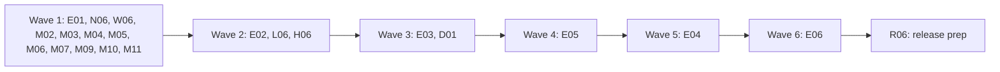

# Plan for 0.6.0-rc.1

The first release candidate of 0.6.0 gives a project a standard home. Records go to `tagreeve/runs/<date>/` by default, a run can carry a label, `tagreeve init` sets up the folders, `tagreeve/config.yml` holds shared defaults, and `suite --baseline` checks every cell against its saved baseline (#811). It also makes `live` a command-line choice only (#815), names the form controls that block a checkout when a `wait: { url }` times out (#810), links a server container's GA4 forwarding exactly when the recorder can prove it (#901), adds the Shop Pay hosts to the platform host list (#585), and fixes the still-valid `review-minor` batches (M02 to M11).

0.6.0-rc.1 starts after 0.5.0 is released. Every entry branches from `main` with the 0.5.0 work in it: S05 (`sentBy`), K05, G05 (the workspace preview guide), P05 (the summary privacy batch that was M1 in the triage) and R05.

Each item is one PR. A PR is done when its acceptance test passes in CI, an adversarial review reports no blockers or majors, and it is squash-merged.

## Goals this release serves

From `docs/goals.md`:

- **A new user starts with one simple setup prompt.** `tagreeve init`, path defaults and a project config let the agent set up a project the same way each time, and keep records out of the repo (E01, E03, E04, E05).
- **Make it easy to change a GTM config reliably.** `suite --baseline` checks every scenario and store after a change (E06). A label names each run (E02). A leak through the server container's GA4 forwarding fails the run when the link is proven (L06). A blocked checkout says why (W06).
- **Compare a run against a saved baseline.** Baselines get default names and paths (E06).
- **Be safe by default.** A committed scenario can no longer send hits to real vendor accounts (N06). The config file cannot widen what a run may do (E04). A warning names a record folder that git would commit (E05). The payment fill is bound to the frame document it checked (M04).
- **Expose all of this to agents through the CLI, with stable `--json`.** Every file that came from a default is named in the text summary and in `--json` (E03, E04, E06). The label is in `--json` (E02).

Non-goals this release comes close to:

- **Legal advice or legal responsibility.** W06 names an unticked terms checkbox. Tagreeve never ticks it, because that accepts a store's terms on someone's behalf.

## Triage

Three read-only reports checked the open 0.6.0 issues against `main` at 0bb7ec2 on 2026-11-03: one for the features (#811, #815, #810, #901, #585), one for the 51 `review-minor` issues, and one for goal 2. The plan author checked the code claims used below against `origin/main` at 0bb7ec2.

Closed or moved on 2026-11-03 with the maintainer's approval, with no code change in this plan:

| Issue | Why |
| --- | --- |
| #820, #842, #863, #884, #889 | Fixed already on `main`. |
| #809, #854, #875 | Moot: scope notes on shipped plans and merged PRs. |
| #859 | Won't fix: moving the help dispatch tests is churn. |
| #870, #871, #869, #874, #853 | Moved to 0.5.0 as P05 (the triage's batch M1). |
| #892, #894, #895, #896 | Moved to 0.5.0: R05 writes the "Known in 0.5.0" list and the README status block. |

Waiting, not in rc.1:

| Issue | Why |
| --- | --- |
| #719 | `node-forge` 1.4.2 is two weeks old on 2026-11-10 at 14:09 UTC. It cannot land before then. |

Not in rc.1. These `review-minor` issues were open on 2026-11-04 and no entry fixes them. They stay open for a later batch between waves:

| Issues | Why |
| --- | --- |
| #693, #727, #729, #730, #749 to #752, #759, #760, #763, #764, #766, #835 to #839, #857, #865 to #867 | The site and demo batch. It touches `site/` and `site/demo/`, which no rc.1 entry changes. #730 (Astro 7 needs Node 22.22, AGENTS.md says 22.18) goes first in that batch. |
| #906, #908 to #910, #912 to #914, #916, #918 to #920 | Follow-ups from the 0.5.0 work (K05, G05, S05, P05). They are filed after the triage. M03 and L06 may fix #909, #910, #914 and #916 in passing, but only when the file is already in their Touches line. |
| #893 | An R05 input. R05 owns it. |

Folded into a feature entry, so that no two entries in one wave share a file:

| Issue | Into | Why |
| --- | --- | --- |
| #860, #861 | E01 | `packages/cli/src/args.ts` and `args.test.ts`. |
| #827 | W06 | `packages/recorder/src/steps.test.ts`. |
| #885 | E05 | `docs/guide/project-layout.md`, "What stays outside the repo". |
| #886 | H06 | `docs/guide/reading-results.md`, the `platformHost` bullet. |

Claims checked against the code:

- `args.ts` sets `out: values.out ?? 'runs'` for `run` and `suite`. There is no `--label`, `--config` or `init`. `suite` needs one folder and refuses `--baseline`. `baseline save` needs two paths.
- `labelRecord` in `packages/cli/src/run.ts` already rewrites the first line of a record after the recorder wrote it, for a suite variant, on success and on a step failure. The store writes the `run` line first (`packages/core/src/store.ts`). So E02 can write `Run.label` and `Run.store` from the CLI, and `packages/recorder/src/recorder.ts` stays free for L06.
- `NETWORKS` in `packages/expect/src/scenario.ts` accepts `live`. `resolveNetwork` in `run.ts` uses `args.network ?? parsed.options.network ?? 'stub'`. Three tests in `packages/cli/src/run.test.ts` and one fixture in `scenario.test.ts` use a scenario's `network: live`. No e2e scenario does.
- `waitForUrl` in `packages/recorder/src/steps.ts` throws `page did not reach <url> within <t>` and lists no controls.
- `linkServerHits` in `packages/recorder/src/server-container/link.ts` gives `exact` only by event ID and event name. `routeToContainer` in `recorder.ts` makes the browser's request to the container itself. The stand-in container answers 200 before its vendor calls, and its GA4 call uses a fixed `cid=pw-client.1` and `ep.event_id`, so it can never show a client ID link.
- `platform-hosts.ts` lists `cdn.shopify.com` and `monorail-edge.shopifysvc.com`. The Shop Pay page, https://shopify.dev/docs/api/commerce-components/pay, says under "Requirements": allow `cdn.shopifycloud.com`, `cdn.shopify.com`, `shop.app`, `pay.shopify.com`, `*.shopifysvc.com` and `*.stripe.com` (checked on 2026-11-03).
- The repo's `.gitignore` has `runs/`, which also ignores `tagreeve/runs/`. So E01 needs no new line there.

## Decisions

Maintainer decisions, 2026-11-03, final. Items marked (this plan) are the plan author's choices, for the maintainer to confirm at the plan review.

- **Scope.** #811 in six entries (E01 to E06), #815, #810, #585, #901, and the review-minor batches M02 to M11 from the triage, with M1 moved to 0.5.0 and M08 folded into E01.
- **Goal 2 is the headline of 0.6.0-rc.2,** not of this plan (see Out of scope).
- **#815, option 2.** A scenario may set `network: stub` or `network: server`. `live` needs `--network live` on the command line. A scenario that says `live` is a scenario error that names the flag, also when the command line passes `--network live`. This is a breaking change with a CHANGELOG line. N06 lands before E04, and the project config refuses `network`.
- **The default `--out`** is `tagreeve/runs/<date>/`, or `tagreeve/runs/<date>-<label>/` with `--label`. `<date>` is the machine's local date, `YYYY-MM-DD`. Records keep exact UTC timestamps. An `out` set in `config.yml` gets the dated folder and the label too. Only an explicit `--out` is used exactly as given.
- **Labels** are 1 to 40 characters of lowercase letters, digits and hyphens (`^[a-z0-9-]{1,40}$`). A label is never rewritten. Anything else is a usage error that names `--label`.
- **Every file that came from a default** is named in the text summary and in `--json`. The record and the manifest are named already by the `Record:` and `Manifest:` lines.
- **`config.yml`** is read from the current directory only (`./tagreeve/config.yml`), never from a parent folder. `--config <file>` replaces it. It never holds secrets. It refuses `network`, `--server-container`, `--allow-test-payment` and server pass-through.
- **`serverHosts` is allowed in the config** (maintainer, 2026-11-03, the agreed #811 scope). "Server pass-through" in #811 means `--network server`, Server mode comes from `--network server` or a scenario's `options.network: server`; the config cannot set `network`, since it is refused. `serverHosts` from the config can supply the hosts for either, so a scenario with `network: server` and no `serverHosts` runs when the config has them. Non-loopback hosts keep today's stderr warning.
- **`--allow-test-payment`** still needs `--site` or `--stores` on the command line, because `AGENTS.md` says it names the exact `--site` host. A site from `config.yml` is not enough.
- **Baselines.** The default name is `<scenario>[.<store>][.<variant>].json` in `tagreeve/baselines/`. `<scenario>` is the file name without `.yml` or `.yaml`. `.<store>` is there only for a run with a store. `.<variant>` is there only for a variant other than `published` (this plan), so `run x.yml --baseline` and a published-only suite share `x.json`. A suite cell with no baseline file under `suite --baseline` exits 2 before any browser starts. A saved baseline never changes an exit code unless `--baseline` is given.
- **#810.** When a `wait: { url }` step times out, the reason lists the form controls that block submission. Three signals count: the control's own validity fails (`validity.valid === false`), `required` or `aria-required="true"` on an unticked checkbox, and `aria-invalid="true"`. Only top-level documents, never frames, so card frames are never read. Names or labels only, never a value, a placeholder or an error text. Tagreeve never calls `checkValidity()` or `reportValidity()`, and never ticks a checkbox.
- **#901.** A container call links exactly by client ID and event name only when exactly one browser hit with the same client ID and event name had its request to the container in flight when the call arrived. Rule 1 (event ID and event name) still ranks first. Ties, and names that differ across vendors, stay `probable`.
- **#585.** Add the hosts that Shopify's Shop Pay page names: exact hosts, plus `*.shopifysvc.com` as the page writes it. Never `*.myshopify.com`, and not the POS firewall list. Each entry links to the Shopify page. `*.stripe.com` stays out, because it is third party.
- **Record schema version 4, once.** E02 bumps `recordSchemaVersion` to 4 for `Run.label` and `Run.store`. L06 changes what a `clientId` exact link means, under the same version. The goal 2 fields of rc.2 are added to the same version 4 before 0.6.0 final, so 0.6 has one bump. The suite manifest goes to `suiteSchemaVersion: 3` once, in E02, and E03 and E06 add to it.
- **The frame of each `dataLayer` push is in version 4 (maintainer, 2026-11-04).** D01 records which frame made each push, so 0.6.0 has one record shape and rc.2's `dataLayer` work (#922) does not change version 4 again. It comes from the adversarial review of #922.
- **`records.ts` has one owner in wave 2 (this plan).** E02 writes the version 4 docstring for both changes and the new `HitVia.confidence` docstring. L06 does not edit `records.ts`. The L06 review checks that the docstring matches the code.
- **The site demo is not re-recorded for E01 (this plan).** `scripts/record-site-demo.ts` passes `--out runs`, which is used as given, so the recorded text does not change.

## Order and waves

Twelve PRs in wave 1, three in wave 2, then one per wave for the rest of #811, then the release prep.

Why the waves are this way:

- **The #811 chain.** E01 to E06 all edit `packages/cli/src/args.ts`, `run.ts` and `suite.ts`, so they run one per wave. E02 needs E01's `out-dir.ts`. E04 needs E03 (site precedence and the defaults list) and N06. E06 needs E02 (`Run.store`) and E03 (the defaults list). E05 runs before E04, as the features triage proposed.
- **`packages/recorder/src/recorder.ts`** changes in M11 (`hopRecord`, wave 1) and L06 (`routeToContainer` and the `linkServerHits` call, wave 2).
- **`fixtures/site/src/stand-in-container.ts`** changes in M07 (wave 1) and L06 (wave 2).
- **`docs/guide/reading-results.md`** changes in E01 (wave 1) and H06 (wave 2). L06 does not edit it. This is why H06 is in wave 2 and not wave 1.
- **`docs/guide/server-container.md`** changes in M03 (wave 1) and L06 (wave 2).
- **`docs/guide/project-layout.md`** changes in E01, E02, E03, E05, E04 and E06, one per wave.
- **`packages/core/src/records.ts`** changes in E02 (wave 2) and D01 (wave 3).
- **Append-only overlaps.** Each PR edits only its own part:
  - `docs/cli.md`. Wave 1: E01 the `--out` rows of `run` and `suite`; N06 the `--network` row, the `--net-log` row and a new `network` row in the scenario options table; W06 the `wait` URL paragraph; M03 the `identity.hashesMatch` source sentence (#891), the declaration hint sentence (#890), the card field reason example (#846) and the `--by-page` row (#855). Wave 2: E02 the `--label` rows, the suite output sentence and the `suite.json` paragraph, and the report header item; H06 the `platformHosts` row.
  - `docs/design.md`. Wave 1: E01 the §9 Storage bullet; N06 the §5.3 `--net-log` bullet and one §5.3 sentence that `live` is a command-line choice; W06 one §5.4 sentence on the `wait` URL reason; M11 the §5.3 unloadGap paragraph (the frame URL fallback and the start-of-navigation limit). Wave 2: E02 the §4 `Run` row; L06 the §4 `via` paragraph and the §9 Correlation bullet; H06 the §5.3 unknown destination rule and the §10.1 platform hosts bullet. Wave 3: E03 the §12 CLI paragraph; D01 the §4 `DataLayerEvent` row and the version 4 paragraph.
  - `fixtures/site/src/index.ts`. Wave 1: W06, M09 and M11 each add their own route lines.
  - `fixtures/site/README.md`. Wave 1: W06, M09 and M11 each add their own rows. Wave 2: L06 the stand-in rows.
  - `CHANGELOG.md`. One marker per PR.

## Rules for every PR

The rules in `AGENTS.md` and the earlier plans still hold: fake IDs and identities only; no cookie value, identity value, card value, `gtmAuth` or container config in any output, with a leak test for each PR that adds output; e2e only against `fixtures/site` (and the stand-in container, with no Docker and no network); context-level hooks only.

More for rc.1:

- Each PR adds a regression test that fails when the change is removed, and the PR description says how that was checked. M03 and R06 are the exceptions.
- Each negative test checks first that its input really holds what the check looks for. On a run that exits 2, read the record named by the `Record:` line on stderr.
- New e2e tests go in new files, unless the entry names an existing file. A CLI e2e that needs its own working directory has its own `execFile` helper and a temporary directory. `e2e/cli-helpers.ts` is not changed.
- Tests never need a running Docker daemon or the network. E05's tests need the local `git` binary and run `git init` in a temporary directory.
- Record schema: E02 sets `recordSchemaVersion` to 4, and no other PR changes it. D01 adds `DataLayerEvent.frame` to version 4 in wave 3, before any 0.6 release, and updates the version 4 docstring. `suiteSchemaVersion` goes to 3 in E02 only. `baselineSchemaVersion` stays 1 and `storesSchemaVersion` stays 1. E04 adds `configSchemaVersion: 1`.
- Every error about a file names the file and the key, never a value from it, as `stores.ts` and `readGtmOverride` do today.
- A PR that changes CLI output that `site/demo/` shows reruns `pnpm build && node --experimental-transform-types scripts/record-site-demo.ts` and commits the result, as `AGENTS.md` says. With no label, no default file and no config, the summary is unchanged, so the demo should not change.
- CHANGELOG: the plan PR does not edit `CHANGELOG.md`. After 0.5.0 is released, the main session adds a `## 0.6.0-rc.1` heading above `## 0.5.0` with one marker per PR that has a user-visible change, a blank line between each pair: E01, N06, W06, M02, M04, M10, M11, E02, L06, H06, E03, D01, E05, E04, E06 and R06. Every ID is a letter and two digits, because `scripts/changelog-markers.test.ts` and the "no markers left" tests match only `<!-- [A-Z]\d{2} -->`. Each PR replaces only its own marker. R06 removes leftover markers. M03, M05, M06, M07 and M09 add no CHANGELOG line.

## PRs

### Wave 1

**E01 Default `--out` and the old `./runs/` notice (#811, #860, #861).** Touches: `packages/cli/src/args.ts` (`out` becomes optional for `run` and `suite`, the two `--out` help lines, and the `DIFF_USAGE` `--all-flags` line), `packages/cli/src/args.test.ts` (the `out: 'runs'` expectations and the unknown-option case), `packages/cli/src/out-dir.ts` (new), `packages/cli/src/out-dir.test.ts` (new), `packages/cli/src/run.ts` (`runCommand`: the out folder and the notice only), `packages/cli/src/suite.ts` (the out folder and the notice only), `e2e/out-default.e2e.test.ts` (new), `docs/cli.md` (the `--out` rows of `run` and `suite`), `docs/design.md` (the §9 Storage bullet), `docs/guide/project-layout.md` ("Where runs go"), `docs/guide/first-run.md` (the record path in the diagram), `docs/guide/reading-results.md` (the record path in the annotated summary, the `grep` example and the `diff` example), `site/src/lib/annotations.ts` (the `rec` line, which `scripts/site-docs.docs.test.ts` compares with the guide's annotated summary), `README.md` (the record paths in "Quick start" and "Suite and report quick start"), `site/src/lib/prompt.ts` (the rule on the `runs/` folder only), `site/src/components/home/SafeByDefault.astro` and `scripts/site-home.docs.test.ts` (the `runs/*.jsonl` card), `CHANGELOG.md` (the E01 marker).
- `resolveOutDir({ out, now, label? })` in `out-dir.ts`: an explicit `--out` is returned as given. With no `--out`, the folder is `tagreeve/runs/<YYYY-MM-DD>/`, from the local date of `now`. E02 adds the label and E04 the config base, so the function takes both from the start and E01 passes neither.
- `run` writes `<folder>/run_<id>.jsonl`, and `suite` writes `<folder>/suite_<id>/`. The folder is made when it does not exist.
- `oldRunsNotice(cwd)`: when `--out` is not given and `./runs/` holds a `run_*.jsonl` file or a `suite_*` folder, print one stderr line before the browser starts: `Note: records now go to tagreeve/runs/<date>/. ./runs/ holds older records; pass --out runs to keep using it.` No notice with an explicit `--out`.
- #860: the unknown-option test asserts that `error.message` equals `Unknown option ${flag}.`. #861: the `--all-flags` line says it also shows flag count changes for platform hosts, as `docs/cli.md` does.
- The repo's `.gitignore` and `eslint.config.js` are not changed: `runs/` in `.gitignore` already covers `tagreeve/runs/`, and ESLint does not read `.jsonl` or `.html` files.
- The prompt rule reads: keep the `tagreeve/runs/` folder on my machine. Step 4 of the prompt is E05's.
Regression test: unit tests for `resolveOutDir` with a fixed `now` near midnight in a fixed time zone (`TZ` set in the test), an explicit `--out`, and the notice with and without old records. In the e2e, a temporary working directory, the fixture site and no `--out`.
Acceptance: `pnpm exec vitest run --project e2e e2e/out-default.e2e.test.ts` passes. The record lands in `tagreeve/runs/<YYYY-MM-DD>/run_<id>.jsonl`, with the date computed before and after the run and either accepted. `--out x` writes `x/run_<id>.jsonl`. A directory with `runs/run_old.jsonl` gets the notice once. On the old code the record is in `runs/`, so the test fails.

**N06 `live` only from the command line (#815).** Touches: `packages/expect/src/scenario.ts` (the `network` option branch and `NETWORKS` only), `packages/expect/src/scenario.test.ts` (the valid fixture that sets `network: live`, and new cases), `packages/cli/src/run.test.ts` (the three `--net-log` tests that use a scenario's `network: live`), `docs/cli.md` (the `--network` row, the `--net-log` row and a new `network` row in the scenario options table), `docs/design.md` (the §5.3 `--net-log` bullet and one §5.3 sentence), `CHANGELOG.md` (the N06 marker, as a breaking change).
- `options.network` accepts `stub` and `server`. `live` is a scenario error: `options.network: live is not allowed in a scenario. Pass --network live on the command line.` It is refused also when the command line passes `--network live`. Any other value keeps today's error, which now lists `stub, server`.
- `run` prints the scenario error and exits 2, as for any invalid scenario. `suite` fails its scan with exit 2 and names the file, through today's `ScenarioError` path, so `run.ts` and `suite.ts` do not change.
- `--net-log` still needs `--network live`. The docs drop "or the scenario's `options.network: live`".
- The CHANGELOG line says that a scenario with `network: live` now fails to load, and to move `live` to the command line.
Regression test: `scenario.test.ts` cases for `live` (refused, the message names `--network live`), `server` and `stub` (accepted). `run.test.ts`: a scenario with `network: live` and `--network live` exits 2 with that message; `--network live --net-log` with a scenario that sets no network starts in live mode (precondition: the stderr has the live warning).
Acceptance: the unit tests pass. On the old code the scenario with `network: live` parses and the run starts in live mode, so the tests fail.

**W06 Blocking controls when a `wait: { url }` times out (#810, #827).** Touches: `packages/recorder/src/steps.ts` (`waitForUrl` only), `packages/recorder/src/locators.ts` (a new `blockingControls(context)` next to `timeoutMessage`, which walks `context.pages()` like `conditionHolds`), `packages/recorder/src/locators.test.ts`, `packages/recorder/src/steps.test.ts` (the #827 bound, and a case for the `wait` URL message), new fixture pages in `fixtures/site/public/` (`terms-required.html`, `terms-aria-invalid.html`, `terms-none.html`), `fixtures/site/src/index.ts` (their routes only), `fixtures/site/README.md` (their rows), `fixtures/site/src/pages-terms.test.ts` (new), `packages/recorder/test/e2e/wait-url-controls.e2e.test.ts` (new), `docs/cli.md` (the `wait` URL paragraph), `docs/shopify-checkout.md` (the sentence on what a blocked Pay click looks like; and `fixtures/site/src/shopify-checkout-doc.test.ts` only if it pins that sentence), `docs/design.md` (one §5.4 sentence), `CHANGELOG.md` (the W06 marker).
- When a `wait: { url }` step times out, `waitForUrl` appends the controls that block submission to today's message, for example `page did not reach /thank-you* within 30s. Blocking controls: checkbox "I agree to the terms and conditions" (required, not ticked).` With no blocking control, the message is exactly today's.
- The three signals, in this order of reasons: `required, not ticked` (a checkbox with `required` or `aria-required="true"` that is not ticked), `invalid` (`validity.valid === false` on any other control), `aria-invalid` (`aria-invalid="true"`). Read `validity` only. Never call `checkValidity()` or `reportValidity()`, because they fire events the page can see and `reportValidity()` shows UI.
- Only the top-level document of each page in the context, the same set `conditionHolds` checks. Never a frame, so a card frame is never read.
- For each control: the role or input type, the accessible name (label text, `aria-label`, `aria-labelledby`, else the `name` attribute) passed through `visibleName`, and the reason. Never the value, the placeholder or an error text. At most ten entries.
- Every `wait: { url }` timeout gets the list, not only one after a `payment` step. A `handoff` `until` timeout does not, as `withControlList` skips handoffs. Tagreeve never ticks a checkbox.
- #827: the shared-timeout test checks that the click timeout is below the step timeout and above zero, with no tight wall-clock bound.
Regression test: `locators.test.ts` cases for each signal, for a name that looks like an email (printed `(hidden)`), and for a control with a typed value (the value is absent). The e2e uses `actionTimeoutMs` of 2 s, because the CLI has no step timeout. On `terms-required.html` a click on Pay and a `wait: { url: "/thank-you*" }` fail with `checkbox "I agree to the terms and conditions" (required, not ticked)`. On `terms-aria-invalid.html`, whose script sets `aria-invalid="true"` after Pay, the reason is `aria-invalid`. On `terms-none.html` the message is today's. Precondition: each page holds a field filled with the fake email, and the message does not hold it.
Acceptance: `pnpm exec vitest run --project e2e packages/recorder/test/e2e/wait-url-controls.e2e.test.ts` passes. On the old code the message has no control list, so the test fails.

**M02 Suite verdict and stores check (#822, #833).** Touches: `packages/cli/src/report/verdict.ts`, `packages/cli/src/report/verdict.test.ts`, `packages/cli/src/stores.ts`, `packages/cli/src/stores.test.ts`, `CHANGELOG.md` (the M02 marker).
- #822: track `namedChecks` per model. In `addFindings`, a check goes to `failedChecks` or `warnedChecks` unless that same model named a finding under the check's own label.
- #833: `readStores` checks read access with `access(path, constants.R_OK)` as well as `isFile()`. The message keeps naming the stores file and the store number, never the rules path.
Regression test: a two-model suite test (one model with a denied leak and a failed `deniedIdentifiers`, one with a failed `deniedIdentifiers` and no leak) reads `built-in check deniedIdentifiers failed in 1 run`. A mode-000 rules file is refused, skipped on Windows and when running as root.
Acceptance: the tests pass, and each fails with its fix reverted.

**M03 Docs fixes (#816, #846, #855, #890, #891).** Touches: `docs/cli.md` (the sections listed in "Order and waves"), `docs/guide/server-container.md` ("What it does not show").
- #816: one bullet: a send from `pagehide` or `visibilitychange` is answered in the page, also to a `serverHosts` host, so the container never gets it and makes no vendor call for it.
- #846: say the count is of inputs that match the field's selector, and the list shows every visible input in the frame. Use an example the code can print.
- #855: the digit, hex and token rules also run on the segment with its dashes removed, which is why a UUID is masked.
- #890: "the scenario's `payment` steps", not "the file's".
- #891: the source list as the issue gives it.
Acceptance: `pnpm docs:build` and `pnpm docs:test` pass. The docs reviewer checks each sentence against the code (`recordUnloadSend` in `recorder.ts`, `countReason` in `payment.ts`, `isValueSegment` in `packages/decoders/src/fields.ts`, used by `maskValuePath` in `diff.ts`, `declarationHint` in `run.ts`).

**M04 Payment fill safety (#845, #841, #844).** Touches: `packages/recorder/src/payment.ts`, `packages/recorder/src/payment.test.ts`, `fixtures/site/public/card-frame-extra-input.html`, `e2e/test-payment-frames.e2e.test.ts` (only if the case is renamed), `CHANGELOG.md` (the M04 marker).
- #845: resolve the `ElementHandle` with `inputs.elementHandle()` first, then run `frameStillServed`, then call `handle.fill`. A handle is bound to its document, so a navigation before the check detaches it, and a navigation after the check does too. The fill fails and nothing is typed into an unchecked document. Resolving the handle after the check would leave a window in which the handle belongs to a new document. The unit tests include an iframe that navigates to an unchecked document after the check but before the handle exists, and assert that nothing is typed. The comment above `fillVerified` says what the handle guarantees.
- #841: call `frameStillServed` just before `countReason`, and fall back to the gone-frame reason if it throws. Pass the attribute text through the typed-value scrub.
- #844: the hidden input in `card-frame-extra-input.html` gets `autocomplete="cc-number"`, so the case fails without the visible filter.
Regression test: a unit test where the frame navigates during a fill try that would succeed (the value never reaches the new document), and one where the frame moves to another host before `countReason` (the reason is the gone-frame reason and names no host).
Acceptance: the tests pass and fail on the old `payment.ts`. The extra-input e2e case fails with the visible filter removed.

**M05 Recording proxy address check (#873, #877).** Touches: `packages/recorder/src/server-container/proxy.ts`, `packages/recorder/src/server-container/proxy.test.ts`.
- #873: destroy each tracked socket before `server.close()` in the branch after the failed address check, as `close()` does.
- #877: a case with a scoped unspecified host (`::%lo0` on macOS, `::%lo` on Linux, skipped where neither exists) that expects `/wildcard/` and passes only because of the check after listen.
Acceptance: the new case fails with the check after listen removed. A case with a client connected between listen and the check rejects within 1 s.

**M06 Test-only hardening (#819, #864, #817).** Touches: `scripts/release-workflow.test.ts`, `scripts/server-container-guide.docs.test.ts`.
- #819: flag any job-level `secrets` key, including `secrets: inherit`. A local `./.github/workflows/*.yml` in `uses` is opened and checked, or refused.
- #864: split run lines on a single `&` too, and drop `#` comments before the `--dry-run` check.
- #817: also check the redirect targets and `chmod` targets in the bash fences and inline code, including G05's preview-environment config example.
Acceptance: inline cases for each fail with the fix reverted. `pnpm docs:test` passes.

**M07 Stand-in container (#826, #824, #825).** Touches: `fixtures/site/src/stand-in-container.ts`, `fixtures/site/src/stand-in-container.test.ts`, `e2e/server-container-runner.e2e.test.ts`, a new stderr-tee wrapper script in `e2e/` (for example `e2e/stand-in-tee.ts`).
- #826: `viaProxy` gets a socket timeout that rejects, and `close()` waits at most 2 s and then destroys open sockets.
- #824: mock `console.error` in `beforeEach` and restore it in `afterEach`. The leak-log test keeps its own capture.
- #825: start a second runner with `TAGREEVE_TEST_SERVER_CONTAINER_CMD` set to the wrapper, which tees the stand-in's raw stderr to a file. Assert that the file holds each secret, that `logTail()` holds none, and that the scrubbed tail still holds a `Config ` line, a `Proxy http://127.0.0.1:` line and a `Calling https://graph.facebook.com/` line.
Acceptance: `pnpm test` passes 20 times in a row (the PR shows the loop). A stalled proxy call no longer hangs `close()`. The leak check fails when the runner stops passing the credential.

**M09 `stubBypass` in the flag detail e2e (#872).** Touches: `e2e/flag-detail-privacy.e2e.test.ts`, `e2e/scenarios/flag-detail-privacy.yml`, a new fixture page in `fixtures/site/public/`, `fixtures/site/src/index.ts` (its route only), `fixtures/site/README.md` (its row), `fixtures/site/src/pages-stub-bypass.test.ts` (new).
- A fixture request that ends as `stubBypass` on every run in stub mode, for example a child frame whose document request redirects to a collection path on the fixture host (design §5.3, "Limit: redirects").
- The scenario puts the SHA-256 of the fake email in `h`, not an unrelated 64-hex value.
Regression test: the e2e asserts the email, its hash and a fake cookie value are in the record and absent from stdout, stderr and `--json`, for `stubBypass` as for the other flags. Precondition: the record has a `stubBypass` flag.
Acceptance: the e2e passes 20 runs in a row (the PR shows the loop). With the query redaction of the summary removed, the `stubBypass` case fails.

**M10 Body scan and Conversions API messages (#848, #850, #851, #849).** Touches: `packages/expect/src/evaluate.ts` (`isEdgeShift`, `hashJudge` and the hashed-values message only), `packages/expect/src/identity-values.test.ts`, `packages/expect/src/meta-capi.test.ts`, `CHANGELOG.md` (the M10 marker).
- #848: a shorter value that occurs in no form of the body (raw, percent-decoded, JSON-unescaped, base64) does not merge.
- #850: a `meta-capi` address field without the digest shape is reported as a plain field, and the message does not call it hashed.
- #851: one comment sentence above `isEdgeShift`.
- #849: the plain-`ct` and second-value tests assert the message and headline hold no `identity.city`, `identity.email` or raw hash value.
Regression test: the `%40` newline case and the phone case give two values. A plain `zp: '00000'` gives the plain-field message.
Acceptance: each new case fails on the old code.

**M11 unloadGap frame identity follow-ups (#879, #880, #881, #882).** Touches: `packages/recorder/src/recorder.ts` (`hopRecord` only), `packages/recorder/src/flags.ts` (the `FrameRef` comment only), `packages/recorder/test/e2e/redirect-frame-id.e2e.test.ts` (new), a new fixture page and its frame document in `fixtures/site/public/`, `fixtures/site/src/index.ts` (its route only), `fixtures/site/README.md` (its row), `fixtures/site/src/pages-frame-nav.test.ts` (new), `e2e/unload-gap-frame-nav.e2e.test.ts` (new), `e2e/scenarios/unload-gap-frame-nav.yml` (new), `e2e/unload-gap-close.e2e.test.ts` (#881 only), `docs/design.md` (the §5.3 unloadGap paragraph), `CHANGELOG.md` (the M11 marker).
- #879: `hopRecord` sets the hop's frame id to the first request's id in `requestFrameIds`.
- #880: a fixture frame pushes an event, navigates to the same URL, then sends a GA4 hit with a non-GA4 name. The push is flagged. Design §5.3 says the counter goes up when a navigation starts, so a navigation that never commits can give later requests the next id, which gives at most an extra warning.
- #881: assert `other.t >= event.t` for the `checkout_completed` push, and that `other.t` is before the run end.
- #882: the design and the `FrameRef` comment name the cases that use the URL fallback: redirect hops before #879, worker requests and container calls. A `--net-log` record never reaches it.
Regression test: `hopRecord` runs only for top-level frame requests (`isFetchableRequest` gates out child frames, so a redirect chain that starts in an `about:srcdoc` frame is never followed, design §5.3). Child-frame hops are recorded by `context.on('request')` and already carry their frame ids. So the recorder e2e starts a redirected GA4 hit in the top-level frame, at a same-origin URL X or at `about:blank`, and makes the `dataLayer` push from an embedded iframe whose `frame.url()` is also X. On the old code the hop's `id` is null, `sameFrame` falls back to URL equality and wrongly covers the push. With the fix the hop carries the top-level frame id and the push is flagged. The CLI e2e for #880.
Acceptance: each test fails on the old code (the redirect case with the `hopRecord` line removed, the navigation case with the `countNavigation` call removed).

### Wave 2

**E02 `--label`, `Run.label` and `Run.store` (#811).** Touches: `packages/cli/src/args.ts` (`--label` on `run` and `suite`, its help lines), `packages/cli/src/args.test.ts`, `packages/cli/src/out-dir.ts` (the label in the folder name), `packages/cli/src/out-dir.test.ts`, `packages/core/src/records.ts` (`Run.label`, `Run.store`, `RECORD_SCHEMA_VERSION = 4`, the version docstring, the `HitVia.confidence` docstring), `packages/core/src/store.test.ts` (the line that expects 3), `packages/recorder/test/e2e/recorder.e2e.test.ts` (the `recordSchemaVersion` expectation and its title only), `e2e/suite.e2e.test.ts` (the `suiteSchemaVersion` expectation only), `e2e/stores.e2e.test.ts` (the version expectation only), `packages/cli/src/run.ts` (`RunSpec`, `runCommand` (the label into `resolveOutDir` and the spec), `executeRun` and `labelRecord` only), `packages/cli/src/suite.ts` (`SuiteManifest.label`, `suiteSchemaVersion: 3`, the store on each spec, and the label in the suite's out folder), `packages/cli/src/suite.test.ts`, `packages/cli/src/summary.ts`, `packages/cli/src/summary.test.ts`, `packages/cli/src/report/model.ts`, `packages/cli/src/report/model.test.ts`, `packages/cli/src/report/render.ts` (the header row), `packages/cli/src/report/render.test.ts`, `packages/cli/src/report/suite.ts` (`isManifest` accepts 3, and the header), `packages/cli/src/report/suite.test.ts`, `e2e/run-label.e2e.test.ts` (new), `docs/cli.md` (the sections listed in "Order and waves"), `docs/design.md` (the §4 `Run` row and a new §4 "Version 4 adds `Run.label` and `Run.store`" paragraph), `docs/guide/project-layout.md` ("Naming a run folder"), `CHANGELOG.md` (the E02 marker).
- `--label <name>` on `run` and `suite`. A label matches `^[a-z0-9-]{1,40}$` and is never rewritten. Anything else exits 2 with `--label must be 1 to 40 lowercase letters, digits or hyphens, got "<label>"`.
- With no `--out`, the folder is `tagreeve/runs/<date>-<label>/`. With `--out`, the folder is used as given and the label is still stored.
- `Run.label` is set when `--label` is given. `Run.store` is the store name of a `suite --stores` cell. Both are written from the CLI: `labelRecord` becomes one function that rewrites the `run` line with the label, the store and the variant, on success and on a step failure, and renames the file only for a suite cell. `recorder.ts` does not change.
- `recordSchemaVersion` is 4. The version docstring says version 4 adds `Run.label` and `Run.store`, and that a `clientId` link may be `exact` (L06). The `HitVia.confidence` docstring says `exact` is proven: by event ID and event name, or by client ID and event name on the one browser hit whose request to the container was in flight.
- The text summary has a `Label: <label>` line when a label is set, and `--json` has `label`. No line and no key without a label, so the demo output does not change.
- `suite.json` has `suiteSchemaVersion: 3` and `label` when set. The HTML report shows the label in the header next to Variant, escaped. `report` reads manifests of version 1, 2 and 3.
Regression test: unit tests for the regex (40 characters pass, 41 fail, `Bad_Label` fails), the folder name, and the rewritten `run` line on a step failure. The e2e: `run --label ca-307-live` with no `--out` writes to `tagreeve/runs/<date>-ca-307-live/`, `Run.label` is `ca-307-live`, `recordSchemaVersion` is 4, and `--json` has the label. `--label x --out o` writes to `o/` and stores `x`. A `suite --stores` cell record has `Run.store`.
Acceptance: the e2e passes. On the old code `--label` is an unknown option and the run exits 2, so the test fails.

**L06 Link rule 2: client ID and event name in flight (#901).** Touches: `packages/recorder/src/server-container/link.ts` (`LinkInput` and `linkServerHits`), `packages/recorder/src/server-container/link.test.ts`, `packages/recorder/src/recorder.ts` (`routeToContainer` and the `linkServerHits` call in `close` only), `fixtures/site/src/stand-in-container.ts` (a new opt-in mode), `fixtures/site/src/stand-in-container.test.ts`, `fixtures/site/README.md` (the stand-in rows), `e2e/server-container-link.e2e.test.ts` (new), `e2e/scenarios/server-container-ga4-forward.yml` (new), `e2e/scenarios/server-container-ga4-answer-first.yml` (new), `docs/design.md` (the sections listed in "Order and waves"), `docs/guide/server-container.md` (the `serverSendProbableLink` bullet, and one sentence on when a client ID link is exact), `CHANGELOG.md` (the L06 marker).
- `routeToContainer` keeps, in memory only, the time each browser request was sent to the container and the time its answer arrived, by request ID, on the clock the proxy stamps container calls with. This is no record field.
- `linkServerHits` ranks: (1) event ID and event name match exactly one browser hit, `by: "eventId"`, `exact`; (2) the call's client ID (a shared value of at least 8 characters, as today) and its event name, compared literally, match exactly one browser hit on a `serverHosts` host whose request to the container was in flight when the call arrived, `by: "clientId"`, `exact`; (3) today's probable rules.
- Two or more such browser hits (a batched GA4 POST with two lines of one event, or two parallel requests): no exact link, fall back to (3). Never pick one. A call whose event name differs from the browser hit's, for example a Data Client `purchase` sent on as a Conversions API `Purchase`, stays probable.
- The stand-in gets an opt-in mode, set by query parameters on the trigger request: `ga4=copy` copies the browser's `cid` and `en` into its GA4 call and sends no event ID; `answer=after` answers the browser only after its vendor calls finish. Without them it behaves as today. The README rows say so.
- The design says what is proven, that ties stay probable, and that the rule depends on the container answering after its tags send (see Flagged concerns). `docs/design.md` §15.5 keeps its 0.5 text; R06 writes §15.6.
Regression test: `link.test.ts` cases: one in-flight candidate gives `exact` by `clientId`; two in-flight candidates give `probable`; a call outside every window gives `probable`; another event name gives no rule 2 link; rule 1 still wins over rule 2. The e2e uses `--network server --server-container` with the stand-in, and an `evaluate` step that POSTs a GA4 hit to `/g/collect` on `sgtmUrl` after a reject, as S05's e2e does. The rule is `mustNot { vendor: ga4, host: www.google-analytics.com, sentBy: server, after: <reject step> }`, so the browser hit alone cannot fail it. With `ga4=copy&answer=after`, the container's GA4 hit has `via: { by: "clientId", confidence: "exact" }`, the result fails with that hit's ID in its evidence and no `serverSendProbableLink` note, and the run exits 1. The control with `ga4=copy` only stays `probable`, warns with the note, and exits 0. Precondition: in both runs the container's GA4 hit has the browser's `cid` and `en` and no event ID. Leak check: the fake email, the proxy credential and the stand-in's config are absent from stdout, stderr and `--json`.
Acceptance: `pnpm exec vitest run --project e2e e2e/server-container-link.e2e.test.ts` passes. On the old code the link is probable and the run exits 0, so the test fails.

**H06 Shop Pay platform hosts (#585, #886).** Touches: `packages/decoders/src/platform-hosts.ts` (entries only), `packages/decoders/src/platform-hosts.test.ts`, `packages/recorder/src/flags.test.ts` (the platform host cases), `docs/cli.md` (the `platformHosts` row), `docs/design.md` (the sections listed in "Order and waves"), `docs/guide/reading-results.md` (the `platformHost` bullet), `CHANGELOG.md` (the H06 marker).
- New entries, each with `source: https://shopify.dev/docs/api/commerce-components/pay`: `pay.shopify.com` (`payments`), `shop.app` (`payments`), `cdn.shopifycloud.com` (`cdn`) and `*.shopifysvc.com` (`telemetry`). The page does not say what each host is for, so the purposes are this plan's labels. The `monorail-edge.shopifysvc.com` entry stays, first, with its own source.
- Recheck that the Hydrogen page still names `cdn.shopify.com`. If it does not, switch that entry's source to the Shop Pay page, which names it.
- Never `*.myshopify.com`, never `*.stripe.com`, and not the POS firewall domains.
- The `platformHosts` row and design §10.1 list the hosts and say Shop Pay. #886: the guide says `options.platformHosts: false` flags those requests as `unknownDestination` again, which fails the run by default.
Regression test: `flags.test.ts`: a POST to `https://pay.shopify.com/...` gets `platformHost` with purpose `payments`, and a POST to `https://otlp-http-production.shopifysvc.com/...` gets `telemetry`. The same requests with `options.platformHosts: false` get `unknownDestination`. `platform-hosts.test.ts`: `shopifysvc.com` itself, `evilshopifysvc.com`, `pay.shopify.com.evil.test` and `js.stripe.com` do not match.
Acceptance: the unit tests pass. On the old list both POSTs are `unknownDestination`, so the tests fail.

### Wave 3

**E03 Path defaults (#811).** Touches: `packages/cli/src/args.ts` (`suite` with no folder, and `--site` or `--stores` no longer required for `suite` at parse time), `packages/cli/src/args.test.ts`, `packages/cli/src/defaults.ts` (new), `packages/cli/src/defaults.test.ts` (new), `packages/cli/src/run.ts` (the tracker list and autoconsent rules only), `packages/cli/src/suite.ts` (the folder, the tracker list, the autoconsent rules, `loadStores`, the site check and its message, the `--allow-test-payment` command-line rule, and `defaults` in the manifest), `packages/cli/src/suite.test.ts`, `packages/cli/src/summary.ts`, `packages/cli/src/summary.test.ts`, `e2e/path-defaults.e2e.test.ts` (new), `docs/cli.md` (the `run` and `suite` option rows for these settings, the `suite` heading line and the `suite.json` paragraph), `docs/design.md` (the §12 CLI paragraph), `docs/guide/project-layout.md` (the layout block at the top and "Suite reads one level"), `CHANGELOG.md` (the E03 marker).
- Defaults, each used only when the file or folder exists and the flag is not given: `tagreeve/scenarios/` for `suite` with no folder; `tagreeve/trackers.json` for `--tracker-list`; `tagreeve/autoconsent/*.json`, sorted, for `--autoconsent-rules`; `tagreeve/stores.json` for `suite --stores`. A flag replaces its default; nothing is merged.
- Site for `suite`: `--site`, then `--stores`, then the default `tagreeve/stores.json`. With none of them, the usage error names all three.
- **Test payments keep a command-line site.** When `--allow-test-payment` is given and neither `--site` nor `--stores` is on the command line, `suite` exits 2 and names the flag, also when `tagreeve/stores.json` exists. A default file never supplies the host a test payment runs on (AGENTS.md: the flag names the exact `--site` host). A unit test and an e2e case cover it, with the precondition that `tagreeve/stores.json` holds the allowlisted host.
- The text summary has one `Defaults:` line that names each default used, for example `Defaults: tagreeve/trackers.json (tracker list), tagreeve/autoconsent/cookiebot.json (autoconsent rules)`. `--json` has `defaults: [{ setting, path }]`. No line and no key when none was used. `suite.json` has the same list under version 3. Paths are the fixed relative names, never absolute.
Regression test: unit tests for each default, present and absent, and for a flag that replaces it. The e2e: a temporary working directory with `tagreeve/scenarios/a.yml`, `tagreeve/trackers.json` and `tagreeve/stores.json` (two fixture stores). `tagreeve suite` with no folder and no `--site` runs `a` on each store, and `--json` lists the three defaults. With `--site`, `stores.json` is not used and not listed. Leak check: no absolute path and no home folder in stdout, stderr or `suite.json`.
Acceptance: the e2e passes. On the old code `suite` with no folder is a usage error, so the test fails.

**D01 The frame of each `dataLayer` push (#922).** Touches: `packages/core/src/records.ts` (`DataLayerEvent.frame` and the version 4 docstring only), `packages/recorder/src/recorder.ts` (the `DATALAYER_BINDING` callback only, which already has `source.frame` and the `frameNumbers` and `eventFrames` maps), `packages/recorder/src/datalayer.ts` (`dataLayerEventFromPayload` takes the frame), `packages/recorder/src/datalayer.test.ts`, `packages/recorder/test/e2e/datalayer-frame.e2e.test.ts` (new), a fixture page that pushes from the top frame and from an embedded frame (`fixtures/site/public/`, its route in `fixtures/site/src/index.ts`, its row in `fixtures/site/README.md`), `docs/design.md` (the §4 `DataLayerEvent` row and the version 4 paragraph: one sentence that version 4 adds `DataLayerEvent.frame`, and that a version 3 event has none and reads as unknown), `CHANGELOG.md` (the D01 marker).
- `DataLayerEvent.frame` is `{ main: boolean, n: number }`: `main` is true for the page's main frame, and `n` is the run's frame number from the existing `frameNumbers` map (the same frame keeps one number for the run). Never a URL, a host, a path or a frame name, because a sandbox frame's URL can hold the page path and checkout tokens.
- A version 3 record has no `frame`; readers treat it as unknown. Nothing else reads the field in rc.1; rc.2's `dataLayer` diff and checks (#922) use it.
Regression test: a unit test that a payload from an embedded frame gets `main: false` and a stable `n`. The e2e loads the fixture page, which pushes one event from the top frame and one from an embedded frame. Precondition: both pushes are in the record. Assert the top-frame push has `main: true`, the embedded push `main: false` with another `n`, and no frame URL or path in any `DataLayerEvent` field.
Acceptance: the e2e passes. On the old code `DataLayerEvent` has no `frame`, so it fails.

### Wave 4

**E05 `tagreeve init` and the git warning (#811, #885).** Touches: `packages/cli/src/args.ts` (`init` in `COMMANDS`, its parse and help), `packages/cli/src/args.test.ts`, `packages/cli/src/main.ts` (the `init` dispatch only), `packages/cli/src/init.ts` (new), `packages/cli/src/init.test.ts` (new), `packages/cli/src/git-ignore.ts` (new), `packages/cli/src/git-ignore.test.ts` (new), `packages/cli/src/run.ts` and `packages/cli/src/suite.ts` (one warning call each, before the browser starts), `e2e/init.e2e.test.ts` (new), `docs/cli.md` (a new `tagreeve init` section), `docs/design.md` (the §12 CLI paragraph), `docs/guide/project-layout.md` (the intro sentence "does not create them for you", and #885 in "What stays outside the repo"), `docs/guide/first-run.md` (one step), `README.md` (one sentence in "Quick start"), `site/src/lib/prompt.ts` (step 4), `CHANGELOG.md` (the E05 marker).
- `tagreeve init` makes `tagreeve/scenarios/` and `tagreeve/baselines/`, and adds `/tagreeve/runs/` to `./.gitignore` in the current directory. It skips the line when git already reports `tagreeve/runs/` as ignored, and never adds it twice. It writes no scenario and no `config.yml`, never overwrites a file, and prints each thing it did or skipped.
- `isUnignoredInWorkTree(path)`: `execFile('git', ['-c', 'core.fsmonitor=false', '-C', <dir>, 'check-ignore', '-q', <path>])`, no shell, a short timeout. Exit 0 means ignored, 1 means not ignored. Anything else, or no git, means silent. It runs after the out folder exists, or on its nearest existing parent.
- `run` and `suite` print one stderr warning when the record folder is inside a git work tree and not ignored: `Warning: <folder> is not in .gitignore. Records hold full request bodies; do not commit them. Run tagreeve init or add the folder to .gitignore.` It never fails a run.
- #885: the pointer to the server container guide ends with a full stop, and `For the override file:` comes before the `chmod` block.
- The prompt's step 4 says to run `tagreeve init` and write the scenarios in `tagreeve/scenarios/`.
Regression test: unit tests for `init` (fresh directory, second run, a broader `runs/` rule already present) and for `isUnignoredInWorkTree` (ignored, not ignored, not a work tree, a missing `git` on `PATH`). The e2e runs `git init` in a temporary directory, then `tagreeve init`, then a fixture run with no `--out` (no warning) and one with `--out records` (one warning that names `records`). Outside git, no warning.
Acceptance: the e2e passes. On the old code `init` is an unknown command, so the test fails.

### Wave 5

**E04 `tagreeve/config.yml` and `--config` (#811).** Touches: `packages/expect/src/project-config.ts` (new: `parseProjectConfig(text, file)` with line-aware YAML errors, the whole key schema (allowed keys, the refused keys `network`, `serverContainer`, `serverContainerConfig`, `allowTestPayment`, `gtmOverride`, and unknown keys, each error naming the file, the key and the line, never the value), built on one `parseOptions(raw, path)` that `parseScenario` also calls, and `mergeOptions(config, scenario)`; `yaml` stays a dependency of expect only), `packages/expect/src/project-config.test.ts` (new), `packages/expect/src/scenario.ts` (extract `parseOptions`), `packages/expect/src/scenario.test.ts`, `packages/expect/src/index.ts` (the exports), `packages/cli/src/project-config.ts` (new: finds and reads the file, the flag and site precedence, the `--allow-test-payment` rule and the defaults entry, reports the sources; it holds no key rules), `packages/cli/src/project-config.test.ts` (new), `packages/cli/src/args.ts` (`--config`, and `--site` no longer required for `run` at parse time; the run-time message still contains `--site is required`, also with no config file, so `e2e/cli-flags.e2e.test.ts` stays unchanged), `packages/cli/src/args.test.ts`, `packages/cli/src/main.test.ts` (the `main(['run','s.yml'])` case: the run-time site error is a `UsageError` with command `run` or `suite`, raised before the scenario file is read, so `main` still prints the short message and the `tagreeve run --help` hint), `packages/cli/src/run.ts` and `packages/cli/src/suite.ts` (load the config, merge, pass the sources on), `packages/cli/src/out-dir.ts` (the config base for the dated folder), `packages/cli/src/out-dir.test.ts`, `packages/cli/src/summary.ts`, `packages/cli/src/summary.test.ts`, `e2e/project-config.e2e.test.ts` (new), `docs/cli.md` (a new "Project config" section and the `--config` rows), `docs/design.md` (the §11 options paragraph, §12 and one §13 sentence on what the config may not hold), `docs/guide/project-layout.md` (the layout block at the top and "What to commit"), `CHANGELOG.md` (the E04 marker).
- The file is `./tagreeve/config.yml` in the current directory, never a parent folder. `--config <file>` replaces it. A missing `--config` file exits 2.
- Keys: `configSchemaVersion: 1` (required), `site` (an http or https URL with no userinfo), `out` (a folder), and `options` with `allowUnknownDestination`, `builtins`, `firstPartyHosts`, `platformHosts`, `serverHosts`, `unloadGapIgnore` and `identifierFields`, checked by the scenario's own validators. `serverHosts` only says which hosts are the user's server; server mode still comes from `--network server` or a scenario's `network: server`. A scenario with `network: server` and no `serverHosts` takes the config's hosts, keeps today's stderr warning for hosts that are not loopback, and the two `resolveNetwork` messages that say "in the scenario" then name `tagreeve/config.yml` too. A unit test covers that case.
- Refused, each with exit 2 and a message that names the key and never the value: `network`, `serverContainer`, `serverContainerConfig`, `allowTestPayment`, `gtmOverride`, and any unknown key.
- Merge: a scenario's own option wins, and a list replaces the config's list. `builtins` merges per check, and the scenario wins per check. The config never overrides a scenario. Command-line flags win over both.
- `out` from the config gets the dated folder and the label: `<out>/<date>[-<label>]/`. Only `--out` is used as given.
- Site: `--site`, then `--stores`, then the config `site`, then the default `tagreeve/stores.json` (suite). When the config has `site` and a default `stores.json` exists, `suite` exits 2 and asks for `--site` or `--stores`.
- E03's test-payment rule extends to the config: `--allow-test-payment` with no `--site` or `--stores` on the command line exits 2 and names the flag, also when the config has `site`, for `run` and `suite`.
- The summary's `Defaults:` line and `--json` `defaults` name `tagreeve/config.yml` when it was read from the default path, as `{ setting: 'config', path: 'tagreeve/config.yml' }`. A `--config` path is not listed.
Regression test: unit tests for every allowed and refused key, the merge rules and the precedence. Leak check: a refused key whose value is a fake `gtm_auth=` string and a fake container config; the value is absent from stderr. The e2e: a temporary working directory with `tagreeve/config.yml` holding `site`, `out` and `options.allowUnknownDestination: true` runs a scenario that would fail on `unknownDestination`, with no flags, and it passes; the summary names `tagreeve/config.yml`. A scenario with its own `allowUnknownDestination: false` fails. `--config other.yml` replaces the file. A `tagreeve/config.yml` in a parent folder is not read. Precondition: the same scenario without the config fails on `unknownDestination`.
Acceptance: the e2e passes. On the old code the config is ignored and the run fails, so the test fails.

### Wave 6

**E06 Default baseline paths and `suite --baseline` (#811).** Touches: `packages/cli/src/baseline.ts` (the default output path, `mkdir` of `tagreeve/baselines/`, `defaultBaselineName(run)`), `packages/cli/src/baseline.test.ts`, `packages/cli/src/args.ts` (`baseline save` with one path, a bare `--baseline` on `run`, `--baseline` on `suite`), `packages/cli/src/args.test.ts`, `packages/cli/src/run.ts` (the default baseline path only), `packages/cli/src/suite.ts` (compare each cell, the cell exit code, `cells[].baseline` in the manifest), `packages/cli/src/suite.test.ts`, `packages/cli/src/summary.ts` (the suite table cell text), `packages/cli/src/summary.test.ts`, `packages/cli/src/report/suite.ts` (drift per cell), `packages/cli/src/report/suite.test.ts`, `e2e/suite-baseline.e2e.test.ts` (new), new suite folders under `e2e/suites/`, `docs/cli.md` (the `baseline save` and `suite` sections, the `--baseline` row, the `suite.json` paragraph and the exit code table), `docs/design.md` (the §11 baseline paragraph), `docs/guide/project-layout.md` (the `baselines/` item of "What to commit"), `CHANGELOG.md` (the E06 marker).
- `defaultBaselineName(run)` is `<scenario>[.<store>][.<variant>].json`, with the rules in Decisions. `baseline save <record>` with one path writes `tagreeve/baselines/<name>`, makes the folder, and prints the path. A record of schema version 3 or lower that has a variant (a suite cell) has no store, so `baseline save` with one path exits 2 and asks for an explicit path.
- `run x.yml --baseline` with no value uses `tagreeve/baselines/<name>`. An argv pre-pass decides: `--baseline` at the end, or followed by a token that starts with `-`, means the default. Otherwise the next token is the path, as today. The docs say to put the bare form after the scenario.
- `suite --baseline` takes an optional folder, by default `tagreeve/baselines/`, and compares each cell with its own file. Every cell's file is checked before any browser starts. A missing file exits 2 and the message lists each missing file.
- A drifting cell is `FAIL (baseline drift)` in the table and in `suite.json`, and the suite exits 1. `cells[].baseline` holds the file name and the drift counts, under manifest version 3.
- A saved baseline never changes an exit code unless `--baseline` is given.
- The default baseline path used by `run` is in the `Defaults:` line and in `--json` `defaults`.
Regression test: unit tests for the names (no store, a store, `published`, `workspace`), for the pre-pass, and for the version 3 record case. The e2e: `baseline save <record>` with no path writes `tagreeve/baselines/<scenario>.json`, and a stores-suite cell writes `<scenario>.<store>.json`. `suite --baseline` with one drifting baseline exits 1, and that cell is FAIL in the table and in `suite.json`. The same suite without `--baseline` exits 0. A missing cell file exits 2 before any browser starts (precondition: no record was written). A bare `--baseline` after the scenario works. Leak check: the drift output holds names and counts only.
Acceptance: the e2e passes. On the old code `suite --baseline` is a usage error and `baseline save` with one path exits 2, so the test fails.

### Release

**R06 Release prep.** Touches: `package.json` (the version), `packages/cli/src/summary.test.ts` (the `readVersion()` line only), `docs/cli.md` (the version sentence), `CHANGELOG.md` (intro line, leftover markers, a "Known in 0.6.0-rc.1" list), `README.md` (status block and install line), `docs/guide/first-run.md`, the Install block of `docs/cli.md`, `site/src/lib/prompt.ts` (`INSTALL_COMMAND` and the agent prompt text), `scripts/docs-text.docs.test.ts` (`installProblem` turns around again: it requires `npm i -g tagreeve@next`, rejects the bare command, and has negative cases for both), `site/demo/` (rerun `scripts/record-site-demo.ts`, so the records say schema version 4), `docs/design.md` (the status line and its revision, §15 item 6 and a new §15.6 "Differences in 0.6"), `site/src/components/home/Hero.astro` and `scripts/docs-site.docs.test.ts` (the release pill, and the hero button and clipboard assertions, which go back to `@next`), and any other test or doc that pins `0.5.0` as the current version.
- If L06 has not merged, R06 removes the rule-2 text from the `RECORD_SCHEMA_VERSION` and `HitVia.confidence` docstrings in `packages/core/src/records.ts`, and that file is in R06's Touches for that case.
- Version `0.6.0-rc.1`. The install line is `npm i -g tagreeve@next`.
- The CHANGELOG section has an "Upgrading from 0.5.0" list: the new default `--out`, a scenario with `network: live` no longer loads, and record schema version 4.
- The Known list cites only open issues. It says goal 2 is not built (rc.2), that #719 waits for 2026-11-10 if not yet landed, that the #901 rule depends on the container answering after its tags send, that the Shopify terms checkbox signal is not confirmed on a real checkout (#810), and that the platform host list holds only hosts a Shopify page names (#585).
Acceptance: `pnpm lint`, `pnpm typecheck`, `pnpm test` and `pnpm docs:test` pass; `scripts/release.sh 0.6.0-rc.1` runs on `main` after merge. The maintainer publishes.

## After the PRs

The maintainer field-tests `0.6.0-rc.1` on a real Shopify store in `stub` mode, supervised, with a person at every payment and log-in handoff:

- **#901, field question.** Does sGTM's built-in GA4 client answer the browser before or after its tags send? Run the accept and reject scenarios with `--server-container` and read the `Server container` summary line. If the GA4 calls now link exactly, the client answers after. If they are still all `probable`, it answers first, the in-flight rule never fires in the field, and the maintainer decides whether to keep the rule or drop it in rc.2.
- **#810.** Run a `payment` checkout with the terms checkbox unticked, and note which signal fired and the reason text. Capture the checkbox's attributes, never its text or value.
- **#585.** Count the `unknownDestination` hosts that are left on a checkout run.
- **#811.** Set up a fresh repo with `tagreeve init`, run `suite` with no flags but `--site`, save baselines with one path, and run `suite --baseline`.

Then 0.6.0-rc.2, with goal 2.

## Flagged concerns

- **#901 may not fire in the field.** The rule is proven only when the container answers after it forwards. The fixture's stand-in does that only in the opt-in mode. If sGTM answers first, nothing changes for users, and nothing gets worse.
- **A wrong exact link is worse than a missing one.** It can fail a run wrongly, and it can hide a leak by judging a container hit by a granted browser hit's time. L06 is reviewed with `sensitive: true`, and the tie rule must stay strict.
- **`.<variant>` in baseline names** is left out for `published`. If the maintainer wants it always, E06 changes one function and its tests.
- **Records under the current directory.** The new default puts records in `tagreeve/runs/`, often inside a repo. E05's warning and `init` are the guard. The old `runs/` default had the same risk.

## Out of scope

| Item | Why it waits |
| --- | --- |
| Goal 2: the web and server tag-firing reporters, `expectedTags` and `tag` rules | The headline of 0.6.0-rc.2. The goal 2 triage report (`triage-goal2.md`, 2026-11-03) has the proposed entries. The server workspace preview header is not needed: #899 showed that a container config from a workspace's preview environment makes the local container serve the workspace build. |
| node-forge bump (#719) | Not before 2026-11-10 at 14:09 UTC. |
| P05 (#870, #871, #869, #874, #853) and the R05 inputs (#892, #894, #895, #896) | In 0.5.0. |
| Override file and server container config paths in `config.yml` | Refused in rc.1. A path "outside the repo" needs a reliable containment check, and `--server-container` stays a command-line choice. |
| Ticking a terms checkbox | Never. It accepts a store's terms on someone's behalf. |
| The POS firewall domains and `*.myshopify.com` as platform hosts | The POS page does not say what each domain is for, and `*.myshopify.com` would cover every merchant. |
