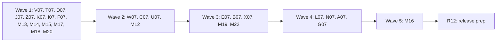

# Plan for 0.6.0-rc.2

The second release candidate of 0.6.0 adds goal 2: a GTM web template that reports which tags fired for each event, `tag` rules, and the list of expected tags that did not fire. It also starts the `dataLayer` and Consent Mode work of #922: a hook that survives re-wraps (#926), custom `dataLayer` names (#927), masked push shapes in `--json` (#928), push shapes in `diff` and `baseline` (#940), a `consentModeSetup` built-in check judged from hits (#929) and an event name map (#930). From the rc.1 field test it adds counts of why a server container call did not link exactly (#1084), a better `configSchemaVersion` message (#1085) and a starter `tagreeve/config.yml` from `init` (#1086). It fixes a path escape in `baseline save` (#1069) and `init --json` (#1051), bumps node-forge (#719), and fixes the `review-minor` batches from the minors triage.

0.6.0-rc.2 starts from `main` after 0.6.0-rc.1 (`1d27d27`, "chore: prepare 0.6.0-rc.1 (#1083)").

Each item is one PR. A PR is done when its acceptance test passes in CI, an adversarial review reports no blockers or majors, and it is squash-merged.

## Goals this release serves

From `docs/goals.md`:

- **Report which tag manager tags fired or failed, per event, without a signed-in person. Report which expected tags did not fire, when the caller gives the container's tag list.** The web reporter template (T07, C07), tag reports in the record (W07), `tag` rules and `expectedTags` (E07), and the guide (G07).
- **Test an unpublished GTM workspace before publishing it.** The reporter runs in a workspace and reports through `--gtm-override` (W07, G07).
- **Make it easy to change a GTM config reliably.** Push shapes show what the page sends to the `dataLayer` before and after a rebuild (U07), and `diff` and `baseline` compare them (B07, A07). The hook records pushes after a loader re-wraps `push` (J07) and from a renamed `dataLayer` (N07).
- **The first run shows where the setup likely breaks consent rules.** `consentModeSetup` reports Google hits with a Consent Mode signal that was never set, and a default without the two v2 signals (Z07).
- **A new user starts with one simple setup prompt.** `init` writes a starter config (I07), and a config without `configSchemaVersion` says which line to add (F07).
- **Expose all of this to agents through the CLI, with stable `--json`.** Tags (E07), push shapes (U07) and link diagnostics (L07) are in `--json`. `init --json` prints JSON (I07). `tagreeve template web` prints the template (C07).
- **Be safe by default.** `baseline save` no longer writes outside `tagreeve/baselines/` (K07). The reporter template is inert for real visitors and sends no event data (T07). Push shapes and tag names are masked in output (U07, E07).

Non-goals this release comes close to:

- **Changing GTM containers.** Tagreeve ships the template as a file. A person imports it, or the user's own agent uses its own GTM API client. Tagreeve never calls the GTM API.
- **Explaining why a tag did not fire.** `notFired` lists expected tags with no report entry. It never says why.
- **A hosted service.** The web report goes from the page to a binding in the test browser. No sink, no collector service.

## Triage

One read-only report checked goal 2 against `origin/main` at `1d27d27` on 2026-11-05. It re-checked every claim of the goal 2 triage (`triage-goal2.md`, written against 0.5.0-rc.2) and of the adversarial review of #922 (`review-922.md`). The `review-minor` issues are triaged by another agent in parallel (see "Minor batches").

Taken into this plan with the maintainer's scope of 2026-11-05:

| Issue | Entry | Note |
| --- | --- | --- |
| Goal 2 (no issue yet) | V07, T07, D07, W07, C07, E07, G07 | The plan PR opens the issues listed in "Issues the plan PR opens". |
| #926 | J07 | |
| #927 | N07 | |
| #928 | U07 | |
| #940 | B07 | |
| #929 | Z07 | |
| #930 | A07 | Tracker: "rc.2 if there is room". Nothing depends on it, so it can move to the next release without blocking. |
| #1084 | L07 | Diagnostics and docs only. The linking rule does not change. |
| #1085 | F07 | |
| #1086 | I07 | Accepted by the maintainer. |
| #1051 | I07 | Same file as #1086. |
| #1069 | K07 | A security fix, so it is its own entry and not in a minor batch. |
| #719 | X07 | Not before 2026-11-10 at 14:09 UTC. |

Not in rc.2:

| Issue | Why |
| --- | --- |
| #931 to #937 | "Next" in the #922 tracker. None is a hard dependency of an rc.2 entry. |
| #938, #939 | "Later" in the tracker. #938 needs W07's reports and J07's `gtmUniqueEventId`, which rc.2 adds. |
| #1017 | Not in the maintainer's rc.2 scope. |
| #1029 | A stricter rule 2 tie. The maintainer chose no change to the linking rule for rc.2 (see OPEN 12). |
| #362 | MCP server. AGENTS.md: CLI only. |

Claims checked against the code at `1d27d27`:

- `packages/core/src/records.ts`: `RECORD_SCHEMA_VERSION = 4`, released in 0.6.0-rc.1 with `Run.label`, `Run.store` and `DataLayerEvent.frame` (`{ main, n }`). `TagReport` is `{type, id, runId, stepId, container, side, event, gtmUniqueEventId, tags}` with no `t`. `TagStatus` is `{id, name, status, executionTime}`. `ResultNote` has seven values. `FlagKind` is a union plus `(string & {})`.
- `NOTE_TEXT` in `packages/cli/src/report/model.ts` is a `Record<ResultNote, string>`, so a new `ResultNote` does not typecheck without a text there.
- Three tests pin record version 4: `packages/core/src/store.test.ts` (line 240), `packages/recorder/test/e2e/recorder.e2e.test.ts` (line 45) and `e2e/run-label.e2e.test.ts` (line 40). `site/demo/*.jsonl` hold version 4. `defaultBaselineName` checks `< 4`, which version 5 does not change.
- `packages/core/src/store.ts`: `readRun` sorts `tagReport` lines into `tagReports` and warns on a newer version. A 0.6.0-rc.1 reader warns on version 5 and still reads the reports.
- `packages/recorder/src/recorder.ts`: `init` exposes the `__tagreeveDataLayer` binding, whose callback already has `source.frame`, `frameNumbers` and `frameDocumentId`. `close` sets `tagReports: []`, and the write loop has no `...records.tagReports`. `Run.containerVersions` is always `{}`.
- `packages/recorder/src/gtm-scrub.ts`: `Scrubber.records` deep-scrubs keys and values of every list other than requests and flags, so it covers `tagReports` and a tag name that holds the auth.
- `packages/recorder/src/gtm-override.ts` validates `expectedTags` (`{id, name?}`), and the run stores them. Nothing reads them.
- `packages/recorder/src/datalayer.ts`: `report()` serialises the item inside the wrapped `push`, before it calls the saved `push`, so a `gtm.uniqueEventId` that GTM stamps while it processes is not seen. A wrapper that does not call through hides later pushes. The setter hooks a new array, so `window.dataLayer = []` after GTM loads records pushes that no tag sees. Only the name `dataLayer` is hooked.
- `packages/recorder/src/server-container/link.ts`: rule 2 counts every earlier same-key browser hit, answered or in flight, and needs `callAt < answeredAt`. Nothing records why a call is not exact. `ServerContainerSummary` in `packages/cli/src/summary.ts` has `calls`, `exact`, `probable`, `unlinked` and `forwarded`.
- `packages/expect/src/project-config.ts` reports a missing `configSchemaVersion` as `configSchemaVersion: required, 1`. The CHANGELOG `config.yml` line and the README do not mention it.
- `packages/cli/src/init.ts` writes no config. `args.ts` refuses positional arguments for `init`, but options like `--json` pass and are ignored.
- `packages/cli/src/baseline.ts`: `defaultBaselineName` joins `run.scenario`, `run.store` and `run.variant` with no checks. `parseBaseline` rejects any `baselineSchemaVersion` other than 1, and does not reject unknown top-level keys, so a 0.6.0-rc.1 reader ignores an optional `dataLayer` section.
- `packages/expect/src/scenario.ts` lists `BUILTIN_NAMES` (five checks). A new built-in adds one `PASS` or `WARN builtin:` line to every summary, which `site/src/lib/annotations.ts`, the annotated summary in `docs/guide/reading-results.md` and `site/demo/` show.
- `GA4_ALIASES` (Shopify standard event to GA4 recommended event) is a private table in `packages/recorder/src/flags.ts`.
- `node-forge` is `1.4.0` in `package.json`, `packages/recorder/package.json` and `pnpm-lock.yaml`.
- GTM template APIs, from Google's template API reference (via Context7, 2026-11-05): `addEventCallback` (permission `read_event_metadata`) gets `(ctid, eventData)`, and `eventData.tags[]` has `id`, `status`, `executionTime` and any tag metadata, once all of the event's tags ran or the event timeout passed. `callInWindow(path, …args)` (permission `access_globals` with `execute`) returns `undefined` when the path does not exist. `sendPixel` makes a GET; no web template API makes a POST. `getContainerVersion` (permission `read_container_data`) returns `containerId`, `debugMode`, `environmentName`, `environmentMode`, `previewMode` and `version`. `copyFromDataLayer` needs `read_data_layer` with a key list.

Claims in `triage-goal2.md` that are wrong or out of date on current `main`:

1. **Record version 4 for the tag fields (A06).** Version 4 shipped in 0.6.0-rc.1. Every new record field needs version 5.
2. **The entry IDs.** A06, T06, D06, W06, C06, E06, G06, R06, S06 and K06 are all used by earlier plans. This plan uses new IDs.
3. **A06 Touches.** It misses `packages/cli/src/report/model.ts` (`NOTE_TEXT` must list every `ResultNote`, or typecheck fails) and `e2e/run-label.e2e.test.ts`, which now pins version 4.
4. **`TagStatus.nameFrom` in the record.** Not wrong code, but this plan keeps the record as GTM sent it. The name filled from `expectedTags` and `nameFrom` are in the output only (Decisions).
5. **The server preview header in design §8.2.** Already rewritten on `main`: §8.2 says a server workspace is tested with a config from its preview environment and that the header is not built. D07 still changes §8.3, §8.4, the §8.5 "Server preview" paragraph and §9.
6. **"A v3 record gives cannot evaluate."** Now every record before version 5, 0.6.0-rc.1 records included, has no tag reports.
7. **"0.5 readers warn on version 4"** is now "0.6.0-rc.1 readers warn on version 5".
8. **The fixture test file `pages-0.6.test.ts`.** The name is free, but `pages-rc2.test.ts` exists from 0.5.0-rc.2. This plan uses feature names (`pages-tags.test.ts`).
9. **"Goal 8 (`init`), #810, #815 and #901 are separate 0.6.0 work"** is out of date: all shipped in rc.1.
10. **Rule syntax.** Design §11 still names `tags.mustFire` and `tags.mustNotFire`. The triage's `tag` rule needs a design change, which E07 makes (OPEN 5).

The rest of the triage holds on `main`: the binding approach, the permission list, the scrub coverage, the proxy that answers any `CONNECT` host, and the stand-in container that talks through the proxy.

## Decisions

Maintainer decisions, 2026-11-05. Items marked (this plan) are the plan author's choices for the maintainer to confirm at the plan review. Items marked OPEN need the maintainer's answer before the first entry that reads them. OPEN 1, 2, 3, 7, 8, 9 and 10 are read by wave 1 (D07, T07, V07, I07), so they must be settled before wave 1 starts. OPEN 4, 5, 6 and 11 are read by waves 2 and 3 and must be settled before wave 2 starts. OPEN 12 and 13 are read by waves 3 and 4 and must be settled before wave 3 starts.

- **Scope.** Goal 2 is the headline. The #922 rc.2 core is #926, #927, #928, #929, #930 and #940. Later #922 issues (#931 to #939) are out. From the rc.1 field test: #1084 (diagnostics and docs only), #1085 and #1086 (accepted). Also #1069, #1051 and #719.
- **#1084 is diagnostics only.** `--json` gets counts of why each container hit is not `exact`, with no IDs and no values. The docs recommend sending an event ID for an exact link, and say plainly that rule 2 rarely fires on a multi-page run. The linking rule does not change.
- **#1086 is accepted.** `init` writes `tagreeve/config.yml` only when it does not exist, with `configSchemaVersion: 1` and comment lines that name the allowed keys, no values. It never overwrites.
- **#719.** node-forge goes to 1.4.2, on or after 2026-11-10 at 14:09 UTC. It touches `package.json` and `pnpm-lock.yaml`, which are gated, so the maintainer merges it.
- **Record schema version 5, once, in V07.** V07 sets `RECORD_SCHEMA_VERSION = 5` and adds every version 5 type and docstring. No later entry edits `packages/core/src/records.ts`. Version 5 holds:
  - `TagReport.t` (required on a version 5 report, the arrival time on the shared clock), `TagReport.frame?` (`{ main, n }`, as `DataLayerEvent.frame`, for a web report) and `TagReport.client?` (the server client name, reserved for the server reporter so it needs no later bump).
  - The `TagStatus.status` docstring: GTM's values `success`, `failure`, `exception` and `timeout`, and any other string kept as GTM sent it.
  - `Run.containerVersions` is written from web reports from version 5 on (docstring only; the field exists).
  - `ResultNote` values `noTagReports` and `tagNameUnknown`, with texts in `NOTE_TEXT`.
  - `Hit.linkMiss?` on a server container hit that is not `exact`: `{ eventId, clientId }`, where `eventId` is `none`, `noMatch` or `several` (rule 1) and `clientId` is `noClientId`, `noSameKeyHit`, `severalSameKeyHits` or `answeredBefore` (rule 2) (L07).
  - `DataLayerEvent.layer?`: the name of the hooked global when it is not `dataLayer` (N07).
  - Flag kinds `dataLayerReassigned` (J07) and `dataLayerNotHooked` (N07).
  - `DataLayerEvent.gtmUniqueEventId` docstring: read after the push returns (J07).
  - `Request.frame?` if OPEN 9 is yes.
- **`suiteSchemaVersion` stays 3.** No entry changes `suite.json`.
- **`baselineSchemaVersion` stays 1.** B07 adds an optional `dataLayer` section. A 0.6.0-rc.1 reader ignores it (`parseBaseline` does not reject unknown keys), and an rc.1 baseline loads and says "pushes not compared".
- **`configSchemaVersion` stays 1.** N07 adds the allowed option `dataLayerNames`. A 0.6.0-rc.1 reader refuses it as an unknown key with exit 2, which is loud, not a silent misread.
- **`storesSchemaVersion` stays 1.**
- **The web reporter sends no event data (this plan).** Only the container ID, the event name, `gtm.uniqueEventId`, the container version string, and for each tag its ID, status, execution time and the name from one metadata key. Unknown keys are dropped by the recorder, not stored.
- **Tag names are kept as GTM sent them in the record (this plan).** A name from `expectedTags` fills a missing name in the output only, with `nameFrom: "expectedTags"` in `--json`. A tag name that the identity scanner calls an email or a phone reads `(other)` in output.
- **`expectedTags` comes from the override file only (this plan).** `notFired` is computed for the override's container, and only when that container sent at least one report. Otherwise the summary says the reporter did not report.
- **Push shapes follow #928 (this plan).** Array indexes read `[*]`; a key segment or event name that `isValueSegment` or the identity scanner calls a value reads `(other)`; types come from a closed set (`string`, `number`, `boolean`, `null`, `object`, `array`); `gtm.*` pushes are counts only. Never a value.
- **`consentModeSetup` is `warn` by default (this plan).** It judges from hits first, as #929 says. It adds no `ResultNote`: the "default set outside the `dataLayer`" case is a passing result with a message.
- **The event name map (this plan).** A07 moves `GA4_ALIASES` to `@tagreeve/decoders` as one built-in table, used by `unloadGap` and by `dataLayer` comparisons. A user map is `--event-map <file>` on `diff` only in rc.2.
- **`packages/core/src/records.ts` has one owner, V07, in wave 1 (this plan).** Entries that need the new types run in later waves. J07 and Z07 run in wave 1 because they need no new type: `FlagKind` accepts any string, and Z07 adds no note.

OPEN, for the maintainer:

1. **OPEN: the server reporter in rc.2 or later.** Recommendation: **later** (0.6.0-rc.3 or 0.6.0 final), after the rc.2 field test has proven the web template in real GTM. Reasons:
   - It adds little that the record lacks. With `--server-container`, every vendor call is already a hit. The reporter adds tag status (`failure`, `exception`, `timeout`), tags that send nothing, and server-side "did not fire".
   - Its unknowns are untested: whether sGTM's `sendHttpRequest` goes through `HTTP_PROXY` to a `.invalid` host, what server `addEventCallback` reports, and whether `getClientName` holds anything. The web template's unknowns (OPEN 3, "After the PRs") are checked first and set the shape the server one copies.
   - rc.2 already has 18 entries plus the minor batches. The server reporter adds two (a template, and a proxy branch with the stand-in), and its proxy branch needs `packages/recorder/src/recorder.ts`, which already changes in four waves. It would add a fifth wave.
   - Version 5 reserves `TagReport.client` and `side: "server"`, and `tag` rules accept `side: server` (cannot evaluate with `noTagReports`), so adding it later needs no record bump and no rule change.
   - If the maintainer wants it in rc.2, O07 and O08 below are written out, in a wave 5.
2. **OPEN: the web transport.** Recommendation: **a page binding through `callInWindow`**, not design §8.1's collector origin. A web template can only GET (`sendPixel`), which design §9 records as an invalid collector report, caps the report at URL length, and would send a request from real visitors' browsers if the template were published. With the binding, a real visitor's page has no such function, so the template does nothing there.
3. **OPEN: the binding name.** Recommendation: `tagreeveTagReport`, with no leading underscores. GTM's `access_globals` key rules for a `__` name are not documented, and a plain name removes that field risk. The other bindings keep their `__tagreeve` names.
4. **OPEN: does "did not fire" fail a run?** Recommendation: **no**. It is reported in the summary and `--json`. A run fails on tags only through an explicit `tag` rule. A full tag list always holds tags that a given scenario never triggers, and a report lost at a navigation would read as "did not fire".
5. **OPEN: rule syntax.** Recommendation: **`tag` inside `must` and `mustNot`**, like cookie rules, in place of design §11's `tags.mustFire` and `tags.mustNotFire`. E07 changes the §11 row.
6. **OPEN: the status default of a `tag` rule.** Recommendation: **any status**, with an optional `status:` list. A `mustNot` that skipped failed tags would miss a tag that sent data and then failed.
7. **OPEN: where the template lives and how users get it.** Recommendation: in the repo (`packages/recorder/src/gtm-templates/`), built into `dist/`, printed by `tagreeve template web`. The Community Template Gallery needs a separate public repo per template under Apache-2.0, and Tagreeve is MIT, so the gallery is a later maintainer decision.
8. **OPEN: a rule line in AGENTS.md.** Recommendation: add one line in D07: "Tagreeve ships GTM templates as files. It never installs or publishes them, and they never send event data." AGENTS.md is the maintainer's file.
9. **OPEN: `Request.frame` in version 5.** Recommendation: **yes**. V07 adds `Request.frame?` (`{ main, n }`, never a URL), and W07 writes it in `recordFor` from the same `frameNumbers` map it uses for `TagReport.frame`. Nothing in rc.2 reads it. #931 and #932 (next) need it to join hits and pushes per frame, and without it they need version 6.
10. **OPEN: `init --json` (#1051).** Recommendation: **print JSON**, `{ "items": [{ "path": "tagreeve/scenarios/", "action": "created" }, …] }` with `action` one of `created`, `skipped` or `added`, because `init` is the first command an agent runs. Any other option is a usage error with exit 2. The other choice is a usage error for `--json` too.
11. **OPEN: push shapes in the text summary.** Recommendation: the text summary gets one line, for example `dataLayer: 14 pushes, 6 events (add_to_cart, purchase, …); shapes in --json`. The shapes are in `--json` only. Auto events can give hundreds of pushes (review-922 m8), and the line keeps the demo change to one line.
12. **OPEN: #1029 (a stricter rule 2 tie).** Recommendation: **leave it out of rc.2** and keep it in the Known list, as the maintainer chose no linking-rule change for #1084. If the maintainer wants it, it folds into L07, which owns `link.ts`. It only makes `exact` rarer, never more common.
13. **OPEN: #930 in rc.2.** Recommendation: keep A07 in wave 4. If wave 3 slips, move it to the next release; nothing depends on it.
14. **Decided by the maintainer (2026-11-05): the reporter install is agent-first.** An agent drives Tagreeve, so the agent installs the reporter with its own GTM access; Tagreeve still never calls the GTM API. C07 adds `tagreeve template web --json` with the template text and the setup steps as fields. The `noTagReports` note (V07) and the `Tags` line of a `--gtm-override` run with no reports (E07) name that command. The guide (G07) puts the agent steps first.

## Order and waves



Eight feature PRs and six minor batches in wave 1, then the tag reports, the template command, the push shapes and the baseline batch, then the tag rules, the `dataLayer` diff, node-forge and two batches, then the link diagnostics, custom names, the event map and the guide, then the config and summary batch, then the release prep.

If the maintainer puts the server reporter in rc.2 (OPEN 1), O07 joins wave 3 and O08 runs in wave 5 next to M16, which touches none of its files.

Why the waves are this way:

- **`packages/core/src/records.ts`** changes in V07 only (wave 1). W07, E07, L07 and N07 need its types, so they run in wave 2 or later.
- **`packages/recorder/src/recorder.ts`** changes in J07 (wave 1: the `dataLayer` binding callback and one flag in `close`), W07 (wave 2: the tag report binding in `init`, `recordFor` for OPEN 9, the late-report wait and the write loop in `close`), M22 (wave 3: the frame number helper and the `DATALAYER_BINDING` callback) and N07 (wave 4: the init script names and the flag input).
- **`packages/recorder/src/datalayer.ts`** changes in J07 (wave 1) and N07 (wave 4).
- **`packages/cli/src/summary.ts`** changes in U07 (wave 2), E07 (wave 3), L07 (wave 4) and M16 (wave 5).
- **`packages/expect/src/scenario.ts`** changes in Z07 (wave 1, `BUILTIN_NAMES`), E07 (wave 3, the `tag` rule) and N07 (wave 4, the `dataLayerNames` option).
- **`packages/expect/src/evaluate.ts`** changes in Z07 (wave 1) and E07 (wave 3).
- **`packages/cli/src/args.ts`** changes in I07 (wave 1), C07 and M12 (wave 2), B07 (wave 3) and A07 (wave 4). M12 edits only the `suite --baseline` help line.
- **`packages/cli/src/main.ts`** changes in I07 (wave 1) and C07 (wave 2).
- **`packages/cli/src/baseline.ts`** changes in K07 (wave 1) and B07 (wave 3).
- **`packages/expect/src/diff.ts` and `packages/cli/src/diff.ts`** change in B07 (wave 3) and A07 (wave 4).
- **`packages/expect/src/project-config.ts`** changes in F07 (wave 1) and N07 (wave 4).
- **`site/demo/`, `site/src/lib/annotations.ts` and the annotated summary in `docs/guide/reading-results.md`** change in Z07 (wave 1, a new built-in line) and U07 (wave 2, the `dataLayer` line). M19 (wave 3) edits `site/demo/`, `site/src/lib/demo-data.ts` and `scripts/record-site-demo.ts` for wording only. R12 reruns the demo for version 5.
- **`fixtures/site/src/containers.ts` and `containers.test.ts`** change in W07 (wave 2, the opt-in reporter) and N07 (wave 4, `&l=`).
- **`packages/recorder/src/flags.ts`** changes in A07 only (wave 4). J07 builds its flag in `recorder.ts`, and N07 puts its check in a new file.
- **`README.md`** changes in F07 (wave 1), M19 (wave 3, the status block only), G07 (wave 4) and R12 (the status block).
- **Append-only overlaps.** Each PR edits only its own part:
  - `docs/design.md`. Wave 1: V07 the §4 `TagReport`, `Hit`, `DataLayerEvent` (and `Request` for OPEN 9) rows and a new "Version 5 adds…" paragraph; D07 §3 (diagram and prose), §8.1, §8.3, §8.4, the §8.5 "Server preview" paragraph and sink bullets, §9 "Collector origin" (the web reporter sentence), "Sink reader" and "Correlation", §13 (the secrets bullet), §14 items 5 and 6; M17 the §4 `via` paragraph (a clarification of the stand-in links, not the L07 sentence); J07 the §5.2 hook bullet; Z07 the §11 built-in checks paragraph; I07 the `tagreeve init` clause of §12. Wave 2: C07 the §12 CLI list; U07 one §13 output sentence. Wave 3: E07 the §11 rules table row and the §8.5 `expectedTags` paragraph; B07 the §11 baseline paragraph; M19 §15 item 7, §15.6, the §5.3 unloadGap paragraph and §10.1. Wave 4: L07 one sentence in the §4 `via` paragraph; N07 the §5.2 hook bullet; A07 one sentence in the §11 baseline paragraph. R12: the status line, §15 item 6 and §15.6 (M19 edits the same §15.6 text in wave 3, so R12 runs after it and rereads the file).
  - `docs/cli.md`. Wave 1: Z07 the built-in checks list; I07 the `tagreeve init` section; F07 the "Project config" section and the `defaults` sentence; M18 the `--out` row, the `platformHosts` row, the payment paragraph, the report examples and the exit code table. Wave 2: C07 a new `tagreeve template` section and the command list; U07 the `--json` summary fields (`dataLayer`). Wave 3: E07 a new "Rules on tags" section, the `tags` `--json` field and the `expectedTags` sentence in "GTM override"; B07 the `diff` and `baseline` sections (`--across-frames`, the `dataLayer` section). Wave 4: L07 the `serverContainer` `--json` field; N07 a `dataLayerNames` row in the scenario options table and in "Project config"; A07 the `--event-map` row of `diff`. Wave 2 also: M12 the `baseline save` and `suite --baseline` paragraphs. R12: the version sentence.
  - `docs/guide/project-layout.md`. Wave 1: I07 (the intro sentence and the layout block) and M18 (the other sections).
  - `CHANGELOG.md` 0.6.0-rc.1 section. Wave 1: F07 (the `config.yml` line) and M18 (the other lines).
  - `fixtures/site/src/index.ts` and `fixtures/site/README.md`. Wave 1: J07, Z07; M17 (the stand-in rows in the README only). Wave 2: W07, U07. Wave 3: B07. Wave 4: L07, N07, A07. Each adds its own route lines and rows.
  - `packages/expect/src/index.ts`. Wave 1: Z07. Wave 2: U07. Wave 3: E07, B07 (one export line each). Wave 4: A07.
  - `packages/decoders/src/index.ts`. Wave 1: Z07 (`gcdSignals`). Wave 4: A07. One export line each.
  - `CHANGELOG.md`. One marker per PR.

## Rules for every PR

The rules in `AGENTS.md` and the earlier plans still hold: CLI only, no MCP server; no hosted service; fake IDs and identities only (`G-PWTEST0001`, `AW-000000001`, `100000000000001`, `GTM-PWTEST1`, `GTM-PWNOVER`); no cookie value, identity value, card value, `gtmAuth` or container config in any output, with a leak test for each PR that adds output; e2e only against `fixtures/site` (and the stand-in container), with no Docker and no network; context-level hooks only (`context.exposeBinding`, `context.addInitScript`, `context.route`, `context.on('request')`); third-party code unmodified, and no tracker data from Tracker Radar, EasyPrivacy or Disconnect.

More for rc.2:

- Each PR adds a regression test that fails when the change is removed, and the PR description says how that was checked. D07, G07 and R12 are the exceptions; they have docs tests.
- Each negative test checks first that its input really holds what the check looks for. On a run that exits 2, read the record named by the `Record:` line on stderr.
- New e2e tests go in new files, unless the entry names an existing file. A CLI e2e that needs its own working directory has its own `execFile` helper and a temporary directory. `e2e/cli-helpers.ts` is not changed.
- Real GTM never runs in a test. The fixture's fake container runs the template's sandboxed JavaScript through a shim of the GTM APIs it uses, as the stand-in container replaces Docker. Real GTM is checked in the supervised field test.
- Record schema: V07 sets `recordSchemaVersion` to 5 and writes every version 5 type and docstring. No other PR edits `packages/core/src/records.ts`. `suiteSchemaVersion` stays 3, `baselineSchemaVersion` 1, `configSchemaVersion` 1 and `storesSchemaVersion` 1.
- Output from the page (tag names, event names, key paths) is masked by the shared rules (`isValueSegment`, `maskValuePath`, `guardFieldName`, the identity scanner). Each PR that prints such text has a leak test with the fake email as a name, a Shopify GID as a key and a checkout token in a sandbox path.
- Every error about a file names the file and the key, never a value from it.
- A PR that changes CLI output that `site/demo/` shows reruns `pnpm build && node --experimental-transform-types scripts/record-site-demo.ts` and commits the result. Z07 and U07 do. If a hand-written reply in `site/demo/*.reply.md` cites a number that changes, the PR fixes the reply.
- CHANGELOG: the plan PR adds a `## 0.6.0-rc.2` heading above `## 0.6.0-rc.1`, with one marker per PR that has a user-visible change, a blank line between each pair (see "CHANGELOG markers"). Every ID is a letter and two digits, because `scripts/changelog-markers.test.ts` and the "no markers left" tests match only `<!-- [A-Z]\d{2} -->`. Each PR replaces only its own marker. R12 removes leftover markers. T07, D07 and G07 add no CHANGELOG line.

## PRs

### Wave 1

**V07 Record schema version 5 (goal 2, #926, #927, #1084).** Touches: `packages/core/src/records.ts` (`RECORD_SCHEMA_VERSION = 5`, the version docstring, `TagReport.t`, `TagReport.frame?`, `TagReport.client?`, the `TagStatus.status` docstring, the `Run.containerVersions` docstring, `Hit.linkMiss?`, `DataLayerEvent.layer?`, the `DataLayerEvent.gtmUniqueEventId` docstring, `ResultNote` `noTagReports` and `tagNameUnknown`, `FlagKind` `dataLayerReassigned` and `dataLayerNotHooked`, and `Request.frame?` if OPEN 9 is yes), `packages/core/src/store.test.ts` (the line that expects 4, and a version 5 file with `tagReport` lines), `packages/cli/src/report/model.ts` (`NOTE_TEXT` for the two notes only), `packages/cli/src/report/model.test.ts` (the two texts), `packages/recorder/test/e2e/recorder.e2e.test.ts` (the `recordSchemaVersion` expectation and its title only), `e2e/run-label.e2e.test.ts` (the `recordSchemaVersion` expectation only), `docs/design.md` (the sections listed in "Order and waves"), `CHANGELOG.md` (the V07 marker).
- Types only. No code writes the new fields in this PR. The `TagReport` docstring says `t` is the arrival time of the report on the shared clock, never a time the page gave.
- `Hit.linkMiss` docstring: set on a server container hit that is not `exact`. It has two class names, one per rule, because rule 1 is tried first and rule 2 only after it. `eventId` (rule 1): `none` (the call carries no event ID, or no event name), `noMatch` (an event ID, and no browser hit with the same ID and event name) or `several` (more than one such hit). `clientId` (rule 2), the first reason that applies: `noClientId` (the call has no event name, or no client ID of at least 8 characters), `noSameKeyHit`, `severalSameKeyHits`, `answeredBefore` (one same-key hit, and the call came after its answer, or it has no window). Class names only, never an ID or a value.
- `NOTE_TEXT`: `noTagReports`: `cannot evaluate: no tag report from this container. Install the reporter: tagreeve template web --json`; `tagNameUnknown`: `cannot evaluate: the tag has no name in its report or in expectedTags`.
- Design §4: the `TagReport` row gains `t`, `frame` and `client`; the `DataLayerEvent` row gains `layer`; the `Hit` row gains `linkMiss`; the `Request` row gains `frame` if OPEN 9 is yes, and is left unchanged if it is no. A new paragraph after the version 4 paragraph: "Version 5 adds…" with each field, the two flag kinds and the two notes, and "A version 4 record reads as before, and a reader that knows only version 4 warns on version 5."
Regression test: the store test reads a version 5 file with two `tagReport` lines into `tagReports` and reads a version 4 file with no warning. `model.test.ts` asserts both texts. On the old code the version is 4, so the e2e expectations and the store test fail.
Acceptance: `pnpm typecheck` and `pnpm test` pass, and `recorder.e2e.test.ts` expects 5. On the old code it is 4, so the test fails.

**T07 The web reporter template and its harness (goal 2).** Touches: `packages/recorder/src/gtm-templates/web-tag-reporter.tpl` (new), `packages/recorder/src/gtm-templates/tpl.ts` (new: `readTemplateSections(text)` returns the sections by name, the sandboxed JavaScript and the parsed permissions), `packages/recorder/src/gtm-templates/tpl.test.ts` (new), `packages/recorder/src/gtm-templates/sandbox.test-helper.ts` (new: runs sandboxed JavaScript in `node:vm` with a `require` that offers only the APIs the permissions grant and throws on any other), `packages/recorder/src/gtm-templates/web-tag-reporter.test.ts` (new).
- The template, `Tagreeve tag reporter`, is a web tag template in GTM's export format (`___TERMS_OF_SERVICE___`, `___INFO___`, `___TEMPLATE_PARAMETERS___`, `___SANDBOXED_JS_FOR_WEB_TEMPLATE___`, `___WEB_PERMISSIONS___`, `___TESTS___`, `___NOTES___`).
- One field: `nameKey` (default `name`), the tag metadata key that holds the tag name.
- When it fires, it reads `event` and `gtm.uniqueEventId` with `copyFromDataLayer` and the version with `getContainerVersion`. It registers `addEventCallback`. The callback calls `callInWindow('tagreeveTagReport', { v: 1, container: ctid, event, gtmUniqueEventId, version, tags: [{ id, status, executionTime, name }] })`, where `name` is the `nameKey` value or `null`. Nothing else from the tag metadata or the event. Then `data.gtmOnSuccess()`. The binding name follows OPEN 3.
- Permissions, exactly: `read_event_metadata`; `access_globals` with the one key `tagreeveTagReport`, execute only; `read_data_layer` with the keys `event` and `gtm.uniqueEventId`; `read_container_data`. No `send_pixel`, `inject_script`, `get_cookies` or write access.
- `___TESTS___` holds GTM's own tests for a person to run in the field test.
Regression test: the harness tests. One event with three tags, two with the name key and one with an extra `group` key, gives one `callInWindow` call with exactly the planned keys, and `group` is absent. With the window function absent, nothing throws and `gtmOnSuccess` runs. The permissions are exactly the four above, and the sandboxed JavaScript requires no other API (the helper throws). `___INFO___` parses with `type: TAG` and `containerContexts: ["WEB"]`.
Acceptance: `pnpm exec vitest run packages/recorder/src/gtm-templates` passes. On the old code the files do not exist.

**D07 Design: the reporters, the sink and the preview header (goal 2).** Touches: `docs/design.md` (the sections listed in "Order and waves", including §3, the §8.5 bullets and the §13 secrets bullet), `AGENTS.md` (one line, only if OPEN 8 is yes), `scripts/design-goal2.docs.test.ts` (new).
- §8.1: the web reporter calls the page binding through `callInWindow` (OPEN 2), lists its permissions and its payload, says it is inert where the binding does not exist, and ships in the repo, not in the Community Template Gallery (OPEN 7). The debug cookie goes.
- §8.3: the server reporter is planned for the local container only (OPEN 1). The recording proxy is the sink. The run token, the HMAC and the remote sink leave the design.
- §8.4 becomes one paragraph: no remote sink is planned, because the local container (§8.5) runs on the user's machine.
- The §8.5 "Server preview" paragraph says the header is not planned: a server workspace is tested with a config from its preview environment and `--server-container`.
- §9: the collector origin bullet says the web reporter uses a binding, not the collector origin. "Sink reader" and "Correlation" drop the sink, the run ID cookie and the run token.
- §14 item 5 closes as "not needed". Item 6 points to §8.1 and the field test.
- §3: the diagram drops `Sink` and the `sgtm -->|tag reports| sink` edge. It shows the page binding as the path for web tag reports and the recording proxy as the server path. The prose drops "Reports from server GTM reach it through the sink".
- §8.5: the table row "Without the flag, no: it needs an endpoint the user runs", the "Server tag-firing reporter… reports… to the sink" bullet, the "Test sink as the vendor endpoint" bullet and the sentence "Tagreeve reads either one only through the sink reader (§9)" are rewritten to the recording proxy, or removed.
- §13: the secrets list drops the run token and the sink credentials.
- §9 "Custom pixel bridge": the debug cookie sentence stays, because it belongs to the Shopify bridge that is not built. D07 adds "not built" to it if the text does not say so.
Regression test: `scripts/design-goal2.docs.test.ts` asserts that design §8 no longer says the preview header or a run token is planned, that §8.3 names the recording proxy, and that §8.1 names `callInWindow` and no gallery. It also asserts that `docs/design.md`, outside the history sections (§15.1 to §15.5), does not mention `Sink` as a planned component, `run token` or `HMAC`, and that the §3 diagram has no `sink` node. On the old text it fails.
Acceptance: `pnpm docs:build` and `pnpm docs:test` pass, and the new test fails on the old `docs/design.md`.

**J07 The `dataLayer` hook survives re-wraps (#926).** Touches: `packages/recorder/src/datalayer.ts`, `packages/recorder/src/datalayer.test.ts`, `packages/recorder/src/recorder.ts` (the `DATALAYER_BINDING` callback and one `dataLayerReassigned` flag in `close` only), `fixtures/site/public/datalayer-wrap.html` (new, with a fake loader script that has three modes by query: `wrap=through`, `wrap=drop`, `reassign`), `fixtures/site/src/index.ts` (its route only), `fixtures/site/README.md` (its row), `fixtures/site/src/pages-datalayer-wrap.test.ts` (new), `packages/recorder/test/e2e/datalayer-wrap.e2e.test.ts` (new), `docs/design.md` (the §5.2 hook bullet), `CHANGELOG.md` (the J07 marker).
- `push` on a hooked array becomes an accessor. The getter returns a reporting wrapper around whatever was last assigned. A re-entrancy guard makes a call-through wrapper report each push once. A wrapper that does not call through no longer hides later pushes.
- `gtm.uniqueEventId`: the init script keeps a reference to each pushed object, reads only that key after the saved `push` returns, and sends it with the push in the same binding call. The time `t` is still taken when the push starts.
- `window.dataLayer = []` after a Google loader request: the setter reports it, and `close` adds one `dataLayerReassigned` flag naming the frame number, never a URL. Pushes to the new array are still recorded.
- The `addToCart` step check (`CART_EVENT` in `steps.ts`) still sees its pushes (review-922 m2).
Regression test: unit tests for the guard (one report per push through a call-through wrapper), the late read of `gtm.uniqueEventId`, and the reassign signal. The e2e loads `/datalayer-wrap` in each mode. Precondition: the fixture counts its own pushes. `wrap=through`: each push is recorded once. `wrap=drop`: the pushes after the wrapper are recorded. A fake loader that stamps `gtm.uniqueEventId` after calling through gives a non-null `gtmUniqueEventId`. `reassign`: the record has one `dataLayerReassigned` flag.
Acceptance: `pnpm exec vitest run --project e2e packages/recorder/test/e2e/datalayer-wrap.e2e.test.ts` passes. On the old code the `wrap=drop` pushes are missing, the IDs are null and no flag is set, so the test fails.

**Z07 `consentModeSetup`, judged from hits (#929).** Touches: `packages/decoders/src/ga4.ts` (export `gcdSignals(gcd)`; `decodeGa4Consent` uses it), `packages/decoders/src/ga4.test.ts`, `packages/decoders/src/index.ts` (one export), `packages/expect/src/consent-mode-setup.ts` (new), `packages/expect/src/consent-mode-setup.test.ts` (new), `packages/expect/src/evaluate.ts` (the call with the other built-ins only), `packages/expect/src/evaluate.test.ts` (the built-in list expectations only), `packages/expect/src/scenario.ts` (`BUILTIN_NAMES` and the default severity), `packages/expect/src/scenario.test.ts`, `packages/expect/src/index.ts` (one export), `fixtures/site/public/consent-mode-hits.html` (new: GA4-shaped hits with chosen `gcs` and `gcd`, by query), `fixtures/site/src/index.ts` (its route only), `fixtures/site/README.md` (its row), `fixtures/site/src/pages-consent-mode.test.ts` (new), `e2e/consent-mode-setup.e2e.test.ts` (new), `e2e/scenarios/consent-mode-setup.yml` (new), `docs/cli.md` (the built-in checks list), `docs/design.md` (the §11 built-in checks paragraph), `docs/guide/what-it-checks.md` (one item), `docs/guide/reading-results.md` (the annotated summary line), `site/src/lib/annotations.ts` (the same line), `site/demo/` (rerun), `CHANGELOG.md` (the Z07 marker).
- The `gcd` letter table stays in the GA4 decoder (design §6). `ga4.ts` exports one pure function, `gcdSignals(gcd)`, that returns for each of `ad_storage`, `analytics_storage`, `ad_user_data` and `ad_personalization` either `notSet` or its default and update values. `decodeGa4Consent` and `consentModeSetup` both use it, so there is one table. `consentModeSetup` reads `Hit.consent.raw.gcd` through it and never parses the letters itself. A unit test in `ga4.test.ts` pins each letter class.
- A new built-in check `consentModeSetup`, `warn` by default. `options.builtins.consentModeSetup` can set `fail`.
- It fails at its severity when a Google hit's `gcd` (from `Hit.consent.raw.gcd`) shows a signal that was never set (`l`), or a default for `ad_storage` and `analytics_storage` without `ad_user_data` and `ad_personalization`. Evidence is the hit IDs. The message names the Google tag ID (`tid`) and the signals, never a value.
- When hits show a default and no frame pushed a `consent default`, the result passes with the message "default set outside the dataLayer (template API, TCF or other)". It is info, not a warning (review-922 B1).
- Grouping is per Google tag ID. Pushes are grouped per frame (`DataLayerEvent.frame`). Joining hits and pushes per frame waits for `Request.frame` (OPEN 9) and #931.
- The message links to Google's consent mode page, and the docs say the `gcd` letters are community-documented only (`ga4.ts` cites the source).
Regression test: unit tests for `l` in each position, a v1-only default, a full default, no Google hits (passes), and the outside-the-`dataLayer` case. The e2e runs the fixture page with a `gcd` that has `l` for `ad_user_data` (precondition: the hit's `raw.gcd` holds it): the summary has `WARN builtin: consentModeSetup` with the hit ID and exit 0; with `builtins: { consentModeSetup: fail }` it exits 1. A full default passes.
Acceptance: `pnpm exec vitest run --project e2e e2e/consent-mode-setup.e2e.test.ts` passes. On the old code no such check runs and `builtins.consentModeSetup` is a scenario error, so the test fails.

**K07 `baseline save` stays in `tagreeve/baselines/` (#1069).** Touches: `packages/cli/src/baseline.ts` (`defaultBaselineName` only), `packages/cli/src/baseline.test.ts`, `CHANGELOG.md` (the K07 marker).
- `defaultBaselineName` refuses a scenario, store or variant that holds `/`, `\`, `..`, a NUL or a leading `.`, or a store or variant that does not match the store and variant patterns. It throws a `BaselineError` that asks for an explicit path, so the command exits 2. The message does not quote the value.
- After the join, the resolved path must be inside the resolved `tagreeve/baselines/`. That second check stays even if the first is loosened.
Regression test: unit cases for `../../x`, `a/b`, `a\b`, `..`, `.hidden`, a store `../s` and a variant with a slash, each refused. `checkout`, `checkout.yml` with store `eu` and variant `workspace` are allowed. A CLI test with a hand-made record whose `scenario` is `../../escape` exits 2, and no file exists outside the temporary `tagreeve/baselines/` (precondition: the record parses).
Acceptance: the tests pass. On the old code the file is written outside the folder, so the test fails.

**I07 `init` writes a starter config and prints JSON (#1086, #1051).** Touches: `packages/cli/src/init.ts`, `packages/cli/src/init.test.ts`, `packages/cli/src/args.ts` (the `init` parse and its usage text only), `packages/cli/src/args.test.ts`, `packages/cli/src/main.ts` (the `init` dispatch only), `e2e/init.e2e.test.ts` (the starter config case and the `--json` case), `docs/cli.md` (the `tagreeve init` section), `docs/design.md` (the `tagreeve init` clause of §12), `docs/guide/project-layout.md` (the intro sentence and the layout block), `docs/guide/first-run.md` (the `init` step only), `CHANGELOG.md` (the I07 marker).
- `init` also writes `tagreeve/config.yml` when it does not exist. The file holds `configSchemaVersion: 1` and comment lines that name the allowed keys (`site`, `out`, `options`) and point to `docs/cli.md`, with no values. It never overwrites, and prints `Created tagreeve/config.yml` or `Skipped tagreeve/config.yml: it exists`.
- #1051 follows OPEN 10: `init --json` prints `{ "items": [...] }` on stdout and nothing else. Any other option is a usage error with exit 2.
- If the minors triage keeps #1048 (a failed `init` prints an absolute path), it folds in here, since it is the same file.
Regression test: unit tests for a fresh folder, a second run (all skipped, the config untouched), an existing config with other text (byte-for-byte unchanged) and `--json`. The e2e: `init` in a temporary directory, then a fixture run with no flags but `--site`. The run reads the starter config with no error, and the `Defaults:` line names `tagreeve/config.yml`. `init --json` parses as JSON and `init --bogus` exits 2.
Acceptance: `pnpm exec vitest run --project e2e e2e/init.e2e.test.ts` passes. On the old code no config is written and `--json` prints text, so the test fails.

**F07 `configSchemaVersion` in the docs and the error (#1085).** Touches: `packages/expect/src/project-config.ts` (the missing-version message only), `packages/expect/src/project-config.test.ts`, `docs/cli.md` (the "Project config" section and the `defaults` sentence), `README.md` (the `config.yml` mention in "In 0.6.0-rc.1" and a minimal example in "Quick start"), `CHANGELOG.md` (the `config.yml` line of 0.6.0-rc.1, and the F07 marker).
- A missing `configSchemaVersion` reads `tagreeve/config.yml: line 1, configSchemaVersion: required. Add the line "configSchemaVersion: 1" at the top of the file.` A wrong value keeps `must be 1`.
- The 0.6.0-rc.1 CHANGELOG `config.yml` line and the README name `configSchemaVersion: 1`, with a minimal example (`configSchemaVersion: 1` and `site: https://shop.example`).
- `docs/cli.md` says that `defaults` in `--json` lists the input files found by a path default and the default `tagreeve/config.yml`, not the record folder, which is `path`. An `out` from `--config` is not listed.
Regression test: a unit test for a config with only `site` asserts the new message, and that it holds no value from the file. The docs reviewer checks the README, CHANGELOG and `docs/cli.md` lines against the code.
Acceptance: the unit test passes. On the old code the message is `configSchemaVersion: required, 1`, so it fails.

**Minor batches.** See "Minor batches". They run in wave 1 where they touch none of the files above.

### Wave 2

**W07 Web tag reports in the run (goal 2).** Touches: `packages/recorder/src/recorder.ts` (`init`: the `tagreeveTagReport` binding and `containerVersions`; `recordFor`: `Request.frame` if OPEN 9 is yes; `close`: the late-report wait, `tagReports` and `...records.tagReports` in the write loop), `packages/recorder/src/tag-report.ts` (new: `parseTagReport(payload, side, ctx)`), `packages/recorder/src/tag-report.test.ts` (new), `packages/recorder/src/recorder-close.test.ts`, `fixtures/site/src/containers.ts` (an opt-in reporter in both builds, with the tag lists above), `fixtures/site/src/containers.test.ts`, `fixtures/site/src/template-shim.ts` (new: a browser shim of `addEventCallback`, `callInWindow`, `copyFromDataLayer` and `getContainerVersion` that runs the shipped `.tpl`'s sandboxed JavaScript, read with `tpl.ts`), `fixtures/site/src/index.ts` (the `/container/tags` route only), `fixtures/site/public/container-tags.html` (new, with a sandboxed iframe that loads the same container), `fixtures/site/README.md` (its rows), `fixtures/site/src/pages-tags.test.ts` (new), `e2e/tag-reports.e2e.test.ts` (new), `e2e/scenarios/tag-reports.yml` (new), `CHANGELOG.md` (the W07 marker).
- The binding handler parses the payload with `parseTagReport`: `container` matches `^GTM-[A-Z0-9]+$`, `event` is a string of at most 256 characters, `gtmUniqueEventId` is a number or null, `version` a string of at most 32 characters, `tags` at most 500 entries. Each entry: an `id` of digits (at most 32), a `status` string of at most 32, an `executionTime` number or null, a `name` string of at most 256 or null. Unknown keys are dropped. A bad payload becomes an `InvalidReport` with an error class and an empty body, never the payload text.
- A good payload becomes a `TagReport` with `side: "web"`, `t` (arrival time on the shared clock), the current `stepId` and `frame` from the binding's source frame. `Run.containerVersions[container] = version`.
- `close` waits, before the browser closes, until no report has arrived for 500 ms, at most 2.5 s, and only when the run got at least one report. GTM's callback can come up to the event timeout after the event.
- The fake container runs the reporter only when the page opts in (`pwContainer.reportTags()`), so every other fixture page and its record stay the same. Fixture tags in the published build: `11` (GA4 config, name `GA4 - Config`, `success`), `12` (Meta pixel, no name, `failure`), `45` (GA4 purchase, never fires). The workspace build, which is what `--gtm-override` always serves, drops `12` and fires `11` (named), `13` (Meta pixel, no name, `failure`), `14` (no name, `success`), `77` (named `GA4 - Workspace Only`, `success`), `88` (named with the fake email, `success`) and `89` (a name that holds the fake `gtm_auth`, `success`). `45` never fires in either build. `containers.test.ts` asserts each list.
Regression test: `tag-report.test.ts` covers a valid payload, an extra key dropped, each cap, and a bad container ID, status and tag ID. The e2e, published build: the record has web `TagReport`s for `gtm.js` and the page's event, from the main frame and the sandboxed iframe (`frame.main` true and false), each with `t` and `stepId`; `11` is `success` and `12` is `failure`; `run.containerVersions['GTM-PWTEST1']` is set. Precondition: the fixture counted its own shim calls. With `--gtm-override`: `77`, `13` and `14` are there and `12` is not. Leak check: first a positive control from outside the scrubbed record: the fixture's own log of `tagreeveTagReport` payloads shows tag `89` with the auth in its name. Then the record's tag `89` name is `[redacted]` (the scrubber runs over `tagReports` before the JSONL is written), and every form in the `gtm-override.e2e.test.ts` leak list is absent from the JSONL, stdout and stderr.
Acceptance: `pnpm exec vitest run --project e2e e2e/tag-reports.e2e.test.ts` passes. On the old code there is no binding, so the shim's `callInWindow` returns `undefined`, the record has no `tagReport` lines, and the test fails.

**C07 `tagreeve template web` (goal 2).** Touches: `packages/cli/src/args.ts` (`template` in `COMMANDS`, its parse and help), `packages/cli/src/args.test.ts`, `packages/cli/src/main.ts` (the `template` dispatch only), `packages/cli/src/template.ts` (new), `packages/cli/src/template.test.ts` (new), `scripts/build.ts` (the template in the build), `scripts/package-bin.test.ts` (the built CLI prints it), `docs/cli.md` (the sections listed in "Order and waves"), `docs/design.md` (the §12 CLI list), `CHANGELOG.md` (the C07 marker).
- `tagreeve template web` prints the `.tpl` text to stdout, byte for byte, and exits 0. It needs no network. An unknown name, no name, or any option other than `--json` exits 2 with usage. `server` is added with the server reporter.
- `tagreeve template web --json` prints one JSON object for an agent that installs the reporter with its own GTM access (decision 14): `{ "templateVersion": 1, "name": "web", "fileName": "tagreeve-tag-reporter.tpl", "template": "<the .tpl text>", "setup": { "trigger": { "type": "customEvent", "eventName": ".*", "regex": true }, "consent": "noAdditionalConsentRequired", "tagMetadata": { "includeTagName": true, "key": "name" }, "publish": false }, "steps": ["…"] }`. `steps` are short imperative sentences in order: import the template in a workspace, add one tag of that type with the trigger and consent above, turn on "Include tag name" with key `name` in each tag's Additional Tag Metadata (or list names in `expectedTags`), never publish the version, run with `--gtm-override`, and check that `tags[<container>].reports` in `--json` is greater than 0 (an entry with `reports: 0` and a `hint` means the install failed). `publish: false` is a fixed value, never an option. The object holds no container ID and no value from a run.
- The text reaches `dist/` at build time (an esbuild `text` loader, or a copy to `dist/templates/`; the implementer picks one), so `npm i -g --install-links github:alfhen/tagreeve#<tag>` works with `dist/` alone.
Regression test: the unit test compares the output with the file, and for `--json` checks every field, that `template` equals the file, and that `publish` is `false`, and that the last step says `tags[<container>].reports` is greater than 0 and never "not empty". `package-bin.test.ts` runs the built CLI and compares both forms.
Acceptance: the tests pass. On the old code `template` is an unknown command and exits 2.

**U07 Masked push shapes in the summary and `--json` (#928).** Touches: `packages/expect/src/push-shape.ts` (new: shapes and masking), `packages/expect/src/push-shape.test.ts` (new), `packages/expect/src/index.ts` (one export), `packages/cli/src/summary.ts` (the `dataLayer` line and `--json` field), `packages/cli/src/summary.test.ts`, `fixtures/site/public/datalayer-shapes.html` (new), `fixtures/site/src/index.ts` (its route only), `fixtures/site/README.md` (its row), `fixtures/site/src/pages-datalayer-shapes.test.ts` (new), `e2e/datalayer-shapes.e2e.test.ts` (new), `e2e/scenarios/datalayer-shapes.yml` (new), `docs/cli.md` (the `dataLayer` field), `docs/design.md` (one §13 output sentence), `docs/guide/reading-results.md` (the annotated summary line and one paragraph), `site/src/lib/annotations.ts` (the same line), `site/demo/` (rerun), `CHANGELOG.md` (the U07 marker).
- `pushShapes(records)` groups pushes per step, event name and frame (`main`, `embedded` or `unknown` for a record without `frame`). Each group has a count, the key paths with types, and its `dle_` IDs. The masking rules are in Decisions. `gtm.*` pushes are counts only. Consent commands show as `consent default` and `consent update` with their signal names, never values.
- `--json` gets `dataLayer: { pushes, steps: [{ step, events: [{ event, frame, count, paths: [{ path, types }], ids }] }] }`. The text summary follows OPEN 11.
- The HTML report does not change in rc.2.
Regression test: unit tests for each masking rule: `items[3].item_id` reads `items[*].item_id`; the fake email as a key and as an event name read `(other)`; a GID key reads `(other)`; a value never appears. The e2e loads `/datalayer-shapes`, which pushes a `purchase` with `ecommerce.items`, a key that is the fake email, an event name that holds the fake email, a GID key, and a push from a sandboxed frame whose path holds a fake checkout token. Precondition: the record holds each of them in `DataLayerEvent.args`. Assert the `--json` shapes, and that the email, the GID, the token and every pushed value are absent from stdout, stderr and `--json`.
Acceptance: `pnpm exec vitest run --project e2e e2e/datalayer-shapes.e2e.test.ts` passes. On the old code no push is in the output, so the test fails.

### Wave 3

**E07 `tag` rules and `expectedTags` (goal 2).** Touches: `packages/expect/src/scenario.ts` (the `tag` rule parse), `packages/expect/src/scenario.test.ts`, `packages/expect/src/tags.ts` (new: matching, `notFired`, the name fill), `packages/expect/src/tags.test.ts` (new), `packages/expect/src/evaluate.ts` (the call into `tags.ts` from the rule loop only), `packages/expect/src/evaluate.test.ts`, `packages/expect/src/index.ts` (one export), `packages/cli/src/summary.ts` (the `Tags` line and the `tags` field), `packages/cli/src/summary.test.ts`, `e2e/tag-rules.e2e.test.ts` (new), `e2e/scenarios/tag-rules.yml` (new), `docs/cli.md` (the sections listed in "Order and waves"), `docs/design.md` (the §11 rules table row and the §8.5 `expectedTags` paragraph), `CHANGELOG.md` (the E07 marker).
- A `tag` rule in `must` or `mustNot` (OPEN 5): `tag: { id: '45' }` or `tag: { name: 'GA4 - *' }` (exactly one of them), with optional `container`, `event` (the `dataLayer` event name), `status` (a list; default any, OPEN 6) and `side` (`web` or `server`; default both). The rule takes `after`, `from` and `count`. `before` and `in` are a scenario error that says consent scopes on tag rules are not built. A match is one `tags[]` entry in one report, and the evidence is the `tag_` record ID.
- No report for the rule's container and side: cannot evaluate, `noTagReports`, never a pass.
- A run with `--gtm-override` that gets no tag report at all, with or without `tag` rules, has a `Tags` line `Tags: no reports from <container>. Install the reporter: tagreeve template web --json`, and `--json` `tags[<container>]` is `{ "reports": 0, "hint": "tagreeve template web --json" }`. A unit test covers the line and the field. A name pattern on a tag with no name in the report and none in `expectedTags`: cannot evaluate, `tagNameUnknown`.
- `expectedTags` (Decisions): `notFired` is the expected IDs with no entry in any web report of the override container. It is reported, never failed (OPEN 4).
- `--json` gets `tags: { "<container>": { reports, fired: [{ id, name, nameFrom, count, statuses }], notFired: [{ id, name }] | null } }`. `notFired` is `null` when the container sent no report. The text line shows when there are reports, when there are `expectedTags`, or when a `--gtm-override` run got no report (then it is the `Tags: no reports from <container>…` line above, and `notFired` is `null`), for example `Tags GTM-PWTEST1: 3 fired, 1 failed (12 Meta - PageView: failure), 1 expected did not fire (45 GA4 - Purchase)`. Names follow the masking in Decisions. The demo output does not change.
Regression test: unit tests for each rule field, each note and the name fill. The e2e runs `/container/tags` with an override, so it gets the workspace build (W07: fired `11`, `13`, `14`, `77`, `88` (named with the fake email) and `89` (auth-named)). The override's `expectedTags` are `11`, `13` (named `Meta - PageView`), `45` and `77`. `--json` `tags['GTM-PWTEST1'].notFired` is exactly `[{ id: '45', … }]`, and the failed `13` shows as `13 Meta - PageView: failure` in the text line. `must { tag: { id: '77' } }` passes. `mustNot { tag: { name: 'Meta *' } }` fails with a `tag_` ID as evidence, through the name from `expectedTags`. `must { tag: { name: 'X *' } }` is `tagNameUnknown`, because the fired tag `14` has no name in the report and none in `expectedTags`. A run of a page without the reporter gives `noTagReports`. Leak check: first assert that the record holds tag `88` with the fake email as its name, and that the fixture's payload log shows tag `89` with the fake auth in its name (the record holds `[redacted]` for it). Then the text and `--json` output show `(other)` for `88` and never the email, show `[redacted]` for `89`, and no form of the auth from the `gtm-override.e2e.test.ts` leak list appears in stdout or stderr.
Acceptance: `pnpm exec vitest run --project e2e e2e/tag-rules.e2e.test.ts` passes. On the old code `tag` is an unknown rule key, the scenario does not load and the run exits 2, so the test fails.

**B07 Push shapes in `diff` and `baseline` (#940).** Touches: `packages/expect/src/diff.ts` (`dataLayer` groups in `diffRuns` and a push shape diff), `packages/expect/src/diff.test.ts`, `packages/expect/src/index.ts` (one export), `packages/cli/src/diff.ts` (the `dataLayer` lines), `packages/cli/src/diff.test.ts`, `packages/cli/src/args.ts` (`--across-frames` on `diff`), `packages/cli/src/args.test.ts`, `packages/cli/src/baseline.ts` (the optional `dataLayer` section in `buildBaseline`, `parseBaseline` and `compareBaseline`), `packages/cli/src/baseline.test.ts`, `fixtures/site/public/datalayer-build.html` (new, `?build=a` and `?build=b`), `fixtures/site/src/index.ts` (its route only), `fixtures/site/README.md` (its row), `fixtures/site/src/pages-datalayer-build.test.ts` (new), `e2e/datalayer-diff.e2e.test.ts` (new), `e2e/scenarios/datalayer-build-a.yml` and `e2e/scenarios/datalayer-build-b.yml` (new), `docs/cli.md` (the sections listed in "Order and waves"), `docs/design.md` (the §11 baseline paragraph), `CHANGELOG.md` (the B07 marker).
- Groups are per consent epoch, event and frame kind (`main`, `embedded`, `unknown`), with U07's masked shapes. `diff` lists an event that is gone or new, a key path that went missing or is new, and a type change. `--across-frames` merges frame kinds, so an event that moved from the pixel sandbox to the theme counts as the same event.
- A baseline gets an optional `dataLayer` section with the masked shapes only. `baselineSchemaVersion` stays 1. Push drift is a warning in `warnings`, never drift: the exit code does not change. Order and counts are not drift. A move to the next or previous epoch is a warning, as for hits. A frame move is a warning.
- A baseline without the section (0.6.0-rc.1) loads and adds the warning "pushes not compared".
Regression test: unit tests for each change kind, `--across-frames`, and an rc.1 baseline file. The e2e: a run of `?build=a`, a run of `?build=b` (which drops `ecommerce.value`, makes `value` a string, and moves `add_to_cart` from the sandboxed frame to the top frame). Precondition: both records hold the pushes. `diff` names the missing path and the type change; without `--across-frames` it lists `add_to_cart` as removed and new, and with it, as the same event. `baseline save` on build a and `run --baseline` on build b exit 0 with the push warnings. A committed rc.1-shaped baseline in the test still loads. Leak check: no pushed value in the diff, the baseline file or the output.
Acceptance: `pnpm exec vitest run --project e2e e2e/datalayer-diff.e2e.test.ts` passes. On the old code `--across-frames` is an unknown option and `diff` shows no pushes, so the test fails.

**X07 node-forge 1.4.2 (#719).** Not before 2026-11-10 at 14:09 UTC. If wave 3 starts earlier, X07 waits for the first wave after that time. Touches: `package.json`, `packages/recorder/package.json`, `pnpm-lock.yaml`, `CHANGELOG.md` (the X07 marker).
- `node-forge` to `1.4.2` exactly in both `package.json` files, through `pnpm install`. `@types/node-forge` stays. `ca.ts` keeps using forge only to build and sign certificates.
- The maintainer merges it: these files are gated.
Regression test: none new. `packages/recorder/src/server-container/ca.test.ts` and the server container e2e cover forge.
Acceptance: `pnpm install --frozen-lockfile`, `pnpm test` and `pnpm e2e` pass on the branch, and `pnpm why node-forge` shows only 1.4.2.

### Wave 4

**L07 Why a container call is not exact (#1084).** Touches: `packages/recorder/src/server-container/link.ts` (`linkMiss` on each container hit that is not `exact`), `packages/recorder/src/server-container/link.test.ts`, `packages/cli/src/summary.ts` (`serverContainer.notExact` in `--json` only), `packages/cli/src/summary.test.ts`, `fixtures/site/public/server-container-link.html` (new: query options send each case below), `fixtures/site/src/index.ts` (its route only), `fixtures/site/README.md` (its row), `fixtures/site/src/pages-server-container-link.test.ts` (new), `e2e/server-container-link-miss.e2e.test.ts` (new), `e2e/scenarios/server-container-link-miss.yml` (new), `docs/guide/server-container.md` (one section: send an event ID for exact links, what the counts mean, and that rule 2 rarely fires on a multi-page run with one client ID), `docs/cli.md` (the `serverContainer` field), `docs/design.md` (one sentence in the §4 `via` paragraph), `CHANGELOG.md` (the L07 marker).
- `linkServerHits` sets `linkMiss` with the first reason that applies, in V07's order. It does not change which link a hit gets: the same inputs give the same `via` as before.
- `--json` `serverContainer` gets `notExact: { eventId: { none, noMatch, several }, clientId: { noClientId, noSameKeyHit, severalSameKeyHits, answeredBefore } }`, counts only. Each not-exact hit counts once under each field. The text line does not change. The `eventId.none` count tells the maintainer whether the container passes `event_id` on.
- The guide says a unique event ID sent with each event (for example the GA4 parameter `event_id`, passed on by the container's tags) links by rule 1, and that this is the way to make a leak through the container fail a run. Whether sGTM's GA4 tag passes `event_id` on is a field check.
Regression test: `link.test.ts` cases for each reason, and a case that asserts every `via` is unchanged for the existing fixtures. The e2e uses `--network server --server-container` with the stand-in and `/server-container-link`, whose options send a pixel hit with or without an `eid`, two pixel hits with one `eid`, two GA4 hits with one client ID and event name, and a call with `ga4=copy`: a call with `ep.event_id` that no browser hit carries gives `eventId: noMatch`; a call without `event_id` gives `eventId: none`; a call whose `event_id` two browser hits carry gives `eventId: several`; two GA4 hits with the same client ID and event name give `severalSameKeyHits` on the second call; `ga4=copy` without `answer=after` gives `answeredBefore`; the stand-in's fixed `cid` gives `noSameKeyHit`. Precondition: each container hit is in the record. Leak check: no client ID, event ID or URL in `notExact` or in the output.
Acceptance: `pnpm exec vitest run --project e2e e2e/server-container-link-miss.e2e.test.ts` passes. On the old code `--json` has no `notExact` and the record no `linkMiss`, so the test fails.

**N07 Custom `dataLayer` names (#927).** Touches: `packages/recorder/src/datalayer.ts` (the init script takes the names as data), `packages/recorder/src/datalayer.test.ts`, `packages/recorder/src/datalayer-names.ts` (new: the `dataLayerNotHooked` check on decoded loader URLs), `packages/recorder/src/datalayer-names.test.ts` (new), `packages/recorder/src/recorder.ts` (`RecorderOptions.dataLayerNames`, the `addInitScript` call and the check in `close` only), `packages/cli/src/run.ts` (pass the option to the recorder only), `packages/expect/src/scenario.ts` (the `dataLayerNames` option), `packages/expect/src/scenario.test.ts`, `packages/expect/src/project-config.ts` (the allowed option), `packages/expect/src/project-config.test.ts`, `fixtures/site/public/datalayer-renamed.html` (new), `fixtures/site/src/containers.ts` (the fake `gtm.js` accepts `&l=` and pushes to that name), `fixtures/site/src/containers.test.ts`, `fixtures/site/src/index.ts` (its route only), `fixtures/site/README.md` (its row), `fixtures/site/src/pages-datalayer-renamed.test.ts` (new), `e2e/datalayer-renamed.e2e.test.ts` (new), `e2e/scenarios/datalayer-renamed.yml` (new), `docs/cli.md` (the sections listed in "Order and waves"), `docs/design.md` (the §5.2 hook bullet), `CHANGELOG.md` (the N07 marker).
- `options.dataLayerNames`: a list of at most 8 names, each matching `^[A-Za-z_$][\w$]{0,63}$`, in a scenario or `config.yml`. `dataLayer` is always hooked. A push from another name gets `DataLayerEvent.layer`.
- The hook traps a name only when it is absent, or a configurable data property that holds an array. It never traps `location`, `Shopify`, `__proto__`, `constructor`, `prototype` or any non-configurable property.
- When a decoded Google loader URL (`gtm.js`, `gtag/js`, and the `stape-custom-loader` decode) has an `l=` name that is not hooked, the run gets one `dataLayerNotHooked` flag that names the option, with the name only if it matches the identifier pattern, else `(other)`. It never hooks a name from a URL.
Regression test: unit tests for the validator, the unsafe names, and the flag on each loader kind. The e2e loads `/datalayer-renamed` (`l=myLayer`). With `dataLayerNames: [myLayer]`: its pushes are in the record with `layer: "myLayer"`. Without it: no push and one `dataLayerNotHooked` flag. Precondition: the fixture counted its pushes.
Acceptance: `pnpm exec vitest run --project e2e e2e/datalayer-renamed.e2e.test.ts` passes. On the old code `dataLayerNames` is an unknown option and nothing warns, so the test fails.

**A07 Event name map for `dataLayer` comparisons (#930).** Touches: `packages/decoders/src/event-names.ts` (new: the built-in Shopify-to-GA4 table, moved from `flags.ts`), `packages/decoders/src/event-names.test.ts` (new), `packages/decoders/src/index.ts` (one export), `packages/recorder/src/flags.ts` (imports the table; no behaviour change), `packages/expect/src/event-map.ts` (new: parse a user map, `old -> new` with optional key path renames), `packages/expect/src/event-map.test.ts` (new), `packages/expect/src/diff.ts` (apply the map to `dataLayer` groups), `packages/expect/src/diff.test.ts`, `packages/expect/src/index.ts` (one export), `packages/cli/src/diff.ts` (read `--event-map`), `packages/cli/src/args.ts` (`--event-map <file>` on `diff`), `packages/cli/src/args.test.ts`, `packages/cli/src/baseline.ts` (the built-in table in the `dataLayer` compare), `fixtures/site/public/datalayer-event-map.html` (new, `?build=a` pushes `checkout_completed` and `?build=b` pushes `purchase`, plus a custom event and a key path that differ), `fixtures/site/src/index.ts` (its route only), `fixtures/site/README.md` (its row), `fixtures/site/src/pages-datalayer-event-map.test.ts` (new), `e2e/datalayer-event-map.e2e.test.ts` (new), `e2e/scenarios/datalayer-event-map-a.yml` and `e2e/scenarios/datalayer-event-map-b.yml` (new), `e2e/scenarios/event-map.json` (new), `docs/cli.md` (the sections listed in "Order and waves"), `docs/design.md` (one sentence in the §11 baseline paragraph), `CHANGELOG.md` (the A07 marker).
- The built-in table applies to every `dataLayer` comparison (`diff`, `baseline`). `--event-map <file>` adds a user map on `diff`. A map file error names the file and the key, never a value.
- Pushes of `gtag('event', name, params)` and `{ event, ecommerce }` have different key roots, so the push kind is part of the shape, and a path rename maps one root to the other (review-922 m10).
Regression test: unit tests for the table (`unloadGap` flags are unchanged: the `flags.test.ts` cases pass as they are), the map parser and a rename. The e2e loads `/datalayer-event-map`: build a pushes `checkout_completed` and build b pushes `purchase`; `diff` lists them as removed and new without the built-in table entry, and as the same event with it. A user map renames a custom event and a path.
Acceptance: `pnpm exec vitest run --project e2e e2e/datalayer-event-map.e2e.test.ts` passes. On the old code the events are removed and new, and `--event-map` is an unknown option, so the test fails.

**G07 Tag reports guide (goal 2).** Touches: `docs/guide/tag-reports.md` (new), `site/astro.config.mjs` (the sidebar entry), `site/src/lib/docs-pages.test.ts` (the page list), `scripts/tag-reports-guide.docs.test.ts` (new), `README.md` (the "Not built yet" line, the question list line, the "Reports tag firing" item and the `gtm` row of the package table).
- The guide is written first as numbered steps an agent follows with its own GTM access, built on `tagreeve template web --json` (decision 14), then as the same steps by hand in the GTM UI. The agent steps end by checking that `tags[<container>].reports` in `--json` is greater than 0 (a `reports: 0` entry with a `hint` is a failed install; the `Tags` line must not say "no reports"), and they say never to publish the workspace version. The content: get the template with `tagreeve template web` (or `--json` with its setup fields); import it in the GTM UI, or with the user's own agent and its own GTM API client; one tag with a Custom Event trigger matching `.*` as a regular expression; consent "No additional consent required"; keep it in a workspace or an environment, never in a published version; "Include tag name" in each tag's Additional Tag Metadata, or names from `expectedTags`; a run with `--gtm-override`; reading `tags` in `--json`; `tag` rules; the limits (report loss at a navigation, the reporter's own entry, forged reports). One Mermaid diagram with a one-line summary under it.
Regression test: `scripts/tag-reports-guide.docs.test.ts` asserts the page is built, the sidebar links it, only `GTM-PWTEST1` and placeholders appear, no `gtm_auth=` value appears, the Mermaid block has a summary line, and the agent steps say `tags[<container>].reports` is greater than 0 and never "not empty". A planted fake value makes it fail.
Acceptance: `pnpm docs:build` and `pnpm docs:test` pass.

### Release

**R12 Release prep.** Touches: `package.json` (the version), `packages/cli/src/summary.test.ts` (the `readVersion()` line only), `docs/cli.md` (the version sentence), `CHANGELOG.md` (intro line, leftover markers, "Upgrading from 0.6.0-rc.1", "Known in 0.6.0-rc.2"), `README.md` (the status block and the "In 0.6.0-rc.2" block), `site/demo/` (rerun `scripts/record-site-demo.ts`, so the records say schema version 5), `docs/design.md` (the status line and its revision, §15 item 6 and §15.6), `site/src/components/home/Hero.astro` and `scripts/docs-site.docs.test.ts` (the release pill), and any other test or doc that pins `0.6.0-rc.1` as the current version.
- Remove the line `Not released yet. The newest release is 0.6.0-rc.1, below.` under `## 0.6.0-rc.2` in CHANGELOG.md. The plan PR adds it so readers of the CHANGELOG do not take the unreleased section for a release.
- Version `0.6.0-rc.2`. The install line stays `npm i -g tagreeve@next`.
- "Upgrading from 0.6.0-rc.1": record schema version 5 (a 0.6.0-rc.1 reader warns); a new `consentModeSetup` line in every summary (warn by default); `init` writes `tagreeve/config.yml` and refuses unknown options; a `dataLayer` line in the text summary.
- §15.6 says the record is version 5 and lists what rc.2 built and what is still not built.
- The Known list cites only open issues. It says:
  - the web reporter was not run in real GTM before the field test, and the `callInWindow` name, the reporter's own entry in `tags[]`, the version string in preview and the timeout status are field checks;
  - a report sent while the page navigates is lost, so `notFired` can list a tag that fired;
  - any page script can call the binding, so a tag report is what the page said, not proof;
  - the server reporter is not built (OPEN 1);
  - the hook after real `gtm.js`, `gtm.uniqueEventId` on real pushes, and pushes from Shopify app pixels are field checks (#922);
  - `consentModeSetup` reads the `gcd` letters, whose format is community-documented only;
  - hits and pushes are not joined per frame (#931, #932);
  - an exact client ID link can go to the wrong browser hit (#1029), and rule 2 rarely fires on a multi-page run (#1084);
  - #719 if it has not landed.
Acceptance: `pnpm lint`, `pnpm typecheck`, `pnpm test`, `pnpm e2e`, `pnpm docs:build` and `pnpm docs:test` pass; `scripts/release.sh 0.6.0-rc.2` runs on `main` after merge. The maintainer publishes.

### Only if OPEN 1 puts the server reporter in rc.2

**O07 Server reporter template (goal 2).** Wave 3. Touches: `packages/recorder/src/gtm-templates/server-tag-reporter.tpl` (new), `packages/recorder/src/gtm-templates/server-tag-reporter.test.ts` (new), `packages/recorder/src/gtm-templates/sandbox.test-helper.ts` (the server APIs), `packages/cli/src/template.ts` (adds `server`), `packages/cli/src/template.test.ts`, `docs/cli.md` (the `template` section), `CHANGELOG.md` (the O07 marker).
- Server-side `addEventCallback`, then `sendHttpRequest('https://collector.tagreeve.invalid/server', { method: 'POST', timeout: 2000 }, body)` with the same payload shape plus `client` from `getClientName`. Permissions: `read_event_metadata`, `send_http` to exactly that URL, `read_event_data` (`event_name`) and the client name. No request header gate.
Acceptance: harness tests as in T07; on the old code `template server` exits 2.

**O08 Server tag reports through the recording proxy (goal 2).** Wave 5. Touches: `packages/recorder/src/server-container/capture.ts` (the collector-host branch), `packages/recorder/src/server-container/capture.test.ts`, `packages/recorder/src/recorder.ts` (store server reports), `fixtures/site/src/stand-in-container.ts` (runs the server template through a Node shim after its vendor calls, opt-in by query), `fixtures/site/src/stand-in-container.test.ts`, `fixtures/site/README.md` (the stand-in rows), `e2e/server-tag-reports.e2e.test.ts` (new), `docs/guide/server-container.md` (one section), `CHANGELOG.md` (the O08 marker).
- A call to `collector.tagreeve.invalid/server` is parsed with `parseTagReport` into a `TagReport` with `side: "server"` and `client`, answered 204, and is not a `Request`, so it is never `unknownDestination`.
Acceptance: with the stand-in the record has server `TagReport`s, `tag { side: server }` rules work, and the container config forms are absent from the output. On the old code the call is a `Request` flagged `unknownDestination` and there are no reports.

## Minor batches

From the minors triage of the 129 open `review-minor` issues, checked against `main` at `1d27d27`: 96 still valid, 7 already fixed, 18 moot and 2 won't fix. The plan PR closes the fixed, moot and won't-fix issues with a comment each (see "Issues the plan PR closes"). #1069 and #1051 are K07 and I07. #848, #864, #953 and #719 stay with their own entries or for later. #1048 folds into I07. Link minors (#1029) stay with L07's decision (OPEN 12).

Where the batches go:

- **Wave 1:** M13, M14, M15, M17, M18, M20. None of them touches a wave 1 feature file.
- **Wave 2:** M12. It needs K07's `baseline.ts` change first, and it shares `suite.ts` and `suite.test.ts` with M13.
- **Wave 3:** M19 and M22. M19 edits `site/demo/`, which Z07 and U07 change in waves 1 and 2. M22 edits `recorder.ts`, which J07 and W07 change in waves 1 and 2.
- **Wave 5:** M16, alone before R12. Its files (`project-config.ts`, `scenario.ts`, `evaluate.ts`, `summary.ts`) are feature files in waves 1 to 4.
- `packages/cli/src/args.ts` and `args.test.ts` are edited in every wave (I07, C07, B07, A07). M12 and M13 add their own test cases only, append-only. I07 (wave 1) and M13 (wave 1) both add `args.test.ts` cases: I07 in the `init` describe block and M13 in a new block of its own.

**M12 Baseline errors and `suite --baseline` (#1076, #1075, #1074, #1073, #1072, #1071, #1068, #1077).** Wave 2. Touches: `packages/cli/src/baseline.ts`, `packages/cli/src/baseline.test.ts`, `packages/cli/src/suite.ts`, `packages/cli/src/suite.test.ts`, `packages/cli/src/args.ts` (the `suite --baseline` help line only), `packages/cli/src/defaults.ts` (the baseline folder hint only), `docs/cli.md` (the `baseline save` and `suite --baseline` paragraphs), `CHANGELOG.md` (the M12 marker).
- `baseline save run.jsonl x/y.json` makes `x/`, or exits 2 with a clear message and no absolute path.
- `suite --baseline <dir>` with a missing scenario folder hints that the folder was read as the baseline folder.
- An invalid baseline file says to fix or save it again; a missing one says to save it. Missing versus unreadable is decided by a `code` field on `BaselineError`, not by message text.
- Two cells that map to one baseline file name exit 2 and name both cells (#1068).
- The unit test "without `--baseline`" first saves a drifting baseline and still exits 0. `docs/cli.md` describes the drift cell text and the report note as the code prints them.
Acceptance: each new case fails on the old code.

**M13 Out folder, old-runs notice and usage errors (#1043, #974, #971, #973, #1022, #1021, #1020, #969, #970).** Wave 1. Touches: `packages/cli/src/suite.ts`, `packages/cli/src/suite.test.ts`, `packages/cli/src/out-dir.ts`, `packages/cli/src/out-dir.test.ts`, `packages/cli/src/args.test.ts` (new cases only), `e2e/run-label-folder.e2e.test.ts` (new: the exit code, bad-label and #1056 cases; `e2e/run-label.e2e.test.ts` is V07's in wave 1 and M13 does not edit it), `e2e/out-default.e2e.test.ts`, `CHANGELOG.md` (the M13 marker).
- The suite site, folder and test-payment errors are `UsageError`s, so `main` adds the help hint.
- The old-runs notice prints after the payment gates and shows the real folder, not `<date>` (#971).
- A suite test covers the default folder, the notice once, and no notice with `--out`. A stores cell record holds only the store name.
- The e2e tests check exit codes, that a bad label creates no `tagreeve` folder, and that the negative notice checks have a `./runs/run_old.jsonl` to react to. #1056: the `--label` with `--out` assertion message includes the failed results from `--json`.
- A `--all-flags` help test pins the platform hosts text.
Acceptance: each new case fails on the old code.

**M14 Default lookups and git-ignore probes (#1040, #1045, #1047, #1054, #1053, #1050, #1038, #1039).** Wave 1. Touches: `packages/cli/src/defaults.ts`, `packages/cli/src/defaults.test.ts`, `packages/cli/src/git-ignore.ts`, `packages/cli/src/git-ignore.test.ts`, `e2e/suite-ignore-warning.e2e.test.ts` (new: the suite warning case; `e2e/init.e2e.test.ts` is I07's in wave 1 and M14 does not edit it), `e2e/path-defaults.e2e.test.ts`, `CHANGELOG.md` (the M14 marker).
- An unreadable default rule folder or file exits 2 with the fixed relative path; only `ENOENT` and `ENOTDIR` mean absent.
- A directory or a dangling link named `*.json` in `tagreeve/autoconsent` is not listed (#1045).
- The ignore probe always tests a file inside the folder, so `records/**` and `*.jsonl` rules give no warning (#1047, #1054).
- The missing-git test first shows the same call is true with the real `PATH`. One e2e runs `suite --out records` in a git temporary folder and expects one warning.
- The path-defaults e2e uses a loopback payment scenario, the exact refusal sentence and a wider leak pattern.
Acceptance: each new case fails on the old code. `init.ts` is not edited (I07). The change to `gitIgnoreStatus` only removes false warnings, so what `init` prints for a folder that is not ignored stays the same, and I07's tests do not depend on it.

**M15 Blocking-control names and their tests (#1005, #1004, #988, #987, #992, #995, #1003, #1002, #999).** Wave 1. Touches: `packages/recorder/src/locators.ts`, `packages/recorder/src/locators.test.ts`, `fixtures/site/public/terms-fields.html`, `fixtures/site/src/pages-terms.test.ts`, `packages/recorder/test/e2e/wait-url-controls.e2e.test.ts`, `CHANGELOG.md` (the M15 marker).
- A `wait` timeout message never holds error text from `role=status`, `<output>` or the common error classes. A terms checkbox whose label is its own `aria-describedby` target keeps its visible name.
- The label text is built without `cloneNode` (#988). `kind` is an allowlisted value, and the list cap uses `MAX_LISTED`.
- The fixture gives each guard (id-based, class-based, `aria-errormessage`, `aria-labelledby` with an inner alert) its own field. Each error text repeats a fake value and is a forbidden string in the e2e. The email field is a blocker whose value is asserted absent, and the browser `validationMessage` is asserted absent.
Acceptance: removing any one guard fails a test. #990 (form scope) waits for the #810 field test.

**M16 Config parsing, scenario types and summary text (#1063, #1062, #1006, #920, #918, #984, #983, #916).** Wave 5. Touches: `packages/expect/src/project-config.ts`, `packages/expect/src/project-config.test.ts`, `packages/expect/src/scenario.ts`, `packages/expect/src/scenario.test.ts`, `packages/expect/src/evaluate.ts` (a comment and `pageWithoutQuery` only), `packages/expect/src/evaluate.test.ts`, `packages/cli/src/summary.ts`, `packages/cli/src/summary.test.ts`, `CHANGELOG.md` (the M16 marker).
- A double-quoted or block-scalar config key is refused as not plain, and an escaped newline cannot put a second line on stderr (#1063). A second YAML document exits 2 (#1062).
- `ScenarioOptions.network` excludes `live`, and the error-text test anchors the end of the list.
- A relative sandbox page with a space is masked as an absolute one is (#920). A flag detail whose event name holds `: /` keeps its advice text (#918).
- A `sentBy: browser` rule next to an unlinked server hit passes with no note.
Acceptance: each new case fails on the old code.

**M17 Server container guide and its docs test (#914, #913, #912, #909, #1030, #1031, #1018, #1011, #955).** Wave 1. Touches: `docs/guide/server-container.md`, `docs/design.md` (the §4 `via` paragraph only), `fixtures/site/README.md` (the stand-in rows only), `scripts/server-container-guide.docs.test.ts`.
- The guide says the live string is the config from step 3, and only the workspace string is built by hand.
- The encode steps create `plain.txt` with `(umask 077; ...)` and tell the user to delete editor backup files (#913).
- The two table rows differ (a column for where `env` and `auth` come from), and the docs test count is updated.
- The link wording drops "never" and the self-cancelling sentence.
- The docs test accepts only `~/`, `$HOME/` and `/dev/null` targets, reads the word after `tee`, and catches `>& file`, `>|` and `/../`, each with an inline case (#1018, #955).
Acceptance: `pnpm docs:test` passes, and each inline case fails with its check removed. No CHANGELOG line.

**M18 CLI and layout docs that mislead (#1059, #1058, #1013, #1000, #1001, #976, #910).** Wave 1. Touches: `docs/cli.md` (the `--out` row, the `platformHosts` row, the payment paragraph, the report examples and the exit code table), `docs/guide/project-layout.md`, `CHANGELOG.md` (the 0.6.0-rc.1 section only).
- `project-layout.md` says the config `site` comes before the default stores file, and that both together exit 2.
- The `--out` row says the old-runs notice needs neither `--out` nor a config `out`.
- The `platformHosts` row groups hosts as design §10.1 does.
- The CHANGELOG and `docs/cli.md` state the gone-frame condition the same way `payment.ts` does (#1000, #1001).
- The report examples use `tagreeve/runs/<date>/` paths. The exit 2 row lists a missing server container image.
Acceptance: `pnpm docs:build` and `pnpm docs:test` pass. The docs reviewer checks each sentence against the code. No CHANGELOG marker.

**M19 README, design and site demo wording (#1081, #1080, #1015, #958, #924, #1079, #1082).** Wave 3. Touches: `README.md` (the status block only), `docs/design.md` (§15 item 7, §15.6, the §5.3 unloadGap paragraph and §10.1 only), `CHANGELOG.md` (the 0.5.0 section only), `site/src/lib/demo-data.ts`, `scripts/record-site-demo.ts`, `site/demo/`.
- The README rc.1 paragraph names the `dataLayer` frame.
- The preview header is gone from the roadmap lines, or points to #899.
- The home page command and the recorded `Record:` line agree (#1082).
Acceptance: `pnpm docs:build` and `pnpm docs:test` pass, including the reply checks. No CHANGELOG marker.

**M20 Test hardening and payment frame reasons (#1028, #1014, #1008, #951, #959, #977, #979, #997, #966, #965, #964).** Wave 1. Touches: `e2e/server-container-link.e2e.test.ts`, `packages/decoders/src/platform-hosts.test.ts`, `packages/expect/src/meta-capi.test.ts`, `packages/recorder/src/server-container/proxy.test.ts`, `e2e/unload-gap-frame-nav.e2e.test.ts`, `packages/recorder/test/e2e/redirect-frame-id.e2e.test.ts`, `e2e/stand-in-tee.ts`, `fixtures/site/src/stand-in-container.ts`, `e2e/flag-detail-privacy.e2e.test.ts`, `packages/recorder/src/payment.ts`, `packages/recorder/src/payment.test.ts`, `CHANGELOG.md` (the M20 marker).
- Each negative leak check first shows its input holds the value (the hash, the token, the URL userinfo).
- The tee exits non-zero without `NODE_EXTRA_CA_CERTS`. The stand-in `close()` settles within its limit when a response is cut off. A proxy that resolves in the rejects cases is closed.
- Both frame tests bound the covering hit by the run end. A test pins `monorail-edge` to its own source.
- #966, #965, #964: when the card frame navigates during a fill or while the input count is read, the reason is the gone-frame text, not a Playwright message, and no path or attribute of the new document is printed. The unit fake detaches its handle when the frame moves.
Acceptance: each test fails when the code it guards is removed.

**M22 dataLayer frame number (#1033, #1034, #1035, #1036).** Wave 3. Touches: `packages/recorder/src/recorder.ts` (the frame number helper and the `DATALAYER_BINDING` callback only), `packages/recorder/src/datalayer.test.ts`, `packages/recorder/test/e2e/datalayer-frame.e2e.test.ts`, `CHANGELOG.md` (the M22 marker).
- A `frameNumber(frame)` helper replaces the side-effect call and the `!`.
- The main and embedded filters read `event.frame.main`, and `mainFrameEventIds` is gone.
- The e2e navigates the embedded frame between two pushes, checks the number stays and differs from main's, serialises `args` and reads the written JSONL.
Acceptance: each new case fails on the old code.

M21 (payment frame reasons) is folded into M20. There is no M21 entry.

## Issues the plan PR closes

Each with a comment that gives the evidence from the minors triage:

- Fixed already: #1066, #1057, #1060, #1046, #994, #989, #986.
- Moot: #1070, #1067, #1064, #993, #975, #967, #962, #961 (duplicate of #962), #947, #946, #945, #944, #943, #942, #941, #1024, #1023, #923.
- Won't fix: #1012, #991.

## CHANGELOG markers

The plan PR adds this under a new `## 0.6.0-rc.2` heading above `## 0.6.0-rc.1`, a blank line between each pair. The minor batches with a user-visible change have markers too: M12, M13, M14, M15, M16, M20 and M22. M17, M18 and M19 are docs and add no line. If OPEN 1 adds the server reporter, `<!-- O07 -->` and `<!-- O08 -->` go after A07.

```markdown
## 0.6.0-rc.2

<!-- V07 -->

<!-- J07 -->

<!-- Z07 -->

<!-- K07 -->

<!-- I07 -->

<!-- F07 -->

<!-- M13 -->

<!-- M14 -->

<!-- M15 -->

<!-- M20 -->

<!-- W07 -->

<!-- C07 -->

<!-- U07 -->

<!-- M12 -->

<!-- E07 -->

<!-- B07 -->

<!-- X07 -->

<!-- M22 -->

<!-- L07 -->

<!-- N07 -->

<!-- A07 -->

<!-- M16 -->

<!-- R12 -->
```

T07, D07 and G07 add no line: the template is not user-visible until C07, and D07 and G07 are docs.

## Issues the plan PR opens

| Title | Entries | Milestone |
| --- | --- | --- |
| Web tag-firing reporter: a GTM template and tag reports in the run record (goal 2) | V07, T07, W07 | 0.6.0 |
| `tag` rules and `expectedTags`: report which expected tags did not fire (goal 2) | E07 | 0.6.0 |
| `tagreeve template`: print the reporter template | C07 | 0.6.0 |
| Guide: tag reports with a workspace preview | G07 | 0.6.0 |
| Design: drop the server preview header, the remote sink and the run token | D07 | 0.6.0 |
| Server tag-firing reporter through the local server container | O07, O08 | 0.6.0 (rc.2 or later, OPEN 1) |
| Later: consent and time scopes on `tag` rules | – | later |
| Later: tag reports in `diff`, `baseline` and the HTML report | – | later |
| Later: `--expected-tags <file>` for any container | – | later |

## After the PRs

The maintainer field-tests `0.6.0-rc.2` on a real Shopify store in `stub` mode, supervised, with a person at every payment and log-in handoff:

- **The web reporter (goal 2).** Import the template from `tagreeve template web` into a test workspace, run GTM's own template tests, and run with `--gtm-override`. Check: GTM accepts the `access_globals` key; the reporter's own entry appears in `tags[]` or not; what `getContainerVersion().version` is in preview; the status a timed-out tag gets; reports from the custom pixel sandbox; how many events lose their report at a navigation.
- **#922 field checks.** Real `gtm.js` re-wraps and calls through, and a theme push after load is recorded once. `gtm.uniqueEventId` is present on recorded pushes. A GTM CMP template: are `setDefaultConsentState` and `updateConsentState` visible in `window.dataLayer`, and in what form? Two containers in one frame share consent state. Pushes from the custom pixel sandbox and from app pixels.
- **`consentModeSetup`.** Count its warnings on the store, and note the `gcd` letters behind each.
- **#1084.** Read `serverContainer.notExact` on the accept and reject scenarios. Then send a unique `event_id` with each event and check whether the container's GA4 calls link by rule 1.
- **#1085, #1086.** In a fresh repo, `tagreeve init`, then `run` with only `--site`.

Then 0.6.0, or an rc.3 for the server reporter if OPEN 1 says later.

## Flagged concerns

- **0.6 now has two record bumps.** The rc.1 plan said goal 2 would add to version 4 "so 0.6 has one bump". That could not hold once 0.6.0-rc.1 shipped version 4. Version 5 is the second, and V07 adds every rc.2 field to it, `Request.frame` too if OPEN 9 is yes, so #931 and #932 do not need a third.
- **Real GTM is never in CI.** The fixture shim is a second implementation of four GTM APIs. Keep it under 100 lines, document each behaviour from Google's API reference, and share `tpl.ts` between the harness and the shim. The supervised field test is the only real check.
- **Report loss reads as "did not fire".** A report sent while the page navigates is lost. This is one more reason `notFired` never fails a run (OPEN 4).
- **Forged reports.** Any page script can call the binding. The recorder stamps `t` on arrival and takes nothing else from the page as time. Reports are what GTM said, not proof.
- **Tag names are the user's text.** They are printed, masked when they look like an email or a phone. A name that holds another secret is printed. The guide says so.
- **Page keys in shapes.** Masking catches values that look like values. A short plain-word secret used as a key still prints. Baselines get committed, so B07 stores only the masked shapes.
- **A new built-in changes every summary.** `consentModeSetup` adds one line to each run and can warn on stores where the Consent Mode setup was fine but the `gcd` letters say otherwise. It is `warn` by default and never changes the exit code unless set to `fail`.
- **`recorder.ts` and `summary.ts` change in four waves each.** Each entry names the functions it edits. The reviewer checks that no entry edits another's part.
- **#1029 stays open.** An exact client ID link can go to the wrong browser hit and hide a leak. L07's counts do not show it.

## Out of scope

| Item | Why it waits |
| --- | --- |
| The server tag-firing reporter (O07, O08) | OPEN 1: recommended after the rc.2 field test proves the web template. Version 5 already reserves its fields. |
| #931 to #937 (Consent Mode order, `gcs` against the `dataLayer`, double sends, ID handover, value classes, `dataLayer` rules, the `dataLayer` scan) | "Next" in the #922 tracker. #931 and #932 need hits and pushes joined per frame (OPEN 9) and the field checks above. |
| #938, #939 | "Later" in the #922 tracker. |
| A change to link rule 2 (#1084 options 2 and 3, #1029) | The maintainer chose diagnostics and docs only. |
| #1017 (`possibleRealData` noise) | Not in the rc.2 scope. |
| Consent scopes (`before`, `in`) on `tag` rules | A server report has the same time problem as server hits. |
| Tag reports and push shapes in the HTML report | Output to `--json` first. |
| `--expected-tags <file>` | `expectedTags` comes from the override file only in rc.2. |
| A user event map for `baseline` | `--event-map` is on `diff` only in rc.2; the built-in table applies everywhere. |
| The Community Template Gallery | Needs separate Apache-2.0 repos. A maintainer decision. |
| The remote sink, the run token, the HMAC, the server preview header and the run ID cookie | D07 removes them from the design. The local container replaces them. |
| An MCP server (#362) | AGENTS.md: CLI only. |
