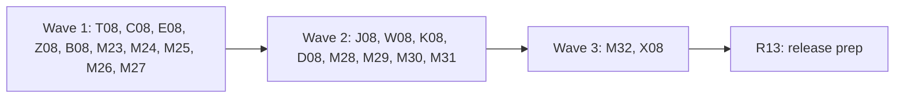

# Plan for 0.6.0-rc.3

The third release candidate of 0.6.0 fixes what the 0.6.0-rc.2 field test found. Two findings block 0.6.0. The web tag reporter gives no valid report in real GTM, because GTM gives `tags[].id` as a number (#1280). And the `dataLayer` hook records no top-frame push when an inline theme script replaces `dataLayer.push` before GTM loads, with no flag (#1281, #926). This candidate fixes both, adds a count check that flags any frame whose `dataLayer` holds more items than the run recorded, and fixes five smaller field findings: handoff text on stdout under `--json` (#1282), `wait: { url, timeout }` (#1283), the Result line warning count (#1284), the `gcd` letters in the `consentModeSetup` message (#1285) and the push kind in push shapes (#1247). It also writes the other field facts into the docs. Last, it takes 61 open `review-minor` issues: real bugs, leaks, wrong docs and output that agents read. 45 are in ten minor batches (M23 to M32), 15 fold into the feature entries that edit the same lines, and #1275 is its own entry, X08 (see "Minor batches").

0.6.0-rc.3 starts from `main` after 0.6.0-rc.2 (`29acedc`, "chore: prepare 0.6.0-rc.2 (#1278)"; `main` is at `bf1c7a0` when this plan was drafted).

Each item is one PR. A PR is done when its acceptance test passes in CI, an adversarial review reports no blockers or majors, and it is squash-merged.

## Goals this release serves

From `docs/goals.md`:

- **Report which tag manager tags fired or failed, per event.** The reporter works in real GTM (T08). The guide states what the field test saw (D08).
- **Record what a site sends at each consent state.** The hook records pushes after a theme replaces `push` (J08). A frame whose `dataLayer` holds pushes the run did not record gets a flag (C08).
- **Make it easy to change a GTM config reliably.** Push shapes keep `gtag` command pushes and object pushes apart, so `diff` and baselines compare like with like (K08).
- **Expose all of this to agents through the CLI, with stable `--json`.** stdout holds only JSON when `--json` is set, also with a handoff (E08). The Result line and `--json` agree on warnings (B08). Errors from `baseline`, `init`, the event map and the argument parser name the file and the key, and `init --json` reports what it did before a failure (M25, M26, M28, M30).
- **The first run shows where the setup likely breaks consent rules.** `consentModeSetup` names the `gcd` letters it read, names Google Ads hits by their `AW-` ID, and says when no hit carried `gcd` (Z08).
- **Be safe by default.** A pushed string, a tag name or a flag detail prints no page value (M23, M24, M32). A config key with a control byte is refused (M30). The payment fill checks the frame at the deadline too (M29). The reporter template asks for specific `dataLayer` keys only (T08).
- **Express expected behaviour as data.** A `tag` rule with an unknown `status` is refused, so a typo cannot make a `mustNot` rule pass (M26). The HTML report shows a rule it cannot evaluate as CANNOT EVALUATE (M23).

Non-goals this release comes close to:

- **Explaining why a tag did not fire.** Unchanged. The field facts in D08 are about the reporter, not about triggers.
- **A hosted service.** Unchanged. The count check runs in the test browser.

## Triage

One read-only pass checked the field findings against `origin/main` at `bf1c7a0` on 2026-11-06, and the J07 branch `feat/datalayer-rewrap` at `7c6288e`.

| Issue | Entry | Note |
| --- | --- | --- |
| #1280 | T08 | Blocker. |
| #1281, #926 | C08, J08 | Blocker. C08 is the flag, J08 is the hook. |
| #1282 | E08 | |
| #1283 | W08 | |
| #1284 | B08 | |
| #1285 | Z08 | |
| #1247 | K08 | Not a blocker. It changes the baseline `dataLayer` section, so it is better before 0.6.0 final (OPEN 10). |
| Field facts (no issue) | D08 | Docs only. |
| #1129, #1240 | T08 | `review-minor`. Both are docstrings in `packages/core/src/records.ts`, which T08 owns. |
| #1261 | D08 | `review-minor`. D08 rewrites the same `eventId.none` paragraph. |
| #1119, #1190 | T08 | `review-minor`. The `read_data_layer` permission of the template T08 edits, and the §15.6 tag reports bullet T08 edits. |
| #1187 | C08 | `review-minor`. The order in `close`, which C08 changes for the tally flush. |
| #1148, #1149, #1152, #1176 | Z08 | `review-minor`. The `consentModeSetup` tag ID and messages, its docs, and the demo test that every demo rerun edits. |
| #1205 | W08 | `review-minor`. The `wait` URL paragraph W08 edits. |
| #1123, #1230, #1231, #1257 | D08 | `review-minor`. The two guides D08 owns. |
| #1276 | R13 | `review-minor`. A docs test of the released CHANGELOG sections. |
| #1275 | X08 | `review-minor`. Not before 2026-11-10 at 14:09 UTC. |
| 45 more `review-minor` issues | M23 to M32 | See "Minor batches". |

Not in rc.3: the `review-minor` issues in the "Later" list (see "Minor batches") and the ones the triage marked later, #1004 (open by the maintainer's decision), the server reporter, #931 to #939, #1029 and #1017. They are not field blockers.

Claims checked against the code at `bf1c7a0`:

- `packages/recorder/src/tag-report.ts`, `parseTag`: `typeof tag.id !== 'string'` or not `^[0-9]+$` returns `{ bad: 'tagId' }`. `parseTagReport` builds the `InvalidReport` with `error: 'tagReport:<field>'` and `body: ''`. Nothing records the type of the bad field. `version` must be a string of at most 32 characters, or the report fails with `tagReport:version`.
- `packages/recorder/src/gtm-templates/web-tag-reporter.tpl`: the callback maps `id: tag.id` with no conversion. It requires only `addEventCallback`, `callInWindow`, `copyFromDataLayer` and `getContainerVersion`.
- `packages/recorder/src/gtm-templates/sandbox.test-helper.ts` and `fixtures/site/src/template-shim.ts` both map each API to a permission (`API_PERMISSION`) and throw for an API with no permission. `makeString` needs no permission in GTM, so both must learn a short list of permission-free APIs, or `require('makeString')` throws in the tests.
- `fixtures/site/src/containers.ts`: `fixtureTags` gives every `id` as a string (`'11'`, `'12'`, …), `executionTime` as a number, and `containerVersion` is `{ published: '3', workspace: '4' }`. The shim builds `gtm.uniqueEventId` as a number. `fixtures/site/src/pages-tags.test.ts` (line 74) compares the reported IDs with `fixtureTags` IDs.
- GTM's template API reference (via Context7, 2026-11-06): `addEventCallback` gives `ctid` (a string) and `eventData.tags[]` with `id`, `status` and `executionTime`, with no stated types. `makeString(value)` returns the value as a string and needs no permission. The field test showed `id` is a number. `executionTime` and `gtm.uniqueEventId` are already numbers in the shim. No other field is known to be a number. Whether `getContainerVersion().version` is a number in a published container is not known (the field test ran only in preview, where it is `QUICK_PREVIEW`).
- `packages/recorder/src/datalayer.ts` on `main`: the init script is now `dataLayerInitScript(names)` (N07, #1241), with a loop over the hooked names, a `trappable` check and `payload.layer`. `hook()` replaces `layer.push` with a reporting wrapper once. A page that later assigns its own `push` that does not call that wrapper (for example one that calls `Array.prototype.push`) is not recorded, and nothing compares the array length with what was recorded. This is #1281.
- `packages/recorder/src/recorder.ts` on `main`: the `DATALAYER_BINDING` callback uses `this.frameNumber(frame)` (M22, #1219); `mainFrameEventIds` is gone. `close` calls `flushUnloadQueues` (a `page.evaluate` on each page, not on live runs), then `waitForLateTagReports`, then closes the browser. `buildDataLayerNotHookedFlag` is in `close`.
- `packages/core/src/records.ts`: `RECORD_SCHEMA_VERSION = 5`. `FlagKind` lists `dataLayerReassigned` (reserved, written by nothing) and `dataLayerNotHooked`, plus `(string & {})`. `InvalidReport` is `{ type, id, runId, t, error, body }`.
- Flags are shown by kind and detail. `summary.ts` (`flags` in `--json`, `formatFlags`) and `report/model.ts` group any kind string. A 0.6.0-rc.2 reader shows a new flag kind with no code change.
- `packages/recorder/src/steps.ts`: the `handoff` case prints with `options.print ?? process.stdout.write`, and `stdinResolver` makes a readline interface with `output: process.stdout` ("Press Enter when done."). `handoff-overlay.ts` prints "Still waiting for the handoff" through the same `print`. `packages/cli/src/run.ts` passes no `print`. So every handoff line goes to stdout, also with `--json`.
- `packages/expect/src/scenario.ts`, the `wait` case: a mapping with `url` and any other key fails with "url cannot be combined with other keys". `steps.ts` waits with `options.actionTimeoutMs ?? 30_000`, and nothing sets `actionTimeoutMs`. #1283 says the other wait forms take `timeout`. They do not: no wait form takes it today. W08 adds it to the URL form only.
- `packages/cli/src/summary.ts`, the end of the text formatter: `warned` counts only results that failed at `warn`. `summary.baseline.warnings` is printed as `Warning:` lines but not counted.
- `packages/expect/src/consent-mode-setup.ts`: the messages name the tag ID and the signal names. The passing message is "Expected Consent Mode signals to be set on Google hits, found every signal set." `docs/cli.md` says the check "never prints a `gcd` value". `site/demo/*.jsonl` hold that message.
- `packages/expect/src/push-shape.ts`: groups are keyed by `[event label, frame]`. `eventLabel` gives `consent <x>` for a consent command, the event name, `gtag <command>` for an array push whose first item is a string, else `(no event)`. `packages/expect/src/diff.ts` keys `PushGroup` by `[epoch, event, frame]`. `packages/cli/src/baseline.ts` `validPushGroup` checks `epoch`, `event`, `frame` and `paths` and does not reject other keys. In the field, `gtag` commands reached the record as one plain object with keys `0`, `1`, `2` (an arguments-like object, probably cloned by the pixel sandbox), so they landed in `(no event)` next to plain object pushes.

The J07 branch (`feat/datalayer-rewrap`):

- Its merge base with `main` is `9051d17` (W07). Since then `main` changed `datalayer.ts` in M22 (#1219) and N07 (#1241).
- `git merge-tree` of the branch into `main` has conflicts in all five changed code and docs files: `packages/recorder/src/datalayer.ts`, `packages/recorder/src/datalayer.test.ts`, `packages/recorder/src/recorder.ts`, `docs/design.md` and `CHANGELOG.md`. The branch still adds to `mainFrameEventIds`, which M22 removed, and its init script is a constant, where N07 made it a function over several names.
- The branch has 14 commits with three merges of `main`, and two open findings from #926: `intact()` checks only the slot at `known - 1`, so `push(o); push(o); unshift(u)` records `o` three times (blocker), and `hook()` returns a no-op sync for an array it already hooked, so `window.dataLayer = window.dataLayer || []` turns off the sync (major).
- Recommendation: rebuild J08 on `main` from a new branch, with the J07 branch as the reference for the hook, its fixture page and its tests (OPEN 5).

## Decisions

Items marked (this plan) are the plan author's choices for the maintainer to confirm at the plan review. Items marked OPEN need the maintainer's answer. OPEN 1 to 4, 6 to 9 and 11 are read by wave 1. OPEN 5 and 10 are read by wave 2.

- **Scope.** The two blockers and the five small field findings. No new feature. #1247 is in, if OPEN 10 agrees. The minor batches and the folded `review-minor` issues are in; test hardening and refactors wait (see "Later").
- **Minor batch choices (this plan).** A `tag` rule refuses a `status` outside GTM's four values (M26, #1226). A user event map entry for a Shopify name wins over the built-in pairing, and the docs say so (M26, #1253). The push shape caps are documented, not marked in the output (M24, #1175). #990 waits: the fix needs a rule for which form was submitted.
- **`packages/core/src/records.ts` has one owner, T08, in wave 1 (this plan).** T08 adds `InvalidReport.got?`, the flag kind of OPEN 1 and the docstrings for #1129 and #1240. C08 and J08 write flag kinds as strings, which `FlagKind` accepts, so they do not edit the file.
- **`recordSchemaVersion` stays 5 (OPEN 2).** `suiteSchemaVersion` stays 3. `baselineSchemaVersion` stays 1: K08 adds an optional `kind` to a baseline push group, which a 0.6.0-rc.2 reader ignores. `configSchemaVersion` and `storesSchemaVersion` stay 1.
- **A 0.6.0-rc.2 template keeps working (this plan).** The parser accepts a number `id`, so a user who installed the rc.2 template does not have to import it again. The rc.3 template sends strings. `templateVersion` in `template web --json` stays 1, and so does the payload `v`.
- **The fixture shim gives what real GTM gives (this plan).** Tag IDs are numbers. The workspace build's version string is `QUICK_PREVIEW`, as in a real preview.

OPEN items, each with the plan author's recommendation:

1. **OPEN: the flag kind for the count check.** Recommendation: a new kind, `dataLayerIncomplete`. Do not reuse `dataLayerReassigned`. Reasons:
   - `dataLayerReassigned` has one meaning that V07 reserved and J08 writes: the page replaced `window.dataLayer` with a new array after a Google loader request. A count gap has other causes: a replaced `push`, a redefined `window.dataLayer` property, a lost binding call at unload, an in-place edit of the array.
   - One kind per cause keeps flags easy to filter, and an agent can tell "the page swapped the array" from "the record is short".
   - The other choice is to reuse `dataLayerReassigned` with a wider meaning. That needs no new kind, but the J08 flag and the C08 flag then read the same.
2. **OPEN: the record schema version.** Recommendation: **stay at 5.** rc.3 adds, within version 5, the flag kind `dataLayerIncomplete` (OPEN 1) and the optional field `InvalidReport.got` (OPEN 3). Reasons:
   - A 0.6.0-rc.2 reader reads both correctly. It shows any flag kind by its kind and detail, and it ignores an unknown optional field. A version bump would only add a warning to a record the old reader handles.
   - A bump to 6 also changes the three tests that pin the version (`packages/core/src/store.test.ts`, `packages/recorder/test/e2e/recorder.e2e.test.ts`, `e2e/run-label.e2e.test.ts`), the version paragraph in design §4, `site/demo/*.jsonl` and the CHANGELOG upgrade notes, in a candidate that exists to fix blockers.
   - Against it: V07 listed its flag kinds as part of version 5, so a reader of the docs could expect each new kind to bump. T08 writes the rule down: a new flag kind or a new optional field that an older reader of the same version reads correctly does not bump the version. A new required field, or a changed meaning, does.
   - If the maintainer prefers a bump, T08 sets `RECORD_SCHEMA_VERSION = 6` and adds the three test files and `site/demo/` to its Touches line, and R13 adds "a 0.6.0-rc.2 reader warns on version 6" to the upgrade notes.
3. **OPEN: where the type of a rejected field goes.** Recommendation: a new optional field `InvalidReport.got`, one of `string`, `number`, `boolean`, `object`, `array`, `null` or `undefined`, set only on a tag report that failed on a field's type or shape. `error` keeps its documented values (`tagReport:tagId` and so on). The other choice is to put the type in `error` (`tagReport:tagId:number`), which needs no records change but changes the error values that design §15.6 lists.
4. **OPEN: does the parser accept a number `version` too?** Recommendation: **yes.** Accept a finite non-negative integer for `version`, as for `id`, and store it as a decimal string. GTM documents `version` as a string, but no field test has read it in a published container. The template also passes it through `makeString` when it is not `undefined`. It costs one branch, and a wrong guess would make every published-container report invalid, as #1280 did.
5. **OPEN: J08 rebuild or merge forward.** Recommendation: **rebuild on `main`.** The merge conflicts in all five files, the branch adds to code that M22 removed, and N07 turned the init script into a function over several names. The implementer ports the hook from `7c6288e` into N07's per-name loop, fixes the two open findings, and keeps the J07 fixture page and tests. The branch stays on the remote as the reference and is deleted after J08 merges.
6. **OPEN: the count check as its own entry before J08.** Recommendation: **yes, C08 in wave 1 and J08 in wave 2.** J07 took ten review rounds and was deferred. C08 is small and fixes the silent part of #1281 on the current hook. If J08 slips again, rc.3 still ships with a flag on every frame that the hook missed, and #926 goes back to the Known list.
7. **OPEN: handoff text on stderr always, or only with `--json`.** Recommendation: **always.** stdout is for results. A person at a terminal sees stderr too, and `run > summary.txt` then keeps prompts out of the file. The other choice keeps text runs as they are and moves the lines only under `--json`.
8. **OPEN: what the Result line counts.** Recommendation: **every baseline warning**, not only the `dataLayer` ones. The text prints each baseline warning as a `Warning:` line, so the count matches what the reader sees. Example: `Result: pass with 4 warnings`. The other choice counts only push drift warnings, as #1284 asks.
9. **OPEN: print the `gcd` letters.** Recommendation: **yes, letters only.** The message names the four signal letters per Google tag ID, for example `gcd letters: rrrr`, as #1285 asks. They are Consent Mode states, not user data. Each letter must be in the decoder's letter table, else it reads `?`. The full `gcd` value (with its digits and any trailing part) is never printed. `docs/cli.md` changes "It never prints a `gcd` value" to say so.
10. **OPEN: K08 in rc.3.** Recommendation: **yes, in wave 2, and droppable.** It changes the stored baseline `dataLayer` section, and #1247 says a later change breaks saved baselines, so before 0.6.0 final is the cheaper time. Nothing depends on it. If wave 2 slips, it moves to 0.6.0 and #1247 stays open.
11. **OPEN: the reporter's own entry in `tags[]`.** Recommendation: **document it, do not filter it.** The template cannot read its own tag ID through the APIs it has permission for, and a filter by name would hide a user tag with the same name. D08 documents it. A filter is a later issue if the maintainer wants one.
12. **OPEN: invalid reports in the summary.** Recommendation: **record only in rc.3.** The `Tags: no reports from <container>` line could add "N invalid reports (tagReport:tagId, got number)". That would have shortened the #1280 diagnosis, but it edits `summary.ts`, which B08 owns in wave 1. File it as a later issue.

## Order and waves



The reporter fix, the count check, the handoff output, the `gcd` letters, the Result line and five minor batches first, then the hook, the URL wait timeout, the push kind, the field-fact docs and four minor batches, then the summary batch and the node-forge exception, then the release prep.

Why the waves are this way:

- **`packages/recorder/src/datalayer.ts`, `datalayer.test.ts` and `packages/recorder/src/recorder.ts`** change in C08 (wave 1, with the `close` order of #1187) and J08 (wave 2). J08 keeps C08's tally, array number and `close` order.
- **`packages/recorder/src/steps.ts`** changes in E08 (wave 1: the `handoff` case and `stdinResolver`) and W08 (wave 2: the `wait` case).
- **`site/demo/`** is rerun by Z08 (wave 1, the `consentModeSetup` message in the records), K08 (wave 2, push kinds in the shapes) and M32 (wave 3, the `dataLayer` line and the diff paths). R13 reruns it last. Z08 fixes `site/src/lib/demo-data.test.ts` (#1176), so the later reruns do not edit it.
- **`packages/core/src/records.ts`** changes in T08 only.
- **`e2e/tag-rules.e2e.test.ts`** changes in T08 and M23, both wave 1, on different lines: T08 the lines that pin version `'4'` or the fixture IDs, M23 the `note:` line with the `noTagReports` text. `NOTE_TEXT` is shared with `summary.ts`, so the text summary changes with it. The second PR to merge rebases on the first; the lines do not overlap.
- **`packages/cli/src/summary.ts` and `summary.test.ts`** change in B08 (wave 1, the Result line) and M32 (wave 3, flag masking and the `dataLayer` line). K08 changes what `pushShapes` returns, not `summary.ts`. R13 edits the `readVersion()` line of the test.
- **`packages/expect/src/push-shape.ts` and `push-shape.test.ts`** change in M24 (wave 1, the `gtag` label) and K08 (wave 2, `kind`). K08 keeps M24's known-command rule.
- **`packages/cli/src/baseline.ts` and `baseline.test.ts`** change in M25 (wave 1, the errors) and K08 (wave 2, `validPushGroup` and the rc.2 baseline warning).
- **`packages/expect/src/scenario.ts` and `scenario.test.ts`** change in M26 (wave 1, the `tag` rule `status`) and W08 (wave 2, the `wait` case).
- **`packages/expect/src/event-map.ts` and `event-map.test.ts`** change in M26 (wave 1, final-name lookup for `paths`, user entry before built-in) and K08 (wave 2, `kind` after a rename). K08 keeps M26's lookup.
- **`packages/recorder/src/gtm-templates/web-tag-reporter.tpl`** changes in T08 only (the sandboxed JavaScript and the `read_data_layer` permission). M30 (wave 2) tests the `template web --json` output after T08 changed the template text.
- **`docs/guide/tag-reports.md` and `docs/guide/server-container.md`** change in D08 only. D08 runs in wave 2, so it can describe `InvalidReport.got` from T08.
- **`AGENTS.md`** changes in M27 only. It is the maintainer's file, so the maintainer merges M27.
- **`pnpm-workspace.yaml`** changes in X08 only. It is gated, so the maintainer merges X08.
- **Append-only overlaps.** Each PR edits only its own part:
  - `docs/design.md`. Wave 1: T08 the §4 version 5 paragraph (the rc.3 additions and the bump rule of OPEN 2) and the §15.6 "Web tag reports are recorded" bullet; C08 one sentence in the §5.2 hook bullet; Z08 the §6 "`gcs` meaning" paragraph (the `gcd` indexes); M27 the §3 diagram edge, the `containerVersions` clause of the §4 `Run` row, the §8.3 "No gating" bullet and reserved-host sentence, the §8.5 server reporter sentence, the option list of the §11 "Project config" paragraph, the `suite --baseline` sentence of the §11 baseline paragraph, and the path defaults sentence of §12. Wave 2: J08 the rest of the §5.2 hook bullet; D08 §8.1 (the field facts) and §14 item 6; K08 one sentence in the §11 baseline paragraph. R13: the status line, §15 and §15.6.
  - `docs/cli.md`. Wave 1: E08 the `handoff` paragraph; Z08 the `consentModeSetup` section; B08 one sentence in the `baseline save` section; M24 two sentences in the `dataLayer` summary paragraph of `run`; M26 the `tag` keys bullet in "Rules on tags" and the `--event-map` row of `diff`; M27 the `--tracker-list` row, the `suite` `--stores` row, the hint sentence of the `suite` shared-options row and the `defaults` paragraph. Wave 2: W08 the `wait` URL paragraph; K08 the `dataLayer` `--json` field and the `baseline save` `dataLayer` sentence; M28 the `tagreeve init` section; M30 the `tagreeve template web` section. R13: the version sentence.
  - `README.md`. Wave 1: M27 the "In 0.6.0-rc.1" block only. R13: the status block and a new "In 0.6.0-rc.3" block.
  - `fixtures/site/src/index.ts` and `fixtures/site/README.md`. Wave 1: C08. Wave 2: J08, K08. Each adds its own route lines and rows.
  - `CHANGELOG.md`. One marker per PR. M27 also edits the `config.yml` line of the 0.6.0-rc.1 section.

## Rules for every PR

The rules in `AGENTS.md` and the earlier plans still hold: CLI only, no MCP server; no hosted service; fake IDs and identities only (`G-PWTEST0001`, `AW-000000001`, `100000000000001`, `GTM-PWTEST1`, `GTM-PWNOVER`); no cookie value, identity value, card value, `gtmAuth` or container config in any output, with a leak test for each PR that adds output; e2e only against `fixtures/site` (and the stand-in container), with no Docker and no network; context-level hooks only; third-party code unmodified, and no tracker data from Tracker Radar, EasyPrivacy or Disconnect.

More for rc.3:

- Each PR adds a regression test that fails when the change is removed, and the PR description says how that was checked. D08, M27, X08 and R13 are the exceptions: D08, M27 and R13 have docs checks, and X08 changes only an install rule.
- Each negative test checks first that its input really holds what the check looks for.
- New e2e tests go in new files, unless the entry names an existing file.
- Real GTM never runs in a test. The fixture shim gives tag IDs as numbers from T08 on, as real GTM does.
- No real store, container ID or field-test value appears in a fixture, a doc or a PR. The field facts are written as "a Shopify store in the 0.6.0-rc.2 field test".
- A flag detail names a frame by its run number and a layer by its hooked name (`dataLayer` or a configured name). Never a URL, never a pushed value.
- CHANGELOG: the plan PR adds a `## 0.6.0-rc.3` heading above `## 0.6.0-rc.2`, with the line `Not released yet. The newest release is 0.6.0-rc.2, below.` and one marker per PR with a user-visible change (see "CHANGELOG markers"). IDs are a letter and two digits. Each PR replaces only its own marker. R13 removes leftover markers and the "Not released yet" line.

## PRs

### Wave 1

**T08 The web reporter works with GTM's number tag IDs (#1280, #1129, #1240, #1119, #1190).** Touches: `packages/recorder/src/gtm-templates/web-tag-reporter.tpl` (the sandboxed JavaScript and the `read_data_layer` permission only), `packages/recorder/src/gtm-templates/sandbox.test-helper.ts` (permission-free APIs), `packages/recorder/src/gtm-templates/web-tag-reporter.test.ts`, `packages/recorder/src/tag-report.ts` (`parseTag`, the `version` check and `fail`), `packages/recorder/src/tag-report.test.ts`, `packages/core/src/records.ts` (`InvalidReport.got?`, the OPEN 1 flag kind in `FlagKind`, the version docstring, the `gtmUniqueEventId` and `layer` docstrings), `fixtures/site/src/template-shim.ts` (permission-free APIs; `FixtureTag.id` is a number), `fixtures/site/src/containers.ts` (`fixtureTags` IDs as numbers; the workspace version `QUICK_PREVIEW`), `fixtures/site/src/containers.test.ts`, `fixtures/site/src/pages-tags.test.ts` (the ID and version expectations only), `e2e/tag-reports.e2e.test.ts` and `e2e/tag-rules.e2e.test.ts` (only lines that pin the version `'4'` or compare the fixture's payload log IDs with `fixtureTags`), `e2e/tag-report-number-ids.e2e.test.ts` (new), `docs/design.md` (the §4 version 5 paragraph and the §15.6 tag reports bullet), `CHANGELOG.md` (the T08 marker).
- The template requires `makeString` and sends `id: makeString(tag.id)`. It sends `version` through `makeString` when it is not `undefined` (OPEN 4). Nothing else in the payload changes. `makeString` needs no permission.
- The permission list keeps the same permissions and keys. `read_data_layer` gets the param `allowedKeys` = `specific` before `keyPatterns`, as current GTM exports write it, so an import cannot widen it to every key (#1119).
- The §15.6 tag reports bullet says "a run with no valid report does not wait", as `waitForLateTagReports` does (#1190).
- The test harness and the fixture shim keep a list of permission-free APIs (`makeString` only). `require` returns such an API without a permission check. Any other API without a granted permission still throws.
- `parseTag` accepts `id` as a string of digits (at most 32), as before, or as a finite non-negative integer (`Number.isSafeInteger(id) && id >= 0`), which it stores as `String(id)`. A float, a negative number, `NaN` or a string with other characters is still `tagReport:tagId`. `version` gets the same rule (OPEN 4). `TagStatus.id` and `Run.containerVersions` stay strings.
- An `InvalidReport` from `parseTagReport` gets `got` (OPEN 3): the JavaScript type class of the rejected value (`array` for an array, `null` for `null`), never the value. A string that fails a pattern or a length cap has `got: "string"`. `body` stays `''`.
- `records.ts`: the `InvalidReport` docstring says what `got` holds and that it never holds a value. `FlagKind` gains the OPEN 1 kind. The version docstring lists the rc.3 additions within version 5 and the bump rule (OPEN 2). The `gtmUniqueEventId` docstring gets the "read after the push returns" sentence, and `layer` keeps only its own text (#1129). The `dataLayerReassigned` entry says J08 writes it (#1240). If J08 is dropped from rc.3, R13 marks it reserved again.
- The fixture shim gives tag IDs as numbers, so the fixture now matches real GTM. `executionTime` and `gtm.uniqueEventId` are already numbers. `status`, `ctid` and the name stay strings.
Regression test: `tag-report.test.ts`: a number `id` (`11`) gives `"11"`; `11.5`, `-1`, `NaN` and `"1a"` give `tagReport:tagId`; a number `version` gives a string; each invalid case has `got` with the right class and no other new key, and a planted fake value is absent from the whole `InvalidReport`. `web-tag-reporter.test.ts`: with `eventData.tags[0].id = 11` (a number), the `callInWindow` payload has `id: "11"`; the required API list is the four APIs plus `makeString`; `require('sendPixel')` still throws; the `read_data_layer` permission holds `allowedKeys` `specific` and the same two key patterns. `containers.test.ts`: every `fixtureTags` ID is a number (the precondition for the e2e).
Acceptance: `pnpm exec vitest run --project e2e e2e/tag-report-number-ids.e2e.test.ts` passes. It runs `/container/tags` with `--gtm-override`. Precondition: `containers.test.ts` shows the shim gives number IDs. The record has web `TagReport`s whose tag IDs are the strings `11`, `13`, `14`, `77`, `88` and `89`, no `invalidReport` line, `run.containerVersions['GTM-PWTEST1']` is `QUICK_PREVIEW`, and `--json` `tags['GTM-PWTEST1'].reports` is greater than 0. On the old code the template passes the number on, `parseTag` rejects it, the record has one `invalidReport` with `tagReport:tagId` per event and no `TagReport`, so the test fails.

**C08 Flag a frame whose `dataLayer` holds pushes the run did not record (#1281, #1187).** Touches: `packages/recorder/src/datalayer.ts` (the init script: the document token, an array number per hooked array, and the tally function), `packages/recorder/src/datalayer.test.ts`, `packages/recorder/src/datalayer-tally.ts` (new: the compare, as a pure function that returns flags), `packages/recorder/src/datalayer-tally.test.ts` (new), `packages/recorder/src/recorder.ts` (the `DATALAYER_BINDING` callback, the order in `close` with the tally before the browser closes, and the flags in `close` only), `packages/recorder/src/recorder-close.test.ts` (the order case), `fixtures/site/public/datalayer-theme.html` (new), `fixtures/site/src/index.ts` (its route only), `fixtures/site/README.md` (its row), `fixtures/site/src/pages-datalayer-theme.test.ts` (new), `packages/recorder/test/e2e/datalayer-tally.e2e.test.ts` (new), `docs/design.md` (one sentence in the §5.2 hook bullet), `CHANGELOG.md` (the C08 marker).
- Scope (this plan, to keep the check simple): the check compares only the document each frame holds when the run closes. Earlier documents of a frame are not compared. A run where every page replaces `push` is still flagged, on its last page. A page that replaced `push` on an earlier page only is not flagged; this goes in the Known list.
- The init script makes a random token per document (`d`), kept in memory only, and numbers each array it hooks, per document and name (`a`: 1, 2, …). It puts `d` and `a` on each push payload. The token is never written to a record or a flag. The hook also counts, per array, the push payloads it has posted (`posted`). It keeps a tally function that the page never calls by itself: it returns `{ d, arrays: [{ layer, a, length, posted }] }`, reading for each hooked name the value of `window[name]` as the page sees it now, with `a` null and `posted` 0 for an array the hook never hooked. The tally contract, which J08 keeps: the tally first runs the hook's own catch-up for each hooked array, if the hook has one (C08's hook has none; J08's growth check is one), and reads `length` and `posted` after it, `posted` is incremented when the hook decides to send a payload, that is when it queues or makes the binding call, so it covers every payload the catch-up found even if J08 posts it from a microtask. The tally itself posts nothing else, and there is no timer, `DOMContentLoaded`, `load` or `pagehide` call.
- `close`, before the browser closes, calls the tally with `frame.evaluate` in every frame of every open page, in all network modes, in parallel under one deadline of 2000 ms, and uses the returned values. A frame that fails or misses the deadline is skipped and gets no flag, so a hung frame cannot stall `close`. Then it waits, at most 1000 ms in all, until the binding has received `posted` payloads for every key of every tally, so payloads the tally's catch-up sent are counted before the compare. A capped key is not waited for. A key still short at the end is compared as it is. This uses `frame.evaluate`, as `flushUnloadQueues` uses `page.evaluate` today; it adds no hook and no browser flag.
- `close` runs in this order: the late tag report wait, the unload flush (not on live runs), the tally, the server container quiet wait and `stopRecording`, then the browser close. The late wait moves first, so a call the container forwards during it is still captured (#1187).
- The binding callback counts every push payload it gets, keyed by frame number, token `d`, layer and `a`, also a payload that does not become a record. Counts are only added to: a late payload from an old document adds to its own key and never changes another key. At most 256 keys are kept per run; past the cap a new key is not counted and is marked capped. The cap never stops a push from becoming a `DataLayerEvent`.
- A tally result is used only when `d` is a string of at most 64 characters, each `layer` is a hooked name (the `dataLayer` names run option plus `dataLayer`), and `length` and `a` are safe non-negative integers (`a` may be null). Anything else is dropped. The flag detail uses the validated numbers and the frame number only, never a page string.
- `datalayer-tally.ts` compares. For each frame's tally, when a `length` is greater than the count for that frame number, `d`, layer and `a` (0 when there is none), the run gets one OPEN 1 flag per frame number and layer: `Frame <n>: <layer> holds <length> items, and <received> were recorded. A page script may have replaced <layer>.push or the array.` A capped key gives no flag. A `length` that is smaller is not flagged (the page removed items).
- On the current hook this flags #1281: the theme's `push` skips the wrapper, so 0 are recorded and the length is 8. After J08 the same page is recorded and not flagged.
- The fixture page `/datalayer-theme` has modes by query. `mode=theme`: an inline `<head>` script, before any loader, sets `window.dataLayer = window.dataLayer || []` and assigns its own `push` that buffers `consent update` pushes for 50 ms and calls `Array.prototype.push` on the array; the page then pushes 8 items, a consent default first. `mode=redefine`: the page replaces the `window.dataLayer` property with `Object.defineProperty` and a new array, then pushes 3 items. `mode=plain`: 3 ordinary pushes. `mode=unshift`: `window.dataLayer = window.dataLayer || []`, one ordinary `dataLayer.push` (both hooks record it, so the hooked array has a prefix), then `n` items added with `Array.prototype.unshift.call` (an in-place edit in front of the prefix, which neither hook records). Every mode also stores the raw array in `window.pwRaw` at load (J08's close case adds through it). A `n` query value (1 to 20) sets how many pushes `mode=plain` and `mode=theme` make; the default is 3 for `plain` and 8 for `theme`. Every push carries the planted fake value `pw-planted-value-1` and the planted fake URL `https://planted.example.test/x`. Each mode counts its own pushes in `window.pwOwnPushes`.
Regression test: `datalayer-tally.test.ts`: equal counts, no flag; length greater, one flag with the numbers and no URL; length smaller, no flag; two layers and two frames give separate flags; `a: null` with a non-empty array gives a flag; counts for an older token in the same frame do not change the result for the current token, before or after the current token's payloads; a tally with a URL or an email as `layer`, a string `length` or a long `d` gives no flag; a capped key gives no flag and the push still becomes a record. `datalayer.test.ts`: the tally returns `d`, `length`, `a` and `posted`; two documents loaded in one frame return different `d`; `posted` equals the payloads the hook sent or queued (on C08's hook, all are sent at once); the tally posts nothing of its own on C08's hook; it never throws into the page. `recorder.ts` close: a tally whose `posted` is ahead of the received count waits for the late payloads and then gives no flag; one that stays short after 1000 ms is compared as it is. A frame whose evaluate never resolves is skipped after the 2000 ms deadline, `close` still ends, and the other frames' tallies are used. `recorder-close.test.ts`: the late tag report wait ends before the session's `stopRecording` and before the unload flush, and the tally runs before the browser closes.
Acceptance: `pnpm exec vitest run --project e2e packages/recorder/test/e2e/datalayer-tally.e2e.test.ts` passes. Precondition per mode: `pwOwnPushes` and the page's own `dataLayer.length`, read before close, match the mode. `mode=redefine`: one flag for the main frame that says 3 items. `mode=theme`: the record never stays silent: it holds the 8 pushes from the main frame, or one flag for the main frame that says 8 items (the test passes on either, so J08 does not edit it). `mode=plain`: 3 pushes and no flag. Navigation: a `mode=plain&n=10` page navigates, in the same frame, to a `mode=theme&n=8` page. Precondition: the tally of the second document returns a `d` that differs from the first, and the first document recorded 10 pushes. The record holds the 10 pushes of the first document and either (no J08) no push of the second and exactly one flag for the main frame that says `holds 8 items, and 0 were recorded`, or (J08) 18 pushes and no flag. A constant token, a counter reset on navigation or a missing token each give 10 recorded against 8 on the no-J08 branch, so no flag and only 10 pushes, and the test fails. After J08 the second document is recorded, so this case cannot guard the token. A second navigation case guards it in both worlds: a `mode=plain&n=10` page navigates, in the same frame, to a `mode=unshift&n=3` page, which pushes one item and then adds 3 with `Array.prototype.unshift.call`. Both hooks record only the one push (J08 sees the prefix change at slot 0 and records nothing for the edit), so the run has 11 pushes and one flag for the main frame that says `holds 4 items, and 1 were recorded`. With a constant token the count is 11, which is at least 4, so no flag, and the test fails. A control, `mode=plain&n=5` then `mode=plain&n=3`, gives 8 pushes and no flag. Leak check: the planted value and the planted URL are in no flag detail, and the test first shows both are in the page's pushes. On the old code `mode=redefine` and `mode=theme` have no flag and no main-frame push, so the test fails.

**E08 Handoff text goes to stderr (#1282).** Touches: `packages/recorder/src/steps.ts` (the default `print` in the `handoff` case and `stdinResolver` only), `packages/recorder/src/steps.test.ts`, `packages/recorder/test/e2e/handoff-stdout.e2e.test.ts` (new), `docs/cli.md` (the `handoff` paragraph), `CHANGELOG.md` (the E08 marker).
- The default `print` writes to `process.stderr`. `stdinResolver` makes its readline interface with `output: process.stderr`. "Handoff: …", the reminder, "Press Enter when done.", "Still waiting for the handoff: …" and "Handoff ended: …" all go to stderr, with or without `--json` (OPEN 7). A caller that passes its own `print` is unchanged.
- stdout under `run --json` and `suite --json` holds only the JSON.
Regression test: a unit test that `stdinResolver` writes its prompt to the stream it is given, and that the default stream is stderr. The CLI cannot run a handoff in CI (a handoff forces a headed browser, and CI has no display), so the e2e uses the library path the CLI uses.
Acceptance: `pnpm exec vitest run --project e2e packages/recorder/test/e2e/handoff-stdout.e2e.test.ts` passes. It calls `recordScenario` with a `launch` that forces `headed: false`, no `print`, and a handoff with `until: { url: "/thank-you-late" }` on `/handoff/until`, and drives the page to that URL. It spies on `process.stdout.write` and `process.stderr.write`. Precondition: the handoff ended with `handoffEnd: "until"`. stderr got "Handoff:" and "Handoff ended:"; stdout got none of the handoff lines. On the old code they are on stdout, so the test fails.

**Z08 `consentModeSetup` names the `gcd` letters (#1285, #1148, #1149, #1152, #1176).** Touches: `packages/decoders/src/ga4.ts` (export `gcdLetters(gcd)`, and the index comment), `packages/decoders/src/ga4.test.ts`, `packages/decoders/src/index.ts` (one export), `packages/expect/src/consent-mode-setup.ts` (the messages, the tag ID of a hit and the count of hits without `gcd` only), `packages/expect/src/consent-mode-setup.test.ts`, `e2e/consent-mode-setup.e2e.test.ts` (the message expectations), `docs/cli.md` (the `consentModeSetup` section), `docs/design.md` (the §6 "`gcs` meaning" paragraph only), `site/demo/` (rerun), `site/src/lib/demo-data.test.ts` (the pinned hit ID), `CHANGELOG.md` (the Z08 marker).
- `gcdLetters(gcd)` returns the four signal letters in the order of `GCD_SIGNALS`, read from the same positions `gcdSignals` reads, or `undefined` when `gcdSignals` would. A letter that is not in the decoder's letter table reads `?`. So `consentModeSetup` still never parses the `gcd` itself (Z07).
- Each message names the letters per Google tag ID, at most five tag IDs and at most three letter sets per tag ID, for example `Google tag G-PWTEST0001 never set ad_user_data and ad_personalization (gcd letters: rrll)` and, on a pass, `found every signal set (gcd letters: G-PWTEST0001 rrrr)`. Letters only (OPEN 9).
- The message is in `--json` `results[].message` and in the text summary when the check warns or fails, as today.
- A Google Ads hit is named `AW-<conversion ID>` when its conversion ID is digits only. `params.tid` names only a GA4 hit, so a page parameter `ep.tid` never shows as a tag ID, and two conversion IDs are two tag IDs (#1148).
- The check counts the Google hits that carry a `gcd`. With none, the message says no Google hit carried `gcd`, so the setup could not be read. With some, it says how many had none. `pass` stays true (#1149).
- `docs/cli.md`: the outside-the-`dataLayer` note starts "When every signal is set". Design §6 and the decoder comment say the letters sit "at indexes 2, 4, 6 and 8, counting from 0" (#1152).
- `demo-data.test.ts` finds a passing hit in the record instead of pinning its ID, so a demo rerun no longer edits it (#1176).
Regression test: unit tests for each verdict (never set, v1 only, every signal set, outside the `dataLayer`, no Google hits) assert the letters. A `gcd` with a planted digit run and a trailing part shows only the four letters. A letter outside the table reads `?`. An Ads hit for `AW-000000001` that carries `ep.tid` = `G-PWTEST0001` is named `AW-000000001`, and a GA4 hit for `G-PWTEST0001` stays a separate tag ID. Hits with only `gcs` give the "could not be read" message, not "found every signal set".
Acceptance: `pnpm exec vitest run --project e2e e2e/consent-mode-setup.e2e.test.ts` passes, with the new expectation that the `--json` message holds `gcd letters:` and the letters of the fixture hit (precondition: the hit's `raw.gcd` holds them). On the old code the message has no letters, so the test fails.

**B08 The Result line counts baseline warnings (#1284).** Touches: `packages/cli/src/summary.ts` (the Result line only), `packages/cli/src/summary.test.ts`, `e2e/baseline-warning-count.e2e.test.ts` (new), `docs/cli.md` (one sentence in the `baseline save` section), `CHANGELOG.md` (the B08 marker).
- The warning count in the Result line is the results that failed at `warn` plus `summary.baseline.warnings.length` (OPEN 8). `Result: fail (baseline drift)` and `Result: fail (n of m)` add the same count. `pass` and `ok` in `--json` do not change, and the exit code does not change.
Regression test: unit tests: push warnings only (`Result: pass with 3 warnings`); one result warning and two baseline warnings (`with 3 warnings`); baseline drift with warnings; no baseline.
Acceptance: `pnpm exec vitest run --project e2e e2e/baseline-warning-count.e2e.test.ts` passes. It uses `e2e/scenarios/datalayer-build-a.yml` and `datalayer-build-b.yml`: `baseline save` on build a, then `run --baseline` on build b with and without `--json`. Precondition: `--json` `baseline.warnings` has at least one `dataLayer` line. The text Result line count equals the result warnings plus `baseline.warnings.length` from the `--json` run, and the exit code is 0. On the old code the count leaves out the baseline warnings, so the test fails.

**Minor batches.** M23, M24, M25, M26 and M27. See "Minor batches".

### Wave 2

**J08 The `dataLayer` hook survives a replaced `push` (#926, #1281).** Rebuilt on `main` (OPEN 5), with `feat/datalayer-rewrap` at `7c6288e` as the reference. Touches: `packages/recorder/src/datalayer.ts` (the init script), `packages/recorder/src/datalayer.test.ts`, `packages/recorder/src/recorder.ts` (the `DATALAYER_BINDING` callback and the `dataLayerReassigned` flag in `close` only), `fixtures/site/public/datalayer-wrap.html` (new, from the J07 branch), `fixtures/site/src/index.ts` (its route only), `fixtures/site/README.md` (its row), `fixtures/site/src/pages-datalayer-wrap.test.ts` (new), `packages/recorder/test/e2e/datalayer-wrap.e2e.test.ts` (new), `packages/recorder/test/e2e/datalayer-theme.e2e.test.ts` (new), `docs/design.md` (the §5.2 hook bullet), `CHANGELOG.md` (the J08 marker).
- The maintainer's design 1, fenced, for every hooked name of N07: `push` on a hooked array is an accessor that returns exactly the function the page last assigned. The initial value records at the base `push` and calls through. A length-growth check, run in a microtask on a read of `push` or of the layer and on `pagehide`, records pushes that skip the base. Every entry point catches its own errors and never throws into the page. Only items appended at the end are recorded.
- Fix the first open finding of #926: keep a shallow copy of the first `known` slots and compare each with `Object.is`. Any mismatch (an `unshift`, a front `splice`, a sort) resets `known` and records nothing.
- Fix the second: keep each array's sync in a `WeakMap`, and return it for an array already hooked, so `window.dataLayer = window.dataLayer || []` keeps the sync.
- Keep C08's token `d`, array number `a`, `posted`, the tally function and its validation, the close call and the close wait. Under C08's tally contract, the tally runs the growth check for each hooked array before it reads `length` and `posted`, and a read the tally makes through the `dataLayer` name does not queue a second check. `posted` counts a payload when the hook queues it for its microtask post, not when the binding call is made, so the tally returns `length` and `posted` that agree while the post is still queued, and the close wait covers the late payload. J08 changes nothing in `close`. The growth check also runs in a microtask after a push, on reads of `push` and of the `dataLayer` name, on `DOMContentLoaded` and `load`, and on `pagehide` as a best effort, because a record made on `pagehide` can be lost. Keep N07's `trappable` check, its never-trapped names and `payload.layer`.
- `gtm.uniqueEventId` is read after the push returns, in a microtask; the time stays the time the push started. A nested push is placed before the push around it by time, as the J07 branch does.
- `window.dataLayer = []` after a request to `gtm.js` or `gtag/js` on `www.googletagmanager.com` in the same frame document adds one `dataLayerReassigned` flag per frame number, with no URL. Pushes to the new array are still recorded.
- The `addToCart` step check (`CART_EVENT` in `steps.ts`) still sees its pushes.
Regression test: the J07 unit tests, ported. New: `push(o); push(o); unshift(u)` records `o` twice; `window.dataLayer = window.dataLayer || []` after the hook keeps recording a later `Array.prototype.push`; a throwing getter on an item does not reach the page. An `unshift` into an empty hooked array, followed by a growth check, is recorded as appends in order (there is no prefix to compare); the C08 fixture does not rely on it. The tally runs the growth check first: an item added through an array reference the page saved at load (not through the `dataLayer` name) just before close, with `length` greater than the recorded count, is found by the tally's catch-up and counted in `posted` while its post is still queued, and the test fails when the tally skips the catch-up. The C08 tally e2e still passes.
Acceptance: `pnpm exec vitest run --project e2e packages/recorder/test/e2e/datalayer-wrap.e2e.test.ts packages/recorder/test/e2e/datalayer-theme.e2e.test.ts` passes. `datalayer-wrap`: the J07 cases (`wrap=through` records each push once and reads a later `gtm.uniqueEventId`; `wrap=drop` records only the push before the wrapper; `wrap=native` and `wrap=guard` record each push once, with the guard run twice; `reassign` gives one `dataLayerReassigned` flag with no URL). `datalayer-theme` on C08's page, `mode=theme`: precondition `pwOwnPushes` is 8; the record holds the 8 pushes from the main frame in order, with the consent default first, and no `dataLayerIncomplete` flag. A second case on the same page: the fixture saves the raw array in `window.pwRaw` at load, and a later evaluate adds one item with `Array.prototype.push.call(window.pwRaw, x)` right before close, without reading `push` or the name. Precondition: `pwRaw.length` is greater than the recorded count just before close. The record holds the item and there is no flag, so the close-time catch-up and the close wait work together. The case fails when the tally skips the catch-up. `datalayer-tally.e2e` keeps `mode=redefine` and the unshift case as the flag-path guards; it does not guard the token on its own after J08. On the old code `mode=theme` records no main-frame push, `wrap=through` IDs are null and there is no `dataLayerReassigned` flag, so the test fails.

**W08 `wait: { url, timeout }` (#1283, #1205).** Touches: `packages/expect/src/scenario.ts` (the `wait` case and the `wait` step type), `packages/expect/src/scenario.test.ts`, `packages/recorder/src/steps.ts` (the `wait` case only), `e2e/wait-url-timeout.e2e.test.ts` (new), `e2e/scenarios/wait-url-timeout.yml` (new), `docs/cli.md` (the `wait` URL paragraph), `CHANGELOG.md` (the W08 marker).
- A URL wait takes an optional `timeout`, a duration like the `handoff` `timeout` (`2s`, `90s`, `2m`). The step type is `{ url: UrlMatcher; timeout?: number }`. `steps.ts` passes `step.value.timeout ?? timeout` to `waitForUrl`, and the timeout message names the given limit.
- Any other key next to `url` keeps the error, which now reads "url only takes timeout". A selector or locator wait does not take `timeout` in rc.3.
- The `wait` URL paragraph also says how a blocking control prints, as `locators.ts` does: a control with no `aria-label`, `name` or `id` shows its kind only; a role or input type outside the known list reads `control`; a name that looks like an email, a hash or a run of six or more digits reads `(hidden)`, and a long name is cut (#1205).
Regression test: unit tests for `{ url, timeout: 90s }`, a bad duration, and `{ url, role }` (still refused).
Acceptance: `pnpm exec vitest run --project e2e e2e/wait-url-timeout.e2e.test.ts` passes. The scenario waits for `/never*` with `timeout: 2s`. The run fails within 20 s with `page did not reach /never* within 2s` on stderr. On the old code the scenario is refused with "url cannot be combined with other keys", so the test fails.

**K08 Push kind in push shapes (#1247).** Touches: `packages/expect/src/push-shape.ts` (`kind`, the arguments-like read and the group key), `packages/expect/src/push-shape.test.ts`, `packages/expect/src/diff.ts` (`PushGroup.kind`, the group key, the kind-merged compare), `packages/expect/src/diff.test.ts`, `packages/expect/src/event-map.ts` and `packages/expect/src/event-map.test.ts` (`kind` after a rename), `packages/cli/src/diff.ts` (the kind in `dataLayer` lines), `packages/cli/src/diff.test.ts`, `packages/cli/src/baseline.ts` (`validPushGroup` and the rc.2 baseline warning), `packages/cli/src/baseline.test.ts`, `fixtures/site/public/datalayer-kinds.html` (new), `fixtures/site/src/index.ts` (its route only), `fixtures/site/README.md` (its row), `fixtures/site/src/pages-datalayer-kinds.test.ts` (new), `e2e/datalayer-kinds.e2e.test.ts` (new), `e2e/scenarios/datalayer-kinds.yml` (new), `docs/cli.md` (the `dataLayer` field and the baseline `dataLayer` sentence), `docs/design.md` (one sentence in the §11 baseline paragraph), `site/demo/` (rerun), `CHANGELOG.md` (the K08 marker).
- Each push shape has `kind`: `gtag` for a `gtag()` command (an `arguments` object or an array whose first item is a string) and `object` for any other push. Groups are keyed by step, event label, frame and kind, so `gtag('event', 'purchase', …)` and `{ event: 'purchase', … }` are two groups.
- An arguments-like object is read as the `gtag` command it holds: a plain object whose own keys are exactly `"0"` to `"n-1"` (n from 1 to 16) and whose `"0"` is a string. Its label follows the `gtag` rules (`consent update`, the event name, or `gtag <command>` for a known command and `gtag (other)` for any other string, as M24 sets them in wave 1), and its paths start at position 2, as for a real command. This is in the shapes only. The record and `isConsentCommand` do not change.
- `PushGroup` gets `kind`. A baseline push group may have `kind` (`object` or `gtag`); `baselineSchemaVersion` stays 1. A baseline group without `kind` (saved by 0.6.0-rc.2) is compared with kinds merged, and the compare adds one warning: `dataLayer push kinds not compared: the baseline was saved by 0.6.0-rc.2. Save it again to compare them.` A 0.6.0-rc.2 reader ignores `kind`.
- `mapPushGroups` sets `kind` from the mapped shape, so a rename still pairs the two sides: a `paths` root rename (`.`) that turns an object push into a gtag one sets `kind` to `gtag`, a rename under a root key sets it to `object`, and the built-in Shopify-name pairing renames the label only. The diff then pairs groups of one label that have different kinds when each side has exactly one group with that label, and adds one warning, `push kind changed: <label>`. So a Shopify `checkout_completed` object push and a gtag `purchase` push pair and report path changes, not `event gone` and `event new`. Two groups of one label on one side (the two `purchase` forms) stay apart. A user map therefore pairs a gtag push with an object push as it does today, and reports path changes, not `event gone` and `event new`.
- Masking does not change. A key or label that looks like a value reads `(other)`.
Regression test: unit tests: the two `purchase` forms are two groups; an arguments-like `{0:'consent',1:'update',2:{ad_storage:'granted'}}` reads `consent update` with the path `ad_storage` and no value; `{0:'a'}` with a non-string or a gap in the keys stays an `object`; an rc.2 baseline gives the warning and no drift. `event-map.test.ts`: with `paths: {purchase: {'.': …}}` a gtag `purchase` push and an object `purchase` push still pair and give path changes. `diff.test.ts` and `event-map.test.ts`: `checkout_completed` as an object push on one side and gtag `purchase` on the other pair with the built-in table, give one `push kind changed: purchase` warning and no `event gone`; with two `purchase` groups of different kinds on one side they stay two nodes; a user entry for a Shopify name that wins over the built-in pairing gives the same pairing.
Acceptance: `pnpm exec vitest run --project e2e e2e/datalayer-kinds.e2e.test.ts` passes. The page pushes `gtag('event', 'purchase', {value})`, `{ event: 'purchase', ecommerce: {value} }`, a plain object without `event`, and an arguments-like consent update. Precondition: the record holds each push, the arguments-like one as one object in `args`. `--json` `dataLayer` has two `purchase` groups with kinds `gtag` and `object`, a `consent update` group with kind `gtag`, and a `(no event)` group with only the plain object's paths. Leak check: the page pushes the planted fake value `pw-planted-value-1`, the precondition shows the record holds it, and it is in no output. On the old code the two `purchase` pushes share one group and the arguments-like push is in `(no event)` with paths `0`, `1` and `2.ad_storage`, so the test fails.

**D08 Field facts from the 0.6.0-rc.2 field test (#1261, #1123, #1230, #1231, #1257).** Touches: `docs/guide/tag-reports.md` (the limits list, one troubleshooting item, and step 6 of the agent steps and of the hand steps), `docs/guide/server-container.md` (the `notExact` paragraph, live config step 4, and the place of the "With `--json`, the same counts" paragraph), `docs/design.md` (§8.1, the field facts sentence, and §14 item 6), `scripts/tag-reports-guide.docs.test.ts` (the new assertions), `scripts/server-container-guide.docs.test.ts` (two new assertions only).
- Write the field facts as what one run on one store showed, not as rules:
  - In a workspace preview, `getContainerVersion().version` is `QUICK_PREVIEW`, so `Run.containerVersions` holds `QUICK_PREVIEW`.
  - The reporter's own tag shows in `tags[]` once per event (OPEN 11). It has no name unless its own Additional Tag Metadata sets one.
  - No `timeout` status was seen; every tag was `success`. The timeout status is still unverified.
  - On one purchase run, the purchase tag's report survived the thank-you navigation. One run is not proof, so the navigation limit stays in the list.
  - GTM gives `tags[].id` as a number. A report from a 0.6.0-rc.2 template is read since 0.6.0-rc.3. An `invalidReport` with `tagReport:tagId` and `got` names the type that was rejected.
- `server-container.md`: on the store's server container, every call that was not `exact` counted under `eventId.none`. Rewrite the closing sentence as #1261 asks: `none` means the call had no event ID or no event name; Google Ads conversion calls never carry one; so a high count often means the page sends no event ID or the container does not pass it on. To tell which, send a unique `event_id` from the page and read `linkMiss` on the hit.
- `tag-reports.md` step 6 (#1230, #1231): the agent step names what to ask its own GTM client for, a preview environment that carries the unpublished version, with its environment ID and authorization code. The hand step names the one dialog that shows both values, or says the wording is unverified, as the last limit bullet does. Both steps say the override file gets mode 0600, link to the `docs/guide/project-layout.md` section, and use `workspace-override.json`.
- `server-container.md`: live config step 4 drops "save it from an editor", since swap and backup files keep the same secret (#1123). The paragraph "With `--json`, the same counts…" moves above "Make a link exact", so it no longer sits under "Why a call is not exact" (#1257).
- No store name, host, container ID or count that could identify the store.
Regression test: `scripts/tag-reports-guide.docs.test.ts` asserts the guide names `QUICK_PREVIEW`, no longer says the reporter's own entry is unconfirmed, says mode 0600 and `workspace-override.json`, and holds only `GTM-PWTEST1` and placeholders. `scripts/server-container-guide.docs.test.ts` asserts the guide has no "from an editor" option for the live config, and the "With `--json`" paragraph comes before "Make a link exact".
Acceptance: `pnpm docs:build` and `pnpm docs:test` pass. No CHANGELOG line.

**Minor batches.** M28, M29, M30 and M31. See "Minor batches".

### Wave 3

**Minor batch.** M32. See "Minor batches".

**X08 Remove the node-forge release-age exception (#1275).** Not before 2026-11-10 at 14:09 UTC. If wave 3 starts earlier, X08 waits for that time. R13 does not wait for X08: if it has not merged when R13 is ready, it merges after the release, and #1275 stays open until then. Touches: `pnpm-workspace.yaml` (the `minimumReleaseAgeExclude` block only).
- Remove the `minimumReleaseAgeExclude` block. `minimumReleaseAge: 20160` stays. `pnpm-lock.yaml` and both `package.json` files do not change.
- The maintainer merges it: the file is gated.
Regression test: none new. Once node-forge 1.4.2 is two weeks old, the exception does nothing.
Acceptance: `pnpm install --frozen-lockfile` passes on the branch, `pnpm-workspace.yaml` has no `minimumReleaseAgeExclude`, and `pnpm test` passes. No CHANGELOG line.

### Release

**R13 Release prep (#1276).** Touches: `package.json` (the version), `packages/cli/src/summary.test.ts` (the `readVersion()` line only), `scripts/changelog-markers.test.ts` (new cases for the released sections), `docs/cli.md` (the version sentence), `CHANGELOG.md` (intro line, leftover markers, "Upgrading from 0.6.0-rc.2", "Known in 0.6.0-rc.3"), `README.md` (the status block and a new "In 0.6.0-rc.3" block), `site/demo/` (rerun `scripts/record-site-demo.ts`), `docs/design.md` (the status line and revision 14, §15.6), the release pill (`site/src/components/home/Hero.astro` and `scripts/docs-site.docs.test.ts`, if they pin `0.6.0-rc.2`), and any other test or doc that pins `0.6.0-rc.2` as the current version.
- Version `0.6.0-rc.3`. The install line stays `npm i -g tagreeve@next`.
- Remove the line `Not released yet. The newest release is 0.6.0-rc.2, below.` under `## 0.6.0-rc.3`.
- "Upgrading from 0.6.0-rc.2": handoff text is on stderr (E08); the reporter template sends string tag IDs, and a 0.6.0-rc.2 template still works (T08); a new flag kind for a frame whose `dataLayer` holds pushes the run did not record (C08); the Result line counts baseline warnings (B08); push shapes have a `kind`, and an rc.2 baseline compares with kinds merged and one warning (K08); the `consentModeSetup` message names the `gcd` letters (Z08). The record stays version 5 (OPEN 2), or "a 0.6.0-rc.2 reader warns on version 6" if the maintainer chose a bump.
- "Upgrading from 0.6.0-rc.2" also lists the minor batch changes a user can see: a `tag` rule with an unknown `status` exits 2 (M26); an option with no command exits 2 (M30); a config key with a control byte exits 2 (M30); a pushed string that is not a known `gtag` command reads `gtag (other)`, so an rc.2 baseline can warn once (M24); the HTML report shows `noTagReports` and `tagNameUnknown` as CANNOT EVALUATE (M23); `init --json` prints the items done before a failure (M28).
- A docs test pins each released 0.6.0-rc.x section (#1276): 0.6.0-rc.3 and 0.6.0-rc.2 sit above 0.6.0-rc.1 in order, each has the install line and its `### Known in …` heading, and neither has a marker or the "Not released yet" line.
- §15.6 lists what rc.3 changed.
- The Known list cites only open issues. It says:
  - the reporter's own entry is in `tags[]` once per event; the timeout status and the version string of a published container are field checks;
  - a report sent while the page navigates can be lost, so `notFired` can list a tag that fired;
  - any page script can call the binding or change what the tally reads, so a tag report and the count check are what the page said, not proof;
  - the server reporter is not built;
  - the hook after real `gtm.js` re-wraps, and `gtm.uniqueEventId` on real pushes, are field checks (#922); arguments-like pushes from the pixel sandbox are read as `gtag` commands in shapes only, so consent commands in them do not count as a `consent default` push for `consentModeSetup`;
  - the count check compares only the document each frame holds when the run closes, so a page that replaced `push` on an earlier page of the run only is not flagged, and it can flag a page that edits its `dataLayer` in place;
  - if J08 did not land: a page script that replaces `dataLayer.push` can hide pushes from the hook (#926); the run flags it;
  - `consentModeSetup` reads the `gcd` letters, whose format is documented only by the community;
  - hits and pushes are not joined per frame (#931, #932);
  - an exact client ID link can go to the wrong browser hit (#1029), and rule 2 rarely fires on a multi-page run (#1084);
  - a `wait` timeout can list a blocking control outside the submitted form (#990);
  - #1004 if it is still open.
- Remove "Deferred out of this release: the `dataLayer` hook that survives a re-wrap (#926)" from the rc.2 section only if it is wrong there; it stays as history. Add it to rc.3 only if J08 is dropped.
Acceptance: `pnpm lint`, `pnpm typecheck`, `pnpm test`, `pnpm e2e`, `pnpm docs:build` and `pnpm docs:test` pass; `scripts/release.sh 0.6.0-rc.3` runs on `main` after merge. The maintainer publishes.

## Minor batches

From the minors triage of every open `review-minor` issue, checked against `main` at `bf1c7a0` on 2026-11-06. The 42 fixed, moot and won't-fix issues are closed already. #1004 stays open by the maintainer's decision and is in no batch. 89 valid issues were marked as fitting rc.3. This plan takes 61 of them:

- 45 in ten batches, M23 to M32.
- 13 folded into the feature entry that edits the same lines: #1119 and #1190 (T08), #1187 (C08), #1148, #1149, #1152 and #1176 (Z08), #1205 (W08), #1123, #1230, #1231 and #1257 (D08), and #1276 (R13).
- #1240 and #1261, which the feature entries already held (T08, D08).
- #1275, as X08.

The other 28 are in "Later" below. T08 also closes #1129 and K08 closes #1247, which the triage marked later.

Where the batches go:

- **Wave 1:** M23, M24, M25, M26 and M27. None touches a wave 1 feature file, except the shared docs parts named in "Order and waves". M24 (`push-shape.ts`), M25 (`baseline.ts`) and M26 (`scenario.ts`, `event-map.ts`) touch files that K08 or W08 change in wave 2, so they go first.
- **Wave 2:** M28, M29, M30 and M31. They touch no feature file of wave 1 or 2, except their own `docs/cli.md` sections. They wait for wave 2 to keep wave 1 small, and M30 tests the template text after T08 changed it.
- **Wave 3:** M32. It edits `summary.ts`, which B08 changes in wave 1, and reruns `site/demo/`, which Z08 and K08 rerun in waves 1 and 2.

**M23 Tag notes in the HTML report and tag name masking (#1128, #1221, #1100, #1102, #1228).** Wave 1. Touches: `packages/cli/src/report/model.ts` (`NOTE_TEXT`, `expectationView` and `namedLeaks` only), `packages/cli/src/report/model.test.ts`, `e2e/tag-rules.e2e.test.ts` (the `note:` expectation of the old `noTagReports` text only; T08 edits other lines of the file), `packages/expect/src/tags.ts` (`NAME_SEPARATORS` and `maskTagName` only), `packages/expect/src/tags.test.ts`, `CHANGELOG.md` (the M23 marker).
- `noTagReports` and `tagNameUnknown` join the cannot-evaluate notes in `expectationView` and `namedLeaks`. The HTML report shows them as CANNOT EVALUATE, not FAIL or WARN (#1128, #1221).
- The `noTagReports` text is neutral: "cannot evaluate: no tag report from this container. For web tags, install the reporter and run with --gtm-override: tagreeve template web --json". The command comes from `TAG_REPORTER_HINT`, so one string names it (#1100, #1102).
- `maskTagName` also splits on `.`, `_`, `+`, brackets and quotes, so a hex or digest token joined to a word reads `(other)`. A plain name such as `GA4 page_view` stays as it is (#1228).
Regression test: model tests assert CANNOT EVALUATE for both notes and that the note text holds `TAG_REPORTER_HINT`. `tags.test.ts` adds `Thanks.<32 hex>`, `thanks_<32 hex>` and `(<32 hex>)` to the leak names, after it shows each input holds the token, and pins `GA4 page_view` unchanged.
Acceptance: each new case fails on the old code.

**M24 Push shape labels and caps (#1174, #1175, #1170).** Wave 1. Touches: `packages/expect/src/push-shape.ts` (`eventLabel` and `isGtagCommand` only), `packages/expect/src/push-shape.test.ts`, `docs/cli.md` (two sentences in the `dataLayer` summary paragraph of `run`), `CHANGELOG.md` (the M24 marker).
- A push whose first item is a string reads `gtag <command>` only for a known `gtag` command: `config`, `consent`, `event`, `get`, `js` or `set`. Any other string reads `gtag (other)`, so `dataLayer.push('<value>')` never prints the value (#1174). `consent` and `event` pushes keep their labels.
- `docs/cli.md` names the labels `gtag <command>`, `gtag (other)` and `(no event)` (#1170), and the caps: a group's paths stop at depth 8 and at 200 paths, and a cut group has no mark (#1175).
Regression test: `dataLayer.push('ord_abc')` gives `gtag (other)`, and `ord_abc` is absent from the whole result (precondition: the input push holds it). Each known command keeps its label.
Acceptance: each new case fails on the old code.

**M25 Baseline errors name the file and the key (#1145, #1207, #1194, #1143).** Wave 1. Touches: `packages/cli/src/baseline.ts` (`parseBaseline`, `defaultBaselineName`, `insideBaselines` and the write paths of `baselineCommand` only), `packages/cli/src/baseline.test.ts`, `CHANGELOG.md` (the M25 marker).
- The refusal of a scenario, store or variant that cannot name a baseline file names that key, and `baselineCommand` puts the record path the user gave in front. The schema version error gets the record path too. No value is quoted (#1145).
- A bad `dataLayer` section reads `<file> has an invalid dataLayer section` (#1207).
- In one-path mode the `mkdir` of `tagreeve/baselines` and every `writeFile` are wrapped. A `BaselineError` names the path the user gave and the errno code only (#1194).
- `insideBaselines` is exported and tested: `tagreeve/baselines/x.json` passes; `tagreeve/baselines`, `tagreeve/x.json`, `tagreeve/baselines/../x.json` and an absolute path outside the folder are refused (#1143).
Regression test: a regular file at `tagreeve/baselines` gives the wrapped message and no `EEXIST:` text; a folder as the output path gives no `EISDIR:` text; each refusal names its key and holds no value.
Acceptance: each new case fails on the old code.

**M26 Tag rules and the event map (#1226, #1227, #1249, #1253, #1254).** Wave 1. Touches: `packages/expect/src/scenario.ts` (the `tag` rule `status` check only), `packages/expect/src/scenario.test.ts` (new `tag` rule cases only), `packages/expect/src/event-map.ts`, `packages/expect/src/event-map.test.ts`, `docs/cli.md` (the `tag` keys bullet in "Rules on tags" and the `--event-map` row of `diff`), `CHANGELOG.md` (the M26 marker).
- A `tag` rule `status` must be `success`, `failure`, `exception` or `timeout`. Any other value exits 2 with an error that names the file and the key and lists the four values (#1226). A record still keeps any status string GTM sends.
- `docs/cli.md` says a number `id` is read as its decimal string (#1227).
- `mapPushGroups` looks up `paths` by the final event name, then by the recorded name and the user-renamed name, so a key such as `checkout_completed` applies (#1249).
- A user entry for a Shopify name wins over the built-in pairing. `docs/cli.md` says so, in place of "adds to the built-in table" (#1253).
- A bad event name error names the key by its position, for example `"events" key 2 is not an event name`, never by its text. `docs/cli.md` says errors name the file and the key position (#1254).
Regression test: `status: sucess` exits 2 with the four values and without `sucess`; a `paths` entry keyed `checkout_completed` renames the path in the `purchase` group; `{"events":{"bad/name":"x"}}` gives `key 1` and no `bad/name`.
Acceptance: each new case fails on the old code.

**M27 Docs that mislead (#1094, #1095, #1110, #1111, #1141, #1157, #1196, #1121, #1233, #730).** Wave 1. Touches: `docs/design.md` (the §3 diagram edge, the `containerVersions` clause of the §4 `Run` row, the §8.3 "No gating" bullet and reserved-host sentence, the §8.5 server reporter sentence, the option list of the §11 "Project config" paragraph, the `suite --baseline` sentence of the §11 baseline paragraph, and the path defaults sentence of §12), `docs/cli.md` (the `--tracker-list` row, the `suite` `--stores` row, the hint sentence of the `suite` shared-options row and the `defaults` paragraph), `README.md` (the "In 0.6.0-rc.1" block only), `CHANGELOG.md` (the `config.yml` line of the 0.6.0-rc.1 section only), `site/src/components/home/Vendors.astro` (the "on the way" list), `AGENTS.md` (the Node line of "Toolchain").
- Design §3 and §8.5 say the server tag reporter is planned. The §3 edge reads "vendor calls (server tag reports: planned)". §8.3 says the reserved host name is not chosen yet (#1111). "No gating" says only the per-run credential gates writes (§9), and drops the claim that only a container Tagreeve started can reach the proxy (#1110).
- Design §4: `Run.containerVersions` is written from web tag reports (#1095). §11: the config options include `dataLayerNames` (#1094). §11: `suite --baseline` also exits 2 for an invalid or unreadable file and for two cells that map to one file name, and `baseline save` makes the folder of an explicit output path (#1196).
- Design §12 and `docs/cli.md`: a default path that exists but cannot be read exits 2 with its relative path; only a missing path counts as absent (#1141). The `suite` hint sentence names the config-site conflict (#1157).
- `README.md` and the 0.6.0-rc.1 CHANGELOG line say the config holds `configSchemaVersion: 1`, not that it must start with it (#1121).
- `Vendors.astro`: web tag-firing reports leave the "on the way" list; server tag reports stay on it (#1233).
- `AGENTS.md`: the docs site and `typecheck` need Node 22.22 or newer. The CLI's `engines` field does not change (#730).
- `AGENTS.md` is the maintainer's file, so the maintainer merges M27.
Acceptance: `pnpm docs:build` and `pnpm docs:test` pass. The docs reviewer checks each sentence against the code. No CHANGELOG marker.

**M28 `init` and the git-ignore probe (#1052, #1133, #1139, #1140).** Wave 2. Touches: `packages/cli/src/init.ts`, `packages/cli/src/init.test.ts`, `packages/cli/src/git-ignore.ts`, `packages/cli/src/git-ignore.test.ts`, `docs/cli.md` (the `tagreeve init` section), `CHANGELOG.md` (the M28 marker).
- A file at `tagreeve/scenarios` or `tagreeve/baselines` exits 2 and says the path is not a folder. It no longer says "Skipped …: it exists" (#1052).
- With `--json`, a failed step still prints `{ items }` with the items done so far, then exits 2. `docs/cli.md` says so (#1133).
- The probe file is `run_probe.jsonl`, so a `run_*.jsonl` rule counts as ignoring run records (#1139).
- `gitIgnoreStatus` takes a probe option. `init` asks about the `tagreeve/runs/` folder itself, so a `.gitignore` with only `*.jsonl` still gets the `/tagreeve/runs/` line. `run` and `suite` keep the record file probe (#1140).
Regression test: a unit case for each. The `.gitignore`-is-a-folder case parses stdout as JSON with the three items done.
Acceptance: each new case fails on the old code.

**M29 Payment frame checks at the deadline (#1164, #1161, #1163).** Wave 2. Touches: `packages/recorder/src/payment.ts` (the `TimeoutError` branch only), `packages/recorder/src/payment.test.ts`, `CHANGELOG.md` (the M29 marker).
- At the deadline, before it rethrows a `TimeoutError`, the fill checks the frame with `frameStillServed` and its URL against `checkedUrl`. A moved or gone frame gives the gone-frame reason, not a Playwright message (#1164).
- A test moves the frame to another accepted card document while the input handle resolves: the gone-frame reason, and nothing typed (#1161).
- A test reloads the same URL during the fill: the gone-frame reason, and no fill, so `!attached` is tested on its own (#1163).
Regression test: the two cases above and a move at the deadline. Loopback card pages only.
Acceptance: each new case fails when the check it guards is removed.

**M30 Arguments, the template command and config keys (#1255, #1182, #1104, #1179, #1269).** Wave 2. Touches: `packages/cli/src/args.ts` (the no-command branch and the `template` branch only), `packages/cli/src/args.test.ts`, `packages/cli/src/template.ts` (`WEB_STEPS` only), `packages/cli/src/template.test.ts`, `packages/expect/src/project-config.ts` (the `Pair` visitor only), `packages/expect/src/project-config.test.ts`, `docs/cli.md` (the `tagreeve template web` section), `CHANGELOG.md` (the M30 marker).
- An option with no command, such as `tagreeve --event-map x.json`, exits 2 with the usage on stderr. `tagreeve` alone and `tagreeve --help` still exit 0 (#1255).
- `template` with an unknown name says the name is unknown and that `web` is the only name, without echoing it. Extra arguments get their own message. `docs/cli.md` says `--help` and `-h` exit 0 and a bare `--` ends the options (#1182).
- `WEB_STEPS` gets a step that says the override file holds `gtmAuth`, a secret the agent must not print or keep in its transcript. `docs/cli.md` says `templateVersion` is the version of the `--json` object's shape, and that the `setup` labels describe the setup and are not GTM API values (#1104).
- A test parses `template web --json`, removes `template`, and finds no `GTM-` ID, no `gtmAuth` value and no run or record ID in the rest. In `template`, the only GTM ID is the fake `GTM-PWTEST1`. `docs/cli.md` states the claim that way (#1179).
- A plain config key with a control byte (U+0000 to U+001F or U+007F) is refused, and the error does not print the key (#1269).
Regression test: a unit case for each. The ESC-byte key leaves no ESC byte on stderr.
Acceptance: each new case fails on the old code.

**M31 Identity value counts and missed layer names (#848, #1239).** Wave 2. Touches: `packages/expect/src/evaluate.ts` (`isEdgeShift` only), `packages/expect/src/identity-values.test.ts`, `packages/recorder/src/datalayer-names.ts` (`buildDataLayerNotHookedFlag` only), `packages/recorder/src/datalayer-names.test.ts`, `CHANGELOG.md` (the M31 marker).
- `isEdgeShift` looks for the shorter value in the same forms `scan()` reads (raw, percent-decoded, JSON-unescaped, base64), not in the raw body only. A shorter value with no occurrence of its own is not merged, so the count and places are right (#848).
- The `dataLayerNotHooked` detail lists the distinct missed names that pass the shown-or-`(other)` masking, at most five, and says how many more there are (#1239).
Regression test: the body `note=joann%40shop.example\nann%40shop.example` (fake values) reports two email values; loaders with `l=a` and `l=b` give one flag that names both.
Acceptance: each new case fails on the old code.

**M32 Summary flag masking, the `dataLayer` line and the demo diff paths (#1267, #1268, #1173, #1199).** Wave 3. Touches: `packages/cli/src/summary.ts` (`redactFlagDetail`, `URL_ENDING_KINDS` and `dataLayerLine` only), `packages/cli/src/summary.test.ts`, `packages/recorder/src/flags.ts` (the `unloadGap` detail only), `packages/recorder/src/flags.test.ts`, `scripts/record-site-demo.ts` (the diff step only), `site/src/lib/demo-data.ts` (only if it reads the diff paths), `site/demo/` (rerun), `CHANGELOG.md` (the M32 marker).
- The `unloadGap` detail masks the page's event name with the shared rules, so a value-like name reads `(other)` (#1267). The summary tests build the detail from the real `unloadGap` text and no longer pin a fake email in the output.
- `redactFlagDetail` takes a `FlagKind`. The end-of-detail URL match runs for every kind except a short list of prose kinds, so a new kind is masked by default (#1268).
- `dataLayerLine` lists page events first, then `consent …`, `gtag …` and `gtm.*` labels (#1173).
- The demo diff runs on the paths the run panel shows (`tagreeve/runs/<date>/run_<id>.jsonl`), so `site/demo/diff.txt` and the home page diff command use them (#1199). Then the demo is rerun.
Regression test: a leak test with `pw-test@example.test` as the `unloadGap` event name (precondition: the built detail holds it); one detail of each kind the recorder writes, `dataLayerIncomplete` and `dataLayerReassigned` included, goes through `redactFlagDetail`; a line with `consent default`, `gtag config` and `add_to_cart` shows `add_to_cart` first.
Acceptance: each new case fails on the old code, and `pnpm docs:build` and `pnpm docs:test` pass after the demo rerun.

### Later

These candidates stay open for the next minor batch, between rc.3 and 0.6.0. None is a field blocker or a known leak.

- **Test hardening, no product change (24):** #908, #1105, #1106, #1131, #1132, #1146, #1155, #1162, #1167, #1171, #1178, #1186, #1192, #1193, #1195, #1202, #1212, #1213, #1217, #1218, #1243, #1244, #1265, #1271.
- **Regexes of the server container guide's docs test (3):** #1124, #1125, #1169.
- **Needs a design rule (1):** #990. The fix needs to know which form was submitted. Until then the list can name a control outside that form.

The 65 issues the triage marked later stay open too, except #1129 (T08) and #1247 (K08).

## CHANGELOG markers

The plan PR adds this under a new `## 0.6.0-rc.3` heading above `## 0.6.0-rc.2`, a blank line between each pair. The minor batches with a user-visible change have markers too: M23, M24, M25, M26, M28, M29, M30, M31 and M32. D08 and M27 are docs and add no line. X08 changes only an install rule and adds no line.

```markdown
## 0.6.0-rc.3

Not released yet. The newest release is 0.6.0-rc.2, below.

<!-- T08 -->

<!-- C08 -->

<!-- E08 -->

<!-- Z08 -->

<!-- B08 -->

<!-- M23 -->

<!-- M24 -->

<!-- M25 -->

<!-- M26 -->

<!-- J08 -->

<!-- W08 -->

<!-- K08 -->

<!-- M28 -->

<!-- M29 -->

<!-- M30 -->

<!-- M31 -->

<!-- M32 -->

<!-- R13 -->
```

Entry IDs: H08, M08, O08, P08, Q08, R08 and S08 are used by earlier plans, so this plan does not use them. M23 to M32 continue the minor batch numbers of earlier plans (M12 to M22 in 0.6.0-rc.2).

## After the PRs

The maintainer field-tests `0.6.0-rc.3` on the same kind of store, in `stub` mode, supervised, with a person at every payment and log-in handoff:

- **The reporter.** First with the 0.6.0-rc.2 template still installed: `tags[<container>].reports` is greater than 0 and there is no `invalidReport`. Then with the rc.3 template. If possible, one run against a published test container, to read the version string type. Look for a `timeout` status. The imported rc.3 template shows "Specific keys" for `read_data_layer`, with the same two keys (#1119).
- **The theme `push` replacement.** On the store with the inline `<head>` script: top-frame pushes are recorded, their count matches the top-frame `dataLayer.length` read during a handoff, and there is no `dataLayerIncomplete` flag. If there is one, its numbers say how many were missed.
- **Handoff with `--json`.** `JSON.parse(stdout)` works on a run with a handoff.
- **`wait: { url, timeout }`** on the thank-you page.
- **#1084 follow-up.** Send a unique `event_id` from the page and read `linkMiss` on the container's GA4 calls.

Then 0.6.0, or an rc.4 if a blocker is found.

## Flagged concerns

- **J07 took ten review rounds.** J08 is the same design on a changed file. C08 ships the flag first, so the release does not depend on J08 alone. The reviewer checks that J08 keeps C08's tally and N07's per-name loop.
- **The test harness and the shim refuse permission-free APIs today.** T08 must teach both about `makeString`, or the T07 harness tests and every fixture page with the reporter fail.
- **The fixture shim is still a second implementation of GTM.** It now gives number IDs, but real GTM may differ in other fields. Only `id` is known to be a number. The parser accepts a number `version` too, because a published container has not been checked.
- **The count check can be wrong in both directions.** It flags an in-place edit of the array (more items than recorded). It checks only the document each frame holds at close, so an earlier page is not checked. This keeps it free of cross-document ordering: no page-side timer, no `pagehide` message and no token hand-over. Its detail says "may".
- **The arguments-like read is a guess about the pixel sandbox.** It is in shapes only. If the field test shows the sandbox clones `arguments` this way, a later change can read them as commands in the recorder too, so `isConsentCommand` and `consentModeSetup` see them.
- **#1283's report says other wait forms take `timeout`.** None does. W08 adds it to the URL form only.
- **B08 and K08 together add a warning to every run against an rc.2 baseline.** K08's "push kinds not compared" warning is counted by B08's Result line. That is correct, and saving the baseline again removes it.
- **No record schema bump (OPEN 2) is a new rule.** If the maintainer accepts it, design §4 states it, so later plans apply it the same way.
- **Minor batches change files that a feature changes in the next wave.** M24 and K08 (`push-shape.ts`), M25 and K08 (`baseline.ts`), M26 and W08 (`scenario.ts`), M26 and K08 (`event-map.ts`). The later entry rereads the file and keeps the batch's change. The reviewer checks that K08 keeps M24's known-command rule.
- **Two entries need the maintainer to merge.** M27 edits `AGENTS.md`, and X08 edits the gated `pnpm-workspace.yaml`.
- **M26 refuses a status that a record can hold.** A record keeps any status string GTM sends, but a rule accepts only GTM's four documented values. If the field test shows another value, a later change can add it to the list.

## Out of scope

| Item | Why it waits |
| --- | --- |
| The server tag reporter | Not a field blocker. Version 5 already reserves its fields. |
| #931 to #939 | "Next" and "Later" in the #922 tracker. |
| #1029 and a change to link rule 2 | No linking-rule change in rc.3. |
| Filtering the reporter's own entry from `tags[]` | OPEN 11: documented only. |
| Invalid reports in the summary | OPEN 12: record only in rc.3. |
| A `timeout` on selector and locator waits | #1283 asks for the URL form only. |
| The `review-minor` issues in "Later" and the ones the triage marked later | Test hardening, refactors and one design rule. The next minor batch, between rc.3 and 0.6.0. |
| #1004 | Open by the maintainer's decision. In no batch. |
| An MCP server (#362) | AGENTS.md: CLI only. |
