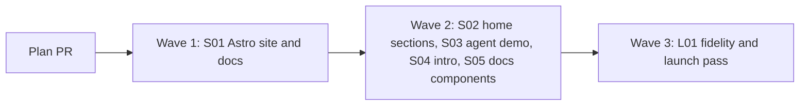

# Plan for the tagreeve.dev redesign

The maintainer asked for a new tagreeve.dev, built from the design handoff "Proposal D" in `brand/site-handoff/`. The new site has a home page that shows the problem and the fix, and the docs in a matching theme. It replaces the VitePress site in `.vitepress/` with Astro, Starlight and Tailwind v4. The docs stay as markdown in `docs/`. Each entry is one PR. A PR is done when its acceptance test passes in CI, an adversarial review reports no blockers or majors, and it is squash-merged.

Read `brand/site-handoff/README.md` before you build an entry. Open `brand/site-handoff/design/Tagreeve Site.dc.html` in a browser for the look and the motion (keep `support.js` next to it). `brand/site-handoff/reference/demo-data.js` has every copy string, timing and mock value. The handoff is a reference. Do not ship its HTML or its `support.js`.

## Goals this plan serves

From `docs/goals.md`:

- **A new user starts with one simple setup prompt to their agent.** The home page leads with "Copy the agent setup prompt" and shows an agent using that prompt's result. The docs keep the same prompt on the first-run guide.
- **Expose all of this to agents through the CLI.** The home page shows the real output of `tagreeve run`, `diff`, `suite` and `--json`, taken from recorded runs, not written by hand.
- **Be safe by default.** The "safe by default" section states the stub mode, the fake identity, the handoff steps and the local `runs/` folder. The site itself sends no request to another host.

The site is not a second interface. It is documentation and an introduction. It has no forms, no analytics and no cookies.

Non-goals this plan comes close to: "a hosted service". The site is static and holds no user data. Nothing in it runs Tagreeve for a visitor.

## What changes from the handoff

The handoff is final for look, copy and motion. Where it conflicts with a rule in this repo, the rule wins:

| Handoff says | This plan does | Why |
| --- | --- | --- |
| Fonts from Google Fonts | Self-host Geist, Geist Mono and Anton from npm packages (for example `@fontsource/*`) | The site makes no requests to other hosts (`scripts/check-docs-dist.ts` and the docs tests enforce it). |
| `northwind.dk` hosts anywhere: the demo, the Commands lines, `USER_PROMPT`, and the intro (`www.northwind.dk`, `staging.northwind.dk`) | The same host names on `northwind.example` (`staging.northwind.example`, `www.northwind.example`). "Northwind Retail ApS" becomes "Northwind Retail". | `AGENTS.md`: no real store data. A `.dk` host could belong to a real store. `.example` is reserved. |
| `/stargazers` | `https://github.com/alfhen/tagreeve/stargazers` | The site has no such page. |
| "The existing `docs/**/*.md` move over unchanged" | They stay in `docs/`. Links and anchors change where Starlight needs it. | VitePress anchors (`#_8-5-...`) and `.md` links do not resolve in Astro without a change. |
| "Make the demo real: record against Tagreeve's test shop" | Record against `fixtures/site` in `stub` mode | The fixture site is the test shop. No real store is used. |
| Design system page (optional) | Not built | The handoff says it is internal. |
| Safe by default: the heading "Point it at production. Nothing leaks." and the stub mode card "Nothing reaches the vendor" | The heading "Known vendor hits stay local." and the stub mode card "Known endpoints stay local", which says that an unknown destination fails the run but its request can still reach the vendor | Stub mode lets hits to unknown destinations through (design §5.3). The handoff's copy promised more than Tagreeve does. |

## Order and waves

S01 swaps the generator and must land alone. The four wave-2 entries each own their own files. Only S05 edits `site/astro.config.mjs` in wave 2. No wave-2 entry edits `package.json` or `pnpm-lock.yaml`: S01 adds every dependency the plan needs. L01 runs after wave 2 has landed.

The site deploys on every merge to `main`. After S01, tagreeve.dev shows the new docs and a home page with the header, the hero and the footer. Wave 2 fills in the rest.

## Changes to the docs-site proposal

`docs/proposal-docs-site.md` governs the site. S01 brings it in line, in the same PR that changes the code:

- A line at the top: the site moved from VitePress to Astro, Starlight and Tailwind v4 with this plan.
- §8: the self-hosted Geist, Geist Mono and Anton fonts replace "the system font stack". The no-CDN rule stays.
- §8: the `.gitignore` bullet names `site/dist` and `site/.astro` instead of the `.vitepress` folders.
- §10: the generator entry names Astro and Starlight instead of VitePress `2.0.0-alpha.20`. The home page entry says `/` is an Astro page. The Web Storage entry names Starlight's theme key and `tagreeve.introSeen` instead of the two VitePress keys.

## Where each `.vitepress/` job goes

| Today | After S01 |
| --- | --- |
| `.vitepress/config.ts`: sidebar, nav, search, head links | `site/astro.config.mjs` (Starlight options) |
| `.vitepress/page-guard.ts` and the `buildEnd` check | `site/src/lib/page-guard.ts`, run from an Astro integration hook in `site/src/plugins/page-guard.ts`. `scripts/docs-pages.test.ts` imports it from the new path. |
| `repoFileLinks` (`LICENSE`, `CHANGELOG.md` to GitHub) | A markdown plugin in `site/src/plugins/repo-links.ts`, which also rewrites `.md` links to page URLs. |
| `themedPictures` (`<picture>` to a light and a dark ``) | A markdown plugin in `site/src/plugins/themed-pictures.ts`. |
| `.vitepress/mermaid.ts` and `Mermaid.vue` | A markdown plugin in `site/src/plugins/mermaid.ts` that emits a plain element with the encoded diagram source, and a client script in `site/src/scripts/mermaid.ts` that imports `mermaid` only when such an element is on the page. |
| `.vitepress/brand-assets.ts` (favicons and marks from `brand/`) | A Vite plugin in `site/src/plugins/brand-assets.ts`. |
| The `brand/` alias in `.vitepress/config.ts` (the README's `brand/lockup.svg` and `brand/lockup-dark.svg`) | The same Vite plugin serves and emits the two lockup files, and the themed-pictures plugin points the README's paths at them. Nothing is copied. |
| `GetStartedPrompt.vue` | `site/src/plugins/get-started-prompt.ts` replaces the raw `<GetStartedPrompt />` tag with plain HTML: the button, the status and the prompt text from `site/src/lib/prompt.ts`. A client script in `site/src/scripts/copy-prompt.ts` makes the button copy. The home page uses the same script. |
| `brand.css` | `site/src/styles/` (tokens and the Starlight theme). |
| `ignoreDeadLinks: false` | `scripts/check-docs-dist.ts`, run inside `docs:build`. |

## Rules for every PR

The rules in `AGENTS.md` and `docs/proposal-docs-site.md` §8 still hold, with the changes S01 writes into the proposal (see "Changes to the docs-site proposal"). In short:

- No analytics, cookies, forms, third-party scripts or CDN fonts. Built pages make no request to another host.
- Web Storage is allowed only for Starlight's theme key and `tagreeve.introSeen`. The values never leave the browser. Cookies stay forbidden.
- Astro telemetry stays off: `ASTRO_TELEMETRY_DISABLED=1` in every place that runs the Astro CLI.
- No file in `site/dist`, and no file in the repo outside `brand/site-handoff/` and `docs/plan-site.md`, contains `northwind.dk`. Those two paths keep the old host as a reference. A repo-wide check must skip them.
- Docs tests in `scripts/*.docs.test.ts`, except `site-intro`, open pages through the shared helper from S01, so the intro never covers them.
- The site's dependencies are root `devDependencies`, with exact versions at least two weeks old. They never enter the CLI's `dist/` or its tarball.
- Actions stay pinned to SHAs.
- Copy comes from the handoff verbatim, except the changes in the table above. Do not rewrite it.
- New or changed docs prose follows the writing rules in `AGENTS.md`. Run the `humanizer` skill on it.
- Diagrams stay Mermaid code blocks in the markdown, bundled with the site.
- The intro and the demo respect `prefers-reduced-motion`. Every button is a `<button>` with a name a screen reader can read.
- The intro's fake apps are original parodies. No real Apple, Google or GTM assets, logos or names beyond "GTM".
- Pages work without JavaScript, except the two islands. The docs, the hero text and the copy-able install command are in the HTML.
- `tagreeve.dev` still never appears under `packages/` or `fixtures/` (CI checks it).
- Each PR adds a test that fails when its change is removed. The PR description says how that was checked.

## PRs

### Wave 1

**S01 Astro site with the docs.** Touches: `site/` (new: `astro.config.mjs`, `tsconfig.json`, `src/content.config.ts`, `src/styles/`, `src/layouts/`, `src/components/`, `src/pages/index.astro`, `src/lib/prompt.ts`, `src/lib/page-guard.ts`, `src/plugins/`, `src/scripts/`), `docs/proposal-docs-site.md` (the changes listed above), `scripts/docs-global-setup.ts` (new, the test global setup), `scripts/docs-test-helpers.ts` (new, the shared test context), `.vitepress/` (removed), `docs/index.md` (removed), `docs/cli.md`, `docs/design.md`, `docs/shopify-checkout.md`, `docs/guide/*.md` and `README.md` (internal links and anchors only), `package.json` (scripts and `devDependencies`), `pnpm-lock.yaml`, `vitest.config.ts`, `tsconfig.json`, `eslint.config.js`, `.gitignore`, `.github/workflows/docs.yml`, `.github/workflows/ci.yml`, `scripts/check-docs-dist.ts` (default folder, and the new internal link and fragment check), `scripts/check-docs-dist.test.ts` (unit cases for a dead page link, a dead fragment and a good link), `scripts/docs-pages.test.ts`, `scripts/docs-site.docs.test.ts`, `scripts/docs-text.docs.test.ts`.

- **Generator.** Astro with Starlight for the docs and Tailwind v4, rooted in `site/`. `pnpm docs:build` builds to `site/dist`, `pnpm docs:preview` serves it and `pnpm docs:test` runs the docs tests. Remove `vitepress`, `vue` and `@fontsource/jost`. Add, now, every dependency wave 2 needs, and list them in the PR description: `astro`, `@astrojs/starlight`, `tailwindcss`, `@tailwindcss/vite`, `preact`, `@astrojs/preact`, and the Geist, Geist Mono and Anton font packages. Keep `mermaid`. `astro.config.mjs` registers `@astrojs/preact` and the Tailwind Vite plugin, so S03 and S04 need no config change. `ASTRO_TELEMETRY_DISABLED=1` is set in the `docs:build`, `docs:preview` and `typecheck` scripts (any Astro CLI call, such as `astro sync`), in the global setup, and in `docs.yml` and `ci.yml`.
- **Type checks.** `site/tsconfig.json` extends Astro's strict config with `jsxImportSource: "preact"`. `pnpm typecheck` runs the root `tsc --noEmit`, then `astro sync` and `tsc --noEmit -p site/tsconfig.json`. The root `tsconfig.json` drops `.vitepress/**/*.ts` and does not include `site/`. `.astro` files are not type-checked: the logic that needs types lives in `.ts` and `.tsx` files.
- **Content.** Starlight reads the pages with a custom loader that globs `README.md` and `docs/**/*.md`, minus the excluded files. Do not copy them. The loader holds no list of pages, so the page guard is the only thing that stops an extra page. Published pages and their URLs: `/` (the Astro home page), `/readme`, `/docs/guide/what-it-checks`, `/docs/guide/first-run`, `/docs/guide/reading-results`, `/docs/cli`, `/docs/design`, `/docs/shopify-checkout`. Nothing else under `docs/` is published: no plan, proposal, goals or release page, and no `brand/site-handoff/` file. The page guard stays: the build fails when a markdown page is published that the sidebar does not list. `scripts/docs-pages.test.ts` tests the ported guard. The docs have no front matter (proposal §3.1). The loader sets each page's title from its first `# ` heading and removes that heading from the body, so the page shows one H1. `README.md` has no `# ` heading, only a raw `<h1><picture>`: it gets the fixed title "README" and keeps its `<h1>` in the body.
- **Links.** Relative `.md` links in the docs (`../cli.md`, `./first-run.md`, `docs/cli.md` in the README) resolve to the page URLs, so the files still work on GitHub. `LICENSE` and `CHANGELOG.md` links go to GitHub, as today. Anchors that used VitePress slugs (`#_8-5-...`) change to the new slugs, in the same commit. A dead internal link or a dead fragment fails `pnpm docs:build`: `scripts/check-docs-dist.ts`, which runs inside `docs:build`, resolves every internal `href` and `#fragment` in `site/dist`. No new package is needed. The CI lychee step still runs, against `site/dist`.
- **Themes.** All tokens from the handoff are CSS variables on `:root` (dark, the default) and `[data-theme="light"]`, also exposed through Tailwind v4 `@theme`. Starlight's own colour variables map to them. The header toggle ("☀ light" / "☾ dark") sets `data-theme` and stores the choice under the key Starlight uses, so the home page and the docs share one choice. No flash of the wrong theme on load. A `<picture>` in the README shows the image for the site's theme, as `.vitepress/config.ts` does today.
- **Header.** As handoff §1, on the home page and the docs: the CSS mark, "tagreeve", the nav (Docs, CLI reference; no Design system link), the toggle, "github ↗" and "(★ star us)". Below 860px, a ☰ button opens the stacked links. Starlight's search box stays in the docs sidebar.
- **Docs theme.** As handoff §3: a 230px sidebar with search, then "guides" and "reference" groups (the same items as today), the active item as a mint-tinted pill, an article no wider than 860px, callouts with a 2px mint left border, prev/next links. Keep the footer line "Docs for main. To read the docs of a release, open the repo at its tag."
- **Get started prompt.** The prompt text lives in one module, `site/src/lib/prompt.ts`, unchanged. The first-run guide's copy button works as today. The home page imports the same text. `scripts/docs-text.docs.test.ts` reads the prompt from the new module.
- **Markdown plugins.** The plugins in "Where each `.vitepress/` job goes" live in `site/src/plugins/`. The docs stay plain `.md`, not MDX, so a plugin can only emit HTML. The behaviour (copy, lazy Mermaid, theme follow) lives in small client scripts in `site/src/scripts/`, loaded from a Starlight component override. S05's plugin follows the same rule and joins the same folder.
- **Mermaid.** Diagrams draw from the bundled `mermaid` package, follow the theme toggle, fit a 390px screen, and load only on pages with a diagram.
- **Search.** Starlight's built-in search, served from the site. It finds `install-browser` and links to `/docs/cli`.
- **Fonts and brand.** Geist, Geist Mono and Anton are self-hosted. Anton loads only where the intro is used. Favicons and marks come from `brand/` at build time. `brand/` stays the one source and nothing is copied into the repo.
- **Home page skeleton.** `/` has the header, the hero from handoff §2 (status pill with `0.4 release candidate · Chromium · MIT`, H1, lede, "Copy the agent setup prompt", "$ npm i -g tagreeve@next", "what does the prompt say?") and the footer ("tagreeve · MIT · runs on infrastructure you control" and the "replay the 5-minute ticket" link). The replay link dispatches a `tagreeve:replay-intro` event on `window`. The other sections are empty components that wave 2 fills, one file each, already placed in the page in the handoff's order: `site/src/components/home/AgentDemo.astro`, `Commands.astro`, `Vendors.astro`, `SafeByDefault.astro`, `WhyName.astro`, `SignOff.astro`, and `site/src/components/intro/FirstVisitIntro.astro`. Each renders nothing. Wave 2 does not edit `index.astro`.
- **Tests.** The docs tests build the site once, in a vitest global setup for the `docs` project, and share one preview server. A wave-2 PR adds its own `scripts/site-*.docs.test.ts` file and does not build again. Unit tests under `site/**/*.test.ts` run in the `unit` project.
- **Deploy.** `.github/workflows/docs.yml` watches `site/**` and `packages/*/src/**` instead of `.vitepress/**`, in both `pull_request` and `push` paths, and uploads `site/dist`. The home page is built from `packages/decoders` and `packages/core`, so a change there must redeploy.
- **Test contexts.** `scripts/docs-test-helpers.ts` exports a function that makes a browser context with `localStorage['tagreeve.introSeen']='1'` set by `context.addInitScript`. Every docs test except `site-intro` uses it. Without it, the S04 intro covers `/` in every Playwright context (empty storage, 1280px wide).

Regression test: every test in today's `scripts/docs-site.docs.test.ts` is ported and passes against the new build, with the selectors changed for Starlight: the published pages and the absent ones, no outside references in the build output, a dead link fails the build (add a dead fragment case), search finds `install-browser`, the first-run copy button, no request to another host on every published page and on `/`, diagrams in light and dark, diagrams at 390px, no diagram code on pages without a diagram. New cases: the theme choice made on `/` holds on `/docs/cli` after a reload; `/` at 390px has no sideways scroll and shows the ☰ button; the hero copy button puts the exact text of `site/src/lib/prompt.ts` on the clipboard and shows "Copied. Paste into your agent"; the npm button copies `npm i -g tagreeve@next`. Each published page has exactly one `h1`. `/readme` loads `lockup.svg` and `lockup-dark.svg` without a 404, in both themes.
New cases: a valid page `docs/zz-unlisted.md` makes the build fail with an error that names the file; the docs scripts, the `typecheck` script, the global setup and both workflows set `ASTRO_TELEMETRY_DISABLED`.
Acceptance: `pnpm docs:build` and `pnpm docs:test` pass. With the page guard disabled, the `docs/zz-unlisted.md` case fails. With a dead fragment in `docs/guide/first-run.md`, the build fails.
QA: open every published page in both themes at 1440px and 390px. Toggle the theme on `/`, then open the docs. Search for a CLI flag. Copy the prompt from the hero and from the first-run guide. Follow every link in the README page. Open a URL that does not exist.

### Wave 2

**S02 Home sections: vendors, safe by default, the name, sign-off.** Touches: `site/src/components/home/Vendors.astro`, `SafeByDefault.astro`, `WhyName.astro`, `SignOff.astro`, `site/src/lib/vendors.ts` (new) and `site/src/lib/vendors.test.ts` (new), `scripts/no-old-name.test.ts` (one allowed line for "Formerly Pingwright."), `scripts/site-home.docs.test.ts` (new).

- Build the four sections from handoff §2 with the exact copy and styles: "Vendors", "Safe by default", "Why 'tagreeve'" (with the word history) and the ASCII sign-off (`BANNER` from `demo-data.js`, the pixel and "REEVE" in mint, the caption "the new tag sheriff in town").
- **Vendors are not hand-typed.** The "decoded" chips come from `vendorKeys` in `packages/decoders/src/decoder.ts`. The "stubbed & recorded" chips come from `trackerVendorKeys` in `tracker-list.ts`, which is already deduplicated. `vendors.ts` imports both through a relative source path into `packages/decoders/src/index.ts`. If the code and the handoff list differ, the code wins, and the PR description says so. "On the way" is copy from the handoff.
- The "Formerly Pingwright." line passes `scripts/no-old-name.test.ts` through one entry in `allowedLines` for that component file, not through `wholeFiles`.

Regression test: `vendors.test.ts` builds its expected sets independently: the decoded set is the unique `hit.vendor` values from decoding one sample request per decoder, and the stubbed set is the unique `vendor` values of `trackerList`. It asserts `vendors.ts` equals both. Remove a key from `vendorKeys` and the test fails. `scripts/site-home.docs.test.ts` checks the four sections render in order with their headings, the banner has no sideways scroll at 390px (the font size shrinks), and the old-name test still fails for a second, unlisted "Pingwright" in the same file.
Acceptance: `pnpm test` and `pnpm docs:test` pass. With `vendors.ts` replaced by a hard-coded list that is missing `sgtm`, `vendors.test.ts` fails.

**S03 Agent demo and commands, from recorded runs.** Touches: `site/src/components/home/AgentDemo.astro`, `Commands.astro`, `site/src/components/demo/` (new: the Preact island and its parts), `site/src/lib/demo-data.ts` (new), `site/src/lib/demo-data.test.ts` (new), `site/demo/` (new: the recorded files and `*.reply.md`), `site/demo/scenarios/` (new: the scenario files used for recording), `scripts/record-site-demo.ts` (new), `scripts/site-demo.docs.test.ts` (new).

- **Record.** `scripts/record-site-demo.ts` starts `fixtures/site`, runs the built CLI in `stub` mode with three scenarios named like the setup prompt's (`undecided.yml`, `accept.yml`, `reject.yml`), and writes for each scenario the record (`site/demo/<s>.jsonl`) and the stdout (`site/demo/<s>.txt`). It also records the outputs the Commands section shows: a `tagreeve diff` of two of these runs, a `tagreeve suite` over the three, and one run's `--json`. The scenarios use only fixture pages, so the hits are real fixture hits with fake IDs. The script is run by hand. Its output is committed.
- **Derive.** `demo-data.ts` reads the committed files at build time with `readRun` and the record types from `packages/core`, through a relative source import, as `scripts/docs-site.docs.test.ts` does for the recorder. It does not parse the JSONL itself. The hits come from `hit` records: vendor, event, and time from the run start, scaled to the demo's window of about 3s. The banner timing and the epoch label come from `consentEpoch` records. The shortened tool output comes from the stdout (the first 3 lines, "… +N lines", the last 2 lines, the exit code). Hits that fail a rule get the fail style from the record's check results, not from a hand-made list.
- **Check.** The agent's plan and reply stay hand-written in `site/demo/<s>.reply.md`, with the copy from the handoff's `PLANS` and `REPLIES`, changed only where the recorded run differs. Every number and every evidence ID in a reply must exist in that scenario's record. If not, `demo-data.ts` throws and `pnpm docs:build` fails, with the missing value in the message.
- **Island.** The AgentDemo island follows handoff "Interactions → AgentDemo" exactly: the idle overlay and "Ask the agent ⏎", one clock from `SEND_AT`, the visitor picker, "↺ replay", the bottom-anchored terminal with the top fade, the hit rows, the verdict card, the reply stream, the y/n and "✓ Sent to Mads…", and Mads's thank-you. The terminal shows `--site https://staging.northwind.example`. With reduced motion, Ask jumps to the final state. Below 860px the columns stack.
- **Commands.** The four rows show the recorded outputs from `site/demo/`, as text in the HTML. The section works without JavaScript for the first row.
- **Seeds.** `scripts/record-site-demo.ts` runs each scenario with a fixed `--seed` and exports the seeds, so the fake identity of each recorded run can be rebuilt in a test.
- **Scrub.** `scripts/record-site-demo.ts` sets `run.identity` to `null`, drops `identitySeed`, and drops hashed identity values from hits before it writes. No record holds a cookie value, the fake identity, its hashes or a typed value. The committed `.jsonl` and `.txt` files are fixture output only.

Regression test: `demo-data.test.ts` checks that a reply with a number or an evidence ID that is not in the record throws and names the value. It checks that the derived hits for each scenario equal the record's `hit` records, in order, and that their scaled times stay in the window. `scripts/site-demo.docs.test.ts` drives the island in Chromium: idle overlay, Ask, the first hit row, the verdict, the reply and the thank-you appear in order for each visitor choice. It checks the reduced-motion jump, that replay restarts, and that the four command rows switch the panel text. A unit test in `demo-data.test.ts` rebuilds each run's email and phone from the seeds that `scripts/record-site-demo.ts` exports, with the repo's own identity generator. It asserts that no file under `site/demo/` holds the email, the phone, their SHA-256 forms, `identitySeed`, a `pw_consent=` cookie value or `northwind.dk`. A positive control runs the same scan on a string that holds the rebuilt email and must report a hit.
Acceptance: `pnpm test`, `pnpm docs:build` and `pnpm docs:test` pass. Change one evidence ID in `site/demo/reject.reply.md` and `pnpm docs:build` fails, naming it. Put the rebuilt email of the `reject` run into `site/demo/reject.txt` and the leak test fails.
QA: run all three visitor choices to the end at 1440px and 390px; switch the choice mid-run; press replay mid-reply; use reduced motion; check every number in each reply against the verdict card; read the command panel outputs against `pnpm exec tagreeve` output for the same files.

**S04 First-visit intro.** Touches: `site/src/components/intro/FirstVisitIntro.astro`, `site/src/components/intro/` (new: the Preact island and its parts), `site/src/lib/intro-data.ts` (new), `scripts/site-intro.docs.test.ts` (new).

- Build the intro from handoff "Interactions → FirstVisitIntro" exactly, with the host names from the deviations table: the desktop, the stages `ask`, `mess`, `wasted`, `shrink` and `fly`, the 13 notifications with their delays and `SCATTER` positions, the tag manager page with its rows, the preview modal that never connects, the shake from the 10th notification, the "wasted" title in Anton, and the fly-out with the site moving in.
- It shows only when `localStorage['tagreeve.introSeen'] !== '1'`, the window is at least 860px wide and reduced motion is off. The flag is set when `fly` starts, so "Skip intro →" and "Not my job (skip)" count as seen. Body scroll is locked while it is open. The footer's `tagreeve:replay-intro` event opens it again. A storage error never blocks the page: the intro then does not show.
- Mint never appears inside the intro. Anton loads only when the intro opens.
- The page under the intro is complete HTML. The intro adds nothing a crawler or a no-script reader sees.

Regression test: `scripts/site-intro.docs.test.ts` checks: the intro shows on a first visit at 1280px; it does not show at 800px, with reduced motion, or with the flag set; skip sets the flag and unlocks scroll; the replay link opens it again with the flag set; no element inside the overlay has a computed colour, background or border colour equal to either theme's mint; the run from Reply to the end of `fly` unmounts the overlay; no request goes to another host during the intro; the other docs tests, which use the shared helper, never see the intro on `/`; no built file contains `northwind.dk`.
Acceptance: `pnpm docs:test` passes. With the reduced-motion check removed, the reduced-motion case fails.
QA: watch the whole intro at 1440px and 1024px; skip at each stage; click a tag row and Preview; replay from the footer; resize below 860px mid-intro; reload after skipping.

**S05 Docs components.** Touches: `site/astro.config.mjs` (component overrides and the plugin only), `site/src/components/docs/` (new), `site/src/plugins/annotated-summary.ts` (new) and its test, `site/src/lib/annotations.ts` (new, the `ANNOT` data), `docs/guide/reading-results.md` (the info string of one fence only), `scripts/site-docs.docs.test.ts` (new).

- **Annotated summary.** In `docs/guide/reading-results.md`, the sample summary fence gets the info string `text annotated`. On GitHub it stays a plain code block. On the site it becomes the dark summary block from handoff §3: hovering or focusing a line highlights it and shows that part's explanation in the side panel, from `ANNOT`. Each annotation names the line it explains by its text, so a changed sample breaks the build instead of pointing at the wrong line. On a narrow screen the explanation shows under the block. It works with the keyboard.
- **Agent callout.** "// using an agent?" with the copy-prompt button, shown on every guide page through a Starlight component override. The prompt comes from `site/src/lib/prompt.ts`.
- **Reference list.** The 170px code column and description style for definition-style lists in `docs/cli.md`, through CSS only. The markdown does not change.

Regression test: the plugin test checks that an annotation whose line text is not in the fence fails with the line named. `scripts/site-docs.docs.test.ts` checks the annotated block on `/docs/guide/reading-results`: focusing each line shows its explanation; the fence on GitHub-style render is a plain code block (check the markdown file still has a normal fence); the agent callout's button copies the prompt on each guide page.
Acceptance: `pnpm test` and `pnpm docs:test` pass. Change one annotated line's text in `ANNOT` and `pnpm docs:build` fails.
QA: hover and tab through the annotated summary in both themes and at 390px; copy the prompt from the callout.

### Wave 3

**L01 Fidelity and launch pass.** Touches: files under `site/src/` that the comparison finds wrong. If `git grep -i vitepress` still finds a reference outside `docs/plan-*.md`, `docs/proposal-*.md` and `brand/site-handoff/`, L01 fixes it.

- Compare each section of `/` and `/docs/guide/reading-results` against the prototype at 1440px and 390px, in both themes, and fix differences in spacing, type, colour and motion.
- Check the whole site with keyboard only, and with a screen reader name check for every button and link.
- Check the built site's total JavaScript on `/docs/cli` stays under the 400 kB limit the docs test sets.

Regression test: screenshots of each home section at 1440px and 390px in both themes are attached to the PR, next to the prototype's. No new automated test unless a fix needs one.
Acceptance: `pnpm docs:test` passes, and the maintainer looks at the live site.
QA: the full QA list of S01 to S05 on the deployed site.

## Out of scope

| What | Why |
| --- | --- |
| Design system page | Internal. The handoff says it does not have to ship. |
| Real progress in the "running…" line | The CLI does not stream progress yet (handoff open item). |
| The ASCII banner in `tagreeve --help` | A CLI change. It goes in a release plan, not the site plan. |
| Social proof line | No user quotes yet. |
| Versioned docs | Unchanged: the site shows `main`. |

## Flagged concerns

- **S01 is large.** The generator swap, the theme and the docs must land together, or the live site breaks. Wave 2 is split so that no other entry is large.
- **Old anchors break for links from outside.** Links to `tagreeve.dev/docs/design#_8-5-...` from issues or chats will open the page top. The pages themselves keep their URLs.
- **The demo shows a fixture run under a story host.** The terminal says `--site https://staging.northwind.example`, but the record was made against `fixtures/site` on loopback. The hits, the IDs and the numbers are real. The host name is part of the story.
- **Re-record when the CLI output format changes.** `scripts/record-site-demo.ts` makes this one command. The build check fails if a reply no longer matches its record.
